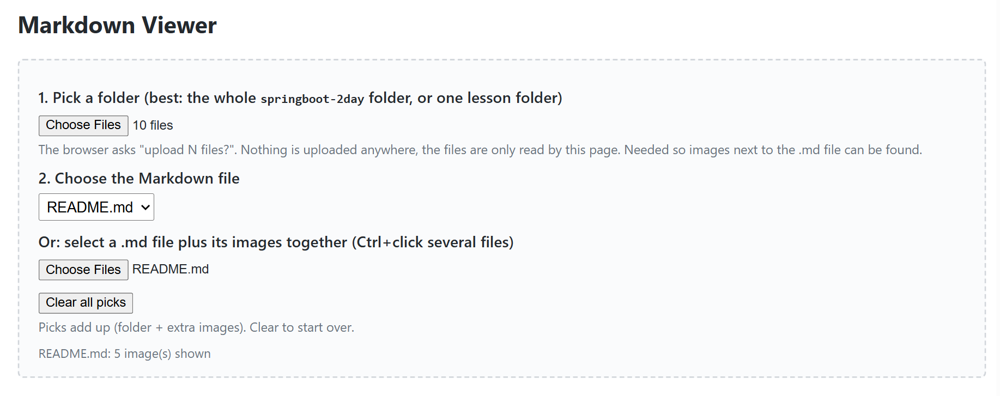

# Spring Boot + Microservices in 2 Days (Architect Interview Prep)

You already know Java, EJB, Hibernate, Oracle, batch/ETL, Elasticsearch and SWIFT/T2S messaging. This course does not teach Java. It maps what you know onto Spring Boot and microservice patterns, and it makes you able to *explain trade-offs out loud*.

## 1. Setup (15 minutes)

Verified on this machine:

| Tool | Version found | Needed for |
|---|---|---|
| Java | Temurin 21.0.12 | everything |
| Docker Desktop | 29.9.2 (daemon running) | Day 2 (Postgres, Kafka, image build) |
| kubectl | v1.36.1 | Day 2 file 10 |
| VS Code | 1.145.2 | editor |
| git | 2.47 | optional |
| Maven | **not installed, not needed**: the project ships the Maven Wrapper (`mvnw`) | |
| kind or minikube | **not installed yet**, install before file 10 (see that file) | local Kubernetes |

Spring Boot version: **3.5.16**, the latest 3.x on Maven Central at the time of writing. start.spring.io now offers only 4.x, so the `pom.xml` in `project/` was written by hand with the 3.5.16 parent. The interview material (Jakarta namespace, `SecurityFilterChain`, Micrometer Tracing, `ProblemDetail`) is the same on Boot 3.x and 4.x. Be ready to say: "I built on 3.5; I know 4.x moves to Spring Framework 7 and modular starters."

VS Code extensions: *Extension Pack for Java* and *Spring Boot Extension Pack*.

Check the build any time (PowerShell, from `springboot-2day/project`):

```powershell
.\mvnw.cmd -q clean verify
```

Expected: no output and exit code 0 (quiet mode prints only failures). On Git Bash use `./mvnw`.

## 2. How to use the files

Every topic file has the same 11 sections: goal and time box, why it matters, concepts, setup, code walkthrough, common mistakes, production issues, architect lens, self-check quiz, interview Q&A, recap.

1. Read sections 1-3 without the keyboard.
2. Do sections 4-5 with the project open and run every command.
3. Read 6-8 slowly. This is where architect-level answers come from.
4. Do the quiz closed-book, then answer the interview questions **out loud**.
5. The night before, read only the Recap sections plus `99-cheatsheet-and-interview-qa.md`.

The code lives in `project/` and grows file by file. Each topic file lists exactly which packages it adds.

## 3. Hour-by-hour schedule

### Day 1: build it (about 8 h)

| Time | File | Output |
|---|---|---|
| 08:30-09:00 | 00 Big picture: what Spring Boot is, architecture, where to start | Layered app running |
| 09:00-10:30 | 01 Core: IoC, DI, AOP | Wired service and proxy demo |
| 10:30-12:00 | 02 Boot internals, config, Actuator | Auto-config report, profiles, health |
| 12:00-13:00 | Lunch plus re-read recaps | |
| 13:00-14:30 | 03 REST, validation, exceptions | Working REST API |
| 14:30-16:30 | 04 Data JPA, transactions | JPA on H2, rollback and N+1 demo |
| 16:30-18:00 | 05 Security, JWT, OAuth2 | Secured endpoints |
| 18:00-19:00 | 06 Testing | Green test suite |
| 19:30-20:30 | Quiz plus interview Q&A out loud (files 01-06) | |

### Day 2: design it (about 8 h)

| Time | File | Output |
|---|---|---|
| 09:00-10:15 | 07 Microservice patterns, resilience | Retry and circuit breaker |
| 10:15-11:45 | 08 Saga, outbox, CQRS | Outbox table plus relay |
| 11:45-13:15 | 09 Kafka with Spring | Producer, idempotent consumer |
| 13:15-14:00 | Lunch | |
| 14:00-15:30 | 10 Docker, Kubernetes | Image running on local cluster |
| 15:30-17:00 | 11 System design: trade settlement | Whiteboard design |
| 17:00-19:00 | 12 Mock interview, story rehearsal | Your stories, rehearsed |
| 19:30-20:30 | 99 Cheatsheet, then sleep | |

If you are short of time, protect these: 01, 04, 05, 07, 08, 09, 11, 12 and 99.

## 4. Folder map: lessons, your project, and my reference

You write the code yourself in **your own folder**: `day1\Handson` (next to the lessons) or any folder outside the course. Keep using the same folder for all lessons. This course folder only holds the lessons and my working solution.

```
springboot-2day/
  00-README-setup-and-roadmap.md
  day1/
    00-big-picture/   README.md  +  images/*.svg      <- lesson text and diagrams
    01-spring-core/   README.md  +  images/*.svg
    02..06            (coming)
  day2/07..12         (coming)
  99-cheatsheet-and-interview-qa.md   (coming)
  reference/
    lesson-00/        working project at the END of lesson 00
    lesson-01/        working project at the END of lesson 01 (= lesson 00 + that lesson's changes)
    ...
  tools/mdviewer.html     browser Markdown viewer (see below), mdviewer.png = its screenshot
  tools/check_lesson.py   my checker (not needed for studying)
```

**How a lesson works**
1. Read sections 1-3 (what and why, with diagrams).
2. Section 4: set up, and see the list of files you will create or change.
3. Section 5: build it step by step in your own folder. Each step has *Do, Write, Why, Checkpoint, Stuck?*. Type the code yourself.
4. If a checkpoint does not match, compare your file with mine: `fc.exe yourfile "$REF\the\same\relative\path"` (`$REF` is set to that lesson's `reference/lesson-NN` folder; the lesson shows how). `FC: no differences encountered` means identical.
5. Every lesson starts from the previous lesson's end state. If you fall behind, copy `reference/lesson-NN-1` into an empty folder and continue.

Open each lesson's `README.md` in VS Code and press `Ctrl+Shift+V` for the preview, so the images show. No VS Code? Use the browser viewer below.

### Viewing the lessons in a browser (`tools/mdviewer.html`)

`tools/mdviewer.html` is a single-file Markdown viewer. Double-click it to open it in your browser (Chrome or Edge). It renders the lesson text, code highlighting, Mermaid diagrams and the SVG/PNG images. It needs internet once per session to load its scripts from a CDN. Nothing is uploaded anywhere; the page only reads the files you pick.



**Option A: pick the folder (recommended, images show automatically)**
1. Open `tools/mdviewer.html`.
2. Under **1. Pick a folder**, click *Choose Files* and select the whole `springboot-2day` folder (or just one lesson folder, e.g. `day1\01-spring-core`). The browser asks "upload N files?". Confirm; this only lets the page read them.
3. Under **2. Choose the Markdown file**, open the dropdown and select the file to read (for example `00-README-setup-and-roadmap.md` or `day1/01-spring-core/README.md`).
4. The status line at the bottom of the box shows how many images were shown, for example `README.md: 5 image(s) shown`.

**Option B: pick one `.md` file plus its images**
1. Under **Or: select a .md file plus its images together**, click *Choose Files*.
2. Ctrl+click the `README.md` and every image it uses (the `.svg` files in its `images` folder), then confirm.

**Adding images that are missing**
- A red box saying `image not found: images/xyz.svg` means the viewer has not seen that file yet.
- Fix: pick the folder that contains the image (or the images themselves) with either picker. Picks **add up**, so you do not lose the file you were reading.
- Click **Clear all picks** to start over with a different folder.
- Keep images in the lesson's `images/` folder and link them relatively, as the lessons do: ``.

Tip: skipped automatically when indexing: `target`, `node_modules`, `.git` and `.mvn` folders.

**Trust but verify:** my checker rebuilds each lesson from the code blocks in its README alone (starting from the previous lesson), compares the result with `reference/`, runs the build and tests, and checks the 11 headings. Every lesson listed above has passed it.

## 5. Ground rules for interview answers

- Say what you did, what you know, and what you would verify. Never bluff.
- Every answer: *what, why, trade-off, failure mode*.
- Link every pattern to your own system: reconciliation, duplicates, ordering, full versus delta loads.
