# 00. Create a Spring Boot project from scratch (and understand what you built)

**You build this yourself** in your own empty folder (for example `C:\study\trade-service`). The folder [`../../reference/lesson-00`](../../reference/lesson-00) holds my working copy. Open it only when you are stuck.

**End state of this lesson:** a layered Trade Service with a REST endpoint and in-memory storage. No AOP, no database, no security yet.

## 1. Goal and time box

**90 minutes** (60 reading and typing, 30 running and debugging). After this lesson you can:
- Say in two minutes what Spring, Spring Boot and a "starter" are, and why Boot exists.
- Create a Spring Boot project from an **empty folder**, with no generator.
- Draw the layered architecture and trace one HTTP request through it.
- Say what happens at startup.
- Know **which files to create first, and how they link**.

## 2. Why it matters

Interviewers open with "What is Spring Boot and why use it?" A weak answer ("it reduces configuration") sounds junior. A strong answer names what it removes (server install, version alignment, wiring boilerplate) and what it costs (hidden magic, large classpath).

| You know | Spring Boot equivalent |
|---|---|
| EJB deployed to WebLogic/JBoss | A plain JVM process (`java -jar`) with Tomcat inside |
| `ejb-jar.xml`, `persistence.xml`, JNDI datasources | `application.yml` plus auto-configured beans |
| Session bean to Entity to DB | Controller to Service to Repository to DB |
| Hibernate `SessionFactory` setup code | Auto-configured `EntityManagerFactory` (lesson 04) |
| Shell script that launches a Java batch with `-cp` and flags | One executable jar; flags become properties |

[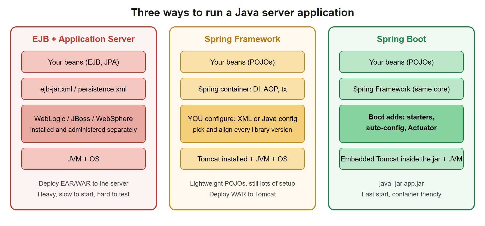](images/01-spring-vs-boot-vs-ejb.svg)

## 3. Concepts explained like a teacher

### What is Spring?
The *Spring Framework* is a Java library whose core is a **container** that creates your objects (called **beans**), connects them (**dependency injection**) and wraps them with services like transactions (**AOP**). Lesson 01 covers this.

### What is Spring Boot?
Spring Boot is **Spring plus defaults**. It does not replace Spring; it removes setup work:

| Boot feature | What it removes |
|---|---|
| **Starters** (`spring-boot-starter-web`) | Hunting for compatible versions of 10 libraries. One dependency pulls a tested set. |
| **Auto-configuration** | Writing the same bean definitions (DispatcherServlet, DataSource, Jackson...) in every project. |
| **Embedded server** | Installing and administering Tomcat/JBoss, building a WAR, deploying it. |
| **Externalized config** (`application.yml`, env vars, profiles) | Different builds per environment. |
| **Actuator** | Writing your own health/metrics endpoints (lesson 02). |
| **Executable jar** | Launch scripts and classpath juggling. |

### Why do we need it? (the 30-second interview answer)
"Spring gives the container, DI and transaction model. Boot makes it production-ready out of the box: dependency management through starters, sensible auto-configuration that backs off when I define my own beans, an embedded server so the deliverable is one jar, and Actuator for health and metrics. That suits microservices and containers, where each service must be small, quick to start and independently deployable."

### The layered architecture

[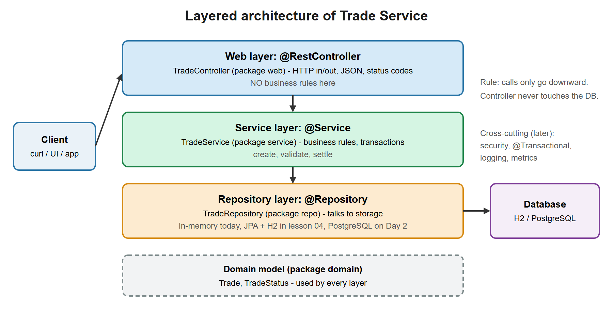](images/02-layered-architecture.svg)

| Layer | Annotation | Responsibility | Must NOT |
|---|---|---|---|
| Web | `@RestController` | HTTP in/out, JSON, status codes | contain business rules, touch the DB |
| Service | `@Service` | Business rules, transaction boundary | know about HTTP |
| Repository | `@Repository` | Storage access | contain business rules |
| Domain | plain classes/records | The data and its invariants | depend on Spring |

Why layers? You can test the service without HTTP, swap storage without touching the service, and change the API without touching the rules. It is the same separation you used with EJB facades and DAOs.

### One request, step by step

[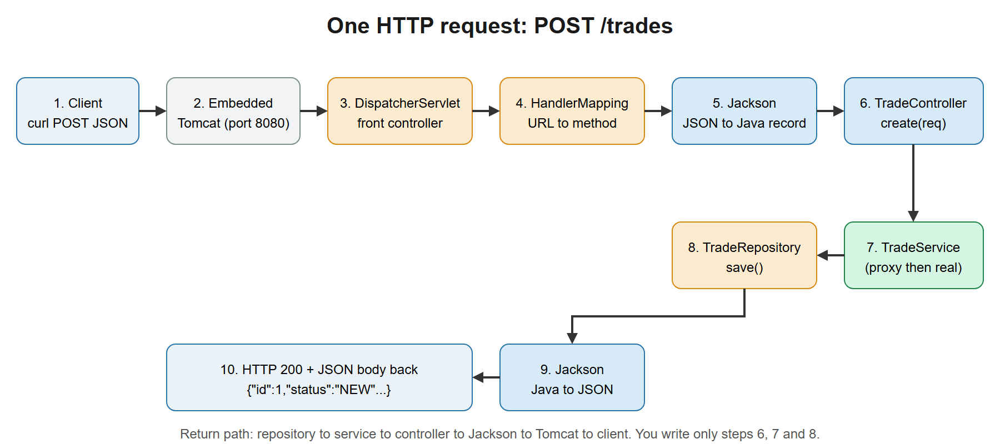](images/03-request-flow.svg)

You only write steps 6, 7 and 8 (controller, service, repository). Tomcat, `DispatcherServlet` (the **front controller**: one servlet that receives every request and routes it), handler mapping and Jackson (JSON conversion) come with the starter.

### What happens at startup

[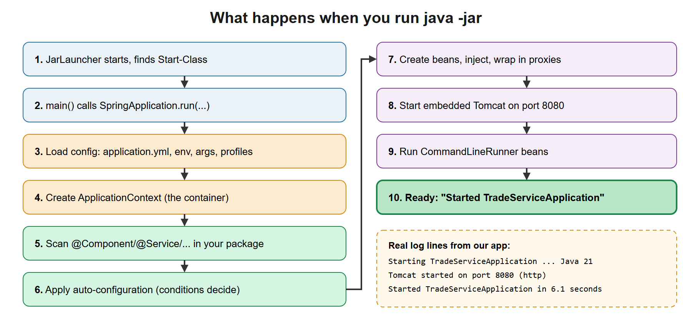](images/04-startup-flow.svg)

### How starters and auto-configuration decide

[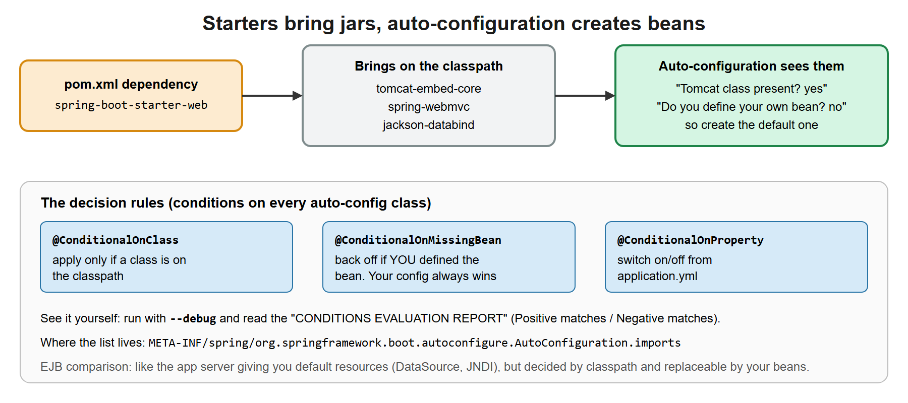](images/05-starter-autoconfig-map.svg)

**Key rule:** Boot's defaults are conditional. If you define your own bean of the same type, Boot backs off. That is how you customize without fighting the framework.

### What is inside the jar

[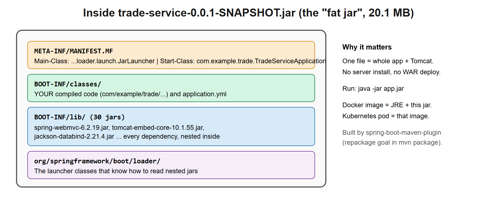](images/07-boot-jar-anatomy.svg)

## 4. Setup steps

### 4.1 Check your tools

Open a terminal (PowerShell on Windows). Run:

```powershell
java -version
```

You need a line that says `21` (for example `openjdk version "21.0.12"`). If you see a lower number, install a JDK 21 (Temurin is fine) and open a new terminal.

### 4.2 VS Code extensions

In VS Code open Extensions (`Ctrl+Shift+X`) and install **Extension Pack for Java** and **Spring Boot Extension Pack**. Restart VS Code.

[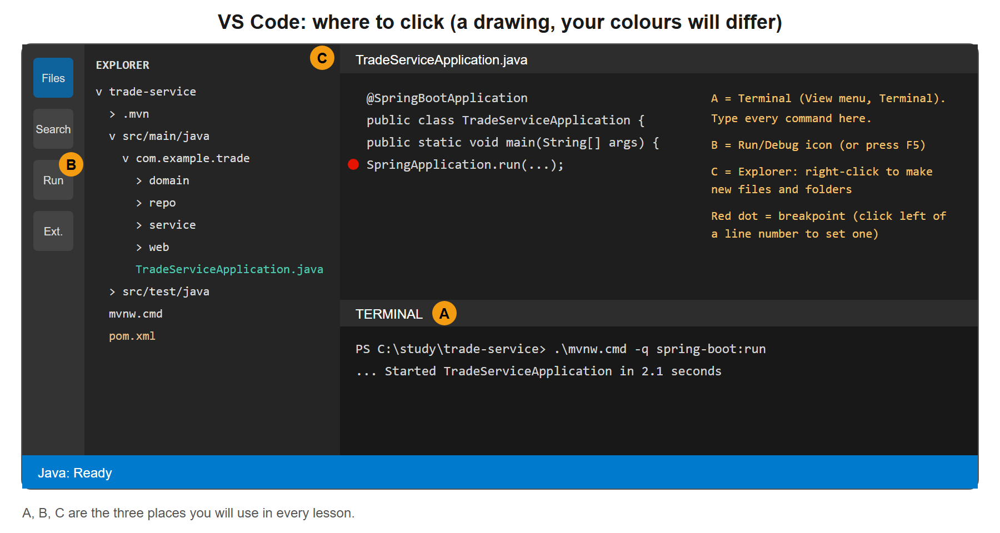](images/08-vscode-layout.svg)

### 4.3 Create your project folder

1. Create an empty folder for your project. Two good choices:
   - `springboot-2day\day1\Handson` (next to the lessons, easy to find), or
   - anywhere outside the course, for example `C:\study\trade-service`.

   The folder name does not matter: the project's name comes from `pom.xml`. The files you create in the steps below go **directly inside this folder** (`pom.xml` at its top level, not in a sub-folder). You keep working in this same folder for all later lessons.
2. In VS Code: *File, Open Folder*, choose it.
3. Open a terminal inside VS Code: *Terminal, New Terminal*. Every command in this lesson is typed here.

**Which terminal am I in?** All commands in these lessons are written for **PowerShell**. Look at the prompt:

| Prompt looks like | You are in | What to do |
|---|---|---|
| `PS C:\study\trade-service>` | PowerShell | Good, continue. |
| `C:\study\trade-service>` (no `PS`) | Command Prompt (cmd.exe) | Type `powershell` and press Enter. The prompt gains `PS`. |

Typical symptom of the wrong terminal: `'pwd' is not recognized as an internal or external command`. (In cmd, `cd` with no arguments prints the folder, but other commands in the lessons, like `$REF` and the curl quoting, also only work in PowerShell.) On Linux, macOS or Git Bash the commands are the same except that you write `./mvnw` instead of `.\mvnw.cmd` and `curl` instead of `curl.exe`.

Check you are in the right place:

```powershell
pwd
```

It must print your new folder.

### 4.4 The plan: files to create, in order

[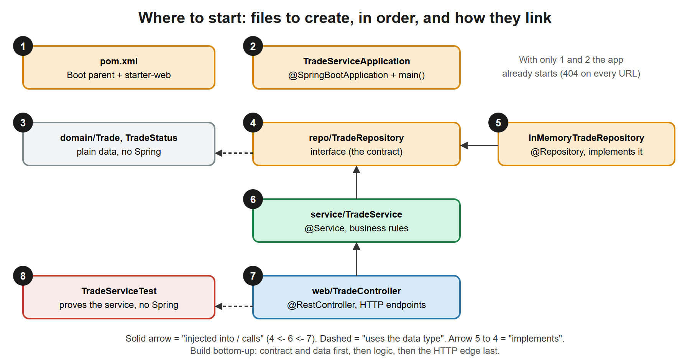](images/06-file-link-map.svg)

You create exactly these files, **bottom-up**: contracts and data first, the HTTP edge last. Nothing calls `new`: the controller declares it needs a service in its constructor, the service declares it needs a repository, and Spring builds the chain.

[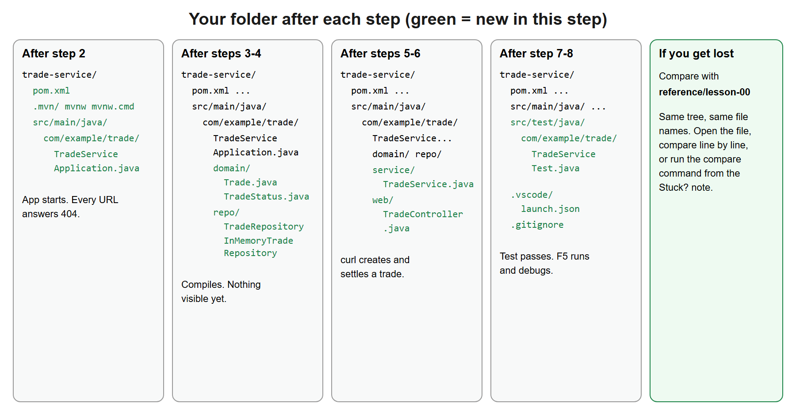](images/09-folder-after-each-step.svg)

### 4.5 How to compare with my working copy when stuck

I keep my version in `reference/lesson-00`. Set a shortcut once per terminal (change the path to where you saved the course):

```powershell
$REF = "C:\path\to\springboot-2day\reference\lesson-00"
```

To compare one file with mine, from your project folder:

```powershell
fc.exe pom.xml "$REF\pom.xml"
```

`FC: no differences encountered` means your file matches mine. Otherwise it prints the differing lines.

## 5. Code walkthrough

This section is a build-along: you write the code yourself, step by step.

Conventions: **File** tells you the path *inside your project folder* and what to type. To create a file, right-click the folder in the Explorer, choose *New File*, type the name. Paths with folders (like `src/main/java/...`) are created by typing the whole path in *New File*; VS Code creates the missing folders.

### Step 1. `pom.xml` and the Maven Wrapper

**Do:** create a file named `pom.xml` in the project root.

**What is this?** Maven is the build tool. The POM (Project Object Model) says what your project is and which libraries it needs. (New to Maven? Read *Deep dive: Maven, the build tool* right after this step.)

**File:** `pom.xml`
```xml
<?xml version="1.0" encoding="UTF-8"?>
<project xmlns="http://maven.apache.org/POM/4.0.0"
         xmlns:xsi="http://www.w3.org/2001/XMLSchema-instance"
         xsi:schemaLocation="http://maven.apache.org/POM/4.0.0 https://maven.apache.org/xsd/maven-4.0.0.xsd">
  <modelVersion>4.0.0</modelVersion>

  <!-- The parent pins versions of over 1,500 libraries, so we never write versions below. -->
  <parent>
    <groupId>org.springframework.boot</groupId>
    <artifactId>spring-boot-starter-parent</artifactId>
    <version>3.5.16</version>
    <relativePath/>
  </parent>

  <!-- Our project's own identity. -->
  <groupId>com.example</groupId>
  <artifactId>trade-service</artifactId>
  <version>0.0.1-SNAPSHOT</version>
  <name>trade-service</name>

  <properties>
    <java.version>21</java.version>
  </properties>

  <dependencies>
    <!-- Web starter: embedded Tomcat + Spring MVC + Jackson (JSON). -->
    <dependency>
      <groupId>org.springframework.boot</groupId>
      <artifactId>spring-boot-starter-web</artifactId>
    </dependency>

    <!-- Test starter: JUnit 5, AssertJ, Mockito, Spring test support. Only used when testing. -->
    <dependency>
      <groupId>org.springframework.boot</groupId>
      <artifactId>spring-boot-starter-test</artifactId>
      <scope>test</scope>
    </dependency>
  </dependencies>

  <build>
    <plugins>
      <!-- Builds the runnable "fat jar" and adds the spring-boot:run command. -->
      <plugin>
        <groupId>org.springframework.boot</groupId>
        <artifactId>spring-boot-maven-plugin</artifactId>
      </plugin>
    </plugins>
  </build>
</project>
```

**Why each part:**
- `parent` = Spring Boot's list of tested library versions. This is why a Boot pom has almost no version numbers.
- `starter-web` brings the web server and JSON support (diagram in section 3).
- `starter-test` is only for tests (`scope test`).
- The plugin builds the executable jar.
- `3.5.16` is the latest Boot 3.x at the time of writing.

**Now get the Maven Wrapper.** The wrapper is three small items (`mvnw`, `mvnw.cmd`, folder `.mvn`) that download the right Maven for you, so nobody has to install Maven. You need Maven **once** to create them. Pick **one** way:

*Option A: Maven zip, nothing installed.* Download `https://repo.maven.apache.org/maven2/org/apache/maven/apache-maven/3.9.16/apache-maven-3.9.16-bin.zip`, unzip it anywhere, then in your project folder run (change the path):

```powershell
& "C:\tools\apache-maven-3.9.16\bin\mvn.cmd" wrapper:wrapper "-Dmaven=3.9.16"
```

*Option B: copy mine.* Copy `mvnw`, `mvnw.cmd` and the `.mvn` folder from `reference/lesson-00` into your project folder.

**Checkpoint:**

```powershell
.\mvnw.cmd -v
```

The first run downloads Maven (a minute). Expected first line: `Apache Maven 3.9.16 (...)` and a `Java version: 21...` line. (On Git Bash/Linux/macOS use `./mvnw`.)

**Stuck?**
- *"mvnw.cmd is not recognized"*: you are in the wrong folder (`pwd`), or the wrapper files were not created (list the folder with `ls`).
- *Java version shows less than 21*: fix 4.1.
- Compare: `fc.exe pom.xml "$REF\pom.xml"`.

### Deep dive: `.mvn/wrapper/maven-wrapper.properties`

The wrapper command creates this small configuration file. It is the only file that decides **which Maven** `mvnw` downloads, so it is worth reading once. It lives at `.mvn/wrapper/maven-wrapper.properties`.

**What a `.properties` file is.** Plain text, one `key=value` per line, `#` starts a comment. Java reads this format natively. (Lesson 02 compares it with YAML, which Spring Boot also reads.)

**Our file (3 keys, verified):**

```properties
wrapperVersion=3.3.4
distributionType=only-script
distributionUrl=https://repo.maven.apache.org/maven2/org/apache/maven/apache-maven/3.9.16/apache-maven-3.9.16-bin.zip
```

| Key | Meaning | Why our value | Other values and options |
|---|---|---|---|
| `distributionUrl` | Where `mvnw` downloads Maven from. **This is the line that pins the Maven version.** | The official 3.9.16 zip on Maven Central. | Change the version number to upgrade Maven for the whole team in one commit. Point it at a company mirror (Nexus/Artifactory) when Maven Central is blocked. |
| `distributionType` | What the wrapper installs. | `only-script`: only the small `mvnw` scripts are committed, and the wrapper downloads the Maven distribution itself. | `bin` (the older style: also commits `maven-wrapper.jar`, which downloads Maven). Prefer `only-script`: no binary jar in git. |
| `wrapperVersion` | Version of the wrapper scripts that generated the file. | Written by the `wrapper:wrapper` goal. | Do not edit by hand; regenerate with `.\mvnw.cmd wrapper:wrapper "-Dmaven=3.9.16"`. |
| `distributionSha256Sum` *(not in our file)* | Checksum of the Maven zip. | Not used here. | Add it in security-sensitive builds so a tampered download is rejected. |
| `wrapperSha256Sum` *(not in our file)* | Checksum of `maven-wrapper.jar` (only with `distributionType=bin`). | Not used. | Same idea for the wrapper jar. |

**Where the download goes.** `C:\Users\<you>\.m2\wrapper\dists\...`. It happens once per Maven version per machine; after that `mvnw` starts instantly.

**How to upgrade Maven for everyone:** edit `distributionUrl` (or rerun `wrapper:wrapper` with a new `-Dmaven=`), commit the file. Every teammate and the CI server picks up the new version on their next `mvnw` run. This is the "works the same on every machine" promise from the Maven deep dive below.

**Commit it.** `.mvn/`, `mvnw` and `mvnw.cmd` belong in git (see `.gitignore` in step 8).

### Deep dive: Maven, the build tool

Read this after step 1 works, or before it if "Maven" is still a black box. Every command in this lesson starts with `mvnw`, so it pays to understand it once, properly. The next deep dive (`pom.xml`) explains the file; this one explains the **tool**, the **commands** and **which command to use when**.

#### A. What is Maven?

Maven is a **build tool**: a program that turns your source code into a runnable, tested package, and that fetches the libraries your code needs. It is written in Java and started from the command line (`mvn`, or `mvnw` for the wrapper).

Maven rests on three ideas:

| Idea | Meaning | Where you see it |
|---|---|---|
| **Declarative** | You describe *what* the project is and needs, not *how* to build it. | `pom.xml` |
| **Convention over configuration** | Everyone puts files in the same places, so nothing has to be configured. | `src/main/java`, `src/test/java`, `src/main/resources`, output in `target/` |
| **Plugins do the work** | Maven itself only coordinates. Compiling, testing and packaging are done by plugins. | `compiler:compile`, `surefire:test`, `spring-boot:repackage` |

#### B. Why do we need it? What problem does it solve?

Picture a project with no build tool. You would have to download every library jar yourself, guess which versions work together, find the jars *those* jars need, type a very long `javac -cp a.jar;b.jar;...` command, run the tests, build the jar, and repeat all of it on every teammate's machine and on the build server. A Spring Boot web app needs over 60 jars, so this is not realistic.

[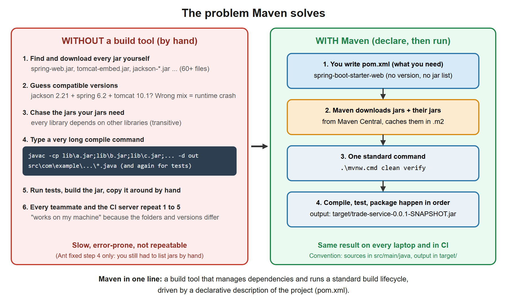](images/13-maven-problem-solution.svg)

| Problem without Maven | How Maven solves it |
|---|---|
| Finding and downloading jars by hand | You list the library once in `pom.xml`. Maven downloads it from **Maven Central** and caches it in `C:\Users\<you>\.m2\repository`. |
| Libraries need other libraries | **Transitive dependencies**: Maven reads each library's own POM and fetches what that library needs (`starter-web` becomes dozens of jars). |
| Incompatible versions | **Dependency management**: the Spring Boot parent pins one tested set of versions. |
| Long, different build commands per project | A fixed **lifecycle** (`compile`, `test`, `package`...). The same command works in every Maven project. |
| "Works on my machine" | The same `pom.xml` and the same pinned Maven version (via the wrapper) give the same result on every laptop and on CI. |
| Different folder layouts per project | One standard layout, so any developer or tool can open any Maven project and know where things are. |
| Sharing your own library | `install` and `deploy` publish your jar to a repository, addressed by `groupId:artifactId:version`. |

**History in one line (interviewers like it).** Ant (2000) automated the steps but you wrote every step and managed jars by hand. Maven (2004) added conventions, a lifecycle and automatic dependency download. Gradle (2012) keeps the idea but uses a Groovy/Kotlin script instead of XML and is faster on large builds. Spring Boot supports both; this course uses Maven because it is the most common in banks and enterprises, and its XML is easy to read.

#### C. Maven, the wrapper and the repositories: who is who?

| Name | What it is |
|---|---|
| `mvn` | A Maven you installed yourself (unzipped and on your `PATH`). Its version depends on your machine. |
| `mvnw` / `mvnw.cmd` | The **Maven Wrapper**: a tiny script in your project. First run downloads the Maven version named in `.mvn/wrapper/maven-wrapper.properties` (ours: `3.9.16`), then runs it. Everyone, and CI, uses the same version with nothing installed. **Use this one.** |
| **Local repository** | Your personal cache: `C:\Users\<you>\.m2\repository`. Downloaded jars and your own `install`ed jars live here. Safe to delete; Maven downloads again. |
| **Central repository** | The public store of libraries: `repo.maven.apache.org`. Maven goes here when a jar is missing locally. |
| **Remote / company repository** | A private server (Nexus, Artifactory) that mirrors Central and stores your company's own jars. Configured in `~/.m2/settings.xml` (proxy, mirror, credentials) or the pom. |
| `settings.xml` | Per-user Maven settings: proxy, mirrors, server passwords. Not part of the project and **never committed**. |

Lookup order for each dependency: local repository first, then the remote ones. That is why the first build is slow (downloads) and later builds are fast (cache).

#### D. The command syntax

```text
mvn [options] [<goal(s)>] [<phase(s)>]
.\mvnw.cmd [options] [<goal(s)>] [<phase(s)>]      (Windows)
./mvnw      [options] [<goal(s)>] [<phase(s)>]      (Linux, macOS, Git Bash)
```

[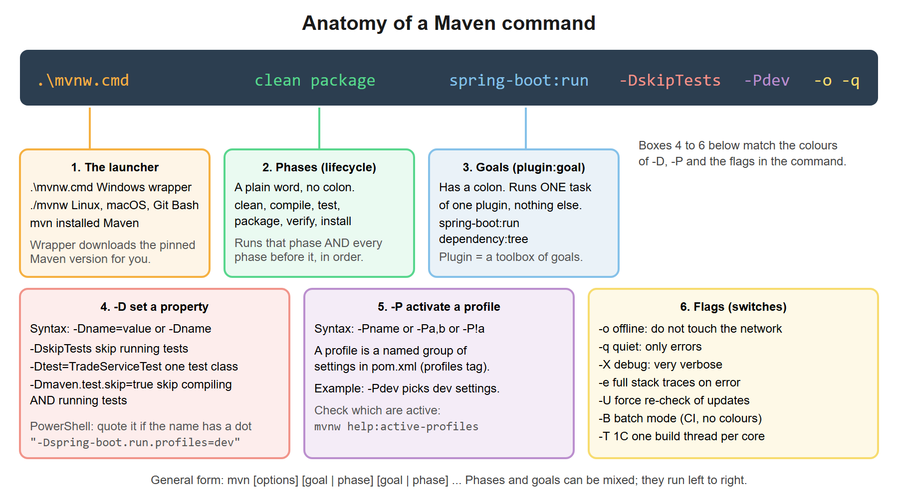](images/14-maven-command-anatomy.svg)

Terms you must keep apart:

| Term | Meaning | Example |
|---|---|---|
| **Phase** | A named step in a lifecycle. Asking for a phase runs it **and every earlier phase**. | `package` |
| **Goal** | One concrete task of a plugin, written `plugin:goal`. Runs alone. | `spring-boot:run`, `dependency:tree` |
| **Plugin** | A bundle of related goals. | `maven-surefire-plugin` (goal `test`) |
| **Lifecycle** | An ordered list of phases. Maven has three: `default`, `clean`, `site`. | see next part |
| **Binding** | The link "this goal runs in that phase". The `jar` packaging binds `compiler:compile` to `compile`, `surefire:test` to `test`, `jar:jar` to `package`. | `help:describe -Dcmd=compile` |

You can give several things in one command. They run **left to right**: `clean package spring-boot:run` means clean, then everything up to package, then run the app.

A goal can also be written with full coordinates, `groupId:artifactId:version:goal`. The short prefix form works for well-known plugins, and you can pin a version only when needed: `org.apache.maven.plugins:maven-dependency-plugin:3.8.1:tree`.

**The default lifecycle, phase by phase.** These are the phases you will use. Verified on our project: each command runs everything above it.

[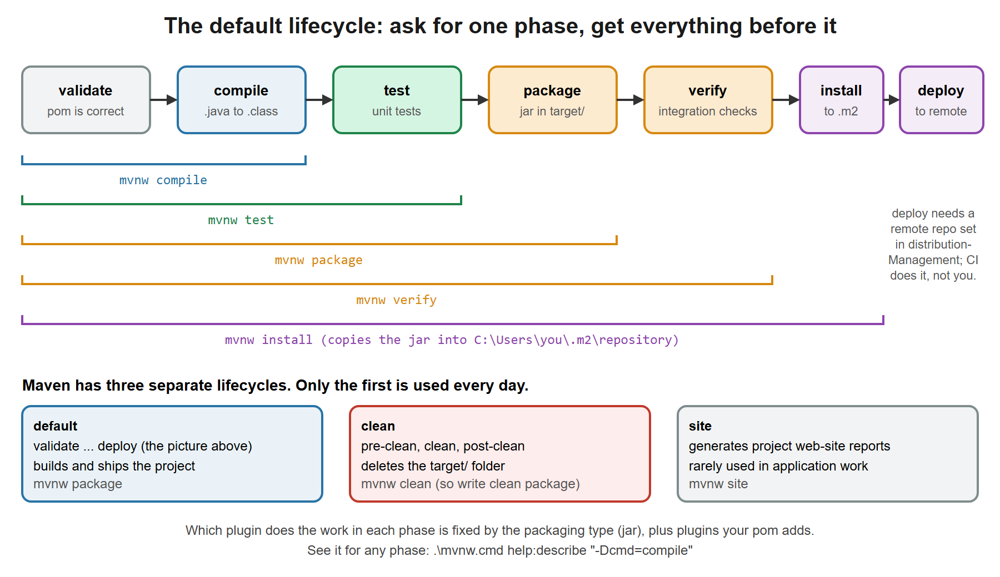](images/15-maven-lifecycle-commands.svg)

| Phase | What happens in our Spring Boot project | Output |
|---|---|---|
| `validate` | Checks the pom is correct and complete. | nothing |
| `compile` | Copies `src/main/resources`, compiles `src/main/java` with `javac`. | `target/classes/` |
| `test` | Compiles `src/test/java`, runs unit tests with **Surefire** (JUnit). | `target/surefire-reports/` |
| `package` | Builds the jar. The Spring Boot plugin then rewrites it into the runnable **fat jar** (`repackage`). | `target/trade-service-0.0.1-SNAPSHOT.jar` |
| `verify` | Runs checks on the package (integration tests, if configured). In our project it adds nothing beyond `package`. | nothing extra |
| `install` | Copies the jar into your local repository so other local projects can depend on it. | `~/.m2/repository/com/example/trade-service/...` |
| `deploy` | Uploads the jar to a remote repository. Normally done by the CI server only. | remote repo |

The other two lifecycles: **`clean`** has one useful phase, `clean`, which deletes `target/`. It is a *separate* lifecycle, so `mvnw package` does **not** clean; you write `mvnw clean package`. **`site`** builds a documentation web site and is rarely used in application work.

#### E. Options and flags you will use

| Option | Meaning | Example |
|---|---|---|
| `-v` | Print Maven and Java versions, then stop. Your first sanity check. | `.\mvnw.cmd -v` |
| `-D<name>=<value>` | Set a **property**. Used by plugins and by `${...}` values in the pom. | `-DskipTests`, `"-Dtest=TradeServiceTest"` |
| `-P<id>` | Activate a **profile** (a named group of pom settings). Comma separated; `!` turns one off. | `-Pdev`, `-Pdev,fast`, `-P!dev` |
| `-o` | **Offline**: never use the network. Fails if something is not in `.m2`. | `.\mvnw.cmd -o test` |
| `-U` | Force a fresh check for updated SNAPSHOTs and for failed downloads cached earlier. | `-U clean verify` |
| `-q` | **Quiet**: print only errors. Good for scripts and short checks. | `-q compile` |
| `-e` | Show the full stack trace of an error. | `-e verify` |
| `-X` | **Debug** output. Very long; search it for the real cause. | `-X verify` |
| `-B` | **Batch** mode: no colours or progress bars. Use on CI servers. | `-B clean verify` |
| `-T 1C` | Build modules in parallel, one thread per CPU core. Only helps multi-module builds. | `-T 1C verify` |
| `-f <path>` | Use a pom in another folder. | `-f ..\other\pom.xml` |
| `-pl <module>`, `-am` | In a multi-module project, build only that module (`-pl`) and what it depends on (`-am`). Not needed in our single-module service. | `-pl trade-api -am package` |
| `-fae`, `-ff` | On a multi-module build: fail at the end / fail fast. | `-fae verify` |

**Property reminders.**
- `-DskipTests` compiles the tests but does not run them. Output says `Tests are skipped.` (verified).
- `-Dmaven.test.skip=true` skips compiling **and** running tests. It also stops test classes being built, which can break modules that share a `test-jar`. Prefer `-DskipTests`.
- `-Dtest=TradeServiceTest` runs one test class; `"-Dtest=TradeServiceTest#createThenSettle"` runs one method (both verified: `Tests run: 1`).
- **PowerShell quoting:** PowerShell splits an unquoted `-Dname.part=value` at the dot, so write `"-Dname.part=value"` in quotes. The lesson text does this everywhere. In Git Bash or Linux the quotes are optional.

#### F. The commands you will actually type in a Spring Boot project

Day to day you need about ten commands. Everything else you can look up.

[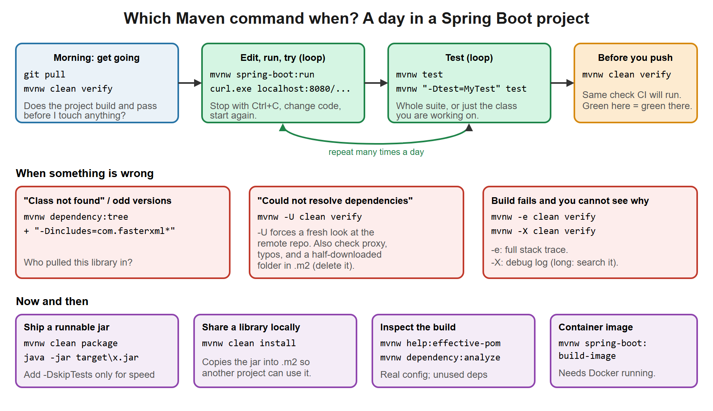](images/16-maven-daily-workflow.svg)

**1. Build and verify**

| Command | Purpose | When you use it |
|---|---|---|
| `.\mvnw.cmd -v` | Show Maven and Java versions. | First day, or "which Java is Maven using?" |
| `.\mvnw.cmd -q compile` | Compile only. Silent means success. | Quick "does it compile?" while coding. |
| `.\mvnw.cmd test` | Compile and run all unit tests. | After each change, before committing. |
| `.\mvnw.cmd "-Dtest=TradeServiceTest" test` | Run one test class (or `Class#method`). | While fixing one failing test. |
| `.\mvnw.cmd clean verify` | Delete `target/`, build everything, run all tests, make the jar. **Our standard full check.** | Before every push; the same thing CI runs. |
| `.\mvnw.cmd clean package` | Like `verify` for our project; produces the jar. | Making the jar to run or deploy. |
| `.\mvnw.cmd clean package -DskipTests` | Same, but tests are not run (verified: still builds the jar). | You need the jar fast and tests already passed. Do not use it to hide failing tests. |
| `.\mvnw.cmd clean install` | `package` plus copy the jar to `~/.m2`. | Another local project depends on this one (a shared library). |

**2. Run the application (Spring Boot plugin goals)**

| Command | Purpose |
|---|---|
| `.\mvnw.cmd spring-boot:run` | Compile (if needed) and start the app with embedded Tomcat. `Ctrl+C` stops it. |
| `.\mvnw.cmd "-Dspring-boot.run.profiles=dev" spring-boot:run` | Start with Spring profile `dev` (profiles are lesson 02). |
| `.\mvnw.cmd "-Dspring-boot.run.arguments=--server.port=8081" spring-boot:run` | Pass program arguments, for example another port. |
| `.\mvnw.cmd "-Dspring-boot.run.jvmArguments=-Xmx512m" spring-boot:run` | Pass JVM options, for example memory or a debug agent (see *Debug it*). |
| `java -jar target\trade-service-0.0.1-SNAPSHOT.jar` | Run the packaged jar. No Maven involved; this is what production does. |
| `.\mvnw.cmd spring-boot:build-image` | Build a container image with Cloud Native Buildpacks. Needs Docker running. |

Note the difference: `spring-boot:run` is for **development** (runs from `target/classes`); the jar is for **deployment**. They behave the same, but test the jar before release.

**3. Understand and troubleshoot** (all verified on our project)

| Command | Purpose | Use when |
|---|---|---|
| `.\mvnw.cmd dependency:tree` | Print every library and **who pulled it in**. | "Where does this jar come from?", version conflicts, `ClassNotFoundException`. |
| `.\mvnw.cmd dependency:tree "-Dincludes=com.fasterxml.jackson.core"` | Same, filtered to one library. | You only care about one library. |
| `.\mvnw.cmd dependency:analyze` | Lists used-but-undeclared and declared-but-unused dependencies. | Cleaning a pom. Treat as hints, not errors: Boot starters legitimately bring libraries you use. |
| `.\mvnw.cmd -q help:effective-pom "-Doutput=effective.xml"` | Write out the pom after merging the parent chain. | "Where does this version or plugin setting come from?" |
| `.\mvnw.cmd -q help:evaluate "-Dexpression=project.version" -DforceStdout` | Print one value (version, Java release...). | Scripts and quick checks. |
| `.\mvnw.cmd help:describe "-Dcmd=compile"` | Shows which plugin goals run in each phase for this project. | Understanding a build, or interview prep. |
| `.\mvnw.cmd help:active-profiles` | Shows which profiles are active. | A profile behaves unexpectedly. |
| `.\mvnw.cmd -U clean verify` | Force a fresh download check. | `Could not resolve dependencies` after a teammate published a new SNAPSHOT. |
| `.\mvnw.cmd -e verify` / `-X verify` | Full stack trace / debug log. | The error message alone is not enough. |
| `.\mvnw.cmd -o test` | Work offline using only `.m2`. | No network, or to prove everything is cached. |

**4. What a typical day looks like**

1. `git pull`, then `.\mvnw.cmd clean verify` to confirm you start from a green build.
2. Change code. `.\mvnw.cmd spring-boot:run` (or **F5** in VS Code), try it with `curl.exe`.
3. Write a test. `.\mvnw.cmd "-Dtest=MyTest" test` until it passes, then `.\mvnw.cmd test` for the whole suite.
4. Before pushing: `.\mvnw.cmd clean verify`. If it is green here it should be green on CI.
5. Something odd with libraries? `dependency:tree`. Nothing downloads? `-U`, check the proxy in `settings.xml`.

#### G. Reading the output

A Maven run is a series of blocks, one per plugin goal:

```
[INFO] --- compiler:3.14.1:compile (default-compile) @ trade-service ---
[INFO] Tests run: 1, Failures: 0, Errors: 0, Skipped: 0
[INFO] BUILD SUCCESS
[INFO] Total time:  8.631 s
```

- `--- plugin:version:goal (execution-id) @ project ---` tells you **which goal** is running. When a build fails, the last such line above `[ERROR]` tells you *which step* broke.
- `BUILD SUCCESS` or `BUILD FAILURE` is the verdict. The process exit code is `0` or non-zero, which is how CI decides.
- Under `BUILD FAILURE`, read the first `[ERROR]` line. It usually names the problem, for example a compile error with file and line, a failing test, or `Could not resolve dependencies`.

#### H. Common Maven mistakes

| Mistake | What you see | Fix |
|---|---|---|
| Running `mvnw` outside the project folder | `The goal you specified requires a project to execute but there is no POM in this directory` | `cd` to the folder that holds `pom.xml` (`pwd` to check). |
| Forgetting `clean` after deleting or renaming a class | An old class still runs, or odd compile results | Add `clean`: `.\mvnw.cmd clean verify`. |
| Typing `.\mvnw.cmd -DskipTests=true` and nothing else | Maven runs the default goal, which is none: `No goals have been specified` | Always name a phase or goal: `.\mvnw.cmd -DskipTests package`. |
| Unquoted `-Dname.part=value` in PowerShell | `Unknown lifecycle phase ".part=value"` | Quote it: `"-Dname.part=value"`. |
| Using `mvn` while the project expects another Maven version | Works for you, fails on CI | Use `mvnw`. |
| Skipping tests to "fix" a red build | Bugs reach production | Fix the test. Use `-DskipTests` only for speed, never to hide failures. |
| Deleting the whole `.m2` folder on every problem | Next build re-downloads hundreds of MB | Try `-U` first. If one artifact is corrupt, delete only its folder under `.m2\repository`. |
| Committing `target/` | Huge repository, merge conflicts | It belongs in `.gitignore` (step 8). |

**Quick exercise (10 min).**
1. Run `.\mvnw.cmd -q compile`, then look inside `target\classes`. Run `.\mvnw.cmd clean` and look again.
2. Run `.\mvnw.cmd test`, then `.\mvnw.cmd "-Dtest=TradeServiceTest#createThenSettle" test`. Both should say `Tests run: 1`.
3. Run `.\mvnw.cmd clean package -DskipTests`. Check that `target\*.jar` exists and the output says `Tests are skipped.`
4. Run `.\mvnw.cmd help:describe "-Dcmd=package"` and name the plugin that runs in the `package` phase.

### Deep dive: `pom.xml`, tag by tag

Read this after step 1 works. You do not need it to continue, but it is the most-asked "basics" topic, and every later lesson edits this file.

**What a POM is.** *POM* means Project Object Model. It is an XML file that describes your project to Maven: who it is, which libraries it needs, and which tools to run to build it. You describe **what** you want; Maven decides **how**, using conventions (source in `src/main/java`, tests in `src/test/java`, output in `target/`).

XML in one minute: tags nest (`<a><b>x</b></a>`), every opening tag needs a closing tag, `<tag/>` is an empty tag, and `<!-- text -->` is a comment.

[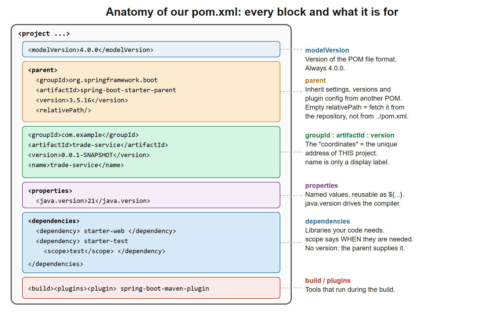](images/10-pom-anatomy.svg)

#### A. Every tag in our file

| Tag | Purpose | In our file | Notes |
|---|---|---|---|
| `<project>` | Root of every POM. Everything else is inside it. | `xmlns`, `xmlns:xsi`, `xsi:schemaLocation` | These three attributes name the XML vocabulary and where its definition file (XSD) lives. Editors use them for auto-complete and validation. Maven itself works without them, so just copy them. |
| `<modelVersion>` | Version of the POM file format. | `4.0.0` | Always `4.0.0` for Maven 3 and 4. Never change it. |
| `<parent>` | Inherit from another POM. | `spring-boot-starter-parent 3.5.16` | See the next table. This single block is why our file is so short. |
| `<groupId>` | Organisation or product, usually a reversed domain. | `com.example` | Part of the project's unique address. Often matches the Java package, but Maven does not force it. |
| `<artifactId>` | The name of this module. | `trade-service` | Becomes the jar name: `trade-service-0.0.1-SNAPSHOT.jar` (verified in our build). |
| `<version>` | Version of this project. | `0.0.1-SNAPSHOT` | `-SNAPSHOT` means "work in progress, may change". A release like `1.0.0` is meant to be immutable. |
| `<name>` | Human-friendly label. | `trade-service` | Display only. Not part of the address. |
| `<properties>` | Named values you can reuse as `${name}`. | `java.version` = `21` | See below. |
| `<dependencies>` | Container for libraries your code needs. | two entries | Must contain `<dependency>` elements. |
| `<dependency>` | One library. | `spring-boot-starter-web`, `spring-boot-starter-test` | Identified by groupId, artifactId (and version). |
| `<scope>` | When the library is needed. | `test` on the test starter | See the scope table below. Default is `compile`. |
| `<build>` | Settings for the build process. | one plugin | Where you configure plugins, resource folders, the final jar name. |
| `<plugins>` / `<plugin>` | Tools that do work during the build. | `spring-boot-maven-plugin` | A **plugin** runs during the build. A **dependency** goes on your program's classpath. They are different things. |

**The three coordinates.** `groupId : artifactId : version` (often called *GAV*) is the unique address of any artifact in the Maven world. Our project is `com.example:trade-service:0.0.1-SNAPSHOT`. Libraries are addressed the same way, for example `org.springframework.boot:spring-boot-starter-web:3.5.16`. Maven Central stores libraries by exactly this address.

**`<parent>` in detail.** A POM can inherit from another POM, like a Java class extending another. Our parent, `spring-boot-starter-parent`, hands us a lot. Verified by inspecting the merged result (see part C):

| What the parent gives you | Evidence |
|---|---|
| Managed versions for a huge list of libraries, so `<dependency>` needs no `<version>` | 1,519 entries in its dependency management |
| Default settings for 30 common Maven plugins | 30 plugins in plugin management |
| Java release from your `java.version` property | `java.version` 21 becomes `maven.compiler.release` 21 |
| UTF-8 source encoding | `project.build.sourceEncoding` is `UTF-8` |
| The Java compiler flag that keeps method parameter names | `parameters` is `true` (Spring uses it to read names like `@PathVariable Long id`) |
| The Boot plugin set up to build the runnable jar | `spring-boot:repackage` runs in our build |

What is inherited: groupId and version (if you omit them), properties, dependency management, plugin management, plugin configuration. What is **not**: your own `artifactId` and `name`. Inheritance can chain: our POM extends `spring-boot-starter-parent`, which extends `spring-boot-dependencies`, which holds the version list.

**`<relativePath/>`.** When you declare a parent, Maven by default first looks for it on disk at `../pom.xml` (the folder above yours), which is right for a company with several modules in one folder. Our Boot parent is **not** on disk; it lives in the repository. The empty tag `<relativePath/>` says "do not look at `../pom.xml`, go to the repository". Without it, Maven prints a warning and wastes a lookup if some unrelated `../pom.xml` exists.

**`<properties>`.**
- You define a name and a value, then use it as `${name}`.
- Built-in ones you can use anywhere: `${project.version}`, `${project.artifactId}`, `${project.basedir}`.
- Spring Boot's parent **reads** `java.version` and sets the compiler to that release. That is why one line, `<java.version>21</java.version>`, is enough (verified: `.\mvnw.cmd help:evaluate "-Dexpression=maven.compiler.release" -DforceStdout` prints `21`).
- The parent defines about 190 properties ending in `.version` (for example `maven-compiler-plugin.version`). To override a managed library's version, set the property of the same name in your own `<properties>`. Prefer this over writing a `<version>` inside a dependency, which breaks the "tested together" guarantee.

**`<scope>`: when is a library available?**

| Scope | On compile classpath | On test classpath | In the final app | Typical use |
|---|---|---|---|---|
| `compile` (default) | yes | yes | yes | Normal libraries (`starter-web`) |
| `provided` | yes | yes | no | Supplied by the runtime, e.g. a servlet API when deploying to an external server |
| `runtime` | no | yes | yes | Needed to run only, e.g. a JDBC driver (lesson 04) |
| `test` | no | yes | no | JUnit, Mockito (`starter-test`) |
| `system` | yes | yes | no | Old and discouraged: points at a jar on disk |
| `import` | n/a | n/a | n/a | Special: only inside `dependencyManagement` with `<type>pom</type>`, to pull in a version list (a "BOM") |

#### B. Other tags you can add

You will meet these in real projects. None is needed for our small service.

| Tag | What it is for | Tiny example |
|---|---|---|
| `<description>` | One-line project description | `<description>Trade settlement service</description>` |
| `<url>` | Project home page | `<url>https://example.com/trade</url>` |
| `<packaging>` | Output type: `jar` (default), `war`, `pom` | `<packaging>jar</packaging>` |
| `<licenses>`, `<developers>`, `<organization>`, `<scm>` | Metadata for publishing a library: licence, people, company, source-control URL | `<licenses><license><name>Apache-2.0</name></license></licenses>` |
| `<modules>` | List sub-projects of a **multi-module** build; the parent POM then has `<packaging>pom</packaging>` | `<modules><module>trade-api</module><module>trade-core</module></modules>` |
| `<dependencyManagement>` | Declares versions **without** adding the library. Children then list the dependency with no version. This is exactly what the Boot parent does | `<dependencyManagement><dependencies><dependency>...<version>1.2</version></dependency></dependencies></dependencyManagement>` |
| `<exclusions>` (inside a `<dependency>`) | Remove an unwanted transitive library, e.g. to swap the logging library | `<exclusions><exclusion><groupId>g</groupId><artifactId>a</artifactId></exclusion></exclusions>` |
| `<optional>` (inside a `<dependency>`) | "I use it, but do not pass it on to projects that depend on me" | `<optional>true</optional>` |
| `<type>`, `<classifier>` (inside a `<dependency>`) | Pick a specific file variant of an artifact (`pom`, `test-jar`, `sources`) | `<type>pom</type>` |
| `<pluginManagement>` | Like `dependencyManagement`, but for plugin versions/config (inside `<build>`) | `<build><pluginManagement><plugins>...` |
| `<executions>` (inside a `<plugin>`) | Bind a plugin **goal** to a **phase** | `<execution><phase>package</phase><goals><goal>repackage</goal></goals></execution>` |
| `<configuration>` (inside a `<plugin>`) | Settings for that plugin | `<configuration><skip>true</skip></configuration>` |
| `<finalName>`, `<resources>`, `<sourceDirectory>` (inside `<build>`) | Rename the jar, change resource folders, change source folders | `<finalName>trade</finalName>` |
| `<repositories>`, `<pluginRepositories>` | Extra places to download from besides Maven Central, e.g. a company server | `<repository><id>corp</id><url>https://repo.corp/maven</url></repository>` |
| `<distributionManagement>` | Where `deploy` uploads your artifact | `<repository><id>corp</id><url>...</url></repository>` |
| `<profiles>` | Switchable groups of settings, activated by `-Pname`, a JDK, an OS or a property | `<profile><id>fast</id><properties><skipTests>true</skipTests></properties></profile>` |
| `<reporting>`, `<issueManagement>`, `<ciManagement>`, `<mailingLists>` | Reports and project metadata (rarely needed in an application) | |

**Order does not matter** between top-level tags, but keep the usual order (parent, coordinates, properties, dependencies, build) so others can read it. Misspelled tags are errors or are silently ignored, depending on the tag.

#### C. How it works when you run Maven

[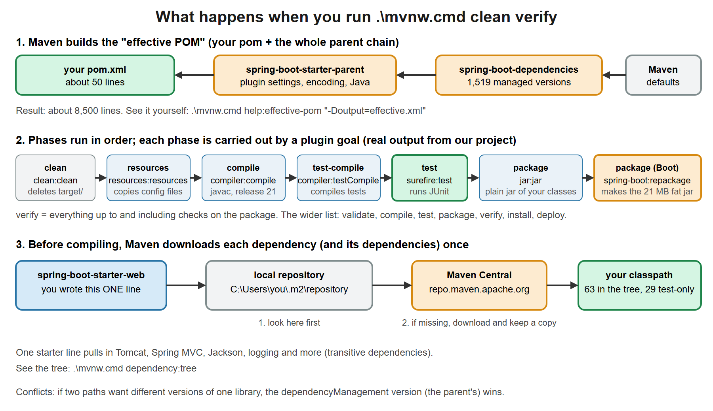](images/11-maven-build-flow.svg)

**Stage 1: the effective POM.** Before doing anything, Maven merges your POM with its parent chain and Maven's built-in defaults into one big in-memory POM. You can write it out and read it (verified on our project):

```powershell
.\mvnw.cmd -q help:effective-pom "-Doutput=effective.xml"
```

For our 50-line file it produced about 8,500 lines (all inherited). Open `effective.xml` and search for `spring-boot-starter-web`: next to it you will find `<version>3.5.16</version>`, which you never wrote. That is the parent at work.

Read single values without opening the file:

```powershell
.\mvnw.cmd -q help:evaluate "-Dexpression=project.version" -DforceStdout
```
Prints `0.0.1-SNAPSHOT`. With `-Dexpression=maven.compiler.release` it prints `21`.

**Stage 2: dependency resolution.** For every `<dependency>` Maven looks in the **local repository** (`C:\Users\<you>\.m2\repository`), downloads from **Maven Central** if missing, and keeps a copy. It then reads *that* library's own POM to fetch *its* dependencies, and so on. These are **transitive dependencies**. Our two lines become many jars. See them (first lines of the real output):

```powershell
.\mvnw.cmd dependency:tree
```
```
com.example:trade-service:jar:0.0.1-SNAPSHOT
+- org.springframework.boot:spring-boot-starter-web:jar:3.5.16:compile
|  +- org.springframework.boot:spring-boot-starter:jar:3.5.16:compile
|  |  +- org.springframework.boot:spring-boot:jar:3.5.16:compile
|  |  +- org.springframework.boot:spring-boot-autoconfigure:jar:3.5.16:compile
|  |  +- org.springframework.boot:spring-boot-starter-logging:jar:3.5.16:compile
...
```

The full tree has 63 entries (29 of them are only for tests). Look for one library with a filter (verified):

```powershell
.\mvnw.cmd dependency:tree "-Dincludes=com.fasterxml.jackson.core"
```
```
com.example:trade-service:jar:0.0.1-SNAPSHOT
   \- com.fasterxml.jackson.core:jackson-databind:jar:2.21.4:compile
      +- com.fasterxml.jackson.core:jackson-annotations:jar:2.21:compile
      \- com.fasterxml.jackson.core:jackson-core:jar:2.21.4:compile
```

*Version conflicts:* if two libraries want different versions of the same third library, Maven picks one. The version in `dependencyManagement` (here, from the parent) always wins, so Boot guarantees one consistent set.

**Stage 3: the lifecycle.** A **lifecycle** is a fixed sequence of **phases** (`validate, compile, test, package, verify, install, deploy`, with a few extra in between). You ask for a phase and Maven runs every phase up to it. A **plugin goal** does the actual work in each phase. Real output of `.\mvnw.cmd clean verify` on our project:

```
--- clean:3.4.1:clean (default-clean) @ trade-service ---
--- resources:3.3.1:resources (default-resources) @ trade-service ---
--- compiler:3.14.1:compile (default-compile) @ trade-service ---
--- resources:3.3.1:testResources (default-testResources) @ trade-service ---
--- compiler:3.14.1:testCompile (default-testCompile) @ trade-service ---
--- surefire:3.5.6:test (default-test) @ trade-service ---
Tests run: 1, Failures: 0, Errors: 0, Skipped: 0
--- jar:3.4.2:jar (default-jar) @ trade-service ---
--- spring-boot:3.5.16:repackage (repackage) @ trade-service ---
BUILD SUCCESS
```

Read each line as `plugin:version:goal (execution-id)`. Note `clean` is a *separate* lifecycle (deletes `target/`), which is why we write `clean verify`. The last line is the Spring Boot plugin rewriting the plain jar into the 21 MB executable "fat jar" (the jar anatomy picture in section 3). Which plugins run, and when, comes from Maven's defaults plus the parent plus your `<build>` block.

#### D. Common `pom.xml` mistakes

| Mistake | How you notice | Fix |
|---|---|---|
| Unclosed or misnested tag | `Non-parseable POM ... expected START_TAG or END_TAG` and a line and column | Go to that line; match every open tag with a close tag |
| `<dependency>` placed outside `<dependencies>` | `'dependencies.dependency' ... is missing` or the library is not found | Put it inside `<dependencies>` |
| Typo in groupId or artifactId | `Could not resolve dependencies ... Could not find artifact` | Copy the coordinates from Maven Central |
| Writing a `<version>` for a Boot-managed library | Works, but can mix incompatible versions | Remove it and let the parent supply it |
| Wrong scope (for example JUnit on `compile`) | Test library ends up in the production jar | Use `<scope>test</scope>` |
| Editing the POM and VS Code does not notice | Red errors remain, new library not recognised | Save; run the Java command "Reload Project", or restart the Java language server |
| Using `SNAPSHOT` for something you release | A "release" changes underneath consumers | Use a fixed version for releases |
| Parent not found offline | `Could not transfer artifact ... spring-boot-starter-parent` | Connect once so it downloads, or check your proxy settings |

**Quick exercise (10 min).** Run `dependency:tree` and find where `tomcat-embed-core` comes from. Which of your two dependencies pulled it in, and through which intermediate starter? Then run the `effective-pom` command and find the `maven-compiler-plugin` entry; read the `release` value it receives.

### Step 2. The application class: your app already runs

**Do:** create the file below. The path creates the package folders for you.

**File:** `src/main/java/com/example/trade/TradeServiceApplication.java`
```java
package com.example.trade;

import org.springframework.boot.SpringApplication;
import org.springframework.boot.autoconfigure.SpringBootApplication;

// @SpringBootApplication = @Configuration + @EnableAutoConfiguration + @ComponentScan.
// Scanning starts at THIS package, so all our classes must live under com.example.trade.
@SpringBootApplication
public class TradeServiceApplication {
    public static void main(String[] args) {
        SpringApplication.run(TradeServiceApplication.class, args);
    }
}
```

**Why:**
- `main` is the normal Java entry point. `SpringApplication.run` starts the whole machine from the startup diagram.
- `@SpringBootApplication` turns on three things: scanning for your components, auto-configuration, and this class acting as a configuration class.
- **Package rule:** it scans *its own package and below*. Every class you create later must live under `com.example.trade`, or Spring will not see it.

**Checkpoint:** start the app.

```powershell
.\mvnw.cmd -q spring-boot:run
```

Expected (verified; timings and process id differ):

```
Starting TradeServiceApplication using Java 21.0.12 ...
Tomcat started on port 8080 (http) with context path '/'
Started TradeServiceApplication in 2.1 seconds
```

In a **second** terminal ask for the home page. In PowerShell use `curl.exe`, not `curl`:

```powershell
curl.exe -s localhost:8080/
```

Expected (verified): `{"timestamp":"...","status":404,"error":"Not Found","path":"/"}`. That is **success**: the web server is running, but you have not mapped any URL yet. Stop the app with `Ctrl+C` in the first terminal.

**Stuck?**
- *Port 8080 already in use*: another program owns it. Stop it, or add `--server.port=8081` after the run command.
- *`Unable to find a suitable main class`* or no output: file saved under the wrong folder, or the package line at the top does not match the folder path.
- *Red squiggles in VS Code but Maven works*: wait for "Java: Ready" in the status bar.

### Step 3. The domain: what a trade is

**File:** `src/main/java/com/example/trade/domain/TradeStatus.java`
```java
package com.example.trade.domain;

public enum TradeStatus { NEW, SETTLED, FAILED }
```

**File:** `src/main/java/com/example/trade/domain/Trade.java`
```java
package com.example.trade.domain;

import java.math.BigDecimal;

// A Java record: immutable data carrier. Good for domain values and DTOs.
public record Trade(Long id, String isin, BigDecimal quantity, BigDecimal price, TradeStatus status) {
    public Trade withStatus(TradeStatus s) {
        return new Trade(id, isin, quantity, price, s);
    }
}
```

**Why:**
- A *record* is a short way to write an immutable class: it generates the constructor, getters (`id()`, `isin()`...), `equals`, `hashCode` and `toString`.
- Immutable matters: `withStatus` returns a **new** trade instead of changing the old one, so a shared object can never be altered by another thread.
- No Spring annotation here. The domain knows nothing about the framework.
- `BigDecimal` for money and quantity, never `double`.

**Checkpoint:** `.\mvnw.cmd -q compile` prints nothing and returns to the prompt (silent means success).

**Stuck?** *`cannot find symbol TradeStatus`*: the two files must be in the same `domain` folder and both start with `package com.example.trade.domain;`.

### Step 4. The repository: where trades are stored

**File:** `src/main/java/com/example/trade/repo/TradeRepository.java`
```java
package com.example.trade.repo;

import com.example.trade.domain.Trade;
import java.util.Optional;

// Depend on the INTERFACE. Spring injects whichever implementation bean exists.
// (Day 1 file 04 replaces the in-memory version with JPA, with no service changes.)
public interface TradeRepository {
    Trade save(Trade t);
    Optional<Trade> findById(Long id);
}
```

**File:** `src/main/java/com/example/trade/repo/InMemoryTradeRepository.java`
```java
package com.example.trade.repo;

import com.example.trade.domain.Trade;
import java.util.Map;
import java.util.Optional;
import java.util.concurrent.ConcurrentHashMap;
import java.util.concurrent.atomic.AtomicLong;
import org.springframework.stereotype.Repository;

// @Repository = @Component + marks the persistence layer. The container creates ONE instance (singleton),
// shared by all threads, hence the thread-safe collections.
@Repository
public class InMemoryTradeRepository implements TradeRepository {
    private final Map<Long, Trade> store = new ConcurrentHashMap<>();
    private final AtomicLong seq = new AtomicLong();

    @Override
    public Trade save(Trade t) {
        Long id = t.id() != null ? t.id() : seq.incrementAndGet();
        Trade saved = new Trade(id, t.isin(), t.quantity(), t.price(), t.status());
        store.put(id, saved);
        return saved;
    }

    @Override
    public Optional<Trade> findById(Long id) {
        return Optional.ofNullable(store.get(id));
    }
}
```

**Why:**
- `@Repository` is the first **stereotype annotation** you meet: it tells Spring "create and manage an object of this class". An object Spring manages is a **bean**.
- By default Spring creates **one** instance (a *singleton*) used by every request thread at once. So the map is a `ConcurrentHashMap` and the counter an `AtomicLong`, both thread-safe.
- The interface is the *contract*; the in-memory class is one implementation. In lesson 04 you will swap in a database without touching the service.

**Checkpoint:** `.\mvnw.cmd -q compile` again, silent.

**Stuck?** *`NoSuchBeanDefinitionException` later at startup*: a missing `@Repository`, or the class sits outside `com.example.trade`.

### Step 5. The service: the business rules

**File:** `src/main/java/com/example/trade/service/TradeService.java`
```java
package com.example.trade.service;

import com.example.trade.domain.Trade;
import com.example.trade.domain.TradeStatus;
import com.example.trade.repo.TradeRepository;
import java.math.BigDecimal;
import org.springframework.stereotype.Service;

@Service
public class TradeService {

    private final TradeRepository repository;

    // Constructor injection: single constructor, so no @Autowired needed (since Spring 4.3).
    // The field is final, so the service can never exist half-wired, and unit tests can call new TradeService(fake).
    public TradeService(TradeRepository repository) {
        this.repository = repository;
    }

    public Trade create(String isin, BigDecimal quantity, BigDecimal price) {
        return repository.save(new Trade(null, isin, quantity, price, TradeStatus.NEW));
    }

    public Trade settle(Long id) {
        Trade t = repository.findById(id)
                .orElseThrow(() -> new IllegalArgumentException("Trade not found: " + id));
        return repository.save(t.withStatus(TradeStatus.SETTLED));
    }
}
```

**Why:**
- **Dependency injection (DI):** the service does not create its repository. It *asks* for one in its constructor, and Spring passes in the `InMemoryTradeRepository` bean. You never write `new TradeService(...)` yourself in the app.
- The service depends on the **interface** `TradeRepository`, not the concrete class. That is what makes the later swap painless.
- Business rules live here: a new trade starts as `NEW`; settling moves it to `SETTLED`.

**Checkpoint:** `.\mvnw.cmd -q compile`, silent.

**Stuck?** *`Parameter 0 of constructor in TradeService required a bean of type TradeRepository`* at startup: the repository class is missing `@Repository` or sits outside the scanned package.

### Step 6. The controller: the HTTP edge

**File:** `src/main/java/com/example/trade/web/TradeController.java`
```java
package com.example.trade.web;

import com.example.trade.domain.Trade;
import com.example.trade.service.TradeService;
import java.math.BigDecimal;
import org.springframework.web.bind.annotation.GetMapping;
import org.springframework.web.bind.annotation.PathVariable;
import org.springframework.web.bind.annotation.PostMapping;
import org.springframework.web.bind.annotation.RequestBody;
import org.springframework.web.bind.annotation.RequestMapping;
import org.springframework.web.bind.annotation.RestController;

// Web layer: translates HTTP <-> Java. It contains NO business logic; it only calls the service.
// @RestController = @Controller + @ResponseBody: return values are written as JSON.
@RestController
@RequestMapping("/trades")
public class TradeController {

    // Request body shape. Jackson (bundled with starter-web) turns JSON into this record.
    public record CreateTradeRequest(String isin, BigDecimal quantity, BigDecimal price) {}

    private final TradeService service;

    public TradeController(TradeService service) {
        this.service = service;
    }

    @PostMapping
    public Trade create(@RequestBody CreateTradeRequest req) {
        return service.create(req.isin(), req.quantity(), req.price());
    }

    @PostMapping("/{id}/settle")
    public Trade settle(@PathVariable Long id) {
        return service.settle(id);
    }
}
```

**Why:**
- `@RestController` says: each method answers an HTTP request and its return value is converted to JSON.
- `@RequestMapping("/trades")` is the common URL prefix; `@PostMapping` handles `POST /trades`; `@PostMapping("/{id}/settle")` handles `POST /trades/1/settle`, with `{id}` captured by `@PathVariable`.
- `@RequestBody` tells Spring: read the HTTP body as JSON and build the record from it.
- The controller has **no rules**; it only calls the service.

**Checkpoint:** run the app and call it.

```powershell
.\mvnw.cmd -q spring-boot:run
```

In the second terminal (PowerShell needs the escaped quotes shown; Git Bash or Linux can use plain `'{"isin":...}'`):

```powershell
curl.exe -s -X POST localhost:8080/trades -H "Content-Type: application/json" -d '{\"isin\":\"US0378331005\",\"quantity\":100,\"price\":189.50}'
curl.exe -s -X POST localhost:8080/trades/1/settle
```

Expected (verified):

```
{"id":1,"isin":"US0378331005","quantity":100,"price":189.50,"status":"NEW"}
{"id":1,"isin":"US0378331005","quantity":100,"price":189.50,"status":"SETTLED"}
```

Stop the app with `Ctrl+C`.

**Stuck?**
- *HTTP 404 on `/trades`*: controller outside `com.example.trade`, or missing `@RestController`.
- *HTTP 400 and a JSON parse error*: the PowerShell quote escaping. Use the exact form above, or Git Bash.
- *HTTP 405*: you used GET; both endpoints are POST.
- *Known flaw (on purpose):* `POST /trades/99/settle` returns **HTTP 500**, because nothing translates the `IllegalArgumentException`. Lesson 03 fixes it with a clean 404.

### Deep dive: the commands you just typed (`curl.exe` and the PowerShell helpers)

Every lesson from here on calls the application with `curl.exe` and uses a few PowerShell commands. This section explains each one once: the **syntax**, **why** it exists and **when** you reach for it. Later lessons only use what is explained here (new commands are explained where they first appear).

#### A. `curl.exe`: talk to an HTTP server from the terminal

**What it is.** `curl` is a small program that sends one HTTP request and prints the response. A browser can only easily send `GET`; `curl` sends any verb, any header and any body, so it is the fastest way to try a REST API.

**Why `curl.exe` and not `curl` in PowerShell.** In Windows PowerShell 5.1, `curl` is an *alias* for `Invoke-WebRequest`, a different command with different options. Writing `curl.exe` (with the extension) bypasses the alias and runs the real program that ships with Windows 10/11. In Git Bash, Linux and macOS you write plain `curl`.

**Syntax.**

```text
curl.exe [options] <url>
```

The URL can omit `http://` (`localhost:8080/trades` works). Quote the URL when it contains `?` or `&`, because PowerShell and shells treat `&` specially: `curl.exe "localhost:8080/trades?status=NEW&page=1"`.

**The options we use** (all verified against the lessons' commands):

| Option | Long form | Meaning | When you use it |
|---|---|---|---|
| `-s` | `--silent` | Do not print the progress meter. | Always, otherwise you get a noisy progress bar mixed into the output. |
| `-i` | `--include` | Print the **status line and response headers**, then the body. | When the *status code* or a header (`Location`, `Content-Type`) is the point of the test. |
| `-I` | `--head` | Send a `HEAD` request: headers only, no body. | Quick "is it up, what type is it?" check. |
| `-X <VERB>` | `--request` | Choose the HTTP verb: `POST`, `PUT`, `PATCH`, `DELETE`. `GET` is the default. | Every call that is not a `GET`. (`-d` already implies `POST`, but writing `-X POST` makes the intent readable.) |
| `-H "Name: value"` | `--header` | Add a request header. Repeat it for several. | `-H "Content-Type: application/json"` whenever you send JSON; `-H "Authorization: Bearer <token>"` from lesson 05 on. |
| `-d '<body>'` | `--data` | The request body. | Creating or changing a resource. |
| `-u user:password` | `--user` | HTTP Basic authentication. | Lesson 05's `/auth/token` login. |
| `-o <file>` | `--output` | Write the body to a file instead of the screen. `-o NUL` discards it (Windows). | When you only need the status code (see `-w`). |
| `-w "<format>"` | `--write-out` | After the transfer print a formatted value such as `%{http_code}`. | Scripts and quick status checks: `curl.exe -s -o NUL -w "%{http_code}" localhost:8080/actuator/beans`. |
| `-v` | `--verbose` | Print the whole conversation, request lines included. | "What exactly did curl send?" |
| `-L` | `--location` | Follow redirects. | A `301/302` response and you want the final page. |
| `-f` | `--fail` | Exit with an error on HTTP 4xx/5xx instead of printing the error body. | Shell scripts that must stop on failure. |
| `--max-time <s>` | | Give up after that many seconds. | Calls to something that may hang. |
| `--data-binary @file.json` | | Send a file's content as the body, unchanged. | A long JSON body: put it in a file and avoid all quoting problems. |

**Reading the call from lesson 00 piece by piece:**

```powershell
curl.exe -s -X POST localhost:8080/trades -H "Content-Type: application/json" -d '{\"isin\":\"US0378331005\",\"quantity\":100,\"price\":189.50}'
```

| Piece | Meaning |
|---|---|
| `-s` | no progress meter |
| `-X POST` | the verb: create something |
| `localhost:8080/trades` | host, port and path. `localhost` is your own computer |
| `-H "Content-Type: application/json"` | tells the server how to read the body. Without it Spring answers `415 Unsupported Media Type` |
| `-d '{...}'` | the JSON body. The `\"` is PowerShell quoting (next part) |

**PowerShell quoting, the one trap.** Windows PowerShell 5.1 removes the inner double quotes when it hands a string to a native program. So a JSON body in single quotes needs each inner `"` written as `\"`. Two ways around it:

```powershell
# 1. Put the body in a file, send the file: no escaping at all.
Set-Content -Path body.json -Value '{"isin":"US0378331005","quantity":100,"price":189.50}'
curl.exe -s -X POST localhost:8080/trades -H "Content-Type: application/json" --data-binary "@body.json"

# 2. Use Git Bash, Linux or macOS, where plain '{"isin":"US0378331005"}' works.
```

**Common curl mistakes**

| Symptom | Cause | Fix |
|---|---|---|
| `415 Unsupported Media Type` | Missing `Content-Type` header | Add `-H "Content-Type: application/json"` |
| `400` and a JSON parse error | Quotes mangled by PowerShell | Use `\"` escaping or `--data-binary "@file"` |
| `405 Method Not Allowed` | Wrong verb (a `GET` to a `POST` URL) | Add `-X POST` |
| `curl: (7) Failed to connect` | The app is not running, or another port | Start the app; check the `Tomcat started on port` line |
| Strange object output, not JSON | You typed `curl`, the PowerShell alias | Type `curl.exe` |

#### B. The other terminal commands in these lessons

| Command | Syntax | What it does | Why / when |
|---|---|---|---|
| `java -version` | `java -version` | Prints the version of the Java on your `PATH`. | First check on any machine. Must say 21. |
| `pwd` | `pwd` | Prints the current folder (PowerShell alias of `Get-Location`). | Before running `mvnw`: it only works in the folder that holds `pom.xml`. |
| `ls` | `ls` or `ls <folder>` | Lists a folder (alias of `Get-ChildItem`). | "Did the file get created? Is `target/` there?" |
| `java -jar` | `java -jar <file.jar> [--key=value ...]` | Runs a packaged jar. Arguments after the jar name become Spring properties. | What production does. Example: `java -jar target\trade-service-0.0.1-SNAPSHOT.jar --server.port=8081`. |
| `java -D` | `java -Dname=value -jar app.jar` | Sets a **JVM system property** *before* the jar name. | Another way to set a Spring property: `-Dserver.port=9091`. Order matters: `-D` goes **before** `-jar`. |
| `$REF = "path"` | `$name = "value"` | Stores text in a PowerShell **variable**, valid for this terminal only. | Used as `"$REF\pom.xml"` so you type the long course path once. |
| `$env:NAME = "value"` | `$env:NAME = "value"` | Sets an **environment variable** for this terminal and the programs it starts. | Passing a secret or a setting to the app without a file (lesson 05: `$env:JWT_SECRET`). |
| `fc.exe` | `fc.exe <yourfile> <otherfile>` | **F**ile **c**ompare: prints the differing lines, or `FC: no differences encountered`. | Comparing your file with the reference copy. |
| `Select-String` | `<command> \| Select-String "<regex>"` | PowerShell's grep: keeps only the lines that match. | Filtering long Maven output (lesson 06). |
| `Start-Process` | `Start-Process <file or url>` | Opens a file with its default program. | Opening the coverage HTML report in the browser (lesson 06). |
| `Ctrl+C` | key | Stops the program running in the terminal. | Stopping `spring-boot:run` or `java -jar`. |

**Exit codes, the idea behind every "silent means success".** Every program ends with a number: `0` means success, anything else means failure. PowerShell stores the last one in `$LASTEXITCODE`. Run `.\mvnw.cmd -q compile` and then `$LASTEXITCODE`: `0` after a good build. CI servers decide pass or fail from that number alone.

### Step 7. A unit test: the service works without Spring

**File:** `src/test/java/com/example/trade/TradeServiceTest.java`
```java
package com.example.trade;

import static org.assertj.core.api.Assertions.assertThat;

import com.example.trade.domain.TradeStatus;
import com.example.trade.repo.InMemoryTradeRepository;
import com.example.trade.service.TradeService;
import java.math.BigDecimal;
import org.junit.jupiter.api.Test;

// Plain unit test: NO Spring needed, which is the payoff of constructor injection.
class TradeServiceTest {
    @Test
    void createThenSettle() {
        var svc = new TradeService(new InMemoryTradeRepository());
        var t = svc.create("US0378331005", BigDecimal.TEN, BigDecimal.ONE);
        assertThat(t.status()).isEqualTo(TradeStatus.NEW);
        assertThat(svc.settle(t.id()).status()).isEqualTo(TradeStatus.SETTLED);
    }
}
```

**Why:** the test builds the service by hand (`new`), because it is just a Java class. No server, no container, runs in milliseconds. This is the benefit of constructor injection.

**Checkpoint:**

```powershell
.\mvnw.cmd clean verify
```

Expected (verified), among other lines: `Tests run: 1, Failures: 0, Errors: 0, Skipped: 0` and `BUILD SUCCESS`. It also creates `target\trade-service-0.0.1-SNAPSHOT.jar`.

### Step 8. Run/Debug setup and `.gitignore`

**File:** `.vscode/launch.json`
```json
{
  "version": "0.2.0",
  "configurations": [
    {
      "type": "java",
      "name": "Run/Debug TradeService",
      "request": "launch",
      "mainClass": "com.example.trade.TradeServiceApplication",
      "projectName": "trade-service"
    },
    {
      "type": "java",
      "name": "Attach to mvnw spring-boot:run (port 5005)",
      "request": "attach",
      "hostName": "localhost",
      "port": 5005
    }
  ]
}
```

**File:** `.gitignore`
```
target/
*.log
.idea/
```

**Why (short version):** `launch.json` saves named Run and Debug recipes for this project. `.gitignore` keeps build output out of version control. The rest of this step explains both files so you understand every value instead of copying it.

[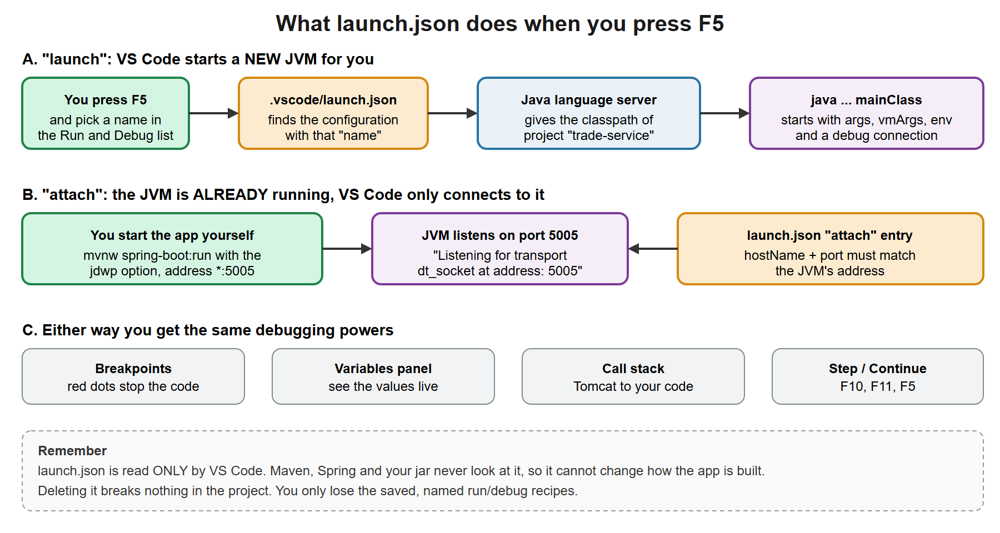](images/12-launch-json-flow.svg)

### Deep dive: `.vscode/launch.json`, value by value

#### A. What is it?

`launch.json` is a settings file for **VS Code's debugger**. It is not Java, not Maven and not Spring. It lives in a folder named `.vscode` inside the folder you opened (`Handson`). Inside it is a list of **configurations**, and each configuration is one recipe: "start (or connect to) a Java program like this, with these options, and let me debug it".

| It is | It is not |
|---|---|
| A VS Code file, read only by VS Code | Read by Maven, Spring Boot, or your jar |
| JSON (VS Code also lets you write `//` comments in it) | A build file. It cannot change how the app is compiled or packaged |
| Per project, and you can commit it to git so teammates get the same recipes | Something the app needs at runtime |

#### B. Why do we need it?

You can already run the app without it (`.\mvnw.cmd spring-boot:run`, or the Run and Debug links the Java extension shows above a `main` method). `launch.json` is worth having because:

1. **One key, same result every time.** F5 starts the app exactly the same way each time. You don't retype long commands.
2. **Options live in one place.** Need a different port, a Spring profile, an environment variable or more memory? You write it once in the recipe (section E below).
3. **Named recipes.** The Run and Debug dropdown lists them by `name`: "run it", "attach to the Maven run", later "run with the dev profile".
4. **It is shareable.** Because `.vscode` is **not** in our `.gitignore`, a teammate who clones the project gets the same buttons.

#### C. How does it work?

Read the picture above together with this list.

- **`launch`** means VS Code starts a **new** Java process for you. It asks the Java language server for the project's classpath (your compiled classes plus the Maven dependencies), then runs `java` with your `mainClass` and a debug connection attached.
- **`attach`** means the Java process is **already running** and VS Code only connects to its debug port. You use this when something else started the app, such as `mvnw spring-boot:run` (Option B under Debug it).

That is the whole mechanism. Breakpoints, the Variables panel, the Call Stack and stepping are the same in both modes.

#### D. Every line of our file, and why it has that value

| Line | What it means | Why we gave this value |
|---|---|---|
| `"version": "0.2.0"` | The version of the `launch.json` file format. | VS Code's own templates use `0.2.0`. Copy it as it is. |
| `"configurations": [ ... ]` | The list of recipes. The Run and Debug dropdown shows one entry per item. | We have two items, so the dropdown has two names. |
| `"type": "java"` | Which debugger extension handles this recipe. | We debug Java, so the Java debugger (part of the Extension Pack for Java). `python` would call the Python debugger. |
| `"name": "Run/Debug TradeService"` | The label you see in the dropdown. | Free text. It must be unique, and it should say what the recipe does. |
| `"request": "launch"` | Start a new JVM. The other allowed value for Java is `attach`. | We want VS Code to start the app. |
| `"mainClass": "com.example.trade.TradeServiceApplication"` | The class whose `main` method starts the program. **Required** for `launch`. | It is the class from Step 2, written with its full package. If the package or name is wrong, the debugger cannot find the class. |
| `"projectName": "trade-service"` | Which project the debugger searches for classes. | It must equal the `artifactId` in `pom.xml`. The extension says this is also required for expression evaluation (typing an expression into the Debug Console). |
| `"request": "attach"` (second recipe) | Connect to a JVM that is already running. | Used with Debug it, Option B. |
| `"hostName": "localhost"` | The machine where that JVM runs. | Your own computer. For a remote server you would write its host name or IP. |
| `"port": 5005` | The debug port of that JVM. | It must equal the `address=*:5005` we passed to the JVM in Option B. 5005 is a common choice, not a rule. Any free port works if both sides agree. |

#### E. What else can you put in a `launch` recipe?

These are the attributes the installed Java debugger (`vscjava.vscode-java-debug` 0.60.0) declares for a `launch` request. Only `mainClass` is required. The descriptions are the extension's own.

| Attribute | What it does | Typical value |
|---|---|---|
| `args` | Command-line arguments passed to your program. | `["--server.port=9091"]` |
| `vmArgs` | Options and system properties for the JVM itself (`-Xmx`, `-D...=...`). | `"-Dserver.port=9091"` |
| `env` | Extra environment variables for the program. | `{ "SERVER_PORT": "9093" }` |
| `envFile` | Absolute path of a file that holds environment variables (default path in the schema is `${workspaceFolder}/.env`). | `"${workspaceFolder}/.env"` |
| `cwd` | The working directory. Default is the workspace root. | `"${workspaceFolder}"` |
| `console` | Where program output goes: `internalConsole`, `integratedTerminal` or `externalTerminal`. | `"integratedTerminal"` |
| `stopOnEntry` | Pause automatically right after launching. | `true` when you want to stop at the first line |
| `classPaths`, `modulePaths` | Replace the automatic classpath. | Leave unset. The debugger resolves them from the project |
| `sourcePaths` | Extra folders to look for source code. | Leave unset for a normal Maven project |
| `javaExec` | Path of a specific `java` program. If unset, the project's JDK is used. | Leave unset |
| `encoding` | Character encoding (schema default `UTF-8`). | Leave unset |
| `shortenCommandLine` | Workaround for very long classpaths on Windows: `none`, `jarmanifest`, `argfile` or `auto`. | Leave at `auto` |
| `stepFilters` | Classes the stepping commands skip (JDK classes, `junit.*` by default). | Leave unset |

For an `attach` recipe the declared attributes are `hostName` (default `localhost`), `port`, `timeout` (milliseconds, default 30000), `projectName`, `sourcePaths` and `stepFilters`.

Inside the braces of a configuration, press `Ctrl+Space` and VS Code lists the attributes the debugger knows, so you never need to guess the spelling.

**Example (verified on the packaged jar):** the same app run with the port changed in three different ways. Each one printed `Tomcat started on port <n>` and answered HTTP on that port.

| How the port is changed | Where it goes in `launch.json` | Result |
|---|---|---|
| Nothing set | nothing | `Tomcat started on port 8080` |
| System property | `"vmArgs": "-Dserver.port=9091"` | `Tomcat started on port 9091` |
| Program argument | `"args": ["--server.port=9092"]` | `Tomcat started on port 9092` |
| Environment variable | `"env": { "SERVER_PORT": "9093" }` | `Tomcat started on port 9093` |

I ran these three ways with the packaged jar (`java -Dserver.port=...`, `java -jar ... --server.port=...` and the `SERVER_PORT` environment variable). The debugger passes `vmArgs`, `args` and `env` to the JVM in the same way, but I did not click F5 in VS Code to prove it. Lesson 02 explains why Spring Boot accepts the same setting from several places and which one wins.

A complete extra recipe you could add after the first one (inside `configurations`) would look like this. It is an illustration, not a file the course needs:

```json
{
  "type": "java",
  "name": "TradeService on port 9091",
  "request": "launch",
  "mainClass": "com.example.trade.TradeServiceApplication",
  "projectName": "trade-service",
  "args": ["--server.port=9091"]
}
```

#### F. How does it affect our project?

- **Build and code: not at all.** `launch.json` is never compiled, packaged or shipped. The jar is identical with or without it.
- **Your daily work: a lot.** It decides what F5 does, so a wrong value shows up as a failed start in the editor, not as a build error.

| Wrong value | What you will see | Fix |
|---|---|---|
| `mainClass` has a typo or wrong package | The debugger cannot find or load the main class | Copy the full name from the `package` line plus the class name in Step 2 |
| `projectName` does not match the `artifactId` | Classes or expression evaluation are not found in the right project | Use the `<artifactId>` from `pom.xml` |
| Port 8080 is busy (an old run is still going) | Spring reports that the web server failed to start because the port was already in use | Stop the old process, or run on another port with `args` as in section E |
| Attach `port` differs from the JVM's `address` | VS Code waits and then fails to connect | Make both numbers the same |
| Invalid JSON (missing comma or brace) | VS Code underlines the error and the recipe is missing from the dropdown | Fix the syntax. The Problems panel points at the line |

#### G. How to create it

Pick one way. All three end with the same file at `Handson\.vscode\launch.json`.

1. **Type it.** In the Explorer click **New File**, type `.vscode/launch.json` and press Enter. VS Code creates the `.vscode` folder for you. Paste the block above and save. This is what the course assumes.
2. **Let VS Code generate it.** Open the **Run and Debug** panel (`Ctrl+Shift+D`) and click **create a launch.json file**. Choose Java if asked. Then replace the generated text with the block above, or keep it and read what it contains.
3. **Add a recipe to an existing file.** Open the file and click **Add Configuration...** at the bottom right. VS Code inserts a template you can edit.

Check it worked: open **Run and Debug**. The dropdown must list **Run/Debug TradeService** and **Attach to mvnw spring-boot:run (port 5005)**.

#### H. What `.gitignore` does

`.gitignore` is read by **git**, not by VS Code or Maven. Each line is a pattern for files git should not track.

| Line | Meaning | Why |
|---|---|---|
| `target/` | The whole Maven output folder | It is rebuilt by `mvnw clean verify`, and it holds a 21 MB jar. Never commit generated files |
| `*.log` | Any file ending in `.log` | Log files change every run and may contain private data |
| `.idea/` | IntelliJ IDEA's project settings | Teammates who use IntelliJ would otherwise commit their personal setup |

Notice what is **not** here: `.vscode/`. We want `launch.json` committed so the run and debug recipes are shared. (Some teams do ignore `.vscode/`. Then every developer writes their own `launch.json`.) The same idea applies to the `.mvn` folder and `mvnw` files: commit them, so everyone builds with the same Maven version.

### Run it

Two ways (verified):

```powershell
.\mvnw.cmd -q spring-boot:run              # during development
java -jar target\trade-service-0.0.1-SNAPSHOT.jar   # the same jar you would deploy
```

Startup log (timings differ):

```
Starting TradeServiceApplication v0.0.1-SNAPSHOT using Java 21.0.12 ...
Tomcat started on port 8080 (http) with context path '/'
Started TradeServiceApplication in 6.108 seconds
```

### Debug it

**Option A, VS Code.** Press `F5` and choose **Run/Debug TradeService**.
1. Set breakpoints (click left of the line number, a red dot appears) at: `TradeController.create`, `TradeService.create`, `InMemoryTradeRepository.save`.
2. Send the POST from step 6.
3. Execution stops in the controller. In the Variables panel, `req` is already a filled-in record: Jackson converted the JSON.
4. Press Continue (`F5`). It stops in the service, then in the repository.
5. Look at the **Call Stack** panel: Tomcat, then `DispatcherServlet`, then your controller. That is the request-flow diagram, live.

**Option B, attach to Maven (verified: the debug port opens).**

```powershell
.\mvnw.cmd spring-boot:run "-Dspring-boot.run.jvmArguments=-agentlib:jdwp=transport=dt_socket,server=y,suspend=n,address=*:5005"
```

It prints `Listening for transport dt_socket at address: 5005`. Then choose **Attach to mvnw spring-boot:run (port 5005)** in VS Code.

**Exercise (10 min).** Stop in `TradeService.create` and read the call stack bottom-up. Count how many frames belong to Spring and Tomcat and how many to your code. That ratio is what Boot saves you from writing.

## 6. Common mistakes

| Mistake | How you recognize it | Fix |
|---|---|---|
| Class in a package outside the main class's package | Endpoint 404, or `NoSuchBeanDefinitionException` | Move it under `com.example.trade` |
| Package line does not match the folder | `package ... does not match expected package` | Make both agree |
| Port 8080 already in use | `Web server failed to start. Port 8080 was already in use.` | Stop the other process or `--server.port=8081` |
| Wrong terminal (cmd instead of PowerShell) | `'pwd' is not recognized...` | Type `powershell` first (see section 4.3) |
| Wrong Java version | `release version 21 not supported` | Use JDK 21 and check `JAVA_HOME` |
| PowerShell `curl` alias | Strange output or errors | Use `curl.exe` |
| JSON quoting broken in PowerShell | HTTP 400 / JSON parse error | Escape quotes as shown, or use Git Bash |
| Business logic in the controller | Impossible to test without HTTP | Move it to the service |
| Treating Boot as "magic" | Cannot explain a surprising behaviour | Run with `--debug` and read the conditions report |

## 7. Production issues and design notes

| Symptom | Root cause | Fix |
|---|---|---|
| Works on my machine, fails in the container | Config hard-coded; environment differs | Externalize config through env vars and profiles (lessons 02, 10) |
| Slow startup in Kubernetes, restart loops | Heavy startup work, no readiness probe | Probes and lazy init (lesson 10) |
| Surprising behaviour after adding a dependency | Auto-configuration kicked in because a class appeared on the classpath | Check the `--debug` conditions report; exclude with `spring.autoconfigure.exclude` |
| Huge image/jar | Every transitive dependency included | Remove unused starters; layered jars (lesson 10) |
| Unhandled exception returns 500 with no useful body | No exception translation | `@RestControllerAdvice` (lesson 03) |
| Dependency vulnerability alerts | Old transitive versions | Upgrade the Boot parent (it manages versions); run dependency scanning |

## 8. Architect lens

- **Boot vs plain Spring:** use Boot unless you have a specific reason not to. Plain Spring is for embedding Spring into an existing app.
- **Boot vs Quarkus/Micronaut:** those start faster and use less memory (compile-time DI, native images). Choose them if cold start or memory dominate cost (serverless, very dense pods). Spring Boot wins on ecosystem, hiring and your team's experience. Spring Boot also supports GraalVM native images, with extra build complexity.
- **Layers are not free:** for a tiny CRUD service three layers can be ceremony. For a trade-settlement domain with rules, the service layer is where the value is.
- **Monolith first:** a Boot app does not have to be a microservice. A modular monolith is often the better start (lesson 07).
- **Version policy:** Boot 3.x needs Java 17+ and uses the `jakarta.*` namespace. Boot 4.x builds on Spring Framework 7. Know the migration cost before you promise an upgrade.

## 9. Self-check quiz

1. What does a Boot "starter" actually contain?
2. What is auto-configuration, and what stops it from overriding your own bean?
3. What is the front controller in Spring MVC?
4. What is inside a Boot executable jar, and what starts first when you run it?
5. Name the layers and one thing each must not do.
6. Why does the controller take `TradeService` in its constructor instead of calling `new`?
7. With only `pom.xml` and the application class, what happens when you call `GET /`?
8. How do you see why a particular auto-configuration was or was not applied?
9. Why does Boot help microservices specifically?
10. Name two reasons to choose something other than Spring Boot.

<details><summary>Answers</summary>

1. Just a `pom` dependency descriptor: a curated set of compatible libraries (for example Tomcat, Spring MVC, Jackson for the web starter). There is almost no code in it.
2. Conditional configuration classes that create default beans based on the classpath and properties. `@ConditionalOnMissingBean` makes them back off when you define the bean.
3. `DispatcherServlet`: a single servlet that receives every request and routes it to the right controller method.
4. Your classes in `BOOT-INF/classes`, dependency jars in `BOOT-INF/lib`, and the launcher classes. `JarLauncher` starts first, then calls the `Start-Class` main method.
5. Web: no business rules or DB access. Service: no HTTP knowledge. Repository: no business rules. Domain: no Spring dependencies.
6. Dependency injection: Spring controls creation, so it can inject the proxied, fully wired instance, and tests can pass a fake.
7. The app starts and returns HTTP 404 with a JSON error body, because no handler is mapped for `/` (you saw this in step 2).
8. Run with `--debug` (or `debug=true`) and read the conditions evaluation report, or use the Actuator `conditions` endpoint (lesson 02).
9. Small self-contained deliverable (one jar), quick start, externalized config, health and metrics endpoints, container friendly.
10. Cold start or memory dominates (use Quarkus/Micronaut or native images); the team already has deep experience in another stack; a tiny function suits a serverless runtime better.

</details>

## 10. Interview Q&A

**Q1. What is Spring Boot and why use it?**
It builds on the Spring Framework. Starters give compatible dependency sets, auto-configuration creates sensible defaults that back off when I define beans, the embedded server makes the deliverable a single jar, and Actuator gives production endpoints. Together that cuts setup, makes services uniform and suits container deployment.

**Q2. Spring vs Spring Boot?**
Spring is the framework (container, DI, AOP, transactions, MVC). Boot is an opinionated layer that configures and packages it. Boot does not replace Spring, and every Spring feature still works.

**Q3. Explain what happens when a Boot app starts.**
The launcher calls `main`. `SpringApplication.run` loads configuration, creates the application context, scans for components, applies auto-configuration, creates and wires the beans, starts the embedded Tomcat, runs the runners and logs "Started...".

**Q4. How does auto-configuration decide what to create?**
Conditions on each auto-config class: class present on the classpath, no user bean of that type, a property enabled. The candidates are listed in an `.imports` file. `--debug` prints the report.

**Q5. How would you structure a Boot service?**
Controller, service, repository, with a domain model. Package by feature once the service grows. The controller stays thin, rules live in the service, and the service depends on repository interfaces.

**Q6. How is this different from EJB?**
The ideas match (container-managed beans, injection, transactions). Spring uses plain objects, runs without an app server, starts fast, tests without a container, and deploys as a jar, so it fits containers and CI better.

**Q7. (Depth you may not have) "Have you built GraalVM native images or used Quarkus?"**
"Not in production. I know native images trade build time and some reflection limits for fast start and low memory, and Quarkus makes that its default. For our bank workloads startup time wasn't the constraint, but I'd evaluate it for serverless or very dense deployments."

## 11. Recap

1. Spring Boot = Spring + starters + auto-configuration + embedded server + Actuator, giving you one runnable jar.
2. Layers: Controller (HTTP) to Service (rules) to Repository (storage), with a domain model; calls go downward only.
3. Startup: launcher, `SpringApplication.run`, scan, auto-configure, wire beans, start Tomcat, ready.
4. Auto-config is conditional and backs off when you define your own bean; `--debug` shows why.
5. Build a new service bottom-up: pom, application class, domain, repository interface and implementation, service, controller, test.
