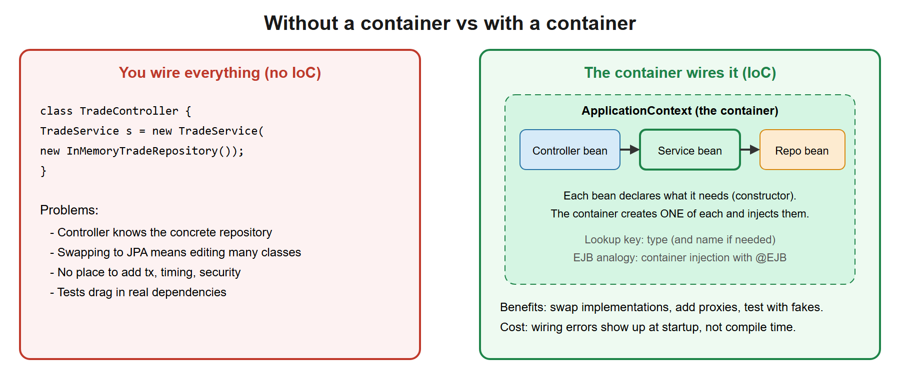
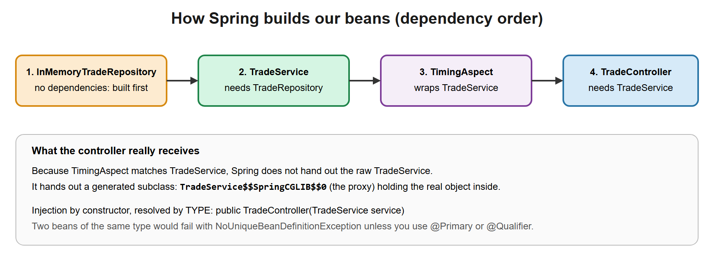
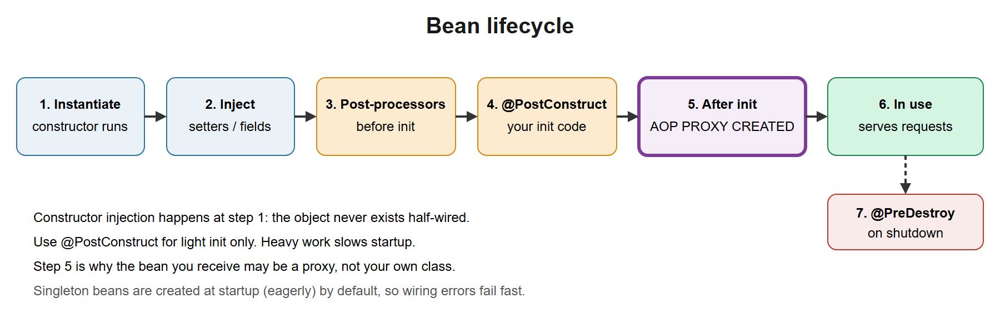
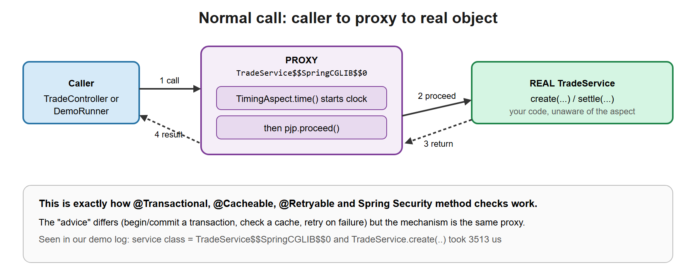
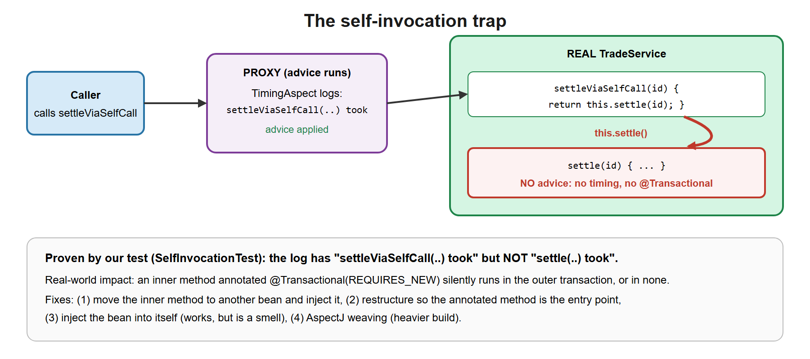

# 01. Spring Core: IoC, DI, AOP

**You build this yourself**, continuing in the same project folder you made in lesson 00. My working copy is [`../../reference/lesson-01`](../../reference/lesson-01). Open it only when you are stuck.

**Starting point:** your project as it was at the end of lesson 00. Not there? Copy everything from `reference/lesson-00` into an empty folder and continue.
**End state:** lesson 00 plus an aspect that times service calls, a demo runner, and two tests that prove how the Spring proxy works.

## 1. Goal and time box

**90 minutes.** After this lesson you can: explain IoC and DI, wire beans with constructor injection, describe the bean lifecycle, explain how Spring AOP uses proxies, and show, with a passing test as proof, why `@Transactional` fails on self-invocation.

## 2. Why it matters

Everything in Spring Boot (transactions, security, caching, retries, metrics) is delivered through the container and proxies. If you understand these two ideas, the rest is configuration.

| You know | Spring equivalent |
|---|---|
| EJB container creates beans and injects with `@EJB` / `@Resource` | Spring container (`ApplicationContext`) creates beans and injects them |
| `ejb-jar.xml` or annotations | `@Component`, `@Bean`, `@Configuration` |
| EJB interceptors (`@AroundInvoke`) | Spring AOP `@Around` advice |
| Container-managed transactions (CMT) | `@Transactional`, implemented through a proxy |
| Heavy container, needs an app server | Lightweight container, runs in a plain JVM |
| Shell batch: a script wires its own steps by hand | The container wires objects for you; you declare what each needs |

## 3. Concepts explained like a teacher

### Inversion of Control (IoC) and Dependency Injection (DI)

Normally your class does `new TradeRepository()`. With **IoC**, your class *declares* what it needs and the framework supplies it. Control over object creation is inverted. **DI** is the mechanism that does it.

[](images/01-container-and-beans.svg)

A **bean** is an object created and managed by the container. The **ApplicationContext** is the container.

| Injection style | Use? |
|---|---|
| Constructor | **Yes, default.** Fields are `final`, the object is always fully built, trivial to unit test |
| Setter | Optional dependencies only |
| Field (`@Autowired` on a field) | Avoid. Hides dependencies, cannot be `final`, needs Spring to test |

**Stereotype annotations:** `@Component` (generic), `@Service`, `@Repository`, `@Controller`. They are all `@Component` with meaning. `@Repository` also translates persistence exceptions.

**Component scanning:** `@SpringBootApplication` scans its own package and sub-packages. A class outside it is invisible. This is the number-one beginner trap.

**Scopes:** `singleton` (default, one per container), `prototype` (new every time), `request`, `session`. A singleton is shared by all threads, so it must be stateless or thread-safe.

### How Spring builds our beans

[](images/02-di-wiring-order.svg)

### Bean lifecycle

[](images/03-bean-lifecycle.svg)

### AOP: Aspect-Oriented Programming

Some concerns cut across many classes: timing, logging, security, transactions. An **aspect** holds that logic. **Advice** is the code (`@Around`, `@Before`, `@After`). A **pointcut** selects which methods. A **join point** is a method execution.

**How Spring AOP works: proxies.** For a bean that matches a pointcut, Spring creates a **proxy** that wraps the real object. Callers receive the proxy. It runs the advice and then calls the real method.

[](images/04-proxy-call-path.svg)

- JDK dynamic proxy: when the bean implements an interface and interface-based proxying is used.
- CGLIB proxy (a generated subclass): Spring Boot's default, which is why proxied classes and methods cannot be `final`.

### The self-invocation trap

If method `a()` in a bean calls `this.b()`, the call goes straight to the real object, not through the proxy. Advice on `b()` (for example `@Transactional`) does not run.

[](images/05-self-invocation-trap.svg)

## 4. Setup steps

1. Open your project folder from lesson 00 in VS Code and a terminal in it.
2. Confirm the starting point still works:

```powershell
.\mvnw.cmd -q clean verify
```

Expected: no output (quiet means success).

3. Set the compare shortcut for this lesson (change the path):

```powershell
$REF = "C:\path\to\springboot-2day\reference\lesson-01"
```

Then, when stuck, compare one file: `fc.exe pom.xml "$REF\pom.xml"`. `FC: no differences encountered` means your file matches mine.

### Files to change or add, in order

| # | File | Change | Why |
|---|---|---|---|
| 1 | `pom.xml` | **edit**: add `spring-boot-starter-aop` | Provides `@Aspect` support (AspectJ) |
| 2 | `aop/TimingAspect.java` | **new** | The cross-cutting logic |
| 3 | `DemoRunner.java` | **new** | Prints the proxy class name at startup |
| 4 | `service/TradeService.java` | **edit**: add `settleViaSelfCall` | Demonstrates the trap |
| 5 | `SelfInvocationTest.java` | **new** | Proves the proxy and the bypass |

Nothing links to `TimingAspect` by name. The container finds it because it is a `@Component` with `@Aspect`, and applies it by pointcut. That is the point of AOP: callers do not know it exists.

## 5. Code walkthrough

This section is a build-along: you write the code yourself, step by step. Where a file already exists, the block shows the **whole file** with the new lines marked `NEW`, so you can replace the file's content.

### Step 1. Add the AOP starter to `pom.xml`

**Do:** open `pom.xml` and add the marked dependency between the web starter and the test starter. The block shows the whole file.

**File:** `pom.xml`
```xml
<?xml version="1.0" encoding="UTF-8"?>
<project xmlns="http://maven.apache.org/POM/4.0.0"
         xmlns:xsi="http://www.w3.org/2001/XMLSchema-instance"
         xsi:schemaLocation="http://maven.apache.org/POM/4.0.0 https://maven.apache.org/xsd/maven-4.0.0.xsd">
  <modelVersion>4.0.0</modelVersion>

  <!-- The parent pins versions of over 1,500 libraries, so we never write versions below. -->
  <parent>
    <groupId>org.springframework.boot</groupId>
    <artifactId>spring-boot-starter-parent</artifactId>
    <version>3.5.16</version>
    <relativePath/>
  </parent>

  <!-- Our project's own identity. -->
  <groupId>com.example</groupId>
  <artifactId>trade-service</artifactId>
  <version>0.0.1-SNAPSHOT</version>
  <name>trade-service</name>

  <properties>
    <java.version>21</java.version>
  </properties>

  <dependencies>
    <!-- Web starter: embedded Tomcat + Spring MVC + Jackson (JSON). -->
    <dependency>
      <groupId>org.springframework.boot</groupId>
      <artifactId>spring-boot-starter-web</artifactId>
    </dependency>

    <!-- AOP starter (NEW in lesson 01): brings AspectJ so we can write @Aspect classes. -->
    <dependency>
      <groupId>org.springframework.boot</groupId>
      <artifactId>spring-boot-starter-aop</artifactId>
    </dependency>

    <!-- Test starter: JUnit 5, AssertJ, Mockito, Spring test support. Only used when testing. -->
    <dependency>
      <groupId>org.springframework.boot</groupId>
      <artifactId>spring-boot-starter-test</artifactId>
      <scope>test</scope>
    </dependency>
  </dependencies>

  <build>
    <plugins>
      <!-- Builds the runnable "fat jar" and adds the spring-boot:run command. -->
      <plugin>
        <groupId>org.springframework.boot</groupId>
        <artifactId>spring-boot-maven-plugin</artifactId>
      </plugin>
    </plugins>
  </build>
</project>
```

**Why:** without this starter there is no `@Aspect` annotation to import. A starter is just a dependency that pulls in the right libraries.

**Checkpoint:** `.\mvnw.cmd -q compile` prints nothing. (The first run downloads AspectJ, which takes a few seconds.)

**Stuck?** *`Non-parseable POM`*: a tag was left unclosed or text was pasted outside a tag. Compare with `fc.exe pom.xml "$REF\pom.xml"`.

### Step 2. The aspect

**File:** `src/main/java/com/example/trade/aop/TimingAspect.java`
```java
package com.example.trade.aop;

import org.aspectj.lang.ProceedingJoinPoint;
import org.aspectj.lang.annotation.Around;
import org.aspectj.lang.annotation.Aspect;
import org.slf4j.Logger;
import org.slf4j.LoggerFactory;
import org.springframework.stereotype.Component;

// A cross-cutting concern (timing) kept out of business code. Spring wraps TradeService in a PROXY;
// callers get the proxy, which runs this advice around the real method.
@Aspect
@Component
public class TimingAspect {
    private static final Logger log = LoggerFactory.getLogger(TimingAspect.class);

    @Around("execution(* com.example.trade.service..*(..))")
    public Object time(ProceedingJoinPoint pjp) throws Throwable {
        long start = System.nanoTime();
        try {
            return pjp.proceed();
        } finally {
            log.info("{} took {} us", pjp.getSignature().toShortString(), (System.nanoTime() - start) / 1000);
        }
    }
}
```

**Why, line by line:**
- `@Aspect` marks the class as an aspect; `@Component` makes it a bean so the container finds it.
- `@Around(...)` is the advice type: it runs *around* the target method. The text in quotes is the **pointcut**: "every method of every class in the `service` package".
- `pjp.proceed()` calls the real method. Code before it runs before the method, code in `finally` runs after, even on an exception.
- We rethrow nothing and swallow nothing: exceptions pass through untouched.

**Checkpoint:** `.\mvnw.cmd -q compile`, silent.

**Stuck?** *`package org.aspectj.lang does not exist`*: Step 1 was not saved, or the dependency is outside the `<dependencies>` tag.

### Deep dive: Spring AOP and AspectJ, the framework behind `@Aspect`

Step 1 added `spring-boot-starter-aop`, which brought a new library, **AspectJ**. This section explains what it is, why we need it, what you can write with it and what you cannot.

#### A. What is it, and who is who?

| Name | What it is |
|---|---|
| **AOP** (aspect-oriented programming) | A programming idea: write a cross-cutting concern (timing, security, transactions, logging) **once**, and say declaratively where it applies, instead of copying it into every method. |
| **AspectJ** | The original, complete AOP language and compiler for Java (2001). It can change the bytecode itself, at compile time or class-load time ("weaving"). |
| **Spring AOP** | Spring's own, simpler AOP. It uses **runtime proxies** and supports only *method execution* on Spring beans. It **borrows AspectJ's annotations** (`@Aspect`, `@Around`) and its pointcut expression language, but does **not** use the AspectJ compiler. |
| `spring-boot-starter-aop` | The dependency that brings `spring-aop` plus the `aspectjweaver` library (which parses the annotations and pointcut text). Boot then auto-configures the proxy creator. |

#### B. Why do we need it?

Without AOP, timing every service method means a `try/finally` with `System.nanoTime()` in each of them: the business rule is buried, the code is repeated, and a new method can forget it. AOP removes the repetition. It is also how Spring delivers `@Transactional`, `@Cacheable`, `@Async` and `@PreAuthorize`: all of them are aspects applied through a proxy, so understanding this one picture explains them all.

#### C. Vocabulary, mapped to our `TimingAspect`

| Term | Meaning | In our file |
|---|---|---|
| **Aspect** | A class holding cross-cutting logic. | `TimingAspect` (`@Aspect`) |
| **Join point** | A point in execution where advice *could* run. In Spring AOP: a **method execution** only. | each call to a `TradeService` method |
| **Pointcut** | A predicate that selects join points. | `execution(* com.example.trade.service..*(..))` |
| **Advice** | The code to run at the selected join points. | the method `time(...)` |
| **Target** | The real object being wrapped. | the real `TradeService` |
| **Proxy** | The object Spring hands out instead of the target. | a generated `TradeService$$SpringCGLIB$$0` |
| **Weaving** | Linking aspects to targets. Spring does it at startup by creating proxies. | `AnnotationAwareAspectJAutoProxyCreator` (a bean post-processor) |

#### D. The five kinds of advice

| Annotation | Runs | Can it change the result? | Typical use |
|---|---|---|---|
| `@Before` | Before the method. | No (it can throw to stop the call). | Argument checks, audit "who called". |
| `@AfterReturning` | After a **normal** return. | It can read the result (`returning = "r"`), not replace it. | Audit of successful operations. |
| `@AfterThrowing` | After an **exception**. | It can read the exception (`throwing = "ex"`). | Alerting, translating failures. |
| `@After` | After the method, **always** (like `finally`). | No. | Cleanup. |
| `@Around` | Around the call; **you** decide whether and when to call `pjp.proceed()`. | **Yes**: change arguments, result or skip the call. | Timing, retry, caching, transactions. The most powerful, so use the weakest advice that does the job. |

#### E. Pointcut expressions: the syntax

```text
execution( modifiers? return-type  declaring-type? method-name ( params ) throws? )
```

Wildcards: `*` matches any one name or type, `..` matches any number of packages (in a type pattern) or any number of arguments (in a parameter list).

| Expression | Selects |
|---|---|
| `execution(* com.example.trade.service.*.*(..))` | Every method of every class **directly** in `service`. |
| `execution(* com.example.trade.service..*(..))` | Every method in `service` **and its sub-packages** (what we use). |
| `execution(public * *(..))` | Every public method. |
| `execution(* settle*(..))` | Methods whose name starts with `settle`. |
| `execution(* *(Long))` | Methods with exactly one `Long` argument. |
| `within(com.example.trade.service..*)` | Every join point inside those types (like `execution(* ..*(..))` for the package). |
| `@annotation(org.springframework.transaction.annotation.Transactional)` | Methods that carry that annotation. |
| `@within(org.springframework.stereotype.Service)` | Methods of classes annotated `@Service`. |
| `bean(tradeService)` | The Spring bean with that name (a Spring-only extra). |
| `this(...)`, `target(...)`, `args(...)` | Match on the proxy type, target type or argument types; `args` can also **bind** arguments to advice parameters. |

Combine with `&&`, `||`, `!`. Give a pointcut a name with `@Pointcut("execution(...)") void inService() {}` and reuse it as `@Around("inService()")`.

#### F. What Spring AOP cannot do (and what then)

| Limit | Consequence | If you need it |
|---|---|---|
| Only **method execution** | No field access, constructor or static-method advice. | Full AspectJ with a compile-time or load-time weaver (`aspectj-maven-plugin`), rarely used. |
| Only **Spring beans** | Objects created with `new` are not advised. | Make it a bean. |
| Only calls that go **through the proxy** | Self-invocation (`this.b()`) bypasses advice: the trap in this lesson. | Move `b()` to another bean, or inject the bean into itself. |
| **CGLIB** subclass proxies | `final` classes and `final` methods cannot be advised; `private` methods are not seen. | Remove `final`; make the method public. |
| Cost | Each advised call adds a small, fixed overhead. | Fine for services; avoid advising tiny methods in tight loops. |

**Options you did not use** (Spring Boot property, in `application.yml`): `spring.aop.proxy-target-class` (default `true`: always CGLIB, even when the bean implements an interface; set `false` for JDK interface proxies) and `spring.aop.auto` (default `true`: turn automatic proxying off with `false`).

**Order of several aspects:** put `@Order(n)` on each aspect class; lower runs first (outermost). `@Transactional` has its own order, which matters when your aspect and a transaction must nest in a specific way.

### Step 3. A runner that calls the service at startup

**File:** `src/main/java/com/example/trade/DemoRunner.java`
```java
package com.example.trade;

import com.example.trade.service.TradeService;
import java.math.BigDecimal;
import org.slf4j.Logger;
import org.slf4j.LoggerFactory;
import org.springframework.boot.CommandLineRunner;
import org.springframework.stereotype.Component;

// Runs once at startup, so we can SEE the container wiring work without a web layer yet.
@Component
public class DemoRunner implements CommandLineRunner {
    private static final Logger log = LoggerFactory.getLogger(DemoRunner.class);
    private final TradeService service;

    public DemoRunner(TradeService service) { this.service = service; }

    @Override
    public void run(String... args) {
        log.info("service class = {}", service.getClass().getSimpleName()); // shows the CGLIB proxy
        var t = service.create("US0378331005", new BigDecimal("100"), new BigDecimal("189.50"));
        log.info("created {}", t);
        log.info("settled {}", service.settle(t.id()));
    }
}
```

**Why:** a `CommandLineRunner` bean is called by Spring Boot once the context is ready. Here it asks the container for `TradeService` (constructor injection again) and prints the *class name of what it received*.

**Checkpoint:** run it without the web server:

```powershell
.\mvnw.cmd -q spring-boot:run "-Dspring-boot.run.arguments=--spring.main.web-application-type=none"
```

Expected (verified; timestamps removed, timings vary):

```
DemoRunner : service class = TradeService$$SpringCGLIB$$0
TimingAspect : TradeService.create(..) took 3513 us
DemoRunner : created Trade[id=1, isin=US0378331005, quantity=100, price=189.50, status=NEW]
TimingAspect : TradeService.settle(..) took 440 us
DemoRunner : settled Trade[id=1, isin=US0378331005, quantity=100, price=189.50, status=SETTLED]
```

Read the first line: the class is **not** `TradeService` but `TradeService$$SpringCGLIB$$0`. That generated class is the **proxy**.

**Stuck?**
- *No `TimingAspect` lines*: the pointcut package text is wrong or the starter is missing.
- *`service class = TradeService`*: the aspect was not applied, so no proxy was created. Check `@Aspect @Component` and the starter.
- The app exits after printing: correct, because there is no web server in this mode.

### Step 4. Add the method that demonstrates the trap

**Do:** replace the content of `TradeService.java` with the version below. The only addition is the `settleViaSelfCall` method.

**File:** `src/main/java/com/example/trade/service/TradeService.java`
```java
package com.example.trade.service;

import com.example.trade.domain.Trade;
import com.example.trade.domain.TradeStatus;
import com.example.trade.repo.TradeRepository;
import java.math.BigDecimal;
import org.springframework.stereotype.Service;

@Service
public class TradeService {

    private final TradeRepository repository;

    // Constructor injection: single constructor, so no @Autowired needed (since Spring 4.3).
    // The field is final, so the service can never exist half-wired, and unit tests can call new TradeService(fake).
    public TradeService(TradeRepository repository) {
        this.repository = repository;
    }

    public Trade create(String isin, BigDecimal quantity, BigDecimal price) {
        return repository.save(new Trade(null, isin, quantity, price, TradeStatus.NEW));
    }

    // DEMO of the self-invocation trap: the inner this.settle(id) call goes straight to the real
    // object, NOT through the Spring proxy, so TimingAspect never sees it (and neither would @Transactional).
    public Trade settleViaSelfCall(Long id) {
        return this.settle(id);
    }

    public Trade settle(Long id) {
        Trade t = repository.findById(id)
                .orElseThrow(() -> new IllegalArgumentException("Trade not found: " + id));
        return repository.save(t.withStatus(TradeStatus.SETTLED));
    }
}
```

**Why:** `settleViaSelfCall` calls `this.settle(...)`. `this` is the **real** object, not the proxy, so the aspect cannot see the inner call.

**Checkpoint:** `.\mvnw.cmd -q compile`, silent.

### Step 5. A test that proves both facts

**File:** `src/test/java/com/example/trade/SelfInvocationTest.java`
```java
package com.example.trade;

import static org.assertj.core.api.Assertions.assertThat;

import com.example.trade.service.TradeService;
import java.math.BigDecimal;
import org.junit.jupiter.api.Test;
import org.springframework.aop.support.AopUtils;
import org.springframework.beans.factory.annotation.Autowired;
import org.springframework.boot.test.context.SpringBootTest;
import org.springframework.boot.test.system.CapturedOutput;
import org.springframework.boot.test.system.OutputCaptureExtension;
import org.junit.jupiter.api.extension.ExtendWith;

// Needs the Spring context (unlike TradeServiceTest) because we are testing the PROXY itself.
@SpringBootTest(properties = "spring.main.web-application-type=none")
@ExtendWith(OutputCaptureExtension.class)
class SelfInvocationTest {

    @Autowired TradeService service;

    @Test
    void injectedBeanIsAProxy() {
        assertThat(AopUtils.isAopProxy(service)).isTrue();
    }

    @Test
    void selfCallBypassesTheAspect(CapturedOutput output) {
        var t = service.create("US0378331005", BigDecimal.TEN, BigDecimal.ONE);
        int mark = output.getOut().length();            // ignore everything logged so far

        service.settleViaSelfCall(t.id());

        String after = output.getOut().substring(mark);
        assertThat(after).contains("TradeService.settleViaSelfCall(..) took"); // outer call: through proxy
        assertThat(after).doesNotContain("TradeService.settle(..) took");      // inner call: bypassed
    }
}
```

**Why:**
- `@SpringBootTest` starts the real container, so the test gets the same proxy the app gets (`@Autowired` = "inject this field", fine in tests).
- `AopUtils.isAopProxy(service)` is a one-line proof that the injected object is a proxy.
- The second test captures what was logged. The *outer* call shows up in the aspect's log; the *inner* `settle` call does not.

**Checkpoint:**

```powershell
.\mvnw.cmd clean verify
```

Expected (verified), among other lines:

```
Tests run: 2, Failures: 0, Errors: 0, Skipped: 0 -- in com.example.trade.SelfInvocationTest
Tests run: 1, Failures: 0, Errors: 0, Skipped: 0 -- in com.example.trade.TradeServiceTest
Tests run: 3, Failures: 0, Errors: 0, Skipped: 0
BUILD SUCCESS
```

A harmless line `Mockito is currently self-attaching...` also appears on Java 21; lesson 06 explains it.

**Stuck?**
- *`NoSuchBeanDefinitionException` for `TradeService`*: the test is in the wrong package, or your main class is outside `com.example.trade`.
- *`doesNotContain` fails*: you may have used `settle` in the demo runner during the same test run. The `mark` makes the test look only at output after the call; check you kept that line.
- *Test passes but aspect log missing in console*: logging output is captured by the test; that is expected.

### Run it

You already ran it in step 3. The web version also still works: `.\mvnw.cmd -q spring-boot:run`, then the two curl calls from lesson 00. In that mode the demo runner also logs the proxy line and the two timings at startup.

### Debug it

Press `F5` and choose **Run/Debug TradeService** (the `launch.json` from lesson 00).

1. Put a breakpoint on the line `return pjp.proceed();` in `TimingAspect`.
2. Press `F5`. `DemoRunner` calls the service at startup, so you stop immediately.
3. Look at the **Call Stack** panel: the frames just below `TimingAspect.time` are `TradeService$$SpringCGLIB$$0.create`, then `DemoRunner.run`. You are standing inside the proxy.
4. Step into (`F11`) `pjp.proceed()` and you land in the real `TradeService.create`.
5. Now add a breakpoint in `TradeService.settle`. Right-click the test method `selfCallBypassesTheAspect` and choose *Debug Test*. Compare the call stacks: for the normal calls there is an aspect frame above the service method; when `settle` is reached from `settleViaSelfCall`, its caller is `settleViaSelfCall` directly, with no aspect frame in between.

**Exercise (5 min).** In `SelfInvocationTest`, change `doesNotContain("TradeService.settle(..) took")` to `contains(...)` and run the tests. It fails. Read the failure message: it shows the captured log with no `settle(..)` line. Change it back.

## 6. Common mistakes

| Mistake | How you notice | Fix |
|---|---|---|
| Class outside the main package | `NoSuchBeanDefinitionException` / `UnsatisfiedDependencyException` | Move it under the `@SpringBootApplication` package |
| Two implementations of one interface | `NoUniqueBeanDefinitionException` | `@Primary` or `@Qualifier("name")` |
| `new TradeService(...)` in Spring code | Aspect and `@Transactional` silently do nothing | Always inject; never `new` a bean |
| Field injection | Cannot unit test without Spring | Constructor injection |
| Mutable state in a singleton | Wrong data under concurrent requests | Keep beans stateless |
| Circular dependency A to B to A | Startup failure (forbidden by default since Boot 2.6) | Redesign; extract a third bean |
| `final` class or method with an aspect | Advice skipped or proxy error | Remove `final` |
| Pointcut too broad | Aspect logs everything, performance noise | Narrow to a package or an annotation |

## 7. Production issues and design notes

| Symptom | Root cause | Fix |
|---|---|---|
| `@Transactional` has no effect, data not rolled back | Self-invocation (proven above) or non-public method | Call through another bean; keep annotated methods public and called from outside |
| Request data leaks between users | State stored in a singleton field | Stateless beans; pass data through parameters |
| Slow startup | Large scan or heavy `@PostConstruct` | Narrow scanning, lazy init, move work to async or readiness |
| Aspect adds latency or noise | Pointcut too broad (`execution(* *(..))`) | Narrow it |
| Aspect swallows exceptions | `catch` without rethrow in `@Around` | Always rethrow, or use `finally` as above |
| Surprising bean replaced in tests or prod | Two beans, `@Primary` picked the wrong one | Prefer explicit `@Qualifier`; check with the Actuator `beans` endpoint (lesson 02) |

## 8. Architect lens

- Use AOP for true cross-cutting concerns (transactions, security, metrics, audit). **Do not** hide business rules in aspects, because the flow becomes impossible to follow.
- Proxy-based AOP only intercepts calls entering a bean from outside. To intercept self-calls or non-Spring objects you need AspectJ weaving, which costs build and operational complexity.
- Prefer explicit code over magic where the behaviour is a business rule.
- DI is also a design tool: depend on interfaces at module boundaries for testability and replaceable adapters (in-memory repository now, JPA in lesson 04).
- **When NOT to use AOP:** logic that must be visible in code review, logic with ordering that matters between several aspects, or a hot path where proxy overhead matters (rare, but measure first).

## 9. Self-check quiz

1. What is the difference between IoC and DI?
2. Why is constructor injection preferred?
3. Where does component scanning start?
4. What is the default bean scope, and what does it imply for state?
5. At which lifecycle phase is the AOP proxy created?
6. JDK proxy vs CGLIB: when is each used?
7. Why does `this.method()` skip `@Transactional`?
8. Two beans implement one interface. What error do you get, and how do you fix it?
9. What does the `service class = ...` line in our demo output prove?
10. Which assertion in `SelfInvocationTest` proves the bypass?

<details><summary>Answers</summary>

1. IoC is the principle (the container controls creation and wiring); DI is the mechanism (dependencies are passed in).
2. Final fields, always-valid objects, explicit dependencies, unit tests without Spring, circular dependencies surface early.
3. The package of the `@SpringBootApplication` class and its sub-packages.
4. Singleton: one shared instance per container, so the bean must be stateless or thread-safe.
5. After initialization, in `BeanPostProcessor.postProcessAfterInitialization`.
6. JDK proxy for interface-based proxying; CGLIB (subclass) otherwise. Boot defaults to CGLIB.
7. The call stays inside the real object and never goes through the proxy that holds the advice.
8. `NoUniqueBeanDefinitionException`; use `@Primary`, `@Qualifier`, or inject a specific type.
9. The injected object is a generated CGLIB subclass, which is the proxy, so advice is applied.
10. `doesNotContain("TradeService.settle(..) took")`: the inner call produced no timing log.

</details>

## 10. Interview Q&A

**Q1. Explain how Spring AOP works.**
Spring wraps beans that match a pointcut in a runtime proxy (JDK or CGLIB). The proxy runs the advice around calls from other beans. Limitations: only calls entering through the proxy are intercepted (self-invocation is not), and only Spring-managed beans.

**Q2. Why constructor injection?**
Immutability, mandatory dependencies, easy tests, and cycles are detected at startup.

**Q3. `@Component` vs `@Bean`?**
`@Component` marks my own class for scanning. `@Bean` is a factory method in a `@Configuration` class, used for third-party classes or conditional or custom construction.

**Q4. Walk me through the bean lifecycle.**
Instantiate, inject, post-processors before init, `@PostConstruct`, post-processors after init (proxies), ready, `@PreDestroy`.

**Q5. Is a singleton bean thread-safe?**
No. Singleton means one instance, not safety. Keep it stateless, or synchronize, or use thread-safe structures.

**Q6. Why did my `@Transactional` not roll back?**
Common causes: self-invocation (the call bypassed the proxy), a non-public method, a checked exception (rollback is only for unchecked by default), or the exception was caught inside the method. I can demonstrate the self-invocation case with a test.

**Q7. How is this different from EJB?**
Same ideas (container-managed lifecycle, injection, interceptors, transactions) but lightweight, POJO-based, no app server, and tests run without a container. I used EJB CMT for years; `@Transactional` is the same model implemented through proxies.

**Q8. (Depth you may not have) "Have you used AspectJ weaving?"**
"I've used Spring proxy-based AOP and EJB interceptors. I haven't used compile-time or load-time weaving in production. I know it's needed to intercept self-calls or non-Spring objects, and I'd weigh that against the build complexity."

## 11. Recap

1. The container creates and wires beans; you declare dependencies, preferably in constructors.
2. `@SpringBootApplication` scans its package downward; anything outside is invisible.
3. Singleton beans are shared by threads, so keep them stateless.
4. AOP = proxies: callers get `TradeService$$SpringCGLIB$$0`, which runs advice then the real method.
5. Self-invocation bypasses the proxy, so `@Transactional` and aspects silently do not apply (proven by `SelfInvocationTest`).
