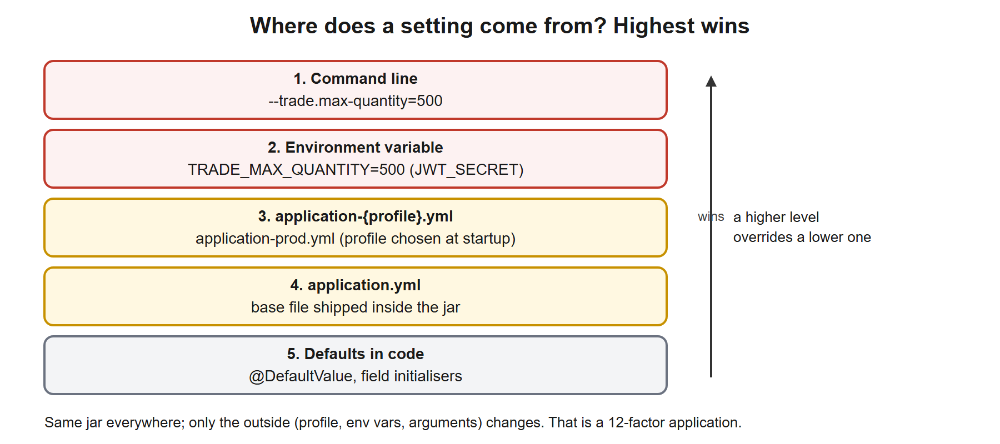
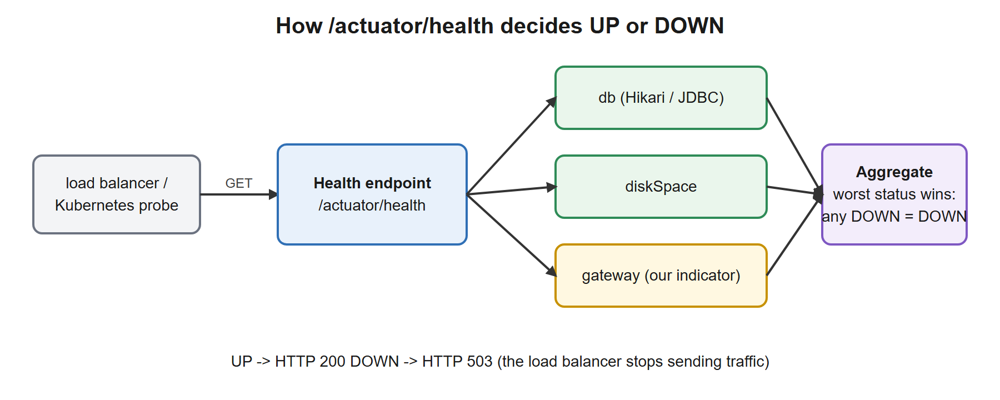

# 02. Boot Internals, Configuration, Actuator

**You build this yourself**, continuing in the same project folder you used in lessons 00 and 01. My working copy is [`../../reference/lesson-02`](../../reference/lesson-02). Open it only when you are stuck.

**Starting point:** your project as it was at the end of lesson 01. Not there? Copy everything from `reference/lesson-01` into an empty folder and continue.
**End state:** lesson 01 plus externalised configuration (`application.yml` with `dev` and `prod` profiles), a type-safe `TradeProperties`, a custom health indicator, a conditional bean, and Actuator endpoints. Fifteen tests pass.

## 1. Goal and time box

**90 minutes.** After this lesson you can: explain what `@SpringBootApplication` and auto-configuration do and why they "back off" when you define your own bean; read the conditions report to find out why something was or was not configured; bind and validate configuration with `@ConfigurationProperties`; switch behaviour with profiles and environment variables; and expose, secure and extend Actuator health for Kubernetes.

## 2. Why it matters

Lessons 00 and 01 showed that Boot assembles an application for you. This lesson shows *how it decides* what to assemble, and how the same jar runs on a laptop, in test and in production with nothing but outside settings changed. Interviewers use this topic to separate people who have used Boot from people who understand it.

| You know | Spring Boot equivalent |
|---|---|
| App server domain config per environment (WebLogic, WebSphere), JNDI environment entries | `application.yml` plus profiles plus environment variables, no app server involved |
| `ejb-jar.xml` / `web.xml` deployment descriptors | Annotations plus `application.yml` |
| Batch job parameters: `.properties` per environment, `-Dkey=value` | Same idea: `--key=value` on the command line, `KEY` as environment variable |
| JMX beans, monitoring scripts that poll a status page | Actuator endpoints (`/actuator/health`, `/actuator/metrics`) |
| Elasticsearch cluster health: green / yellow / red | Health status: `UP` / `DOWN` (plus custom statuses), aggregated across components |
| "Is the SWIFT link up?" check before processing | A `HealthIndicator` bean, used by the load balancer or Kubernetes |

## 3. Concepts explained like a teacher

### What `@SpringBootApplication` really does

It is three annotations in one: `@Configuration` (this class can define beans), `@ComponentScan` (find my `@Component`s below this package), and `@EnableAutoConfiguration` (**the magic**).

### Auto-configuration: conditional beans that back off

Inside `spring-boot-autoconfigure.jar` there are hundreds of ordinary `@Configuration` classes: one for the DataSource, one for Jackson, one for Tomcat, and so on. A file in that jar lists them all. At startup Boot reads the list and evaluates each class, but **every one is guarded by conditions**:

| Condition | Meaning | Example |
|---|---|---|
| `@ConditionalOnClass` | only if this class is on the classpath | JPA setup only if Hibernate is there |
| `@ConditionalOnMissingBean` | only if *you* have not defined this bean | **the "back off" rule**: your bean wins |
| `@ConditionalOnProperty` | only if a property has a value | our `AuditLogger` below |
| `@ConditionalOnWebApplication` | only in a web app | lesson 05 uses this |

That is why adding a starter to `pom.xml` is enough: the jar arrives, the condition becomes true, the beans appear. And it is why defining your own `ObjectMapper` replaces Boot's: the `@ConditionalOnMissingBean` check now fails.

**Proof, not opinion.** The conditions report from our own application (you will fetch it in step 5):

```
NEGATIVE  DataSourceAutoConfiguration : @ConditionalOnClass did not find required class
          'org.springframework.jdbc.datasource.embedded.EmbeddedDatabaseType'
NEGATIVE  GsonAutoConfiguration       : @ConditionalOnClass did not find required class 'com.google.gson.Gson'
NEGATIVE  KafkaAutoConfiguration      : @ConditionalOnClass did not find required class '...KafkaTemplate'
POSITIVE  JacksonAutoConfiguration    : @ConditionalOnClass found required class 'com.fasterxml.jackson.databind.ObjectMapper'
```

We have no database library yet, so there is no DataSource. In lesson 04 we add `h2` and `spring-boot-starter-data-jpa`, and the same report flips to positive. Nothing else changes.

### Where does a setting come from? Property sources and precedence

[](images/01-config-precedence.svg)

Higher wins. This one rule explains most "why is my value ignored?" problems. Two helpful facts:

- **Relaxed binding.** These all set the same property: `trade.max-quantity` (yml), `--trade.max-quantity=5` (argument), `TRADE_MAX_QUANTITY=5` (environment variable, as Linux and Kubernetes need it).
- **Profiles.** `application-prod.yml` is loaded *in addition to* `application.yml` when the `prod` profile is active, and its keys win. Activate with `--spring.profiles.active=prod` or the `SPRING_PROFILES_ACTIVE` environment variable. We set `spring.profiles.default: dev` so a plain run behaves as development.

Use profiles for *sets of behaviour* (verbose logging, which endpoints are open). Do **not** put secrets or hostnames in profile files in the repository: inject those from the environment (lesson 05 does this for the JWT secret).

### `@Value` or `@ConfigurationProperties`?

| | `@Value("${trade.venue}")` | `@ConfigurationProperties(prefix = "trade")` |
|---|---|---|
| Scope | one field at a time | a whole group, as one typed object |
| Validation | none | Bean Validation at startup (`@Validated`) |
| Testing | needs Spring | `new TradeProperties(...)`: it is just a record |
| Metadata for IDE help | no | yes (and Actuator shows the group) |

Prefer `@ConfigurationProperties` for anything beyond a one-off. A missing or invalid value then **stops startup with a clear message** instead of failing at 3 a.m.

### Actuator: the application describes itself

[](images/02-health-aggregation.svg)

Actuator adds HTTP endpoints for operations: `health`, `info`, `metrics`, `beans`, `conditions`, `configprops`, `env`, `mappings`, `loggers`, `threaddump`.

- **Existing is not the same as exposed.** Most endpoints exist but only `health` is exposed over HTTP by default. `management.endpoints.web.exposure.include` controls what is reachable. We open everything in `dev` and only `health,info` in `prod`.
- **Health aggregates.** Every `HealthIndicator` bean contributes; the worst status wins. `DOWN` is returned as HTTP **503**, which is exactly what a load balancer needs.
- **Liveness and readiness** (Kubernetes): *liveness* asks "should you restart me?", *readiness* asks "should you send me traffic?". Enabled with `management.endpoint.health.probes.enabled=true` (our `prod` file). Do **not** put external dependencies (the database, the SWIFT gateway) into *liveness*: a dependency outage would make Kubernetes restart healthy pods in a loop. Dependencies belong in readiness.
- **Secrets are masked.** Boot 3 replaces the values in `/env` and `/configprops` with `******` by default (we will see it). Good. It does not make exposing them to the internet acceptable: lesson 05 puts every endpoint except health and info behind the `ADMIN` role.

## 4. Setup steps

1. Open your project folder in VS Code and a terminal in it.
2. Confirm the starting point still works:

```powershell
.\mvnw.cmd -q clean verify
```

Expected: no output.

3. Set the compare shortcut for this lesson (change the path):

```powershell
$REF = "C:\path\to\springboot-2day\reference\lesson-02"
```

When stuck, compare one file: `fc.exe pom.xml "$REF\pom.xml"`. `FC: no differences encountered` means identical.

### Files to change or add, in order

| # | File | Change | Why |
|---|---|---|---|
| 1 | `pom.xml` | **edit**: add `actuator` and `validation` starters | Endpoints, and Bean Validation for configuration |
| 2 | `src/main/resources/application.yml` | **new** | Base configuration, applies everywhere |
| 3 | `src/main/resources/application-dev.yml` | **new** | Developer profile: open and chatty |
| 4 | `src/main/resources/application-prod.yml` | **new** | Production profile: minimal and quiet |
| 5 | `config/TradeProperties.java` | **new** | Type-safe, validated settings |
| 6 | `TradeServiceApplication.java` | **edit**: `@ConfigurationPropertiesScan` | Registers the properties class |
| 7 | `service/TradeService.java` | **edit**: use the limit | The setting does real work |
| 8 | `test/.../TradeServiceTest.java` | **edit** | Constructor changed |
| 9 | `health/GatewayStatus.java`, `health/GatewayHealthIndicator.java` | **new** | A custom health contributor |
| 10 | `audit/AuditLogger.java` | **new** | A conditional bean |
| 11 | `ConfigurationTest`, `ActuatorTest`, `ConditionalBeanTest` | **new** tests | Prove all of it |

## 5. Code walkthrough

A build-along. Where a file already exists, the block shows the **whole file** with the changes inside, so you can replace its content.

### Step 1. Add the Actuator and validation starters

**Do:** open `pom.xml` and add the two marked dependencies. The block shows the whole file.

**File:** `pom.xml`
```xml
<?xml version="1.0" encoding="UTF-8"?>
<project xmlns="http://maven.apache.org/POM/4.0.0"
         xmlns:xsi="http://www.w3.org/2001/XMLSchema-instance"
         xsi:schemaLocation="http://maven.apache.org/POM/4.0.0 https://maven.apache.org/xsd/maven-4.0.0.xsd">
  <modelVersion>4.0.0</modelVersion>

  <!-- The parent pins versions of over 1,500 libraries, so we never write versions below. -->
  <parent>
    <groupId>org.springframework.boot</groupId>
    <artifactId>spring-boot-starter-parent</artifactId>
    <version>3.5.16</version>
    <relativePath/>
  </parent>

  <!-- Our project's own identity. -->
  <groupId>com.example</groupId>
  <artifactId>trade-service</artifactId>
  <version>0.0.1-SNAPSHOT</version>
  <name>trade-service</name>

  <properties>
    <java.version>21</java.version>
  </properties>

  <dependencies>
    <!-- Web starter: embedded Tomcat + Spring MVC + Jackson (JSON). -->
    <dependency>
      <groupId>org.springframework.boot</groupId>
      <artifactId>spring-boot-starter-web</artifactId>
    </dependency>

    <!-- AOP starter (lesson 01): brings AspectJ so we can write @Aspect classes. -->
    <dependency>
      <groupId>org.springframework.boot</groupId>
      <artifactId>spring-boot-starter-aop</artifactId>
    </dependency>

    <!-- Actuator (NEW in lesson 02): /actuator/health, /actuator/beans, /actuator/conditions, metrics... -->
    <dependency>
      <groupId>org.springframework.boot</groupId>
      <artifactId>spring-boot-starter-actuator</artifactId>
    </dependency>

    <!-- Validation starter (NEW in lesson 02): Bean Validation (jakarta.validation) + Hibernate Validator.
         Lesson 02 uses it to validate configuration; lesson 03 uses it to validate request bodies. -->
    <dependency>
      <groupId>org.springframework.boot</groupId>
      <artifactId>spring-boot-starter-validation</artifactId>
    </dependency>

    <!-- Test starter: JUnit 5, AssertJ, Mockito, Spring test support. Only used when testing. -->
    <dependency>
      <groupId>org.springframework.boot</groupId>
      <artifactId>spring-boot-starter-test</artifactId>
      <scope>test</scope>
    </dependency>
  </dependencies>

  <build>
    <plugins>
      <!-- Builds the runnable "fat jar" and adds the spring-boot:run command. -->
      <plugin>
        <groupId>org.springframework.boot</groupId>
        <artifactId>spring-boot-maven-plugin</artifactId>
      </plugin>
    </plugins>
  </build>
</project>
```

**Why:** `spring-boot-starter-actuator` brings the endpoints. `spring-boot-starter-validation` brings Bean Validation (`jakarta.validation`) with Hibernate Validator as the implementation; we use it for configuration now and for request bodies in lesson 03.

**Checkpoint:** `.\mvnw.cmd -q compile` prints nothing.

**Stuck?** *`package jakarta.validation.constraints does not exist` later*: the validation starter is missing or outside `<dependencies>`.

### Step 2. The three configuration files

`application.yml` is the base. Create the `resources` folder if it does not exist (it sits next to `java` under `src/main`).

**File:** `src/main/resources/application.yml`
```yaml
# Base configuration: applies in every profile. Profile files (application-dev.yml, application-prod.yml)
# are layered on top and win when the same key appears in both.
spring:
  application:
    name: trade-service
  profiles:
    default: dev          # used only when no profile is activated explicitly

# Our own settings, bound to the TradeProperties record (prefix "trade").
trade:
  max-quantity: 1000000
  venue: XLON

# Custom switch for the conditional bean in lesson 02.
audit:
  enabled: false

# Actuator: expose only what is safe by default; the dev profile opens more.
management:
  endpoints:
    web:
      exposure:
        include: health,info
  info:
    env:
      enabled: true       # publish the "info.*" keys below at /actuator/info

info:
  app:
    name: trade-service
    description: Trade capture and settlement demo
```

**File:** `src/main/resources/application-dev.yml`
```yaml
# Developer laptop: open everything, be chatty.
management:
  endpoints:
    web:
      exposure:
        include: "*"
  endpoint:
    health:
      show-details: always

logging:
  level:
    com.example.trade: DEBUG
```

**File:** `src/main/resources/application-prod.yml`
```yaml
# Production: expose the minimum, hide health details, enable Kubernetes probes.
management:
  endpoints:
    web:
      exposure:
        include: health,info
  endpoint:
    health:
      show-details: never
      probes:
        enabled: true       # adds /actuator/health/liveness and /actuator/health/readiness

trade:
  max-quantity: 500000

logging:
  level:
    com.example.trade: INFO
```

**Why, key by key:**
- `spring.profiles.default: dev`: used only when you activate nothing, so a plain run is "dev". Activating `prod` replaces it.
- `trade.*`: our own settings. They become the `TradeProperties` object in step 3. `prod` overrides `max-quantity` and inherits `venue`.
- `audit.enabled: false`: the switch for step 7.
- `management.endpoints.web.exposure.include`: which endpoints are reachable. `"*"` needs quotes in YAML. `dev` opens all; `prod` keeps two.
- `show-details: always` (dev) versus `never` (prod): detailed health reveals disk paths and component names, which you do not want to show an unauthenticated caller in production.
- `probes.enabled: true` (prod): adds the Kubernetes liveness and readiness groups.
- `management.info.env.enabled` plus the `info:` block: what `/actuator/info` returns.

YAML is whitespace-sensitive: **two spaces per level, never tabs**.

**Checkpoint:** `.\mvnw.cmd -q compile` still silent (YAML is not parsed yet; the checkpoint in step 5 proves it).

**Stuck?** *`mapping values are not allowed here`* at startup later: wrong indentation or a tab.

### Deep dive: `application.yml`, the configuration files

You just created three configuration files. This section explains what they are, how Spring Boot finds and merges them, what each key does, and the options we did **not** use.

#### A. What is it, and why do we need it?

An `application.yml` (or `application.properties`) is a text file that holds **settings** the program reads at startup: the port, the database URL, log levels, your own limits. Putting settings in a file (not in Java code) means the **same jar** runs on a laptop, in test and in production with different values and no rebuild. That is the "externalized configuration" promise of Spring Boot, and the third factor of the *12-factor app*: *store config in the environment*.

| It is | It is not |
|---|---|
| Read by Spring Boot at startup, from the classpath (`src/main/resources` is copied into the jar) | A Maven file. Maven does not read it (it only copies it) |
| Merged with command-line arguments, environment variables and other sources, with a fixed precedence (the picture in section 3) | The only place settings can come from |
| Safe for non-secret settings | A place for passwords. Secrets come from environment variables or a secret store |

#### B. YAML or `.properties`? Two spellings of the same thing

Boot reads both. Our lessons use YAML; the maven-wrapper file in lesson 00 used properties.

```properties
# application.properties
management.endpoints.web.exposure.include=health,info
trade.max-quantity=1000000
```

```yaml
# application.yml (the same two settings)
management:
  endpoints:
    web:
      exposure:
        include: health,info
trade:
  max-quantity: 1000000
```

| | `.properties` | `.yml` |
|---|---|---|
| Structure | Flat dotted keys | Nesting by indentation (no repeated prefixes) |
| Lists | `a[0]=x`, `a[1]=y` | `a:` then `- x` lines (or `a: x,y` for a simple list) |
| Comments | `#` | `#` |
| Risk | None | **Indentation is meaning**: two spaces per level, **never tabs** |
| Several profiles in one file | Not possible | Yes, with `---` separators (see D) |

If both files exist in the same place, **`.properties` wins**. Pick one format per project and stay with it.

**YAML types in one minute:** `port: 8080` is a number; `enabled: false` a boolean; `name: trade-service` a string. Quote a value that starts with `*`, `{` or `[`, or that contains `: ` (as in `include: "*"`). Values such as `yes`, `no` or `010` can be read as other types, so quote them when you mean text.

#### C. Where Boot looks, and in what order (lowest to highest priority)

| # | Source | Example | Notes |
|---|---|---|---|
| 1 | Defaults in code | `@DefaultValue("XLON")`, `@Value("${x:default}")` | Lowest |
| 2 | `application.yml` / `.properties` **inside the jar** | `classpath:/application.yml` | Our base file |
| 3 | `application-{profile}.yml` inside the jar | `application-prod.yml` | Only when that profile is active |
| 4 | `application.yml` **next to the jar** or in `./config/` | `.\config\application.yml` | Lets operations override without rebuilding |
| 5 | `application-{profile}.yml` outside the jar | | |
| 6 | **Environment variables** | `TRADE_MAX_QUANTITY=500` | The standard in containers |
| 7 | **Java system properties** | `java -Dtrade.venue=XNYS -jar app.jar` | |
| 8 | **Command-line arguments** | `--trade.venue=XNYS` | Highest |

For files, Boot searches the classpath root, `classpath:/config/`, the current folder and `./config/`; later locations override earlier ones. A key in a higher source hides the same key in a lower one; other keys are merged. That is why `application-prod.yml` only lists what **differs** from the base.

#### D. Profiles: one codebase, several environments

A **profile** is a named set of settings, switched on at startup.

| How to activate | Example |
|---|---|
| Property | `spring.profiles.active=prod` |
| Command line | `java -jar app.jar --spring.profiles.active=prod` |
| Environment variable | `SPRING_PROFILES_ACTIVE=prod` |
| Maven run | `.\mvnw.cmd "-Dspring-boot.run.profiles=prod" spring-boot:run` |
| Tests | `@ActiveProfiles("prod")` |

- `spring.profiles.default: dev` (ours) applies **only** when no profile is active. Activating `prod` replaces it; it does not add to it.
- Several at once: `--spring.profiles.active=prod,eu`. Later ones win on conflicts.
- **Profile groups** activate several profiles from one name: `spring.profiles.group.prod: prod-db,prod-security`.
- **One file, many profiles** (YAML only): separate documents with `---` and name each with `spring.config.activate.on-profile`:

```yaml
trade:
  venue: XLON
---
spring:
  config:
    activate:
      on-profile: prod
trade:
  venue: XNYS
```

- Beans can also be tied to a profile: `@Profile("dev")`.

#### E. Writing a value in terms of another, and reading it in code

| Feature | Example | Result |
|---|---|---|
| Placeholder with default | `jwt.secret: ${JWT_SECRET:dev-only-secret}` | Take the environment variable `JWT_SECRET`; if absent, use `dev-only-secret` |
| Reference another key | `info.app.venue: ${trade.venue}` | Repeats the value; one place to change |
| **Relaxed binding** | `trade.max-quantity`, `trade.maxQuantity`, `TRADE_MAX_QUANTITY` | All bind to the same field. Use **kebab-case** in files and **UPPER_SNAKE_CASE** for environment variables |
| `@ConfigurationProperties` | our `TradeProperties` | Type-safe, validated, one object for a whole prefix (preferred) |
| `@Value("${trade.venue}")` | a single field | Quick for one value; no validation and no relaxed binding of the name |

For a list in an environment variable use `MY_LIST_0=a`, `MY_LIST_1=b`, or a comma-separated value.

#### F. Our three files, key by key

| File | Key | Why that value |
|---|---|---|
| `application.yml` | `spring.application.name` | Appears in logs and, later, in tracing and service discovery |
| | `spring.profiles.default: dev` | A plain run behaves like a laptop run |
| | `trade.*` | Our own settings, bound to `TradeProperties` |
| | `audit.enabled: false` | Feeds `@ConditionalOnProperty` in step 7 |
| | `management.endpoints.web.exposure.include: health,info` | Safe default: only two endpoints reachable over HTTP |
| | `management.info.env.enabled` and `info.*` | What `/actuator/info` prints |
| `application-dev.yml` | `include: "*"`, `show-details: always` | Everything visible while developing |
| | `logging.level.com.example.trade: DEBUG` | Our own package logs at debug |
| `application-prod.yml` | `show-details: never`, `probes.enabled: true` | Hide internals, enable Kubernetes probes |
| | `trade.max-quantity: 500000` | A stricter business limit in production |
| | `logging.level.com.example.trade: INFO` | Quiet logs |

#### G. Common keys you did not use (and when you would)

| Key | Default | What it does |
|---|---|---|
| `server.port` | `8080` | HTTP port. `0` picks a random free port (useful in tests) |
| `server.servlet.context-path` | `/` | Prefix for every URL, for example `/api` |
| `server.shutdown` | `immediate` | `graceful` finishes in-flight requests first; pair it with `spring.lifecycle.timeout-per-shutdown-phase: 30s` |
| `server.compression.enabled` | `false` | gzip responses |
| `server.error.include-message`, `include-stacktrace` | `never` | Whether the default error body shows the message or a stack trace. Keep `never` |
| `server.tomcat.threads.max` | `200` | Maximum request threads |
| `server.tomcat.max-connections`, `accept-count` | `8192`, `100` | Connection and queue limits |
| `spring.main.banner-mode` | `console` | `off` hides the ASCII banner |
| `spring.main.lazy-initialization` | `false` | `true` creates beans on first use: faster startup, errors appear later |
| `spring.main.web-application-type` | detected | `none` for an app with no web server (our tests use it) |
| `spring.config.import` | none | Pull in another file or a config server: `optional:file:./local.yml` |
| `spring.jackson.*` | | JSON options (lesson 03) |
| `spring.servlet.multipart.*` | | File-upload limits |
| `logging.level.<logger>` | `INFO` | Level per package or class: `TRACE, DEBUG, INFO, WARN, ERROR, OFF` |
| `logging.file.name`, `logging.logback.rollingpolicy.*` | console only | Write a log file and roll it by size or date |
| `logging.pattern.console` | Boot's pattern | Change the log line layout |
| `debug: true` | `false` | Same as `--debug`: print the conditions report |

#### H. The logging setup you got for free

Boot uses **SLF4J** (the logging API your code calls: `LoggerFactory.getLogger(...)`) with **Logback** (the engine that writes the lines). `logging.level.*` changes levels without any Logback file. When you need more (JSON logs, several outputs) you add `logback-spring.xml` in `src/main/resources`; Boot picks it up and lets you use `<springProfile>` blocks inside it. Lesson 10 uses JSON logs for containers.

#### I. How to check which value won

Run the app, then:

```powershell
curl.exe -s localhost:8080/actuator/env/trade.max-quantity
curl.exe -s localhost:8080/actuator/configprops
```

The first prints the final value **and which source supplied it** (for a port set on the command line it names `commandLineArgs`, which we saw when checking `server.port`). Secrets appear as `******`.

| Mistake | Symptom | Fix |
|---|---|---|
| Tab character in YAML | `found character '\t' that cannot start any token` | Spaces only, two per level |
| Wrong indentation | The setting is ignored, or `mapping values are not allowed here` | Compare with the nesting shown above |
| Unquoted `*` | YAML alias error | `include: "*"` |
| `.properties` file next to `.yml` | The YAML value seems ignored | `.properties` wins; keep one format |
| Wrong profile file name | Profile file ignored | It must be `application-<profile>.yml`, and the profile must be active |
| Typing `maxQuantity` as an environment variable | Not bound | `TRADE_MAX_QUANTITY` |

### Step 3. The type-safe properties class

**File:** `src/main/java/com/example/trade/config/TradeProperties.java`
```java
package com.example.trade.config;

import jakarta.validation.constraints.NotBlank;
import jakarta.validation.constraints.NotNull;
import java.math.BigDecimal;
import org.springframework.boot.context.properties.ConfigurationProperties;
import org.springframework.validation.annotation.Validated;

// Type-safe configuration: keys under "trade." in application*.yml are bound to these fields at startup.
// @Validated makes a bad value (missing, blank) fail the startup instead of failing at 3 a.m. in production.
@ConfigurationProperties(prefix = "trade")
@Validated
public record TradeProperties(@NotNull BigDecimal maxQuantity, @NotBlank String venue) {}
```

Now register it. **Do:** replace the content of the main class:

**File:** `src/main/java/com/example/trade/TradeServiceApplication.java`
```java
package com.example.trade;

import org.springframework.boot.SpringApplication;
import org.springframework.boot.autoconfigure.SpringBootApplication;
import org.springframework.boot.context.properties.ConfigurationPropertiesScan;

// @SpringBootApplication = @Configuration + @EnableAutoConfiguration + @ComponentScan.
// Scanning starts at THIS package, so all our classes must live under com.example.trade.
// @ConfigurationPropertiesScan finds @ConfigurationProperties classes (TradeProperties) and registers them as beans.
@ConfigurationPropertiesScan
@SpringBootApplication
public class TradeServiceApplication {
    public static void main(String[] args) {
        SpringApplication.run(TradeServiceApplication.class, args);
    }
}
```

**Why:**
- A **record** is ideal: immutable, no setters, the constructor *is* the binding.
- `@ConfigurationProperties(prefix = "trade")` binds `trade.max-quantity` to `maxQuantity` (relaxed binding maps the dash to camelCase).
- `@Validated` plus `@NotNull` / `@NotBlank` makes startup fail if a value is missing.
- `@ConfigurationPropertiesScan` finds the annotated record and registers it as a bean, so it can be injected.

**Checkpoint:** `.\mvnw.cmd -q compile` silent.

### Step 4. Use the setting, and fix the unit test

**File:** `src/main/java/com/example/trade/service/TradeService.java`
```java
package com.example.trade.service;

import com.example.trade.config.TradeProperties;
import com.example.trade.domain.Trade;
import com.example.trade.domain.TradeStatus;
import com.example.trade.repo.TradeRepository;
import java.math.BigDecimal;
import org.springframework.stereotype.Service;

@Service
public class TradeService {

    private final TradeRepository repository;
    private final TradeProperties props;

    // Constructor injection: single constructor, so no @Autowired needed (since Spring 4.3).
    // The fields are final, so the service can never exist half-wired, and unit tests can call new TradeService(fake, props).
    public TradeService(TradeRepository repository, TradeProperties props) {
        this.repository = repository;
        this.props = props;
    }

    public Trade create(String isin, BigDecimal quantity, BigDecimal price) {
        // The limit comes from configuration (trade.max-quantity), so each environment can set its own.
        if (quantity.compareTo(props.maxQuantity()) > 0) {
            throw new IllegalArgumentException("Quantity " + quantity + " exceeds limit " + props.maxQuantity());
        }
        return repository.save(new Trade(null, isin, quantity, price, TradeStatus.NEW));
    }

    // DEMO of the self-invocation trap: the inner this.settle(id) call goes straight to the real
    // object, NOT through the Spring proxy, so TimingAspect never sees it (and neither would @Transactional).
    public Trade settleViaSelfCall(Long id) {
        return this.settle(id);
    }

    public Trade settle(Long id) {
        Trade t = repository.findById(id)
                .orElseThrow(() -> new IllegalArgumentException("Trade not found: " + id));
        return repository.save(t.withStatus(TradeStatus.SETTLED));
    }
}
```

**File:** `src/test/java/com/example/trade/TradeServiceTest.java`
```java
package com.example.trade;

import static org.assertj.core.api.Assertions.assertThat;
import static org.assertj.core.api.Assertions.assertThatThrownBy;

import com.example.trade.config.TradeProperties;
import com.example.trade.domain.TradeStatus;
import com.example.trade.repo.InMemoryTradeRepository;
import com.example.trade.service.TradeService;
import java.math.BigDecimal;
import org.junit.jupiter.api.Test;

// Plain unit test: NO Spring needed, which is the payoff of constructor injection.
// We build the properties by hand: it is just a record.
class TradeServiceTest {
    private final TradeService svc = new TradeService(
            new InMemoryTradeRepository(), new TradeProperties(new BigDecimal("1000"), "TEST"));

    @Test
    void createThenSettle() {
        var t = svc.create("US0378331005", BigDecimal.TEN, BigDecimal.ONE);
        assertThat(t.status()).isEqualTo(TradeStatus.NEW);
        assertThat(svc.settle(t.id()).status()).isEqualTo(TradeStatus.SETTLED);
    }

    @Test
    void rejectsQuantityAboveConfiguredLimit() {
        assertThatThrownBy(() -> svc.create("US0378331005", new BigDecimal("1001"), BigDecimal.ONE))
                .isInstanceOf(IllegalArgumentException.class)
                .hasMessageContaining("exceeds limit 1000");
    }
}
```

**Why:** the service now receives `TradeProperties` through its constructor. The unit test builds the properties by hand, with no Spring, which is the payoff of "a record, not a magic object". The new test proves the limit is enforced from configuration.

**Checkpoint:**

```powershell
.\mvnw.cmd -q clean verify
```

Expected: no output. (If a test failed you would see the report.)

**Stuck?** *`constructor TradeService cannot be applied`*: you changed the service but not `TradeServiceTest` (or the reverse). *`Binding to target ... failed`* at startup: a key under `trade:` has the wrong name or is missing in the YAML.

### Step 5. Run it and read the Actuator

```powershell
.\mvnw.cmd -q spring-boot:run
```

In a second terminal (use `curl.exe`; plain `curl` is a PowerShell alias for something else):

```powershell
curl.exe -s localhost:8080/actuator/health
curl.exe -s localhost:8080/actuator/info
```

Expected (verified; the numbers in `diskSpace` differ on your machine):

```
{"status":"UP","components":{"diskSpace":{"status":"UP","details":{...}},"ping":{"status":"UP"},"ssl":{"status":"UP","details":{...}}}}
{"app":{"name":"trade-service","description":"Trade capture and settlement demo"}}
```

Now look inside Boot:

```powershell
curl.exe -s localhost:8080/actuator/beans | Out-File beans.json -Encoding utf8
curl.exe -s localhost:8080/actuator/conditions | Out-File conditions.json -Encoding utf8
curl.exe -s localhost:8080/actuator/mappings
curl.exe -s localhost:8080/actuator/metrics/jvm.memory.used
```

- `beans`: all **312** beans (verified for this lesson). Search it for `tradeService`, `timingAspect`, `inMemoryTradeRepository`, `demoRunner`: ours are in there next to Boot's.
- `conditions`: **190 positive and 293 negative** matches (verified). Open the file and find `DataSourceAutoConfiguration` under *negativeMatches*.
- `mappings`: the URL table, with `/trades` and `/trades/{id}/settle` from lesson 00.
- `metrics`: Micrometer numbers, for example JVM memory. This is what Prometheus scrapes in production.

Stop the app with `Ctrl+C`. Delete the two JSON files.

**Stuck?**
- *404 on `/actuator/beans`*: you are not in the `dev` profile. Check the first startup log line says `falling back to 1 default profile: "dev"`.
- *Connection refused*: the app did not start; read the first error in the first terminal.

### Deep dive: Spring Boot Actuator and Micrometer

You added `spring-boot-starter-actuator` in step 1 and used it in step 5. This section is the complete explanation: what it is, why it exists, every endpoint, how to configure it, and how it connects to monitoring systems.

#### A. What is it?

**Actuator** is a Spring Boot module that adds **production-ready endpoints** to a running application: health, metrics, configuration, loggers, thread dump and more. The word comes from mechanical engineering: a device that moves or controls something. You do not write these endpoints; adding the starter registers them.

**Micrometer** is the metrics library behind `/actuator/metrics`. It is to metrics what SLF4J is to logging: a neutral API (counters, gauges, timers) with a plug-in "registry" per monitoring system (Prometheus, Datadog, CloudWatch, Elastic...). Your code records a metric once; the registry decides where it goes. Micrometer also provides the tracing API used on Day 2.

#### B. Why do we need it?

A service you cannot observe cannot be operated. Operations people and platforms need answers to: *Is it alive? Is it ready for traffic? How many requests, how slow? What is the heap doing? Which settings did it really start with? Can I raise a log level without a restart?* Without Actuator each team would invent its own `/status` page. With it, Kubernetes, load balancers, Prometheus and humans all use the same standard endpoints.

#### C. How it works

[](images/02-health-aggregation.svg)

- Each **endpoint** has an id (`health`). It can be **exposed** over HTTP and/or JMX and **enabled or restricted** independently. Both must allow it.
- HTTP endpoints live under the base path `/actuator`.
- Beans of type `HealthIndicator` are collected and aggregated into the `health` endpoint; `MeterBinder`s feed Micrometer.

#### D. The endpoints (verified: the 13 below appeared with `include: "*"` in our `dev` profile)

| Endpoint | What it returns | When you use it |
|---|---|---|
| `health` | `UP` / `DOWN` plus components (disk space, ping, ssl, our gateway) | Load balancer and Kubernetes probes; first check after a deployment |
| `info` | Free-form data: our `info.*` keys, build and git info | "Which version is running?" |
| `metrics` | List of meter names; `/actuator/metrics/<name>` gives one value | CPU, heap, `http.server.requests`, thread pools |
| `env` | Properties, **with the source of each value** | "Why is my setting not what I expected?" |
| `configprops` | Every `@ConfigurationProperties` bean and its bound values | Check our `TradeProperties` |
| `beans` | Every bean in the context and its dependencies | Understand wiring; find duplicates |
| `conditions` | The auto-configuration report (positive and negative matches) | "Why did Boot (not) configure X?" |
| `mappings` | Every URL mapping and its controller method | "Is my endpoint registered?" |
| `loggers` | Level of each logger; **`POST` changes a level at runtime** | Turn on `DEBUG` for one package without a restart |
| `threaddump` | All threads and their stacks | A hung or slow service |
| `caches` | Cache names and managers | When caching is used |
| `scheduledtasks` | `@Scheduled` jobs | Batch-style services |
| `sbom` | Software bill of materials, if generated at build time | Supply-chain checks |

Endpoints that exist but did **not** appear in our list because their conditions are not met:

| Endpoint | Appears when | What it does |
|---|---|---|
| `shutdown` | enabled explicitly | Stops the application. **Never** expose it without strong security |
| `heapdump` | present on supported JVMs when exposed | Downloads a heap dump: it contains **secrets in memory**, protect it |
| `logfile` | `logging.file.name` is set | Returns the log file |
| `prometheus` | `micrometer-registry-prometheus` on the classpath | Metrics in the Prometheus text format |
| `httpexchanges` | an `HttpExchangeRepository` bean exists | Recent requests |
| `auditevents` | an `AuditEventRepository` bean exists | Security audit events |
| `flyway`, `liquibase` | that library is used | Applied database migrations |
| `startup` | `SpringApplication.setApplicationStartup(...)` | Startup timeline |

#### E. Health in detail

`/actuator/health` returns the **worst** status of its components (`DOWN` beats `UP`). Built-in indicators appear only when their library is present: `diskSpace`, `ping`, `ssl`, plus `db`, `redis`, `rabbit`, `mongo` and others when you use those.

| Setting | Values | Meaning |
|---|---|---|
| `management.endpoint.health.show-details` | `never` (default), `when-authorized`, `always` | Whether the `components` section is visible. `never` still gives `{"status":"UP"}` |
| `management.endpoint.health.show-components` | same values | Show component names and status without details |
| `management.endpoint.health.roles` | e.g. `ADMIN` | Who counts as "authorized" |
| `management.endpoint.health.probes.enabled` | `true` | Adds `/actuator/health/liveness` and `/actuator/health/readiness` |
| `management.endpoint.health.group.<name>.include` | list of indicators | Define your own group, e.g. `readiness` includes `db,gateway` |
| `management.health.<name>.enabled` | `false` | Switch off one built-in indicator (`management.health.diskspace.enabled`) |
| `management.endpoint.health.status.http-mapping.<STATUS>` | HTTP code | Map `DOWN` to 503 (the default) or others |

**Liveness vs readiness** (said in section 3, repeated because it is asked in interviews): liveness = "restart me if false", so it must **not** depend on external systems; readiness = "send me traffic if true", so it **may** depend on the database or a gateway.

#### F. Exposure and access: the two switches

```yaml
management:
  endpoints:
    web:
      exposure:
        include: health,info,metrics     # which endpoints are reachable over HTTP
        exclude: heapdump                # carve out exceptions from "*"
      base-path: /actuator               # change the URL prefix
    jmx:
      exposure:
        include: "*"                     # JMX has its own list (default: health only)
  endpoint:
    shutdown:
      access: none                       # Boot 3.4+: none | read-only | unrestricted
    health:
      show-details: when-authorized
  server:
    port: 9090                           # serve Actuator on a separate management port
```

| Setting | Why |
|---|---|
| `exposure.include` / `exclude` | The security switch for HTTP. Default is `health` only. **Never** use `"*"` in production without authentication |
| `management.endpoint.<id>.access` | Restricts an endpoint (Boot 3.4+). Older versions use `management.endpoint.<id>.enabled=false` |
| `management.server.port` | A **separate port** for Actuator that is not exposed to the internet (only to the cluster or the monitoring system). A common production pattern |
| `management.endpoints.web.base-path` | Move `/actuator` to an unguessable or company-standard path |
| `management.endpoint.<id>.cache.time-to-live` | Cache an expensive endpoint's response |

Lesson 05 secures all of this: `health` and `info` are public, the rest needs the `ADMIN` role.

#### G. Metrics and Micrometer in practice

```powershell
curl.exe -s localhost:8080/actuator/metrics
curl.exe -s localhost:8080/actuator/metrics/jvm.memory.used
curl.exe -s "localhost:8080/actuator/metrics/http.server.requests?tag=status:404"
```

| Meter type | Meaning | Example |
|---|---|---|
| **Counter** | Only goes up | Trades created, orders rejected |
| **Gauge** | Goes up and down; sampled | Queue size, heap used |
| **Timer** | Count, total time and max of short events (also percentiles) | `http.server.requests` |
| **Distribution summary** | Like a timer for non-time values | Message size |

Every meter can have **tags** (dimensions) such as `status`, `uri`, `method`; a monitoring system slices by them. Beware **high-cardinality tags** (user id, trade id): every distinct value creates a new time series and can overload the monitoring system. Use the URI **template** (`/trades/{id}`, which Spring does for you), never the filled-in URL.

Recording your own metric (an illustration, not a file the course needs):

```java
@Service
public class TradeService {
    private final Counter created;
    public TradeService(TradeRepository repository, MeterRegistry registry) {
        this.repository = repository;
        this.created = Counter.builder("trades.created").tag("venue", "XLON").register(registry);
    }
    // ... in create(): created.increment();
}
```

Common settings: `management.metrics.tags.application=trade-service` (a tag added to every meter), `management.metrics.distribution.percentiles-histogram.http.server.requests=true` (histogram buckets so the monitoring system can compute percentiles), `management.prometheus.metrics.export.enabled`.

**Connecting a monitoring system:** add the registry dependency (for example `io.micrometer:micrometer-registry-prometheus`), expose the `prometheus` endpoint, and let Prometheus scrape `/actuator/prometheus` on a schedule (pull model). Datadog or CloudWatch registries push instead. Day 2 file 07 builds on this for resilience metrics.

#### H. Changing a log level at runtime

```powershell
# Syntax: POST /actuator/loggers/<logger name> with the new level
curl.exe -s -X POST localhost:8080/actuator/loggers/com.example.trade -H "Content-Type: application/json" -d '{\"configuredLevel\":\"DEBUG\"}'
curl.exe -s localhost:8080/actuator/loggers/com.example.trade
```

The second call returns `configuredLevel` and `effectiveLevel` (we saw `DEBUG` for our dev profile when listing it earlier). Send `{"configuredLevel":null}` to reset. The change lasts until restart. It is the production-support tool for "turn on debug for ten minutes".

#### I. Security of Actuator

`env`, `beans`, `heapdump` and `threaddump` reveal internals. Rules: expose the minimum; put the rest behind authentication and a role; consider `management.server.port`; keep `shutdown` closed. Boot masks values of keys like `password`, `secret`, `token` as `******` by default (`management.endpoint.env.show-values`, `configprops.show-values`: `NEVER`, `ALWAYS`, `WHEN_AUTHORIZED`).

| Mistake | Consequence | Fix |
|---|---|---|
| `include: "*"` in production | Anyone can read your configuration and heap | Whitelist: `health,info` (plus `prometheus` on a protected port) |
| Database check in the liveness group | A database outage restarts every healthy pod | Put dependencies in readiness only |
| Detailed health shown to anonymous callers | Reveals disk paths, component names | `show-details: when-authorized` or `never` |
| High-cardinality metric tag | Monitoring system overload and cost | Tag with bounded values only |

### Step 6. A custom health indicator

**Do:** create the two classes.

**File:** `src/main/java/com/example/trade/health/GatewayStatus.java`
```java
package com.example.trade.health;

import java.util.concurrent.atomic.AtomicBoolean;
import org.springframework.stereotype.Component;

// Stand-in for the state of a real downstream (a SWIFT gateway, a database, a broker).
// In production this would be a ping or a connection check. Here a flag lets a test flip it.
@Component
public class GatewayStatus {
    private final AtomicBoolean up = new AtomicBoolean(true);

    public boolean isUp() { return up.get(); }

    public void setUp(boolean value) { up.set(value); }
}
```

**File:** `src/main/java/com/example/trade/health/GatewayHealthIndicator.java`
```java
package com.example.trade.health;

import org.springframework.boot.actuate.health.Health;
import org.springframework.boot.actuate.health.HealthIndicator;
import org.springframework.stereotype.Component;

// A custom health contributor. Spring Boot finds every HealthIndicator bean and adds it to /actuator/health.
// The bean name minus "HealthIndicator" becomes the key in the JSON: here "gateway".
@Component
public class GatewayHealthIndicator implements HealthIndicator {
    private final GatewayStatus gateway;

    public GatewayHealthIndicator(GatewayStatus gateway) { this.gateway = gateway; }

    @Override
    public Health health() {
        return gateway.isUp()
                ? Health.up().withDetail("gateway", "SWIFT").build()
                : Health.down().withDetail("gateway", "SWIFT").withDetail("reason", "no heartbeat").build();
    }
}
```

**Why:** `GatewayStatus` stands in for "is the downstream reachable?" (in production: a ping, a connection check, a last-heartbeat timestamp). `GatewayHealthIndicator` is a bean implementing `HealthIndicator`; Boot finds it automatically and adds it to the aggregate under the key `gateway` (class name minus `HealthIndicator`). No registration code.

**Checkpoint:** run the app again and call `curl.exe -s localhost:8080/actuator/health`. The JSON now has:

```
"gateway":{"status":"UP","details":{"gateway":"SWIFT"}}
```

**Stuck?** *No `gateway` key*: the class is outside `com.example.trade` (invisible to scanning, lesson 01) or the class name does not end with `HealthIndicator` so the key looks different.

### Step 7. A conditional bean

**File:** `src/main/java/com/example/trade/audit/AuditLogger.java`
```java
package com.example.trade.audit;

import org.slf4j.Logger;
import org.slf4j.LoggerFactory;
import org.springframework.boot.autoconfigure.condition.ConditionalOnProperty;
import org.springframework.stereotype.Component;

// A conditional bean: it exists ONLY when audit.enabled=true. This is exactly how auto-configuration
// decides what to create, just with our own switch instead of "is the H2 jar on the classpath?".
@Component
@ConditionalOnProperty(name = "audit.enabled", havingValue = "true")
public class AuditLogger {
    private static final Logger log = LoggerFactory.getLogger(AuditLogger.class);

    public AuditLogger() { log.info("audit logging is ON"); }
}
```

**Why:** `@ConditionalOnProperty` is the same mechanism Boot's own auto-configuration uses, applied to our code. Without the property the class is simply not a bean.

**Checkpoint:** run it twice without the web server and compare:

```powershell
.\mvnw.cmd -q spring-boot:run "-Dspring-boot.run.arguments=--spring.main.web-application-type=none"
.\mvnw.cmd -q spring-boot:run "-Dspring-boot.run.arguments=--audit.enabled=true --spring.main.web-application-type=none"
```

Only the second prints (verified):

```
AuditLogger : audit logging is ON
```

`--audit.enabled=true` is a command-line argument, which is level 1 in the precedence picture, so it beat `audit.enabled: false` in the YAML.

### Step 8. Tests that prove it

**File:** `src/test/java/com/example/trade/ConfigurationTest.java`
```java
package com.example.trade;

import static org.assertj.core.api.Assertions.assertThat;

import com.example.trade.config.TradeProperties;
import org.junit.jupiter.api.Nested;
import org.junit.jupiter.api.Test;
import org.springframework.beans.factory.annotation.Autowired;
import org.springframework.boot.test.context.SpringBootTest;
import org.springframework.test.context.ActiveProfiles;

// Shows that profiles change configuration: same code, different values.
class ConfigurationTest {

    @Nested
    @SpringBootTest(properties = "spring.main.web-application-type=none")
    class DefaultProfile {
        @Autowired TradeProperties props;

        @Test
        void usesValuesFromTheBaseFile() {
            assertThat(props.maxQuantity()).isEqualByComparingTo("1000000");
            assertThat(props.venue()).isEqualTo("XLON");
        }
    }

    @Nested
    @SpringBootTest(properties = "spring.main.web-application-type=none")
    @ActiveProfiles("prod")
    class ProdProfile {
        @Autowired TradeProperties props;

        @Test
        void prodFileOverridesTheBaseFile() {
            assertThat(props.maxQuantity()).isEqualByComparingTo("500000");
            assertThat(props.venue()).isEqualTo("XLON");   // not overridden, so the base value remains
        }
    }

    @Nested
    @SpringBootTest(properties = {"spring.main.web-application-type=none", "trade.max-quantity=500"})
    class ExplicitOverride {
        @Autowired TradeProperties props;

        @Test
        void aPropertyOnTheTestOrCommandLineBeatsTheFiles() {
            assertThat(props.maxQuantity()).isEqualByComparingTo("500");
        }
    }
}
```

**File:** `src/test/java/com/example/trade/ActuatorTest.java`
```java
package com.example.trade;

import static org.springframework.test.web.servlet.request.MockMvcRequestBuilders.get;
import static org.springframework.test.web.servlet.result.MockMvcResultMatchers.jsonPath;
import static org.springframework.test.web.servlet.result.MockMvcResultMatchers.status;

import com.example.trade.health.GatewayStatus;
import org.junit.jupiter.api.Nested;
import org.junit.jupiter.api.Test;
import org.springframework.beans.factory.annotation.Autowired;
import org.springframework.boot.test.autoconfigure.web.servlet.AutoConfigureMockMvc;
import org.springframework.boot.test.context.SpringBootTest;
import org.springframework.test.context.ActiveProfiles;
import org.springframework.test.web.servlet.MockMvc;

class ActuatorTest {

    @Nested
    @SpringBootTest
    @AutoConfigureMockMvc
    class Dev {
        @Autowired MockMvc mvc;
        @Autowired GatewayStatus gateway;

        @Test
        void healthIsUpAndShowsOurCustomIndicator() throws Exception {
            mvc.perform(get("/actuator/health"))
                    .andExpect(status().isOk())
                    .andExpect(jsonPath("$.status").value("UP"))
                    .andExpect(jsonPath("$.components.gateway.status").value("UP"));
        }

        @Test
        void healthGoesDownWith503WhenTheGatewayIsDown() throws Exception {
            gateway.setUp(false);
            try {
                mvc.perform(get("/actuator/health"))
                        .andExpect(status().isServiceUnavailable())
                        .andExpect(jsonPath("$.status").value("DOWN"))
                        .andExpect(jsonPath("$.components.gateway.details.reason").value("no heartbeat"));
            } finally {
                gateway.setUp(true);    // the context is shared by other tests: always restore
            }
        }

        @Test
        void infoShowsKeysFromTheYaml() throws Exception {
            mvc.perform(get("/actuator/info"))
                    .andExpect(jsonPath("$.app.name").value("trade-service"));
        }

        @Test
        void devExposesTheBeansEndpoint() throws Exception {
            mvc.perform(get("/actuator/beans")).andExpect(status().isOk());
        }
    }

    @Nested
    @SpringBootTest
    @AutoConfigureMockMvc
    @ActiveProfiles("prod")
    class Prod {
        @Autowired MockMvc mvc;

        @Test
        void prodDoesNotExposeBeans() throws Exception {
            mvc.perform(get("/actuator/beans")).andExpect(status().isNotFound());
        }

        @Test
        void prodHidesHealthDetailsButKeepsProbes() throws Exception {
            mvc.perform(get("/actuator/health"))
                    .andExpect(status().isOk())
                    .andExpect(jsonPath("$.components").doesNotExist());
            mvc.perform(get("/actuator/health/liveness")).andExpect(status().isOk());
            mvc.perform(get("/actuator/health/readiness")).andExpect(status().isOk());
        }
    }
}
```

**File:** `src/test/java/com/example/trade/ConditionalBeanTest.java`
```java
package com.example.trade;

import static org.assertj.core.api.Assertions.assertThat;

import com.example.trade.audit.AuditLogger;
import org.junit.jupiter.api.Nested;
import org.junit.jupiter.api.Test;
import org.springframework.beans.factory.annotation.Autowired;
import org.springframework.boot.test.context.SpringBootTest;
import org.springframework.context.ApplicationContext;

// Auto-configuration in miniature: the same class is a bean or not depending on a property.
class ConditionalBeanTest {

    @Nested
    @SpringBootTest(properties = "spring.main.web-application-type=none")
    class SwitchOff {
        @Autowired ApplicationContext ctx;

        @Test
        void auditLoggerIsAbsentByDefault() {
            assertThat(ctx.getBeanNamesForType(AuditLogger.class)).isEmpty();
        }
    }

    @Nested
    @SpringBootTest(properties = {"spring.main.web-application-type=none", "audit.enabled=true"})
    class SwitchOn {
        @Autowired ApplicationContext ctx;

        @Test
        void auditLoggerExistsWhenEnabled() {
            assertThat(ctx.getBeanNamesForType(AuditLogger.class)).hasSize(1);
        }
    }
}
```

**Why:**
- `ConfigurationTest` shows the three outcomes of precedence: base file, profile file overriding the base, and a property given directly to the test. (We use `500` in the last one and not something small: `DemoRunner` creates a trade of 100 at startup, which must stay under the limit. See the exercise.)
- `ActuatorTest` uses `MockMvc` to call the endpoints without a real port. It proves health is `UP`, flips our gateway to `DOWN` and expects **503**, and proves that `prod` hides `beans` and details but keeps the probes. The `try/finally` restores the flag because Spring *caches the context* between tests (lesson 06), so state leaks unless you clean up.
- `ConditionalBeanTest` proves the bean exists only when the switch is on.
- `@Nested` classes group tests that need different Spring configuration; each nested class with its own annotations gets its own context.

**Checkpoint:**

```powershell
.\mvnw.cmd clean verify
```

Expected (verified), among other lines:

```
Tests run: 4, Failures: 0, Errors: 0, Skipped: 0 -- in com.example.trade.ActuatorTest$Dev
Tests run: 2, Failures: 0, Errors: 0, Skipped: 0 -- in com.example.trade.ActuatorTest$Prod
Tests run: 15, Failures: 0, Errors: 0, Skipped: 0
BUILD SUCCESS
```

**Stuck?**
- *`healthIsUp...` fails with 404*: the default profile is not `dev`; check `spring.profiles.default`.
- *`prodHidesHealthDetails...` fails with `$.components` found*: `show-details: never` is not in `application-prod.yml`, or the `@ActiveProfiles("prod")` is missing.

### Run it, in production mode

```powershell
.\mvnw.cmd -q spring-boot:run "-Dspring-boot.run.arguments=--spring.profiles.active=prod"
curl.exe -s localhost:8080/actuator/health
curl.exe -s localhost:8080/actuator/health/readiness
curl.exe -s -o NUL -w "%{http_code}`n" localhost:8080/actuator/beans
```

Expected (verified):

```
{"status":"UP","groups":["liveness","readiness"]}
{"status":"UP"}
404
```

Same jar, different outside: no details, probe groups present, `beans` gone.

### Debug it

1. Print the full conditions report without Actuator: add `--debug` to the arguments (`"-Dspring-boot.run.arguments=--debug --spring.main.web-application-type=none"`). The console shows `CONDITIONS EVALUATION REPORT` with *Positive matches* and *Negative matches*. This is the first thing to do when "Boot did not configure my X".
2. Put a breakpoint in `GatewayHealthIndicator.health()`, press `F5` (**Run/Debug TradeService**), call `curl.exe -s localhost:8080/actuator/health`, and read the call stack: a Boot health endpoint calls every indicator in turn.
3. Property wins: in the Run configuration, add `--trade.max-quantity=50` and start. The app **fails at startup** with `IllegalArgumentException: Quantity 100 exceeds limit 50`: `DemoRunner` created a 100-lot trade and our new rule rejected it. Same effect with the environment variable: `$env:TRADE_MAX_QUANTITY = "50"` then run (clear it afterwards with `Remove-Item Env:TRADE_MAX_QUANTITY`).

**Exercise (10 min).** In `TradeProperties` add `@Positive` to `maxQuantity` (import `jakarta.validation.constraints.Positive`) and start with `--trade.max-quantity=-1`. Read the startup failure: Boot reports `Property: trade.maxQuantity, Value: "-1", Reason: must be greater than 0`. Remove the argument. Then answer: why is failing at startup better than failing on the first request?

## 6. Common mistakes

| Mistake | How you notice | Fix |
|---|---|---|
| Tab character or wrong indent in YAML | Startup error `mapping values are not allowed here` | Two spaces per level; the IDE can show whitespace |
| Misspelled key (`trade.max-quanity`) | The default is used silently, or a `@NotNull` fails | Use `@ConfigurationProperties` + `@Validated`; add `spring-boot-configuration-processor` for IDE hints |
| Expecting a profile file to *replace* the base file | A key you did not set in `prod` still has the base value | Profile files **layer** on the base; only repeated keys are overridden |
| Exposing `"*"` in production | Anyone can read `env`, `beans`, `threaddump`, `heapdump` | Expose the minimum; secure the rest (lesson 05) |
| Test changes shared state and does not restore it | Another test fails depending on order | Restore in `finally`, or use `@DirtiesContext` (slow) |
| Defining a bean that silently replaces an auto-configured one | Behaviour changes everywhere (for example Jackson formats) | That is `@ConditionalOnMissingBean` working as designed: customise via a `*Customizer` bean instead of replacing |
| `curl` in PowerShell returns odd output or prompts | `Invoke-WebRequest` runs instead | Use `curl.exe` |

## 7. Production issues and design notes

| Symptom | Root cause | Fix |
|---|---|---|
| Pods restart in a loop during a database outage | The database check is part of **liveness** | Liveness = process alive only; dependencies go in readiness |
| Traffic still reaches a broken instance | Readiness always `UP` | Add real `HealthIndicator`s; keep them fast (a slow check slows every probe) |
| Wrong value in production, right value locally | A profile or an env var overrides it (precedence) | Check `/actuator/env/<key>` (the `source` field names where it came from; values are masked) |
| Secret visible in a repository or log | Put in a profile file | Environment or secret store; never commit |
| Health endpoint is slow or times out | An indicator makes a blocking call with no timeout | Timeouts on every check; cache the result for a few seconds |
| Metrics cardinality explosion | A tag with unbounded values (user id, trade id) | Tag with bounded values only (status, type) |
| Startup fails only in one environment | Missing required property (good!) | That is the validation doing its job: read the failure message |

## 8. Architect lens

- **12-factor config.** One build artifact, configuration outside it. Promote the *same* jar from test to production; only profile, environment variables and secrets change.
- **Profiles are for behaviour, environment variables are for environment.** Hostnames, credentials and feature toggles that differ per deployment come from outside; profiles describe *kinds* of runs (`dev`, `prod`, `test`).
- **Health design is part of the architecture.** Decide per dependency whether its failure should remove the pod from rotation (readiness), restart it (almost never), or only alert (a metric). Write it down.
- **Observability is not optional.** Health, metrics and logs/traces are the three signals; Actuator plus Micrometer gives the first two (traces arrive on Day 2 with correlation ids).
- **Treat management endpoints as an attack surface.** Expose few, authenticate the rest, and consider a separate management port (`management.server.port`) that only the platform can reach.
- **When NOT to use `@ConfigurationProperties`:** a single constant that never varies; do not turn every number into configuration.

## 9. Self-check quiz

1. What three annotations make up `@SpringBootApplication`?
2. Why does adding a dependency to `pom.xml` configure things without any code?
3. What does `@ConditionalOnMissingBean` mean, and what "back off" behaviour does it give you?
4. Rank: environment variable, `application.yml`, command-line argument, `application-prod.yml`. Highest first.
5. `trade.max-quantity` as an environment variable: what is its name?
6. Two advantages of `@ConfigurationProperties` over `@Value`.
7. What does `DOWN` return as an HTTP status, and who benefits?
8. Liveness versus readiness: which should include the database check, and why?
9. Why does `ActuatorTest` restore the gateway flag in a `finally` block?
10. How do you find out why an auto-configuration did **not** apply?

<details><summary>Answers</summary>

1. `@Configuration`, `@ComponentScan`, `@EnableAutoConfiguration`.
2. The jar arrives on the classpath, which makes the `@ConditionalOnClass` conditions of the matching auto-configuration true, so its beans are created.
3. "Create this bean only if the application has not defined one." Your own bean always wins over Boot's default.
4. Command-line argument, environment variable, `application-prod.yml`, `application.yml`.
5. `TRADE_MAX_QUANTITY`.
6. Typed groups and startup validation; also testable without Spring and visible to IDE tooling and Actuator.
7. 503 Service Unavailable. Load balancers and Kubernetes use it to stop routing traffic.
8. Readiness. If liveness included it, a database outage would make the platform restart healthy pods.
9. Spring caches and reuses the application context between tests, so a leftover `DOWN` would break other tests depending on the run order.
10. The `conditions` endpoint or the `--debug` startup flag: the *Negative matches* section states which condition failed.

</details>

## 10. Interview Q&A

**Q1. How does Spring Boot auto-configuration work?**
`@EnableAutoConfiguration` makes Boot load the auto-configuration classes listed in `spring-boot-autoconfigure`. Each is a normal `@Configuration` guarded by conditions (`@ConditionalOnClass`, `@ConditionalOnMissingBean`, `@ConditionalOnProperty`). If the library is on the classpath and I have not defined my own bean, Boot creates a sensible default; if I define one, it backs off. I debug it with `--debug` or `/actuator/conditions`.

**Q2. How do you manage configuration across environments?**
One immutable artifact. Defaults in `application.yml`, behaviour sets in profile files, everything environment-specific (hosts, credentials, secrets) from environment variables or a secret store. Precedence is command line, environment, profile file, base file. Typed `@ConfigurationProperties` with validation so a bad value fails at startup.

**Q3. `@Value` or `@ConfigurationProperties`?**
`@ConfigurationProperties` for groups: typed, validated, immutable as a record, testable by hand. `@Value` only for a single simple value.

**Q4. What is Actuator and how do you secure it?**
Operational endpoints: health, metrics, info, loggers, and more. I expose the minimum over HTTP, let only `health` and `info` be public, put the rest behind an admin role (or a separate management port), and mask sensitive values. Metrics go to Prometheus through Micrometer.

**Q5. Liveness versus readiness probes?**
Liveness tells the platform to restart a stuck process; readiness tells it whether to route traffic. Dependencies such as the database or a downstream gateway go into readiness only, otherwise an outage causes restart storms.

**Q6. How would you add a custom health check?**
Implement `HealthIndicator` as a bean (or extend `AbstractHealthIndicator`), return `Health.up()` or `Health.down()` with details, keep it fast with a timeout. Boot registers it automatically.

**Q7. Why did a property I set have no effect?**
Check precedence and the exact key. `/actuator/env/<key>` shows which source supplied the winning value. Check the active profile, and whether an environment variable overrides the file.

**Q8. (Depth you may not have) "Have you written your own auto-configuration or starter?"**
"Not for production. I know the shape: a `@AutoConfiguration` class registered in `META-INF/spring/org.springframework.boot.autoconfigure.AutoConfiguration.imports`, guarded by conditions, and a starter module that only carries dependencies. I have applied the same conditions on my own beans, like the conditional audit logger."

## 11. Recap

1. Auto-configuration is a set of conditional `@Configuration` classes; adding a jar flips conditions, defining your own bean makes Boot back off.
2. Settings come from several sources; the higher source wins (command line, environment, profile file, base file, code defaults).
3. Use `@ConfigurationProperties` records with `@Validated`: typed, testable, and fail-fast.
4. Profiles describe kinds of runs; environment variables carry environment and secrets. One jar, many environments.
5. Actuator exposes health (aggregated, 503 when `DOWN`), metrics and the conditions report; expose little, secure the rest, and keep dependencies out of liveness.
