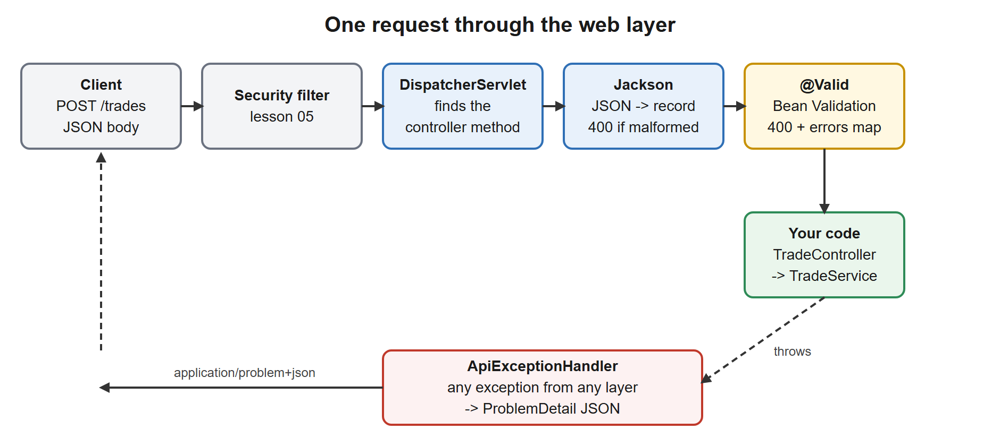
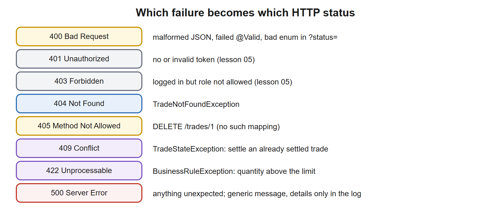

# 03. REST, Validation, Exceptions

**You build this yourself**, continuing in the same project folder. My working copy is [`../../reference/lesson-03`](../../reference/lesson-03). Open it only when you are stuck.

**Starting point:** your project as it was at the end of lesson 02. Not there? Copy everything from `reference/lesson-02` into an empty folder and continue.
**End state:** lesson 02 plus a complete REST API for trades (create, read, list, settle), validated request bodies, domain exceptions mapped to proper HTTP statuses in one place, and 28 passing tests including web-layer slice tests.

## 1. Goal and time box

**90 minutes.** After this lesson you can: design resource URLs and choose status codes you can defend; validate input at the boundary with Bean Validation; turn every failure into a consistent `application/problem+json` response from one class; and test the web layer in isolation with `@WebMvcTest` and a mocked service.

## 2. Why it matters

The REST layer is the contract with every client. Inconsistent errors, a `200` that hides a failure, or a stack trace in a response body are the first things a reviewer notices. This is also where "what status code would you return?" interview questions come from.

| You know | Spring equivalent |
|---|---|
| JAX-RS `@Path`, `@GET`, `@POST` | `@RequestMapping`, `@GetMapping`, `@PostMapping` |
| `@PathParam`, `@QueryParam`, entity parameter | `@PathVariable`, `@RequestParam`, `@RequestBody` |
| JAXB / JSON-B | Jackson (bundled with the web starter) |
| Bean Validation (JSR 380) on EJB/JAX-RS | The same annotations, triggered by `@Valid` |
| JAX-RS `ExceptionMapper`, SOAP faults | `@RestControllerAdvice` returning `ProblemDetail` |
| SWIFT ACK / NAK messages | `2xx` accepted, `4xx` "your message is wrong", `5xx` "we failed" |
| Reject a malformed message before it reaches the engine | Validate at the boundary, before the service runs |

## 3. Concepts explained like a teacher

### One request through the web layer

[](images/01-request-pipeline.svg)

`DispatcherServlet` (the single front servlet) finds the controller method for the URL and HTTP verb. **Jackson** turns the JSON body into a Java object (a record here). If the parameter is marked `@Valid`, **Bean Validation** checks the annotations before your method runs. If any step fails, or your code throws, the exception is handed to one `@RestControllerAdvice` class which writes the error response. Your controller never contains `try/catch` for HTTP concerns.

### Resource design: nouns, verbs, status codes

- **URLs are nouns**: `/trades`, `/trades/42`. The HTTP verb is the action: `GET` read (safe, repeatable), `POST` create or run an action, `PUT` replace, `PATCH` partial change, `DELETE` remove.
- **Create returns `201 Created` and a `Location` header** pointing at the new resource, so the client never guesses the id URL.
- **Actions that are not CRUD** become a sub-resource: `POST /trades/{id}/settle`. Do not invent `GET /settleTrade?id=42`: `GET` must never change state.
- **Idempotency matters for retries.** `GET`, `PUT`, `DELETE` should be safe to repeat. Our `settle` is deliberately *not* idempotent (a second call returns `409`); real payment APIs add an `Idempotency-Key` header so a retry after a timeout cannot double-book.
- **Do not expose your database entity.** A request record, a domain record, and later an entity are separate on purpose: you can change the database without breaking clients.

### Which status code?

[](images/02-status-codes.svg)

The three that people confuse:

| Code | Meaning | Our case |
|---|---|---|
| **400** | The request itself is malformed or violates the shape rules | Bad JSON, bad ISIN, negative quantity |
| **409** | The request is fine but conflicts with the **current state** of the resource | Settling a trade that is already settled |
| **422** | The request is well-formed but breaks a **business rule** | Quantity above the configured limit |

(Teams argue about 400 versus 422. Pick one rule, write it down, apply it everywhere. The architect's point is consistency, not which one.)

### Bean Validation

Annotations on the request record describe the rules: `@NotBlank`, `@NotNull`, `@Positive`, `@Pattern`, `@Size`, `@Email`, `@Digits`. They run only when the controller parameter has `@Valid`. A failure throws `MethodArgumentNotValidException` *before* the controller method executes.

Two layers, two jobs:
- **Boundary validation (annotations):** shape. Is it present, the right format, positive?
- **Business rules (service code):** meaning. Is it under the limit, is the trade in the right state? These need data or configuration and belong in the service, which throws a domain exception.

### Central error handling and `ProblemDetail`

`@RestControllerAdvice` is a class whose `@ExceptionHandler` methods apply to every controller. We return **`ProblemDetail`**, Spring's implementation of **RFC 9457 (Problem Details for HTTP APIs)**: a standard JSON error shape with `type`, `title`, `status`, `detail`, `instance`, served as `application/problem+json`. We add one extension field, `errors`, for field-level validation messages.

Rules of a good error response: consistent shape everywhere, a status that matches the cause, a message safe for a client, and **no internals** (no stack trace, SQL or hostnames). The detail goes to the log, not the response.

## 4. Setup steps

1. Open your project folder in VS Code and a terminal in it.
2. Confirm the starting point:

```powershell
.\mvnw.cmd -q clean verify
```

Expected: no output.

3. Set the compare shortcut (change the path):

```powershell
$REF = "C:\path\to\springboot-2day\reference\lesson-03"
```

### Files to change or add, in order

| # | File | Change | Why |
|---|---|---|---|
| 1 | `service/TradeNotFoundException.java`, `BusinessRuleException.java`, `TradeStateException.java` | **new** | Domain failures, free of HTTP |
| 2 | `repo/TradeRepository.java`, `repo/InMemoryTradeRepository.java` | **edit**: add `findAll` | List endpoint |
| 3 | `service/TradeService.java` | **edit** | `get`, `list`, state check, domain exceptions |
| 4 | `test/.../TradeServiceTest.java` | **edit** | New exception types and rules |
| 5 | `web/TradeController.java` | **edit** | Full REST API with validation |
| 6 | `web/ApiExceptionHandler.java` | **new** | One place for error responses |
| 7 | `TradeControllerTest.java`, `TradeApiTest.java` | **new** tests | Slice test and end-to-end test |

## 5. Code walkthrough

A build-along. Where a file already exists, the block shows the **whole file**.

### Step 1. Domain exceptions and a `findAll`

**File:** `src/main/java/com/example/trade/service/TradeNotFoundException.java`
```java
package com.example.trade.service;

// Unchecked on purpose: callers cannot sensibly recover, and unchecked exceptions roll back @Transactional (lesson 04).
// The web layer maps it to HTTP 404 in ApiExceptionHandler. The service knows nothing about HTTP.
public class TradeNotFoundException extends RuntimeException {
    public TradeNotFoundException(Long id) {
        super("Trade not found: " + id);
    }
}
```

**File:** `src/main/java/com/example/trade/service/BusinessRuleException.java`
```java
package com.example.trade.service;

// The request is well-formed but breaks a business rule (for example the quantity limit). Mapped to HTTP 422.
public class BusinessRuleException extends RuntimeException {
    public BusinessRuleException(String message) {
        super(message);
    }
}
```

**File:** `src/main/java/com/example/trade/service/TradeStateException.java`
```java
package com.example.trade.service;

// The trade exists but is in the wrong state for this action (settling a trade that is already settled).
// Mapped to HTTP 409 Conflict.
public class TradeStateException extends RuntimeException {
    public TradeStateException(String message) {
        super(message);
    }
}
```

**File:** `src/main/java/com/example/trade/repo/TradeRepository.java`
```java
package com.example.trade.repo;

import com.example.trade.domain.Trade;
import java.util.List;
import java.util.Optional;

// Depend on the INTERFACE. Spring injects whichever implementation bean exists.
// (Day 1 file 04 replaces the in-memory version with JPA, with no service changes.)
public interface TradeRepository {
    Trade save(Trade t);
    Optional<Trade> findById(Long id);
    List<Trade> findAll();
}
```

**File:** `src/main/java/com/example/trade/repo/InMemoryTradeRepository.java`
```java
package com.example.trade.repo;

import com.example.trade.domain.Trade;
import java.util.Comparator;
import java.util.List;
import java.util.Map;
import java.util.Optional;
import java.util.concurrent.ConcurrentHashMap;
import java.util.concurrent.atomic.AtomicLong;
import org.springframework.stereotype.Repository;

// @Repository = @Component + marks the persistence layer. The container creates ONE instance (singleton),
// shared by all threads, hence the thread-safe collections.
@Repository
public class InMemoryTradeRepository implements TradeRepository {
    private final Map<Long, Trade> store = new ConcurrentHashMap<>();
    private final AtomicLong seq = new AtomicLong();

    @Override
    public Trade save(Trade t) {
        Long id = t.id() != null ? t.id() : seq.incrementAndGet();
        Trade saved = new Trade(id, t.isin(), t.quantity(), t.price(), t.status());
        store.put(id, saved);
        return saved;
    }

    @Override
    public Optional<Trade> findById(Long id) {
        return Optional.ofNullable(store.get(id));
    }

    @Override
    public List<Trade> findAll() {
        return store.values().stream().sorted(Comparator.comparing(Trade::id)).toList();
    }
}
```

**Why:** the service must report problems without knowing about HTTP (it will also be called by batch jobs and message listeners later). So it throws plain Java exceptions with business meaning. They are **unchecked** (`RuntimeException`): callers cannot sensibly recover, and unchecked exceptions roll back a `@Transactional` method by default (lesson 04).

**Checkpoint:** `.\mvnw.cmd -q compile` silent.

### Step 2. Update the service and its unit test

**File:** `src/main/java/com/example/trade/service/TradeService.java`
```java
package com.example.trade.service;

import com.example.trade.config.TradeProperties;
import com.example.trade.domain.Trade;
import com.example.trade.domain.TradeStatus;
import com.example.trade.repo.TradeRepository;
import java.math.BigDecimal;
import java.util.List;
import org.springframework.stereotype.Service;

@Service
public class TradeService {

    private final TradeRepository repository;
    private final TradeProperties props;

    // Constructor injection: single constructor, so no @Autowired needed (since Spring 4.3).
    // The fields are final, so the service can never exist half-wired, and unit tests can call new TradeService(fake, props).
    public TradeService(TradeRepository repository, TradeProperties props) {
        this.repository = repository;
        this.props = props;
    }

    public Trade create(String isin, BigDecimal quantity, BigDecimal price) {
        // The limit comes from configuration (trade.max-quantity), so each environment can set its own.
        if (quantity.compareTo(props.maxQuantity()) > 0) {
            throw new BusinessRuleException("Quantity " + quantity + " exceeds limit " + props.maxQuantity());
        }
        return repository.save(new Trade(null, isin, quantity, price, TradeStatus.NEW));
    }

    public Trade get(Long id) {
        return repository.findById(id).orElseThrow(() -> new TradeNotFoundException(id));
    }

    // status == null means "no filter".
    public List<Trade> list(TradeStatus status) {
        return repository.findAll().stream()
                .filter(t -> status == null || t.status() == status)
                .toList();
    }

    // DEMO of the self-invocation trap: the inner this.settle(id) call goes straight to the real
    // object, NOT through the Spring proxy, so TimingAspect never sees it (and neither would @Transactional).
    public Trade settleViaSelfCall(Long id) {
        return this.settle(id);
    }

    public Trade settle(Long id) {
        Trade t = get(id);
        if (t.status() == TradeStatus.SETTLED) {
            throw new TradeStateException("Trade " + id + " is already settled");
        }
        return repository.save(t.withStatus(TradeStatus.SETTLED));
    }
}
```

**File:** `src/test/java/com/example/trade/TradeServiceTest.java`
```java
package com.example.trade;

import static org.assertj.core.api.Assertions.assertThat;
import static org.assertj.core.api.Assertions.assertThatThrownBy;

import com.example.trade.config.TradeProperties;
import com.example.trade.domain.TradeStatus;
import com.example.trade.repo.InMemoryTradeRepository;
import com.example.trade.service.BusinessRuleException;
import com.example.trade.service.TradeNotFoundException;
import com.example.trade.service.TradeService;
import com.example.trade.service.TradeStateException;
import java.math.BigDecimal;
import org.junit.jupiter.api.Test;

// Plain unit test: NO Spring needed, which is the payoff of constructor injection.
class TradeServiceTest {
    private final TradeService svc = new TradeService(
            new InMemoryTradeRepository(), new TradeProperties(new BigDecimal("1000"), "TEST"));

    @Test
    void createThenSettle() {
        var t = svc.create("US0378331005", BigDecimal.TEN, BigDecimal.ONE);
        assertThat(t.status()).isEqualTo(TradeStatus.NEW);
        assertThat(svc.settle(t.id()).status()).isEqualTo(TradeStatus.SETTLED);
    }

    @Test
    void rejectsQuantityAboveConfiguredLimit() {
        assertThatThrownBy(() -> svc.create("US0378331005", new BigDecimal("1001"), BigDecimal.ONE))
                .isInstanceOf(BusinessRuleException.class)
                .hasMessageContaining("exceeds limit 1000");
    }

    @Test
    void unknownIdIsNotFound() {
        assertThatThrownBy(() -> svc.get(99L)).isInstanceOf(TradeNotFoundException.class);
    }

    @Test
    void settlingTwiceIsAStateError() {
        var t = svc.create("US0378331005", BigDecimal.TEN, BigDecimal.ONE);
        svc.settle(t.id());
        assertThatThrownBy(() -> svc.settle(t.id())).isInstanceOf(TradeStateException.class);
    }

    @Test
    void listFiltersByStatus() {
        var a = svc.create("US0378331005", BigDecimal.TEN, BigDecimal.ONE);
        svc.create("US0378331005", BigDecimal.TEN, BigDecimal.ONE);
        svc.settle(a.id());
        assertThat(svc.list(null)).hasSize(2);
        assertThat(svc.list(TradeStatus.SETTLED)).extracting("id").containsExactly(a.id());
        assertThat(svc.list(TradeStatus.NEW)).hasSize(1);
    }
}
```

**Why:** `create` now throws `BusinessRuleException` for the limit (it was `IllegalArgumentException`). `get` and `list` are new. `settle` refuses a trade that is already settled, which is a *state* rule. The unit tests still run with no Spring at all.

**Checkpoint:** `.\mvnw.cmd -q clean verify` prints nothing.

**Stuck?** *`cannot find symbol TradeStateException`*: step 1 file not saved or in the wrong package (`com.example.trade.service`).

### Step 3. The controller

**File:** `src/main/java/com/example/trade/web/TradeController.java`
```java
package com.example.trade.web;

import com.example.trade.domain.Trade;
import com.example.trade.domain.TradeStatus;
import com.example.trade.service.TradeService;
import jakarta.validation.Valid;
import jakarta.validation.constraints.NotBlank;
import jakarta.validation.constraints.NotNull;
import jakarta.validation.constraints.Pattern;
import jakarta.validation.constraints.Positive;
import java.math.BigDecimal;
import java.net.URI;
import java.util.List;
import org.springframework.http.ResponseEntity;
import org.springframework.web.bind.annotation.GetMapping;
import org.springframework.web.bind.annotation.PathVariable;
import org.springframework.web.bind.annotation.PostMapping;
import org.springframework.web.bind.annotation.RequestBody;
import org.springframework.web.bind.annotation.RequestMapping;
import org.springframework.web.bind.annotation.RequestParam;
import org.springframework.web.bind.annotation.RestController;
import org.springframework.web.servlet.support.ServletUriComponentsBuilder;

// Web layer: translates HTTP <-> Java. It contains NO business logic; it only calls the service.
// @RestController = @Controller + @ResponseBody: return values are written as JSON.
@RestController
@RequestMapping("/trades")
public class TradeController {

    // Request body shape. Jackson turns JSON into this record, then Bean Validation checks the annotations
    // (because the parameter is marked @Valid). A record is perfect here: immutable and no boilerplate.
    public record CreateTradeRequest(
            @NotBlank @Pattern(regexp = "[A-Z]{2}[A-Z0-9]{9}[0-9]", message = "must be a 12-character ISIN") String isin,
            @NotNull @Positive BigDecimal quantity,
            @NotNull @Positive BigDecimal price) {}

    private final TradeService service;

    public TradeController(TradeService service) {
        this.service = service;
    }

    // 201 Created + Location header pointing at the new resource: the REST convention for POST that creates.
    @PostMapping
    public ResponseEntity<Trade> create(@Valid @RequestBody CreateTradeRequest req) {
        Trade created = service.create(req.isin(), req.quantity(), req.price());
        URI location = ServletUriComponentsBuilder.fromCurrentRequest()
                .path("/{id}").buildAndExpand(created.id()).toUri();
        return ResponseEntity.created(location).body(created);
    }

    @GetMapping("/{id}")
    public Trade get(@PathVariable Long id) {
        return service.get(id);
    }

    // GET /trades?status=NEW. A bad value ("status=BOGUS") is rejected with 400 before this method runs.
    @GetMapping
    public List<Trade> list(@RequestParam(required = false) TradeStatus status) {
        return service.list(status);
    }

    // An action on a resource, modelled as POST on a sub-resource. Not idempotent here: a second call gives 409.
    @PostMapping("/{id}/settle")
    public Trade settle(@PathVariable Long id) {
        return service.settle(id);
    }
}
```

**Why, piece by piece:**
- `CreateTradeRequest` is a record with the validation rules on its components. The ISIN pattern is 2 letters, 9 letters or digits, 1 digit (the shape, not the real check digit).
- `@Valid @RequestBody`: Jackson builds the record, then validation runs.
- `ResponseEntity.created(location).body(...)` returns `201` and the `Location` header. `ServletUriComponentsBuilder` builds the URL from the current request, so it is correct behind any host or port.
- `@RequestParam(required = false) TradeStatus status`: Spring converts `?status=NEW` to the enum; a bad value is a `400` before your code runs.
- The controller has **no** business logic and **no** `try/catch`.

**Checkpoint:** run the app and try the happy path (the demo runner already created trade `1` at startup, so yours gets id `2`):

```powershell
.\mvnw.cmd -q spring-boot:run
```

```powershell
curl.exe -s -i -X POST localhost:8080/trades -H "Content-Type: application/json" -d '{\"isin\":\"US0378331005\",\"quantity\":100,\"price\":189.50}'
curl.exe -s localhost:8080/trades/2
```

Expected (verified; date headers removed):

```
HTTP/1.1 201
Location: http://localhost:8080/trades/2
Content-Type: application/json

{"id":2,"isin":"US0378331005","quantity":100,"price":189.50,"status":"NEW"}
{"id":2,"isin":"US0378331005","quantity":100,"price":189.50,"status":"NEW"}
```

**Stuck?**
- *`400` on a request that looks right*: a bad JSON escape. In PowerShell, quote as shown (`-d '{\"isin\":...}'`).
- *`415 Unsupported Media Type`*: the `Content-Type: application/json` header is missing.

### Deep dive: Spring MVC, Bean Validation and Jackson, the three libraries behind the web layer

Steps 1 to 3 used three frameworks without introducing them properly. This section does that: what each is, why it exists, what it can do beyond what we used, and the configuration keys that change its behaviour.

#### A. Spring MVC

**What it is.** The web part of the Spring Framework (`spring-webmvc`, brought by `spring-boot-starter-web`). It implements the *front controller* pattern: `DispatcherServlet` receives every HTTP request, asks **handler mappings** which controller method matches the URL and verb, asks **argument resolvers** to build the method's parameters (path, query, body), calls it, then asks **return value handlers** and **message converters** to write the response.

**Why.** Without it you write raw servlets: parse the URL, read the stream, convert JSON, set the status, and repeat that in every endpoint.

**The annotations: used here and not used here.**

| Annotation | Purpose | Example | In our code? |
|---|---|---|---|
| `@RestController` | Controller whose return values become the response body | `class TradeController` | Yes |
| `@RequestMapping("/trades")` | Common prefix (also verb and media-type filters) | on the class | Yes |
| `@GetMapping`, `@PostMapping`, `@PutMapping`, `@PatchMapping`, `@DeleteMapping` | Verb plus path shortcut | `@GetMapping("/{id}")` | Yes (GET and POST; DELETE is not mapped on purpose, so it answers 405) |
| `@PathVariable` | A value from the URL path | `@PathVariable Long id` | Yes |
| `@RequestBody` | Read the HTTP body into an object (Jackson) | `@RequestBody CreateTradeRequest req` | Yes |
| `@RequestParam` | A query-string value, optional with a default | `@RequestParam(required = false) TradeStatus status` | Yes (`?status=`) |
| `@Valid` / `@Validated` | Run Bean Validation on the argument | `@Valid @RequestBody ...` | Yes |
| `@ResponseStatus` | Fixed status for a method or exception | `@ResponseStatus(HttpStatus.CREATED)` | No (we use `ResponseEntity`) |
| `ResponseEntity<T>` | Full control: status, headers, body | `ResponseEntity.created(uri).body(t)` | Yes |
| `@RequestHeader` | A request header | `@RequestHeader("Idempotency-Key") String key` | No (Day 2 uses the idea) |
| `@CookieValue` | A cookie value | | No |
| `@ModelAttribute` | Bind form fields to an object | | No (HTML forms, not JSON APIs) |
| `@RequestPart` | One part of a multipart (file upload) request | | No |
| `@CrossOrigin` | Allow another website's JavaScript to call this API (CORS) | | No (lesson 05 mentions CORS) |
| `@ExceptionHandler`, `@RestControllerAdvice` | Turn exceptions into responses | `ApiExceptionHandler` | Yes (step 4) |
| `@GetMapping(produces = "application/json")`, `consumes` | Restrict by media type; a mismatch gives 406 or 415 | | No |

**Status codes you meet from the framework itself** (not from your code): `404` no mapping, `405` wrong verb, `406` cannot produce the requested type, `415` body type not supported (missing `Content-Type`), `400` unreadable body or bad parameter type.

#### B. Bean Validation (Jakarta Validation)

**What it is.** A standard (JSR 380, package `jakarta.validation`) for describing constraints as **annotations** on fields, plus a validator that checks them. The implementation is **Hibernate Validator**; it has nothing to do with the Hibernate ORM. Spring integrates it through `spring-boot-starter-validation`.

**Why.** Rules such as "ISIN has 12 characters" written as `if` statements are repeated, forgotten and inconsistent. Annotations put the rule next to the data and give a uniform error.

**Constraint annotations (all in `jakarta.validation.constraints`):**

| Annotation | Checks | Null passes? | Used here? |
|---|---|---|---|
| `@NotNull` | not null | no | Yes |
| `@NotBlank` | text with at least one non-space character | no | Yes |
| `@NotEmpty` | text, collection or map not empty | no | |
| `@Size(min, max)` | length of text / size of a collection | yes | |
| `@Pattern(regexp)` | text matches a regular expression | yes | Yes (ISIN) |
| `@Positive`, `@PositiveOrZero`, `@Negative`, `@NegativeOrZero` | sign of a number | yes | Yes (`@Positive`) |
| `@Min`, `@Max` | numeric bounds (integers) | yes | |
| `@DecimalMin`, `@DecimalMax` | bounds for `BigDecimal` and text numbers | yes | |
| `@Digits(integer, fraction)` | maximum digits before and after the point | yes | |
| `@Email` | e-mail shape | yes | |
| `@Past`, `@PastOrPresent`, `@Future`, `@FutureOrPresent` | date and time | yes | |
| `@AssertTrue`, `@AssertFalse` | boolean value | yes | |
| `@Valid` (on a field) | **cascade**: validate the nested object too | n/a | |

"Null passes" matters: `@Positive` on a field that is `null` is **valid**. Combine with `@NotNull` to forbid null.

**Useful attributes:** `message` (text, may use `{...}` keys from a message bundle), `groups` (apply a rule only in a named scenario, for example `OnCreate`), `payload`.

**`@Valid` or `@Validated`?** `@Valid` (Jakarta) triggers validation and **cascades** into nested objects. `@Validated` (Spring) additionally supports **groups** and can be put on a **class** to validate method parameters of a bean (`@Validated class Service { void f(@Positive int x) }`) and on `@ConfigurationProperties` classes (lesson 02).

**Writing your own constraint** (when no built-in fits, for example a real ISIN check digit):

```java
@Target({ElementType.FIELD, ElementType.PARAMETER, ElementType.RECORD_COMPONENT})
@Retention(RetentionPolicy.RUNTIME)
@Constraint(validatedBy = IsinValidator.class)
public @interface ValidIsin {
    String message() default "not a valid ISIN";
    Class<?>[] groups() default {};
    Class<? extends Payload>[] payload() default {};
}

public class IsinValidator implements ConstraintValidator<ValidIsin, String> {
    public boolean isValid(String v, ConstraintValidatorContext c) {
        return v == null || IsinChecksum.valid(v);   // null is for @NotNull to reject
    }
}
```

**Where it runs:** on controller arguments (`MethodArgumentNotValidException` for bodies, `HandlerMethodValidationException` in Spring 6.1+ for parameters), on `@Validated` beans (`ConstraintViolationException`), on `@ConfigurationProperties` (startup fails), and on JPA entities before persisting (if you opt in). Our handler turns the first into a `ProblemDetail` with an `errors` field.

#### C. Jackson

**What it is.** Jackson is the JSON library: it converts **Java objects to JSON** (serialization) and **JSON to Java objects** (deserialization). `jackson-databind` is the part you use; Boot adds modules for Java 8 dates, `Optional` and records. Spring MVC calls it through an `HttpMessageConverter`.

**Why.** Hand-written JSON parsing is slow to write and error-prone. Jackson reads our `CreateTradeRequest` record and writes our `Trade` straight from the declared fields.

**Annotations you will meet:**

| Annotation | What it does |
|---|---|
| `@JsonProperty("trade_id")` | Use another JSON name for a field |
| `@JsonIgnore` | Never read or write this field |
| `@JsonIgnoreProperties(ignoreUnknown = true)` | Ignore JSON fields the class does not know |
| `@JsonInclude(JsonInclude.Include.NON_NULL)` | Skip null fields in the output |
| `@JsonFormat(pattern = "yyyy-MM-dd")` | Date and number format for one field |
| `@JsonCreator` | Choose the constructor or factory used for reading |

**Configuration keys (`application.yml`), none used in our files, defaults shown:**

| Key | Default | Effect |
|---|---|---|
| `spring.jackson.default-property-inclusion` | `always` | `non_null` omits null fields everywhere |
| `spring.jackson.serialization.write-dates-as-timestamps` | `false` | Dates as ISO text (`2026-11-09`) instead of numbers |
| `spring.jackson.deserialization.fail-on-unknown-properties` | `false` | `true` rejects JSON with unexpected fields (stricter API) |
| `spring.jackson.property-naming-strategy` | none | e.g. `SNAKE_CASE` for the whole API |
| `spring.jackson.time-zone` | none | Zone used when writing dates |
| `spring.jackson.mapper.accept-case-insensitive-enums` | `false` | `new` accepted for `NEW` |

**Two behaviours to know.** (1) `BigDecimal` is written as a JSON **number**, so `189.50` stays `189.50`, but a client that parses it as a floating-point number may lose precision; for money some APIs send a string. (2) By default Boot does **not** fail on unknown JSON fields, so a client typo (`qty` for `quantity`) is silently ignored and the field arrives as `null`. That is why our `@NotNull` matters.

#### D. Common mistakes in this layer

| Mistake | What you see | Fix |
|---|---|---|
| `@Valid` missing on the `@RequestBody` parameter | Bad data reaches the service; annotations do nothing | Add `@Valid` |
| `@Positive` without `@NotNull` | `null` passes | Add `@NotNull` |
| Validating a nested object without `@Valid` on the field | Inner rules never run | Put `@Valid` on the field |
| Returning the JPA entity directly | Lazy-loading errors, leaking columns | Return a record or DTO |
| Sending JSON without `Content-Type` | `415 Unsupported Media Type` | `-H "Content-Type: application/json"` |
| Throwing `IllegalArgumentException` for "not found" | `500` | A domain exception mapped in `ApiExceptionHandler` |

### Step 4. The central exception handler

**File:** `src/main/java/com/example/trade/web/ApiExceptionHandler.java`
```java
package com.example.trade.web;

import com.example.trade.service.BusinessRuleException;
import com.example.trade.service.TradeNotFoundException;
import com.example.trade.service.TradeStateException;
import java.util.LinkedHashMap;
import java.util.Map;
import org.slf4j.Logger;
import org.slf4j.LoggerFactory;
import org.springframework.http.HttpHeaders;
import org.springframework.http.HttpStatus;
import org.springframework.http.HttpStatusCode;
import org.springframework.http.ProblemDetail;
import org.springframework.http.ResponseEntity;
import org.springframework.web.bind.MethodArgumentNotValidException;
import org.springframework.web.bind.annotation.ExceptionHandler;
import org.springframework.web.bind.annotation.RestControllerAdvice;
import org.springframework.web.context.request.WebRequest;
import org.springframework.web.servlet.mvc.method.annotation.ResponseEntityExceptionHandler;

// ONE place that turns exceptions into HTTP responses, for every controller.
// The body is a ProblemDetail (RFC 9457): JSON with type, title, status, detail, content type application/problem+json.
// ResponseEntityExceptionHandler already maps Spring's own errors (bad JSON, wrong method, bad parameter type) to
// ProblemDetail; we add our domain exceptions and enrich the validation error.
@RestControllerAdvice
public class ApiExceptionHandler extends ResponseEntityExceptionHandler {
    private static final Logger log = LoggerFactory.getLogger(ApiExceptionHandler.class);

    @ExceptionHandler(TradeNotFoundException.class)
    ProblemDetail notFound(TradeNotFoundException ex) {
        return ProblemDetail.forStatusAndDetail(HttpStatus.NOT_FOUND, ex.getMessage());
    }

    @ExceptionHandler(TradeStateException.class)
    ProblemDetail conflict(TradeStateException ex) {
        return ProblemDetail.forStatusAndDetail(HttpStatus.CONFLICT, ex.getMessage());
    }

    @ExceptionHandler(BusinessRuleException.class)
    ProblemDetail unprocessable(BusinessRuleException ex) {
        return ProblemDetail.forStatusAndDetail(HttpStatus.UNPROCESSABLE_ENTITY, ex.getMessage());
    }

    // Validation failure: add a map field -> message so a client can show errors next to the right input.
    @Override
    protected ResponseEntity<Object> handleMethodArgumentNotValid(MethodArgumentNotValidException ex,
            HttpHeaders headers, HttpStatusCode status, WebRequest request) {
        Map<String, String> errors = new LinkedHashMap<>();
        ex.getBindingResult().getFieldErrors().forEach(e -> errors.putIfAbsent(e.getField(), e.getDefaultMessage()));
        ProblemDetail pd = ProblemDetail.forStatusAndDetail(HttpStatus.BAD_REQUEST, "Validation failed");
        pd.setProperty("errors", errors);
        return handleExceptionInternal(ex, pd, headers, status, request);
    }

    // Safety net: anything unexpected becomes a generic 500. Log the detail here, never send it to the client
    // (stack traces and SQL fragments help attackers, not users).
    @ExceptionHandler(Exception.class)
    ProblemDetail unexpected(Exception ex) {
        log.error("Unhandled exception", ex);
        return ProblemDetail.forStatusAndDetail(HttpStatus.INTERNAL_SERVER_ERROR, "Unexpected error");
    }
}
```

**Why, piece by piece:**
- `extends ResponseEntityExceptionHandler` gives us Spring's own mappings for free: unreadable JSON, wrong method, bad parameter type, missing parameter, all as `ProblemDetail`.
- One `@ExceptionHandler` per domain exception maps it to a status. The service never mentions a status code.
- We **override** `handleMethodArgumentNotValid` to add an `errors` map (`field` to `message`) so a UI can show each message beside the right input. `putIfAbsent` keeps the first message per field.
- The last handler is the **safety net**: any other exception is logged with its stack trace and answered with a generic `500`. The client gets "Unexpected error", never the exception text (which may contain SQL, hostnames or personal data).

**Checkpoint:** restart the app (the in-memory data is gone, so trade `2` does not exist yet) and provoke each error:

```powershell
curl.exe -s -X POST localhost:8080/trades -H "Content-Type: application/json" -d '{\"isin\":\"US0378331005\",\"quantity\":100,\"price\":189.50}'
curl.exe -s -i -X POST localhost:8080/trades -H "Content-Type: application/json" -d '{\"isin\":\"bad\",\"quantity\":-5}'
curl.exe -s -i localhost:8080/trades/99
curl.exe -s -i -X POST localhost:8080/trades/2/settle
curl.exe -s -i -X POST localhost:8080/trades/2/settle
curl.exe -s -i -X POST localhost:8080/trades -H "Content-Type: application/json" -d '{\"isin\":\"US0378331005\",\"quantity\":2000000,\"price\":1}'
curl.exe -s -i "localhost:8080/trades?status=BOGUS"
curl.exe -s -i -X DELETE localhost:8080/trades/1
```

Expected bodies and statuses (verified, headers shortened):

```
400  application/problem+json
{"type":"about:blank","title":"Bad Request","status":400,"detail":"Validation failed","instance":"/trades","errors":{"isin":"must be a 12-character ISIN","price":"must not be null","quantity":"must be greater than 0"}}

404  {"type":"about:blank","title":"Not Found","status":404,"detail":"Trade not found: 99","instance":"/trades/99"}

200  (first settle)  {"id":2,...,"status":"SETTLED"}
409  {"type":"about:blank","title":"Conflict","status":409,"detail":"Trade 2 is already settled","instance":"/trades/2/settle"}

422  {"type":"about:blank","title":"Unprocessable Entity","status":422,"detail":"Quantity 2000000 exceeds limit 1000000","instance":"/trades"}

400  {"type":"about:blank","title":"Bad Request","status":400,"detail":"Failed to convert 'status' with value: 'BOGUS'","instance":"/trades"}

405  Allow: GET   {"type":"about:blank","title":"Method Not Allowed","status":405,"detail":"Method 'DELETE' is not supported.","instance":"/trades/1"}
```

Every error has the same shape. Read the validation response closely: three problems found in one round trip (`isin`, `price` missing, `quantity` negative).

**Stuck?**
- *Validation request returns `201` or `500`*: `@Valid` is missing on the controller parameter, or the validation starter is missing (lesson 02 step 1).
- *Errors are plain HTML or a Whitelabel page*: `ApiExceptionHandler` is outside `com.example.trade` or lacks `@RestControllerAdvice`.
- *Not found returns `500`*: the `TradeNotFoundException` handler is missing; the catch-all took it.

### Step 5. Tests: a web slice and an end-to-end journey

**File:** `src/test/java/com/example/trade/TradeControllerTest.java`
```java
package com.example.trade;

import static org.mockito.ArgumentMatchers.any;
import static org.mockito.ArgumentMatchers.eq;
import static org.mockito.BDDMockito.given;
import static org.springframework.test.web.servlet.request.MockMvcRequestBuilders.get;
import static org.springframework.test.web.servlet.request.MockMvcRequestBuilders.post;
import static org.springframework.test.web.servlet.result.MockMvcResultMatchers.content;
import static org.springframework.test.web.servlet.result.MockMvcResultMatchers.header;
import static org.springframework.test.web.servlet.result.MockMvcResultMatchers.jsonPath;
import static org.springframework.test.web.servlet.result.MockMvcResultMatchers.status;

import com.example.trade.domain.Trade;
import com.example.trade.domain.TradeStatus;
import com.example.trade.service.BusinessRuleException;
import com.example.trade.service.TradeNotFoundException;
import com.example.trade.service.TradeService;
import com.example.trade.service.TradeStateException;
import com.example.trade.web.TradeController;
import java.math.BigDecimal;
import java.util.List;
import org.junit.jupiter.api.Test;
import org.springframework.beans.factory.annotation.Autowired;
import org.springframework.boot.test.autoconfigure.web.servlet.WebMvcTest;
import org.springframework.http.MediaType;
import org.springframework.test.context.bean.override.mockito.MockitoBean;
import org.springframework.test.web.servlet.MockMvc;

// A "slice" test: only the web layer is started (controllers, the exception handler, JSON conversion).
// The service is replaced by a Mockito mock, so we test HTTP behaviour alone and fast.
@WebMvcTest(TradeController.class)
class TradeControllerTest {

    @Autowired MockMvc mvc;
    @MockitoBean TradeService service;

    private static final String VALID = """
            {"isin":"US0378331005","quantity":100,"price":189.50}""";

    private static Trade trade(long id, TradeStatus status) {
        return new Trade(id, "US0378331005", new BigDecimal("100"), new BigDecimal("189.50"), status);
    }

    @Test
    void createReturns201WithLocationHeader() throws Exception {
        given(service.create(eq("US0378331005"), any(), any())).willReturn(trade(7, TradeStatus.NEW));

        mvc.perform(post("/trades").contentType(MediaType.APPLICATION_JSON).content(VALID))
                .andExpect(status().isCreated())
                .andExpect(header().string("Location", "http://localhost/trades/7"))
                .andExpect(jsonPath("$.id").value(7))
                .andExpect(jsonPath("$.status").value("NEW"));
    }

    @Test
    void invalidBodyReturns400WithFieldErrors() throws Exception {
        String bad = """
                {"isin":"not-an-isin","quantity":-5}""";

        mvc.perform(post("/trades").contentType(MediaType.APPLICATION_JSON).content(bad))
                .andExpect(status().isBadRequest())
                .andExpect(content().contentTypeCompatibleWith("application/problem+json"))
                .andExpect(jsonPath("$.detail").value("Validation failed"))
                .andExpect(jsonPath("$.errors.isin").value("must be a 12-character ISIN"))
                .andExpect(jsonPath("$.errors.quantity").exists())
                .andExpect(jsonPath("$.errors.price").exists());
    }

    @Test
    void malformedJsonReturns400() throws Exception {
        mvc.perform(post("/trades").contentType(MediaType.APPLICATION_JSON).content("{oops"))
                .andExpect(status().isBadRequest());
    }

    @Test
    void unknownTradeReturns404ProblemDetail() throws Exception {
        given(service.get(99L)).willThrow(new TradeNotFoundException(99L));

        mvc.perform(get("/trades/99"))
                .andExpect(status().isNotFound())
                .andExpect(content().contentTypeCompatibleWith("application/problem+json"))
                .andExpect(jsonPath("$.status").value(404))
                .andExpect(jsonPath("$.detail").value("Trade not found: 99"));
    }

    @Test
    void settlingTwiceReturns409() throws Exception {
        given(service.settle(1L)).willThrow(new TradeStateException("Trade 1 is already settled"));

        mvc.perform(post("/trades/1/settle")).andExpect(status().isConflict());
    }

    @Test
    void businessRuleReturns422() throws Exception {
        given(service.create(any(), any(), any())).willThrow(new BusinessRuleException("too big"));

        mvc.perform(post("/trades").contentType(MediaType.APPLICATION_JSON).content(VALID))
                .andExpect(status().isUnprocessableEntity())
                .andExpect(jsonPath("$.detail").value("too big"));
    }

    @Test
    void unexpectedErrorReturnsGeneric500WithoutLeakingDetails() throws Exception {
        given(service.get(1L)).willThrow(new IllegalStateException("jdbc:oracle://secret-host failed"));

        mvc.perform(get("/trades/1"))
                .andExpect(status().isInternalServerError())
                .andExpect(jsonPath("$.detail").value("Unexpected error"));
    }

    @Test
    void listPassesTheStatusFilterAndRejectsBadValues() throws Exception {
        given(service.list(TradeStatus.NEW)).willReturn(List.of(trade(1, TradeStatus.NEW)));

        mvc.perform(get("/trades").param("status", "NEW"))
                .andExpect(status().isOk())
                .andExpect(jsonPath("$[0].id").value(1));
        mvc.perform(get("/trades").param("status", "BOGUS"))
                .andExpect(status().isBadRequest());
    }
}
```

**File:** `src/test/java/com/example/trade/TradeApiTest.java`
```java
package com.example.trade;

import static org.springframework.test.web.servlet.request.MockMvcRequestBuilders.get;
import static org.springframework.test.web.servlet.request.MockMvcRequestBuilders.post;
import static org.springframework.test.web.servlet.result.MockMvcResultMatchers.jsonPath;
import static org.springframework.test.web.servlet.result.MockMvcResultMatchers.status;

import org.junit.jupiter.api.Test;
import org.springframework.beans.factory.annotation.Autowired;
import org.springframework.boot.test.autoconfigure.web.servlet.AutoConfigureMockMvc;
import org.springframework.boot.test.context.SpringBootTest;
import org.springframework.http.MediaType;
import org.springframework.test.web.servlet.MockMvc;

// Full application, real service and repository, HTTP simulated by MockMvc (no real port needed).
// One test walks the whole lifecycle, the way a client would.
@SpringBootTest
@AutoConfigureMockMvc
class TradeApiTest {

    @Autowired MockMvc mvc;

    @Test
    void createGetSettleAndConflict() throws Exception {
        String body = """
                {"isin":"US0378331005","quantity":100,"price":189.50}""";

        var created = mvc.perform(post("/trades").contentType(MediaType.APPLICATION_JSON).content(body))
                .andExpect(status().isCreated())
                .andExpect(jsonPath("$.status").value("NEW"))
                .andReturn();
        String location = created.getResponse().getHeader("Location");

        mvc.perform(get(location)).andExpect(status().isOk()).andExpect(jsonPath("$.isin").value("US0378331005"));
        mvc.perform(post(location + "/settle")).andExpect(status().isOk()).andExpect(jsonPath("$.status").value("SETTLED"));
        mvc.perform(post(location + "/settle")).andExpect(status().isConflict());
    }

    @Test
    void quantityAboveTheConfiguredLimitIs422() throws Exception {
        String body = """
                {"isin":"US0378331005","quantity":2000000,"price":1}""";

        mvc.perform(post("/trades").contentType(MediaType.APPLICATION_JSON).content(body))
                .andExpect(status().isUnprocessableEntity());
    }
}
```

**Why:**
- `@WebMvcTest(TradeController.class)` starts **only the web layer**: the controller, `ApiExceptionHandler`, Jackson, validation. No service, no repository, no server. `@MockitoBean` puts a Mockito mock of `TradeService` in its place, so each test says "when the service does X, the HTTP answer must be Y". Fast (about a second for the whole class) and precise.
- `given(...).willThrow(...)` simulates each failure without building the situation in a database.
- The 500 test proves **no leak**: the mocked exception text contains a fake JDBC URL, and the assertion checks the response only says "Unexpected error".
- `TradeApiTest` is the opposite: the **real** application (real service and repository), HTTP simulated by `MockMvc`. One test walks the whole lifecycle by following the `Location` header, like a client.
- Both styles are needed: slices pin down the contract cheaply; one end-to-end test proves the layers are wired together.

**Checkpoint:**

```powershell
.\mvnw.cmd clean verify
```

Expected (verified), among other lines:

```
Tests run: 8, Failures: 0, Errors: 0, Skipped: 0 -- in com.example.trade.TradeControllerTest
Tests run: 2, Failures: 0, Errors: 0, Skipped: 0 -- in com.example.trade.TradeApiTest
Tests run: 5, Failures: 0, Errors: 0, Skipped: 0 -- in com.example.trade.TradeServiceTest
Tests run: 28, Failures: 0, Errors: 0, Skipped: 0
BUILD SUCCESS
```

**Stuck?**
- *`package org.springframework.test.context.bean.override.mockito does not exist`*: old Boot version. `@MockitoBean` needs Spring Framework 6.2 (Boot 3.4+); ours is 3.5.16.
- *`NoSuchBeanDefinitionException: TradeService` in the slice test*: the `@MockitoBean TradeService service;` field is missing.
- *`location` is `null` in `TradeApiTest`*: the controller returns the body without `ResponseEntity.created`.

### Run it

You already did in steps 3 and 4. List what you created: `curl.exe -s localhost:8080/trades` and `curl.exe -s "localhost:8080/trades?status=SETTLED"`.

### Debug it

1. Put a breakpoint in `ApiExceptionHandler.notFound(...)`, press `F5`, call `curl.exe -s -i localhost:8080/trades/99`. The call stack shows `DispatcherServlet` calling the handler after `TradeController.get` threw: your controller never caught anything.
2. Put another breakpoint on the first line of `TradeController.create` and send the *invalid* body from step 4. **It is never reached**: validation failed before the method ran, and `handleMethodArgumentNotValid` answered instead.
3. Run only the slice tests: right-click `TradeControllerTest`, **Run Test**. Compare the startup time with `TradeApiTest`.

**Exercise (10 min).** Add a rule: a trade with `price` above 10,000 must be rejected. Decide which layer it belongs in (shape or meaning?), which status code it should return, and write the failing test first in `TradeControllerTest` or `TradeServiceTest`. Then implement it. (A reasonable answer: a business rule, so a configuration value in `TradeProperties`, a check in `TradeService.create`, `BusinessRuleException`, `422`.)

## 6. Common mistakes

| Mistake | How you notice | Fix |
|---|---|---|
| Forgetting `@Valid` | Invalid data reaches the service | `@Valid @RequestBody` on every body parameter |
| `200` with an error message in the body | Clients must parse text to find failures | Use the right status; one `ProblemDetail` shape |
| Returning the entity or exposing internal ids and fields | A database change breaks clients | Separate request, domain and entity types |
| `catch (Exception e)` in the controller | Duplicate logic, inconsistent errors | Throw; handle once in `@RestControllerAdvice` |
| Stack trace or SQL in the response | Visible in a browser or a security scan | Generic `500` body, details in the log only |
| `GET` that changes state | Crawlers or prefetch trigger it | Use `POST` for actions |
| Verbs in URLs (`/createTrade`) | Hard to extend, ad hoc | Nouns plus HTTP verbs; actions as sub-resources |
| Money as a JSON number consumed by JavaScript | `0.1 + 0.2` style rounding in the client | Agree a contract: string amounts, or integer minor units, and document the scale |
| Validation message for each field but only the first error returned | Users fix one error per round trip | Return all field errors, as our `errors` map does |

## 7. Production issues and design notes

| Symptom | Root cause | Fix |
|---|---|---|
| Duplicate trades after a client timeout | The client retried a non-idempotent `POST` | `Idempotency-Key` header stored server-side; or a client-generated id with a unique constraint |
| Everything is `500` in the dashboard | Domain failures not mapped | Map business errors to `4xx`, so `5xx` alerts mean *us* |
| `5xx` alerts fire for client mistakes | Same cause | Alert on `5xx` only, track `4xx` as a business metric |
| Huge request crashes or slows the service | No body size limit | `server.tomcat.max-swallow-size`, gateway limits, bounded lists in DTOs |
| Clients break after a field rename | No versioning policy | Additive changes only, or `/v2` and a deprecation window |
| Unreadable `400` for a malformed date or enum | Default message is technical | Customise `ResponseEntityExceptionHandler` methods you care about |
| Slow list endpoint | `findAll` returns everything | Pagination (`page`, `size`, a max size); lesson 04 introduces `Pageable` |
| Stack traces in logs lost the correlation | No request id | Day 2: correlation id in MDC and traces |

## 8. Architect lens

- **Design the contract first.** URLs, status codes, error shape and field names are a public API. Write them down (OpenAPI) before many clients depend on them.
- **One error model for the whole organisation.** RFC 9457 `ProblemDetail` with stable `type` URIs lets clients branch on the kind of error, not on message text.
- **Layering keeps rules testable.** Controller translates HTTP, service holds rules, repository holds data. The slice tests prove the translation without a database; unit tests prove rules without Spring.
- **Validation is defence at the edge, not a security control by itself.** Still validate again where the data is *used* (service, database constraints).
- **Idempotency and retries are an architecture topic**, not a controller detail: any network call will be retried by someone. Design `POST` endpoints that handle it.
- **When NOT to use REST:** high-volume internal event flows (use messaging, Day 2), chatty fine-grained calls between services (consider gRPC or batching), and long-running operations (return `202 Accepted` with a status resource).

## 9. Self-check quiz

1. Why does `create` return `201` and a `Location` header?
2. Which status for: malformed JSON; unknown trade id; settling an already-settled trade; quantity above the limit?
3. What does `@Valid` trigger, and when does it run relative to the controller method?
4. Why do the domain exceptions not mention HTTP?
5. What is `ProblemDetail` and what content type does it use?
6. What does `ResponseEntityExceptionHandler` give you for free?
7. Why is there a catch-all `@ExceptionHandler(Exception.class)` that returns a fixed message?
8. What does `@WebMvcTest` start, and what replaces the service?
9. Why do we still keep one `@SpringBootTest` journey (`TradeApiTest`)?
10. `GET /trades/settle?id=5` changes data. What is wrong, and what is the fix?

<details><summary>Answers</summary>

1. `201` tells the client something was created; `Location` gives its URL so the client does not construct it.
2. 400; 404; 409; 422.
3. Bean Validation on the request object. It runs after JSON parsing and before the controller method; a failure never reaches the method.
4. The service is reused by non-HTTP callers (batch, messaging) and should express business meaning; mapping to HTTP is the web layer's job.
5. The RFC 9457 standard JSON error format (`type`, `title`, `status`, `detail`, `instance`, extensions); `application/problem+json`.
6. Standard `ProblemDetail` responses for Spring's own errors: malformed body, unsupported media type or method, missing or mistyped parameters, and more.
7. Unexpected failures must not leak internals; the detail is logged, the client sees a generic message and `500`.
8. The web layer only (controllers, advice, converters, validation). A Mockito mock (`@MockitoBean`) replaces `TradeService`.
9. Slices do not prove that the real layers are wired together; one end-to-end test does.
10. `GET` must be safe (no state change). Use `POST /trades/{id}/settle`.

</details>

## 10. Interview Q&A

**Q1. How do you design a REST API for trade settlement?**
Resources as nouns (`/trades`), verbs from HTTP, `201` with `Location` on create, actions as sub-resources (`POST /trades/{id}/settle`), filters as query parameters, pagination for lists, a single `ProblemDetail` error shape. Settle is a state transition: a repeat gives `409`, and for retries from unreliable clients I add an idempotency key.

**Q2. `400`, `409` or `422`?**
`400` malformed or shape-invalid; `409` conflicts with the resource's current state; `422` valid shape but breaks a business rule. I accept either `400` or `422` for validation as long as the team is consistent and documents it.

**Q3. How do you do validation and error handling in Spring?**
Bean Validation annotations on request records with `@Valid` for shape; business rules in the service throwing domain exceptions; one `@RestControllerAdvice` mapping everything to RFC 9457 `ProblemDetail`, with a field-error map for validation and a generic `500` that never leaks internals.

**Q4. How do you test controllers?**
`@WebMvcTest` with `@MockitoBean` for the service to test status codes, JSON shape and error mapping quickly; a few `@SpringBootTest` journeys with `MockMvc` or a real port for wiring; unit tests for the rules without Spring.

**Q5. What is the difference between `@Controller` and `@RestController`?**
`@RestController` is `@Controller` plus `@ResponseBody`: return values are serialised (JSON) instead of resolved as view names.

**Q6. How do you make a POST safe to retry?**
A client-supplied idempotency key stored with the result (unique constraint), so a retry returns the original response instead of creating a second trade. This is the same duplicate-protection idea as in SWIFT message processing, just at the API edge.

**Q7. How would you version the API?**
Prefer additive, backward-compatible changes. When breaking, a path version (`/v2/trades`) or a media type version, run both for a deprecation window, and measure usage before removing the old one.

**Q8. (Depth you may not have) "How do you document the API?"**
"I have documented with Swagger/OpenAPI annotations or hand-written specs. With Boot I would add `springdoc-openapi` to generate the spec from the controllers, and I would treat the spec as the contract that clients review. I have not set up contract testing with Pact myself, but I understand the consumer-driven idea."

## 11. Recap

1. A request flows through `DispatcherServlet`, Jackson, then validation, and only then reaches your controller method.
2. URLs are nouns, verbs are HTTP, `POST` that creates returns `201` plus `Location`, and actions become sub-resources.
3. Shape validation uses annotations and `@Valid`; business rules live in the service and throw domain exceptions with no HTTP in them.
4. One `@RestControllerAdvice` maps every failure to a consistent `application/problem+json`; unexpected errors become a generic `500` with the detail only in the log.
5. Test the web layer with `@WebMvcTest` and a mocked service, and keep one real end-to-end journey.
