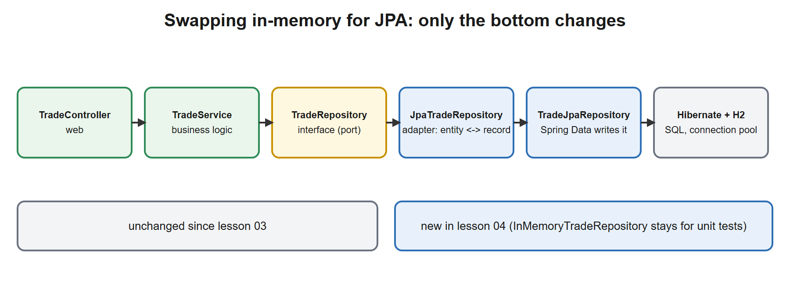
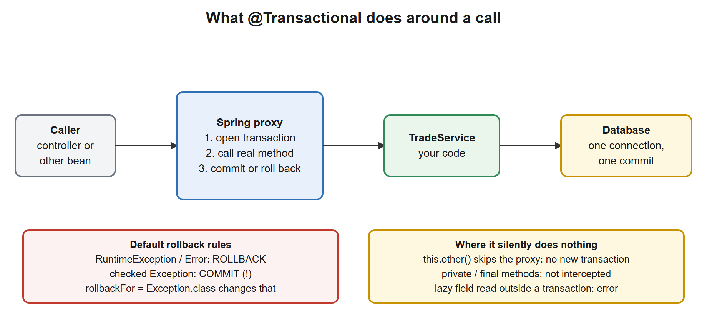
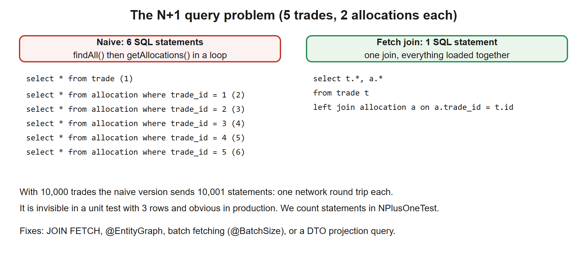

# 04. Data JPA and Transactions

**You build this yourself**, continuing in the same project folder. My working copy is [`../../reference/lesson-04`](../../reference/lesson-04). Open it only when you are stuck.

**Starting point:** your project as it was at the end of lesson 03. Not there? Copy everything from `reference/lesson-03` into an empty folder and continue.
**End state:** lesson 03 with the in-memory repository replaced by JPA on an H2 database (the service logic does not change), transactions on the service, a proof of how rollback really works, and a measured N+1 problem and its fix. 36 tests pass.

## 1. Goal and time box

**120 minutes** (this is the biggest lesson of the day). After this lesson you can: map entities and relations with JPA; use Spring Data repositories and write a custom query; explain what `@Transactional` does and does not do, with passing tests as proof (rollback rules, self-invocation); and find and fix an N+1 problem with a number instead of an opinion.

## 2. Why it matters

You already know Hibernate and Oracle. The new part is *how Spring wires them*: Spring creates the `EntityManager`, the transaction manager and the proxies; you write interfaces and annotations. Most production incidents in this layer are the same few things: a transaction that did not roll back, a lazy field read at the wrong time, and a loop that sends thousands of queries.

| You know | Spring equivalent |
|---|---|
| Hibernate `Session` / JPA `EntityManager` you open yourself or get from the EJB container | Injected for you; the same persistence context rules apply |
| EJB container-managed transactions, `@TransactionAttribute(REQUIRED)` | `@Transactional` (default propagation `REQUIRED`), implemented by a proxy |
| DAO class with HQL/Criteria | A Spring Data repository **interface**: Spring writes the class |
| `persistence.xml`, `hibernate.cfg.xml` | `spring.jpa.*` and `spring.datasource.*` in `application.yml` |
| Oracle sequence plus `@SequenceGenerator` | Same; we use identity on H2 for brevity (see the notes) |
| ETL: bulk load with JDBC batch, commit every N rows | Spring Data for the transactional core; `JdbcTemplate` or Spring Batch for bulk loads |

## 3. Concepts explained like a teacher

### Layers: what changes and what does not

[](images/01-layers-with-jpa.svg)

In lesson 01 we wrote `TradeRepository` as an interface and said the in-memory version could be replaced "with no service changes". Now we prove it. `JpaTradeRepository` implements the same interface and delegates to `TradeJpaRepository`, which Spring Data generates at startup. The service only knows the interface (the **port**); the JPA class is the **adapter**.

### JPA in ten lines (you know this; here is how it looks in Spring)

- An **entity** is a mutable class with `@Entity`, an `@Id`, and a no-arg constructor. Keep entities inside the persistence package; the rest of the application uses the immutable `Trade` record. That is why JPA details never leak into your JSON or your service.
- The **persistence context** is the session-level cache: inside a transaction, loading the same id twice gives the same object, and changes to a managed entity are written at commit (**dirty checking**) even without calling `save`.
- `@OneToMany` is **lazy** by default (a list is loaded only when touched). `@ManyToOne` is **eager** by default: always set `fetch = LAZY` on it.
- `@Enumerated(EnumType.STRING)`, never `ORDINAL`: reordering the enum must not corrupt data.
- **Spring Data**: `interface TradeJpaRepository extends JpaRepository<TradeEntity, Long>` gives `save`, `findById`, `findAll`, `count`, `deleteAll`, paging. Method names like `findByIsinAndStatus` become queries; `@Query` takes JPQL.
- `ddl-auto: create-drop` lets Hibernate build tables from entities. Fine for learning and tests; real systems use **Flyway or Liquibase** migrations and `validate`.
- **Identity versus sequence.** `GenerationType.IDENTITY` (database auto-increment) forces an insert per row and disables JDBC batching; on Oracle you would use a `SEQUENCE` with an allocation size so Hibernate can batch. Matters for bulk loads.
- **Optimistic locking:** add a `@Version` column so two concurrent updates of the same row fail instead of overwriting each other. We do not need it here, but any entity that two users can edit should have it.

### Transactions: what `@Transactional` really does

[](images/02-transaction-proxy.svg)

It is **AOP, the same proxy mechanism as lesson 01**. The proxy opens a transaction before the method, calls your code, and commits afterwards or rolls back if a rollback-worthy exception comes out. Everything in lesson 01 about proxies applies, including the self-invocation trap.

The rules that are asked in every interview:

| Topic | Rule |
|---|---|
| Default rollback | **Only** for `RuntimeException` and `Error`. A **checked** exception still **commits** |
| Change it | `@Transactional(rollbackFor = Exception.class)` |
| Propagation | Default `REQUIRED`: join the caller's transaction or start one. `REQUIRES_NEW` suspends the caller's and starts an independent one (use for audit logs that must survive a rollback) |
| `readOnly = true` | A hint: skips dirty checking, some databases route to a replica. It does **not** forbid writes by itself |
| Self-invocation | `this.other()` bypasses the proxy: no new transaction, no `REQUIRES_NEW`, nothing |
| Visibility | Proxy-based: public methods called from **outside** the bean |
| Where to put it | On the **service** layer, around one business operation. Not on controllers, not on every repository call |
| Exceptions you catch | If you catch the exception inside the method, the proxy never sees it: **no rollback** |
| Test methods | A `@Transactional` *test* wraps everything in one transaction that is rolled back, which can **hide** the very rollback behaviour you want to test |

### Lazy loading and the N+1 problem

[](images/03-n-plus-one.svg)

Loading a list of trades is one query. Touching each trade's lazy `allocations` list triggers one more query **per trade**: 1 + N statements. It is invisible with 3 rows in a test and disastrous with 10,000 in production. The fixes: `JOIN FETCH` in a query (what we use), `@EntityGraph`, `@BatchSize` (loads collections in groups), or a projection that selects only what you need.

Related: reading a lazy field **outside** a transaction throws `LazyInitializationException`. The "fix" of keeping the session open while the view renders is **open-in-view**, which Boot enables by default (and warns about). We set `spring.jpa.open-in-view: false`: it hides performance problems and holds a database connection while your JSON is written.

### H2 versus a real database

H2 in memory is quick and needs nothing installed, which is perfect for learning and for fast tests. But it is not Oracle or PostgreSQL: SQL dialect details, locking behaviour, sequences, JSON and date types can differ, so a test can pass on H2 and fail in production. Mitigations: H2's compatibility modes, and, better, **Testcontainers** to run the real database in Docker for the tests that matter (mentioned in lesson 06, used with Postgres on Day 2).

## 4. Setup steps

1. Open your project folder in VS Code and a terminal in it.
2. Confirm the starting point:

```powershell
.\mvnw.cmd -q clean verify
```

Expected: no output.

3. Set the compare shortcut (change the path):

```powershell
$REF = "C:\path\to\springboot-2day\reference\lesson-04"
```

### Files to change or add, in order

| # | File | Change | Why |
|---|---|---|---|
| 1 | `pom.xml` | **edit**: JPA starter and H2 | Hibernate, Spring Data, connection pool, in-memory database |
| 2 | `application.yml`, `application-dev.yml` | **edit** | JPA settings and SQL logging |
| 3 | `persistence/TradeEntity.java`, `AllocationEntity.java`, `TradeJpaRepository.java` | **new** | The mapping and the Spring Data repository |
| 4 | `persistence/JpaTradeRepository.java`, `repo/InMemoryTradeRepository.java` | **new / edit** | The adapter; the in-memory class stops being a bean |
| 5 | `service/TradeService.java` | **edit** | `@Transactional`, plus rollback demos |
| 6 | `TransactionTest.java` | **new** | Proves the rollback rules |
| 7 | `service/AllocationReportService.java`, `NPlusOneTest.java` | **new** | Measures N+1 and the fix |
| 8 | `JpaTradeRepositoryTest.java` | **new** | A persistence slice test |

## 5. Code walkthrough

A build-along. Where a file already exists, the block shows the **whole file**.

### Step 1. Add JPA and H2

**Do:** add the two marked dependencies to `pom.xml` (whole file shown).

**File:** `pom.xml`
```xml
<?xml version="1.0" encoding="UTF-8"?>
<project xmlns="http://maven.apache.org/POM/4.0.0"
         xmlns:xsi="http://www.w3.org/2001/XMLSchema-instance"
         xsi:schemaLocation="http://maven.apache.org/POM/4.0.0 https://maven.apache.org/xsd/maven-4.0.0.xsd">
  <modelVersion>4.0.0</modelVersion>

  <!-- The parent pins versions of over 1,500 libraries, so we never write versions below. -->
  <parent>
    <groupId>org.springframework.boot</groupId>
    <artifactId>spring-boot-starter-parent</artifactId>
    <version>3.5.16</version>
    <relativePath/>
  </parent>

  <!-- Our project's own identity. -->
  <groupId>com.example</groupId>
  <artifactId>trade-service</artifactId>
  <version>0.0.1-SNAPSHOT</version>
  <name>trade-service</name>

  <properties>
    <java.version>21</java.version>
  </properties>

  <dependencies>
    <!-- Web starter: embedded Tomcat + Spring MVC + Jackson (JSON). -->
    <dependency>
      <groupId>org.springframework.boot</groupId>
      <artifactId>spring-boot-starter-web</artifactId>
    </dependency>

    <!-- AOP starter (lesson 01): brings AspectJ so we can write @Aspect classes. -->
    <dependency>
      <groupId>org.springframework.boot</groupId>
      <artifactId>spring-boot-starter-aop</artifactId>
    </dependency>

    <!-- Actuator (NEW in lesson 02): /actuator/health, /actuator/beans, /actuator/conditions, metrics... -->
    <dependency>
      <groupId>org.springframework.boot</groupId>
      <artifactId>spring-boot-starter-actuator</artifactId>
    </dependency>

    <!-- Validation starter (NEW in lesson 02): Bean Validation (jakarta.validation) + Hibernate Validator.
         Lesson 02 uses it to validate configuration; lesson 03 uses it to validate request bodies. -->
    <dependency>
      <groupId>org.springframework.boot</groupId>
      <artifactId>spring-boot-starter-validation</artifactId>
    </dependency>

    <!-- JPA starter (NEW in lesson 04): Spring Data JPA + Hibernate + HikariCP connection pool + transaction support. -->
    <dependency>
      <groupId>org.springframework.boot</groupId>
      <artifactId>spring-boot-starter-data-jpa</artifactId>
    </dependency>

    <!-- H2 (NEW in lesson 04): in-memory database for learning and tests. Runtime only: our code never imports it. -->
    <dependency>
      <groupId>com.h2database</groupId>
      <artifactId>h2</artifactId>
      <scope>runtime</scope>
    </dependency>

    <!-- Test starter: JUnit 5, AssertJ, Mockito, Spring test support. Only used when testing. -->
    <dependency>
      <groupId>org.springframework.boot</groupId>
      <artifactId>spring-boot-starter-test</artifactId>
      <scope>test</scope>
    </dependency>
  </dependencies>

  <build>
    <plugins>
      <!-- Builds the runnable "fat jar" and adds the spring-boot:run command. -->
      <plugin>
        <groupId>org.springframework.boot</groupId>
        <artifactId>spring-boot-maven-plugin</artifactId>
      </plugin>
    </plugins>
  </build>
</project>
```

**Why:** `spring-boot-starter-data-jpa` brings Spring Data JPA, Hibernate, the HikariCP connection pool and transaction support. H2 is an embedded database; its scope is `runtime` because our code never imports it. Boot sees H2 on the classpath and **auto-configures a DataSource** (remember the negative match for `DataSourceAutoConfiguration` in lesson 02: it flips now).

**Checkpoint:** `.\mvnw.cmd -q compile` silent.

### Step 2. Configuration

**File:** `src/main/resources/application.yml`
```yaml
# Base configuration: applies in every profile. Profile files (application-dev.yml, application-prod.yml)
# are layered on top and win when the same key appears in both.
spring:
  application:
    name: trade-service
  profiles:
    default: dev          # used only when no profile is activated explicitly
  jpa:
    open-in-view: false           # no Hibernate session during view rendering: lazy-loading mistakes fail early
    hibernate:
      ddl-auto: create-drop       # Hibernate builds the tables from the entities. Learning only: real systems use Flyway/Liquibase.

# Our own settings, bound to the TradeProperties record (prefix "trade").
trade:
  max-quantity: 1000000
  venue: XLON

# Custom switch for the conditional bean in lesson 02.
audit:
  enabled: false

# Actuator: expose only what is safe by default; the dev profile opens more.
management:
  endpoints:
    web:
      exposure:
        include: health,info
  info:
    env:
      enabled: true       # publish the "info.*" keys below at /actuator/info

info:
  app:
    name: trade-service
    description: Trade capture and settlement demo
```

**File:** `src/main/resources/application-dev.yml`
```yaml
# Developer laptop: open everything, be chatty.
management:
  endpoints:
    web:
      exposure:
        include: "*"
  endpoint:
    health:
      show-details: always

logging:
  level:
    com.example.trade: DEBUG
    org.hibernate.SQL: DEBUG      # print every SQL statement Hibernate sends
```

**Why:**
- `open-in-view: false`: explained above.
- `ddl-auto: create-drop`: Hibernate creates the tables at startup and drops them at shutdown (learning only).
- We did **not** set a datasource URL: Boot creates an embedded H2 database with a generated name. Real databases: `spring.datasource.url`, `username`, `password` (from the environment!).
- `org.hibernate.SQL: DEBUG` in `dev` prints every statement. It is the cheapest and best habit for finding N+1 and unexpected queries.

### Deep dive: JPA, Hibernate, Spring Data, HikariCP and H2, the persistence stack

Step 1 added one starter and Boot configured five things behind it. Here is the complete picture: what each piece is, why it exists, and the configuration keys (the ones we set and the ones we did not).

#### A. Who is who?

[](images/01-layers-with-jpa.svg)

| Piece | What it is | Why it exists | You know it as |
|---|---|---|---|
| **JDBC** | The low-level Java API to talk to a database (connections, statements, result sets). | The base everything else stands on. | What you used in plain batch jobs |
| **JPA** (Jakarta Persistence) | A **specification**: annotations (`@Entity`, `@Id`) and an `EntityManager` API for mapping objects to tables. It is only an interface standard. | Write against a standard, not a vendor. | The JPA part of EJB 3 |
| **Hibernate** | The most used **implementation** of JPA (an ORM: object-relational mapper). It generates the SQL, tracks changes and caches loaded objects. | Removes hand-written insert/update SQL and result-set mapping. | Your Hibernate experience, unchanged |
| **Spring Data JPA** | A Spring layer **on top of JPA**. You declare a repository *interface*; at startup Spring generates the implementation. | Removes the DAO boilerplate (`find`, `save`, paging, simple queries). | Generated DAOs |
| **HikariCP** | A fast **connection pool**. | Opening a database connection costs milliseconds to seconds; a pool keeps a few open and lends them out. | A WebLogic/JBoss datasource pool |
| **H2** | A database written in Java that runs **inside** your JVM, in memory or in a file. | Learning and fast tests with nothing to install. | Not Oracle: see section 3 |
| `spring-boot-starter-data-jpa` | The dependency that brings Spring Data JPA, Hibernate, HikariCP, `spring-tx` (transactions) and `spring-jdbc`. | One line instead of ten matching versions. | |

**What Boot configures for you** (each is conditional, backs off if you define your own): a `DataSource` (Hikari, pointing at H2 because it is on the classpath and no URL is set), an `EntityManagerFactory` (Hibernate), a `PlatformTransactionManager` (so `@Transactional` works), and the Spring Data repository proxies.

#### B. The JPA annotations: used and not used

| Annotation | Meaning | Used? |
|---|---|---|
| `@Entity`, `@Table(name = "trades")` | A class mapped to a table; name the table | Yes |
| `@Id` | The primary key | Yes |
| `@GeneratedValue(strategy = ...)` | How ids are produced: `IDENTITY` (auto-increment), `SEQUENCE` (a database sequence; best for batching, e.g. Oracle), `TABLE` (slow, avoid), `AUTO` | Yes |
| `@Column(name, nullable, length, precision, scale, unique)` | Column details; `precision`/`scale` matter for `BigDecimal` | Yes |
| `@Enumerated(EnumType.STRING)` | Store an enum by name, never by position | Yes |
| `@OneToMany(mappedBy, cascade, orphanRemoval, fetch)` | One parent, many children; `mappedBy` names the owning field on the child | Yes |
| `@ManyToOne(fetch = LAZY)`, `@JoinColumn` | Many children, one parent; the foreign key column | Yes |
| `@ManyToMany`, `@JoinTable` | Many to many with a link table | No |
| `@OneToOne` | One to one | No |
| `@Embedded`, `@Embeddable` | A value object stored in the same table | No |
| `@Version` | Optimistic locking column | No (mentioned in section 3) |
| `@Transient` | Not persisted | No |
| `@Lob` | Large text or binary | No |
| `@CreatedDate`, `@LastModifiedDate` (+ `@EnableJpaAuditing`) | Fill audit timestamps automatically | No |
| `@Index` (inside `@Table(indexes = ...)`) | Declare an index (matters once `ddl-auto` creates schema) | No |

**Fetch types:** `LAZY` loads related data when first touched; `EAGER` loads it with the parent. JPA defaults: `@OneToMany` and `@ManyToMany` are lazy, `@ManyToOne` and `@OneToOne` are **eager**: always write `fetch = LAZY` explicitly on the latter two.

**Cascade types:** `PERSIST`, `MERGE`, `REMOVE`, `REFRESH`, `DETACH`, `ALL`. Cascade only from a parent that *owns* the children (an order and its lines), never across independent aggregates.

#### C. Spring Data repositories

```java
public interface TradeJpaRepository extends JpaRepository<TradeEntity, Long> { ... }
```

| You inherit | From |
|---|---|
| `save`, `saveAll`, `findById`, `findAll`, `deleteById`, `count`, `existsById` | `CrudRepository` |
| `findAll(Sort)`, `findAll(Pageable)` | `PagingAndSortingRepository` |
| `flush`, `saveAndFlush`, `deleteAllInBatch`, `getReferenceById` | `JpaRepository` |

**Derived queries.** A method *name* becomes a query: `findBy` + property + keyword. Spring parses it at startup, so a typo fails at **startup**, not at 3 a.m.

| Keyword | Example | JPQL idea |
|---|---|---|
| (none) / `Is` | `findByIsin(String isin)` | `where isin = ?` |
| `And`, `Or` | `findByIsinAndStatus(...)` | `where isin = ? and status = ?` |
| `Between` | `findByTradeDateBetween(a, b)` | `between` |
| `LessThan`, `GreaterThan`, `LessThanEqual` | `findByQuantityGreaterThan(x)` | `>` |
| `Like`, `Containing`, `StartingWith` | `findByIsinStartingWith("US")` | `like 'US%'` |
| `In`, `NotIn` | `findByStatusIn(Collection<TradeStatus>)` | `in (...)` |
| `IsNull`, `IsNotNull` | `findByVenueIsNull()` | `is null` |
| `OrderBy...Desc` | `findByStatusOrderByIdDesc(s)` | `order by id desc` |
| `Top`, `First` | `findTop10ByOrderByIdDesc()` | limit |
| `countBy`, `existsBy`, `deleteBy` | `countByStatus(s)` | count / exists / delete |

**When names get unreadable use `@Query`** with JPQL (queries over entities, not tables): `@Query("select t from TradeEntity t join fetch t.allocations where t.id = :id")`. Use `nativeQuery = true` for raw SQL. Add `@Modifying` for update and delete queries. Return types: an entity, `Optional<T>`, `List<T>`, `Page<T>`/`Slice<T>` (with a `Pageable` parameter), or an interface/record **projection** (select only some columns).

#### D. Configuration keys (we set two; here are the rest)

**We set** `spring.jpa.open-in-view: false`, `spring.jpa.hibernate.ddl-auto: create-drop`, and the SQL log level. **Not set, defaults shown:**

| Key | Default | What it does |
|---|---|---|
| `spring.datasource.url` | embedded H2 in memory, generated name | JDBC URL: `jdbc:postgresql://host:5432/trades`. Real systems set this |
| `spring.datasource.username`, `password` | `sa`, empty (embedded) | Credentials. **Environment variables, never a committed file** |
| `spring.datasource.driver-class-name` | derived from the URL | Rarely needed |
| `spring.datasource.hikari.maximum-pool-size` | `10` | Maximum connections. **Size it from the database's capacity and your thread count**, not "bigger is faster" |
| `spring.datasource.hikari.minimum-idle` | same as maximum | Idle connections kept ready |
| `spring.datasource.hikari.connection-timeout` | `30000` ms | How long a request waits for a free connection before failing |
| `spring.datasource.hikari.max-lifetime` | `1800000` ms | Retire connections before the database or a firewall closes them |
| `spring.jpa.hibernate.ddl-auto` | `create-drop` (embedded) or `none` | `none`, `validate` (check entities match the tables), `update` (alter; risky), `create`, `create-drop`. **Production: `validate` or `none` plus Flyway/Liquibase** |
| `spring.jpa.show-sql` | `false` | Prints SQL to the console. Prefer the logger `org.hibernate.SQL` (what we use) |
| `spring.jpa.properties.hibernate.format_sql` | `false` | Pretty-print SQL |
| `spring.jpa.properties.hibernate.jdbc.batch_size` | none | Group inserts/updates into batches (not with `IDENTITY` ids) |
| `spring.jpa.properties.hibernate.default_batch_fetch_size` | none | A global `@BatchSize` that softens N+1 |
| `spring.jpa.properties.hibernate.generate_statistics` | `false` | Hibernate counts queries and cache hits (our N+1 test counts statements like this) |
| `spring.jpa.database-platform` | detected | Force a Hibernate dialect (rarely needed in recent versions) |
| `spring.jpa.open-in-view` | `true` (with a warning) | We set `false`, see section 3 |
| `spring.sql.init.mode` | `embedded` | Run `schema.sql` / `data.sql` at startup |
| `spring.h2.console.enabled` | `false` | Browser console at `/h2-console`. **Dev only**, never in production |
| `spring.datasource.name`, `spring.datasource.generate-unique-name` | `true` | Unique embedded database name per start |

**H2 URL options** worth knowing: `jdbc:h2:mem:trades;DB_CLOSE_DELAY=-1` keeps the in-memory database alive between connections; `MODE=Oracle` or `MODE=PostgreSQL` makes H2 imitate that database's SQL; `jdbc:h2:file:./data/trades` stores it in a file.

**Real database next:** replace H2 with `postgresql` (scope `runtime`), set `spring.datasource.*` from environment variables, set `ddl-auto: validate`, and add Flyway (`spring-boot-starter-flyway`/`flyway-core`): SQL files `V1__create_trades.sql` in `src/main/resources/db/migration` run in version order, once. Day 2 does this with Postgres in Docker.

#### E. Reading the SQL Hibernate sends

With `org.hibernate.SQL: DEBUG` (our `dev` profile) each statement appears in the log. To also see the **bound values**, set `org.hibernate.orm.jdbc.bind: TRACE` (Hibernate 6). Habit to build: after writing any repository method, look at the SQL once. Count the statements. One query for a list is normal; one per row is N+1.

#### F. Common mistakes

| Mistake | Symptom | Fix |
|---|---|---|
| `ddl-auto: update` in production | Hibernate alters real tables on startup | `validate` + migrations |
| `@ManyToOne` left eager | Extra joins and loads you did not ask for | `fetch = LAZY` |
| Returning an entity from the controller | `LazyInitializationException`, leaked columns | Map to a record |
| Pool larger than the database allows | `too many connections`, slow database | Size the pool; one pool per instance times instances |
| `IDENTITY` ids with a bulk load | One insert per row, no batching | Use a `SEQUENCE` with an allocation size |
| Forgetting `@Transactional` on a multi-step service method | Half the work saved on failure | Annotate the service method (this lesson, step 5) |
| Using H2 results as proof for Oracle/Postgres behaviour | Passes locally, fails in production | Testcontainers (Day 2) |

### Step 3. Entities and the Spring Data repository

**File:** `src/main/java/com/example/trade/persistence/TradeEntity.java`
```java
package com.example.trade.persistence;

import com.example.trade.domain.Trade;
import com.example.trade.domain.TradeStatus;
import jakarta.persistence.CascadeType;
import jakarta.persistence.Column;
import jakarta.persistence.Entity;
import jakarta.persistence.EnumType;
import jakarta.persistence.Enumerated;
import jakarta.persistence.GeneratedValue;
import jakarta.persistence.GenerationType;
import jakarta.persistence.Id;
import jakarta.persistence.OneToMany;
import jakarta.persistence.Table;
import java.math.BigDecimal;
import java.util.ArrayList;
import java.util.List;

// The JPA entity: a mutable class mapped to the TRADE table. It stays inside the persistence package.
// The rest of the app works with the immutable Trade record, so JPA details (lazy collections, proxies,
// no-arg constructors) never leak into the service or the JSON.
@Entity
@Table(name = "trade")
public class TradeEntity {

    @Id
    @GeneratedValue(strategy = GenerationType.IDENTITY)     // the database assigns the id
    private Long id;

    @Column(nullable = false, length = 12)
    private String isin;

    @Column(nullable = false, precision = 19, scale = 0)    // whole units
    private BigDecimal quantity;

    @Column(nullable = false, precision = 19, scale = 4)
    private BigDecimal price;

    @Enumerated(EnumType.STRING)                            // never ORDINAL: reordering the enum would corrupt data
    @Column(nullable = false, length = 10)
    private TradeStatus status;

    // LAZY is the default for collections: the allocations are NOT loaded until someone touches the list.
    // That default is the root of the N+1 problem demonstrated in NPlusOneTest.
    @OneToMany(mappedBy = "trade", cascade = CascadeType.ALL, orphanRemoval = true)
    private List<AllocationEntity> allocations = new ArrayList<>();

    protected TradeEntity() {}                              // JPA needs a no-arg constructor

    public TradeEntity(String isin, BigDecimal quantity, BigDecimal price, TradeStatus status) {
        this.isin = isin;
        this.quantity = quantity;
        this.price = price;
        this.status = status;
    }

    public void addAllocation(String account, BigDecimal qty) {
        allocations.add(new AllocationEntity(this, account, qty));   // keep both sides of the relation in sync
    }

    // Copy the editable fields from the domain record onto this entity.
    void apply(Trade t) {
        this.isin = t.isin();
        this.quantity = t.quantity();
        this.price = t.price();
        this.status = t.status();
    }

    Trade toDomain() {
        return new Trade(id, isin, quantity, price, status);
    }

    public Long getId() { return id; }

    public List<AllocationEntity> getAllocations() { return allocations; }
}
```

**File:** `src/main/java/com/example/trade/persistence/AllocationEntity.java`
```java
package com.example.trade.persistence;

import jakarta.persistence.Column;
import jakarta.persistence.Entity;
import jakarta.persistence.FetchType;
import jakarta.persistence.GeneratedValue;
import jakarta.persistence.GenerationType;
import jakarta.persistence.Id;
import jakarta.persistence.JoinColumn;
import jakarta.persistence.ManyToOne;
import jakarta.persistence.Table;
import java.math.BigDecimal;

// One trade is split across several client accounts: many allocations belong to one trade.
@Entity
@Table(name = "allocation")
public class AllocationEntity {

    @Id
    @GeneratedValue(strategy = GenerationType.IDENTITY)
    private Long id;

    // The owning side of the relation: this table holds the foreign key column TRADE_ID.
    @ManyToOne(fetch = FetchType.LAZY, optional = false)    // @ManyToOne is EAGER by default: always set LAZY
    @JoinColumn(name = "trade_id")
    private TradeEntity trade;

    @Column(nullable = false, length = 20)
    private String account;

    @Column(nullable = false, precision = 19, scale = 0)
    private BigDecimal quantity;

    protected AllocationEntity() {}

    AllocationEntity(TradeEntity trade, String account, BigDecimal quantity) {
        this.trade = trade;
        this.account = account;
        this.quantity = quantity;
    }

    public String getAccount() { return account; }

    public BigDecimal getQuantity() { return quantity; }
}
```

**File:** `src/main/java/com/example/trade/persistence/TradeJpaRepository.java`
```java
package com.example.trade.persistence;

import java.util.List;
import org.springframework.data.jpa.repository.JpaRepository;
import org.springframework.data.jpa.repository.Query;

// Spring Data writes the implementation at startup: save, findById, findAll, count, delete... for free.
// We only declare the extra queries we need.
public interface TradeJpaRepository extends JpaRepository<TradeEntity, Long> {

    // JOIN FETCH loads trades AND their allocations in ONE SQL statement. "distinct" removes the duplicate
    // trade rows that the join produces (one per allocation).
    @Query("select distinct t from TradeEntity t left join fetch t.allocations")
    List<TradeEntity> findAllWithAllocations();
}
```

**Why, piece by piece:**
- `TradeEntity` has `apply(Trade)` and `toDomain()` (package-private): the *only* place where entity and record meet.
- `addAllocation` keeps **both sides** of the relation in sync; forgetting one side is a classic bug.
- `cascade = ALL, orphanRemoval = true`: saving or deleting a trade also saves or deletes its allocations.
- `mappedBy = "trade"` means the foreign key lives in `allocation.trade_id` (the many side owns it).
- `findAllWithAllocations` is a JPQL query with `join fetch`; `distinct` removes duplicate trade rows produced by the join.
- You write **no implementation** for `TradeJpaRepository`. Spring generates it at startup.

**Checkpoint:** `.\mvnw.cmd -q compile` silent.

**Stuck?** *`No identifier specified for entity`*: the `@Id` is missing or imported from the wrong package (use `jakarta.persistence`, not `javax`). *`Unknown entity`*: the class is outside `com.example.trade`, so it is not scanned.

### Step 4. The adapter, and the in-memory class steps aside

**File:** `src/main/java/com/example/trade/persistence/JpaTradeRepository.java`
```java
package com.example.trade.persistence;

import com.example.trade.domain.Trade;
import com.example.trade.repo.TradeRepository;
import com.example.trade.service.TradeNotFoundException;
import java.util.List;
import java.util.Optional;
import org.springframework.stereotype.Repository;

// ADAPTER: implements the TradeRepository interface the service already depends on, using Spring Data underneath.
// Because the service only knows the interface, swapping in-memory for JPA needed no change in the service's logic.
@Repository
public class JpaTradeRepository implements TradeRepository {

    private final TradeJpaRepository jpa;

    public JpaTradeRepository(TradeJpaRepository jpa) {
        this.jpa = jpa;
    }

    @Override
    public Trade save(Trade t) {
        TradeEntity entity = (t.id() == null)
                ? new TradeEntity()
                : jpa.findById(t.id()).orElseThrow(() -> new TradeNotFoundException(t.id()));
        entity.apply(t);
        return jpa.save(entity).toDomain();
    }

    @Override
    public Optional<Trade> findById(Long id) {
        return jpa.findById(id).map(TradeEntity::toDomain);
    }

    @Override
    public List<Trade> findAll() {
        return jpa.findAll().stream().map(TradeEntity::toDomain).toList();
    }
}
```

**File:** `src/main/java/com/example/trade/repo/InMemoryTradeRepository.java`
```java
package com.example.trade.repo;

import com.example.trade.domain.Trade;
import java.util.Comparator;
import java.util.List;
import java.util.Map;
import java.util.Optional;
import java.util.concurrent.ConcurrentHashMap;
import java.util.concurrent.atomic.AtomicLong;

// No longer a Spring bean since lesson 04 (the JPA adapter is the TradeRepository bean now).
// We keep it as a plain class: a fast, fake repository for unit tests. It is still thread-safe by habit.
public class InMemoryTradeRepository implements TradeRepository {
    private final Map<Long, Trade> store = new ConcurrentHashMap<>();
    private final AtomicLong seq = new AtomicLong();

    @Override
    public Trade save(Trade t) {
        Long id = t.id() != null ? t.id() : seq.incrementAndGet();
        Trade saved = new Trade(id, t.isin(), t.quantity(), t.price(), t.status());
        store.put(id, saved);
        return saved;
    }

    @Override
    public Optional<Trade> findById(Long id) {
        return Optional.ofNullable(store.get(id));
    }

    @Override
    public List<Trade> findAll() {
        return store.values().stream().sorted(Comparator.comparing(Trade::id)).toList();
    }
}
```

**Why:**
- `JpaTradeRepository` is a `@Repository` implementing `TradeRepository`. `save` loads the existing entity when there is an id (so it *updates*) or creates a new one, copies the fields, saves, and returns the record.
- `InMemoryTradeRepository` **loses `@Repository`**. Two beans implementing one interface would give `NoUniqueBeanDefinitionException` (lesson 01, mistakes table). It remains useful as a fast fake for unit tests, and lesson 06 proves it behaves like the real thing.

**Checkpoint:** run the app and watch the console:

```powershell
.\mvnw.cmd -q spring-boot:run
```

Expected (verified; timestamps and thread names removed, long lines shortened):

```
HHH000412: Hibernate ORM core version 6.6.53.Final
HikariPool-1 - Start completed.
org.hibernate.SQL : drop table if exists allocation cascade
org.hibernate.SQL : create table allocation (quantity numeric(19,0) not null, id bigint generated by default as identity, trade_id bigint not null, account varchar(20) ...
org.hibernate.SQL : create table trade (price numeric(19,4) not null, quantity numeric(19,0) not null, ...
DemoRunner : service class = TradeService$$SpringCGLIB$$0
org.hibernate.SQL : insert into trade (isin,price,quantity,status,id) values (?,?,?,?,default)
DemoRunner : created Trade[id=1, isin=US0378331005, quantity=100, price=189.50, status=NEW]
org.hibernate.SQL : select te1_0.id,te1_0.isin,te1_0.price,te1_0.quantity,te1_0.status from trade te1_0 where te1_0.id=?
org.hibernate.SQL : update trade set isin=?,price=?,quantity=?,status=? where id=?
DemoRunner : settled Trade[id=1, isin=US0378331005, quantity=100, price=189.5000, status=SETTLED]
```

Read it carefully, it teaches three things:
1. **Hibernate created the tables** from your entities (`ddl-auto`).
2. `settle` produced **one `select` and one `update`**. Our adapter calls `findById` again inside `save`, but the second lookup is answered from the persistence context, so no second query. That is the first-level cache.
3. **Look at `price`**: `189.50` before, `189.5000` after. The database column has scale 4, so the value read back has four decimals. For money, compare with `compareTo` (or AssertJ `isEqualByComparingTo`), never `equals`. We use that in tests.

Also check `curl.exe -s localhost:8080/actuator/health`: there is now a `"db":{"status":"UP","details":{"database":"H2",...}}` component. Boot added a health indicator for the new DataSource on its own.

**Stuck?**
- *`NoUniqueBeanDefinitionException: ... TradeRepository`*: `@Repository` is still on `InMemoryTradeRepository`.
- *`Table "TRADE" not found`*: `ddl-auto` is not set, or an entity is not scanned.
- *Startup error `Failed to determine a suitable driver class`*: the H2 dependency is missing or has the wrong scope.

### Step 5. Make the service transactional

**File:** `src/main/java/com/example/trade/service/TradeService.java`
```java
package com.example.trade.service;

import com.example.trade.config.TradeProperties;
import com.example.trade.domain.Trade;
import com.example.trade.domain.TradeStatus;
import com.example.trade.repo.TradeRepository;
import java.math.BigDecimal;
import java.util.List;
import org.springframework.stereotype.Service;
import org.springframework.transaction.annotation.Transactional;

// @Transactional on the CLASS: every public method runs in a transaction, opened by the Spring proxy
// before the method and committed (or rolled back) after it. Reads override this with readOnly = true.
@Service
@Transactional
public class TradeService {

    private final TradeRepository repository;
    private final TradeProperties props;

    // Constructor injection: single constructor, so no @Autowired needed (since Spring 4.3).
    // The fields are final, so the service can never exist half-wired, and unit tests can call new TradeService(fake, props).
    public TradeService(TradeRepository repository, TradeProperties props) {
        this.repository = repository;
        this.props = props;
    }

    public Trade create(String isin, BigDecimal quantity, BigDecimal price) {
        // The limit comes from configuration (trade.max-quantity), so each environment can set its own.
        if (quantity.compareTo(props.maxQuantity()) > 0) {
            throw new BusinessRuleException("Quantity " + quantity + " exceeds limit " + props.maxQuantity());
        }
        return repository.save(new Trade(null, isin, quantity, price, TradeStatus.NEW));
    }

    @Transactional(readOnly = true)     // hint: no dirty checking, and some databases can route it to a replica
    public Trade get(Long id) {
        return repository.findById(id).orElseThrow(() -> new TradeNotFoundException(id));
    }

    // status == null means "no filter".
    @Transactional(readOnly = true)
    public List<Trade> list(TradeStatus status) {
        return repository.findAll().stream()
                .filter(t -> status == null || t.status() == status)
                .toList();
    }

    // DEMO of the self-invocation trap: the inner this.settle(id) call goes straight to the real
    // object, NOT through the Spring proxy, so TimingAspect never sees it (and neither would @Transactional).
    public Trade settleViaSelfCall(Long id) {
        return this.settle(id);
    }

    public Trade settle(Long id) {
        Trade t = get(id);
        if (t.status() == TradeStatus.SETTLED) {
            throw new TradeStateException("Trade " + id + " is already settled");
        }
        return repository.save(t.withStatus(TradeStatus.SETTLED));
    }

    // ALL OR NOTHING: if any id is unknown, TradeNotFoundException (unchecked) rolls back the whole transaction,
    // including the trades already settled earlier in the loop.
    public void settleAll(List<Long> ids) {
        for (Long id : ids) {
            settle(id);
        }
    }

    // DEMO 1: a CHECKED exception does NOT roll back by default. The settle below is committed.
    public void settleThenFailChecked(Long id) throws Exception {
        settle(id);
        throw new Exception("checked failure after settle");
    }

    // DEMO 2: rollbackFor = Exception.class makes the same failure roll back.
    @Transactional(rollbackFor = Exception.class)
    public void settleThenFailCheckedWithRollbackFor(Long id) throws Exception {
        settle(id);
        throw new Exception("checked failure after settle");
    }
}
```

**Why, piece by piece:**
- `@Transactional` on the **class** means every public method runs in a transaction; the reads override with `readOnly = true`.
- `settleAll` is "all or nothing": it settles each id, and an unknown id throws `TradeNotFoundException` (unchecked), which rolls back **everything**, including trades already settled earlier in the loop. Notice that `settleAll` calls `settle` through `this` (self-invocation!). It works *because* the outer method already holds the transaction and the inner call simply joins it. The trap from lesson 01 bites when you **need** the inner call to behave differently (for example `REQUIRES_NEW`).
- The two `settleThenFail...` methods are demonstrations: a **checked** exception commits by default; `rollbackFor = Exception.class` changes that. They exist only to prove it.

**Checkpoint:** `.\mvnw.cmd -q compile` silent.

### Step 6. Tests that prove the rollback rules

**File:** `src/test/java/com/example/trade/TransactionTest.java`
```java
package com.example.trade;

import static org.assertj.core.api.Assertions.assertThat;
import static org.assertj.core.api.Assertions.assertThatThrownBy;

import com.example.trade.domain.TradeStatus;
import com.example.trade.service.TradeNotFoundException;
import com.example.trade.service.TradeService;
import java.math.BigDecimal;
import java.util.List;
import org.junit.jupiter.api.Test;
import org.springframework.beans.factory.annotation.Autowired;
import org.springframework.boot.test.context.SpringBootTest;

// Deliberately NOT @Transactional: if the test method opened its own transaction, the service's rollback
// rules would be hidden. Each service call here is its own transaction, so we see real commit/rollback.
@SpringBootTest(properties = "spring.main.web-application-type=none")
class TransactionTest {

    @Autowired TradeService service;

    private Long newTrade() {
        return service.create("US0378331005", BigDecimal.TEN, BigDecimal.ONE).id();
    }

    @Test
    void settleAllCommitsEverythingWhenAllSucceed() {
        Long a = newTrade(), b = newTrade();
        service.settleAll(List.of(a, b));
        assertThat(service.get(a).status()).isEqualTo(TradeStatus.SETTLED);
        assertThat(service.get(b).status()).isEqualTo(TradeStatus.SETTLED);
    }

    @Test
    void uncheckedExceptionRollsBackTheWholeBatch() {
        Long a = newTrade();

        assertThatThrownBy(() -> service.settleAll(List.of(a, 999_999L)))
                .isInstanceOf(TradeNotFoundException.class);

        // Trade "a" was settled inside the transaction, but the rollback undid it.
        assertThat(service.get(a).status()).isEqualTo(TradeStatus.NEW);
    }

    @Test
    void checkedExceptionDoesNotRollBackByDefault() {
        Long a = newTrade();

        assertThatThrownBy(() -> service.settleThenFailChecked(a)).hasMessage("checked failure after settle");

        assertThat(service.get(a).status()).isEqualTo(TradeStatus.SETTLED);   // committed despite the exception!
    }

    @Test
    void rollbackForMakesACheckedExceptionRollBack() {
        Long a = newTrade();

        assertThatThrownBy(() -> service.settleThenFailCheckedWithRollbackFor(a)).hasMessage("checked failure after settle");

        assertThat(service.get(a).status()).isEqualTo(TradeStatus.NEW);
    }
}
```

**Why:**
- The test class is **deliberately not `@Transactional`**: if the test opened a transaction, the service's `@Transactional` would just join it and nothing would ever really commit or roll back. Each service call here is its own transaction, so we see real behaviour.
- `uncheckedExceptionRollsBackTheWholeBatch`: trade `a` was settled *inside* the transaction, then trade `999999` threw; afterwards `a` is `NEW` again.
- `checkedExceptionDoesNotRollBackByDefault`: the exception propagates **and the settle is committed**. This is the surprise that costs money in production.
- `rollbackForMakesACheckedExceptionRollBack`: same failure, opposite outcome.

**Checkpoint:**

```powershell
.\mvnw.cmd clean verify
```

Expected: `Tests run: 4, Failures: 0, Errors: 0, Skipped: 0 -- in com.example.trade.TransactionTest`, and the rest of the suite still green (all lesson 03 tests ran against the **real database** now, with no change to them).

**Stuck?**
- *`checkedExceptionDoesNotRollBackByDefault` fails (status is `NEW`)*: you added `rollbackFor` to the wrong method, or `@Transactional` imported from `jakarta.transaction` (also works, but with different rules; use `org.springframework.transaction.annotation.Transactional`).
- *`uncheckedException...` fails (status is `SETTLED`)*: the service is not transactional, or `settleAll` is not public.

### Step 7. Measure the N+1 problem

**File:** `src/main/java/com/example/trade/service/AllocationReportService.java`
```java
package com.example.trade.service;

import com.example.trade.persistence.TradeJpaRepository;
import org.springframework.stereotype.Service;
import org.springframework.transaction.annotation.Transactional;

// A read-only report. It talks to the JPA repository directly (reports often skip the domain model).
// @Transactional is REQUIRED here: lazy collections can only be loaded while the Hibernate session is open.
@Service
@Transactional(readOnly = true)
public class AllocationReportService {

    private final TradeJpaRepository trades;

    public AllocationReportService(TradeJpaRepository trades) {
        this.trades = trades;
    }

    // N+1: 1 query for the trades, then 1 more query PER TRADE the first time .getAllocations() is touched.
    public int totalAllocationsNaive() {
        return trades.findAll().stream().mapToInt(t -> t.getAllocations().size()).sum();
    }

    // The fix: one JOIN FETCH query, nothing left to load lazily.
    public int totalAllocationsFetched() {
        return trades.findAllWithAllocations().stream().mapToInt(t -> t.getAllocations().size()).sum();
    }
}
```

**File:** `src/test/java/com/example/trade/NPlusOneTest.java`
```java
package com.example.trade;

import static org.assertj.core.api.Assertions.assertThat;

import com.example.trade.domain.TradeStatus;
import com.example.trade.persistence.TradeEntity;
import com.example.trade.persistence.TradeJpaRepository;
import com.example.trade.service.AllocationReportService;
import jakarta.persistence.EntityManagerFactory;
import java.math.BigDecimal;
import org.hibernate.SessionFactory;
import org.hibernate.stat.Statistics;
import org.junit.jupiter.api.BeforeEach;
import org.junit.jupiter.api.Test;
import org.springframework.beans.factory.annotation.Autowired;
import org.springframework.boot.test.context.SpringBootTest;

// Proves the N+1 problem with a NUMBER instead of an opinion: we count the SQL statements Hibernate prepares.
@SpringBootTest(properties = {
        "spring.main.web-application-type=none",
        "spring.jpa.properties.hibernate.generate_statistics=true"})   // makes Hibernate count statements
class NPlusOneTest {

    @Autowired TradeJpaRepository trades;
    @Autowired AllocationReportService report;
    @Autowired EntityManagerFactory emf;

    Statistics stats;

    @BeforeEach
    void seed() {
        trades.deleteAll();                  // start every test from a known state: exactly 5 trades, 10 allocations
        for (int i = 0; i < 5; i++) {
            var t = new TradeEntity("US0378331005", BigDecimal.TEN, BigDecimal.ONE, TradeStatus.NEW);
            t.addAllocation("ACC-A", new BigDecimal("6"));
            t.addAllocation("ACC-B", new BigDecimal("4"));
            trades.save(t);                  // cascade saves the two allocations too
        }
        stats = emf.unwrap(SessionFactory.class).getStatistics();
    }

    @Test
    void naiveLoopRunsOneQueryPerTradePlusOne() {
        long tradeCount = trades.count();   // 5
        stats.clear();

        int total = report.totalAllocationsNaive();

        assertThat(total).isEqualTo((int) tradeCount * 2);
        assertThat(stats.getPrepareStatementCount()).isEqualTo(1 + tradeCount);   // the "N+1"
    }

    @Test
    void joinFetchRunsExactlyOneQuery() {
        long tradeCount = trades.count();   // 5
        stats.clear();

        int total = report.totalAllocationsFetched();

        assertThat(total).isEqualTo((int) tradeCount * 2);
        assertThat(stats.getPrepareStatementCount()).isEqualTo(1);
    }
}
```

**Why:**
- The report service is `readOnly` and transactional on purpose: lazy collections load only while the session is open. Remove `@Transactional` and the naive method throws `LazyInitializationException`.
- The test seeds 5 trades with 2 allocations each. `generate_statistics=true` makes Hibernate count the prepared statements. The naive loop prepares **6** (1 + 5); the fetch join prepares **1**. A *number* in a test turns "I think it is slow" into a regression test: if someone removes the `join fetch`, the build fails.
- `trades.deleteAll()` first, so each test starts from exactly 5 trades.

**Checkpoint:** `.\mvnw.cmd clean verify`. Expected: `Tests run: 2 ... -- in com.example.trade.NPlusOneTest` and overall `Tests run: 36, Failures: 0, Errors: 0, Skipped: 0` (this one is after step 8).

**Stuck?** *Naive count is 1, not 6*: the allocations were loaded before the measurement (for example a test method that is itself `@Transactional` shares one session), or `stats.clear()` is called after the call.

### Step 8. A persistence slice test

**File:** `src/test/java/com/example/trade/JpaTradeRepositoryTest.java`
```java
package com.example.trade;

import static org.assertj.core.api.Assertions.assertThat;

import com.example.trade.domain.Trade;
import com.example.trade.domain.TradeStatus;
import com.example.trade.persistence.JpaTradeRepository;
import java.math.BigDecimal;
import org.junit.jupiter.api.Test;
import org.springframework.beans.factory.annotation.Autowired;
import org.springframework.boot.test.autoconfigure.orm.jpa.DataJpaTest;
import org.springframework.context.annotation.Import;

// A persistence "slice": starts only JPA and an embedded database, not the web layer or our services.
// Each test runs in a transaction that is rolled back at the end, so tests do not affect each other.
@DataJpaTest
@Import(JpaTradeRepository.class)       // the slice scans only JPA repositories, so we add our adapter by hand
class JpaTradeRepositoryTest {

    @Autowired JpaTradeRepository repository;

    @Test
    void saveAssignsAnIdAndFindByIdReadsItBack() {
        Trade saved = repository.save(new Trade(null, "US0378331005", new BigDecimal("100"), new BigDecimal("189.5"), TradeStatus.NEW));

        assertThat(saved.id()).isNotNull();
        assertThat(repository.findById(saved.id())).hasValueSatisfying(t -> {
            assertThat(t.isin()).isEqualTo("US0378331005");
            assertThat(t.price()).isEqualByComparingTo("189.5");   // compare BigDecimal by value, not scale
        });
    }

    @Test
    void savingWithAnExistingIdUpdatesTheRow() {
        Trade saved = repository.save(new Trade(null, "US0378331005", BigDecimal.TEN, BigDecimal.ONE, TradeStatus.NEW));

        repository.save(saved.withStatus(TradeStatus.SETTLED));

        assertThat(repository.findById(saved.id()).orElseThrow().status()).isEqualTo(TradeStatus.SETTLED);
        assertThat(repository.findAll()).hasSize(1);
    }
}
```

**Why:** `@DataJpaTest` starts **only** JPA and an embedded database, not the web layer and not our services (about half a second). Each test runs in a transaction that is **rolled back** at the end, so tests cannot affect each other. `@Import` adds our adapter because the slice only scans JPA repositories. Note `isEqualByComparingTo("189.5")`: the scale issue from step 4.

**Checkpoint:**

```powershell
.\mvnw.cmd clean verify
```

Expected (verified), among other lines:

```
Tests run: 2, Failures: 0, Errors: 0, Skipped: 0 -- in com.example.trade.JpaTradeRepositoryTest
Tests run: 2, Failures: 0, Errors: 0, Skipped: 0 -- in com.example.trade.NPlusOneTest
Tests run: 4, Failures: 0, Errors: 0, Skipped: 0 -- in com.example.trade.TransactionTest
Tests run: 36, Failures: 0, Errors: 0, Skipped: 0
BUILD SUCCESS
```

The console is noisy now because `dev` logs every SQL statement; lesson 06 quietens it for tests.

### Run it

```powershell
.\mvnw.cmd -q spring-boot:run
curl.exe -s -X POST localhost:8080/trades -H "Content-Type: application/json" -d '{\"isin\":\"US0378331005\",\"quantity\":100,\"price\":189.50}'
curl.exe -s -X POST localhost:8080/trades/2/settle
```

Watch the console between the two calls: `insert` for the create; `select` then `update` for the settle. The data lives in memory: stop the app and it is gone (H2 in-memory, `create-drop`).

### Debug it

1. Put a breakpoint in `JpaTradeRepository.save`, run `F5`, and `curl` a create. Step over `jpa.save(entity)` and watch the **console**: the `insert` appears right then (identity generation forces an immediate insert), while for an update the `update` statement appears only **after** `settle` returns, at commit. That is the persistence context flushing.
2. In `NPlusOneTest` set a breakpoint inside `totalAllocationsNaive`, debug the test, and step through the stream: each first call to `getAllocations().size()` prints a `select ... from allocation` in the console.
3. H2 console: not enabled here (lesson 05 locks the API down). Use the SQL log instead.

**Exercise (15 min).**
(a) In `AllocationReportService` delete `@Transactional(readOnly = true)` and run `NPlusOneTest`. Read the exception name (`LazyInitializationException`) and explain it in one sentence. Restore it.
(b) Add `@Version private Long version;` to `TradeEntity`, run the tests, and look at the `update` statement in the log: it now contains `where id=? and version=?`. That extra condition is how optimistic locking detects a concurrent change.

## 6. Common mistakes

| Mistake | How you notice | Fix |
|---|---|---|
| `LazyInitializationException` | Thrown when a lazy list is read after the transaction ended | Fetch what you need inside the transaction (`join fetch`, `@EntityGraph`) or return a DTO built inside it |
| N+1 queries | SQL log shows the same select repeated | `join fetch`, `@EntityGraph`, `@BatchSize`; guard with a statement-count test |
| `@Transactional` on a private or self-called method | Silently no transaction | Public method on another bean (lesson 01) |
| Expecting a rollback on a checked exception | Partial data committed | `rollbackFor`, or throw unchecked exceptions |
| Catching the exception inside the `@Transactional` method | No rollback happens | Rethrow, or call `TransactionAspectSupport.currentTransactionStatus().setRollbackOnly()` |
| `@Transactional` on a test hiding commit behaviour | Rollback tests pass but production differs | Keep transaction-behaviour tests non-transactional |
| `FetchType.EAGER` "to make errors go away" | Every query loads half the database | Keep LAZY; fetch deliberately |
| Comparing `BigDecimal` with `equals` | `189.50` is not equal to `189.5000` | `compareTo`, `isEqualByComparingTo` |
| `EnumType.ORDINAL` | Reordering the enum corrupts data | `EnumType.STRING` |
| Exposing entities in the REST layer | Lazy loading in JSON, cyclic references, API tied to the schema | Return records/DTOs |
| `ddl-auto=update` in production | Surprise schema changes | Flyway/Liquibase migrations, `validate` |

## 7. Production issues and design notes

| Symptom | Root cause | Fix |
|---|---|---|
| Database CPU high, app "fast" in tests | N+1 or missing index | SQL log and statistics in test; execution plans; add indexes |
| Connection pool exhausted, threads waiting | Long transactions, or open-in-view holding connections, or calling a slow remote service inside a transaction | Keep transactions short; no remote calls inside; size the pool deliberately (`spring.datasource.hikari.maximum-pool-size`) |
| Deadlocks under load | Two transactions lock rows in different order | Consistent ordering; short transactions; retry on `DeadlockLoserDataAccessException` |
| Lost update (second user overwrites the first) | No optimistic locking | `@Version`; handle `ObjectOptimisticLockingFailureException` with a `409` |
| Bulk load takes hours | One insert per row through JPA with identity ids | JDBC batching with sequences, `JdbcTemplate.batchUpdate`, or Spring Batch with chunked commits |
| Works on H2, fails on Oracle/Postgres | Dialect or locking differences | Test critical paths on the real database (Testcontainers) |
| Data partly saved after an error | Checked exception, or exception swallowed | `rollbackFor` or unchecked exceptions; never swallow |
| Slow startup in tests | Many contexts, each creating a schema | Reuse contexts (same configuration), use slices |

## 8. Architect lens

- **Transaction boundary = business operation.** One service method is one unit of work. Keep it small; never hold a transaction while calling another system. Across systems you need patterns, not one transaction: that is the saga and outbox of Day 2.
- **Ports and adapters pay off.** The service depends on `TradeRepository`; the database technology is replaceable and testable with a fake. We proved the swap with a green test suite.
- **Entities are persistence details.** Separate records for the domain and the API keeps the schema free to evolve. Mapping costs a few lines; coupling costs a rewrite.
- **Schema ownership.** Hibernate-generated schemas are for tests. Production schemas are versioned migrations reviewed like code.
- **Know when not to use JPA.** Reporting over large data sets, bulk ETL and complex SQL are often better served by `JdbcTemplate`, jOOQ or native queries, in the same transaction. JPA excels at the transactional core with object graphs.
- **Consistency story.** Decide where you need strong consistency (inside one database transaction) and where eventual consistency is acceptable (between services). This decision drives Day 2.

## 9. Self-check quiz

1. What creates the implementation of `TradeJpaRepository`?
2. What is the persistence context, and what is dirty checking?
3. Which relation type is eager by default, and what should you do about it?
4. Which exception types roll back a `@Transactional` method by default?
5. A method throws a checked `Exception` inside `@Transactional`. Committed or rolled back? How do you change it?
6. Why is `TransactionTest` not itself `@Transactional`?
7. What is the N+1 problem and how did we measure it?
8. Why did the price change from `189.50` to `189.5000`, and how should you compare it?
9. What does `open-in-view: false` change, and why did we choose it?
10. Name two reasons H2 passing does not prove Oracle will pass.

<details><summary>Answers</summary>

1. Spring Data, at startup (a runtime-generated proxy implementing the interface).
2. The per-transaction cache of managed entities. Dirty checking compares managed entities with their loaded state at flush and writes the differences, even without calling `save`.
3. `@ManyToOne` and `@OneToOne`. Declare `fetch = LAZY` and load what you need explicitly.
4. `RuntimeException` and `Error`.
5. Committed. Use `@Transactional(rollbackFor = Exception.class)` (or throw an unchecked exception).
6. A test transaction would wrap the service call, so the service would join it and its own commit or rollback would not really happen or be visible.
7. One query for the list plus one per row for the lazy collection. We counted prepared statements with Hibernate statistics: 6 for the loop, 1 with `join fetch`.
8. The column has scale 4. Compare with `compareTo` or `isEqualByComparingTo`.
9. No Hibernate session during JSON rendering, so lazy loading outside the service fails early instead of hiding extra queries and holding a connection.
10. Different SQL dialect/locking/type behaviour, sequences versus identity, and different isolation and optimizer behaviour.

</details>

## 10. Interview Q&A

**Q1. How does `@Transactional` work and when does it not?**
A proxy opens a transaction around a public method called from outside the bean and commits or rolls back on exit. It rolls back on unchecked exceptions and errors by default, not on checked ones. It does nothing on self-invocation, on private or final methods, or when the exception is swallowed. I can show each with a test.

**Q2. Explain propagation `REQUIRED` versus `REQUIRES_NEW`.**
`REQUIRED` joins the caller's transaction or creates one. `REQUIRES_NEW` suspends the caller's transaction and runs in an independent one, so it commits even if the caller later rolls back, for example an audit record. It needs a call through a proxy to take effect.

**Q3. What is the N+1 problem and how do you fix it?**
Loading N parent rows and then one query per row for a lazy association. I find it in the SQL log or a statistics-based test and fix it with `join fetch`, `@EntityGraph`, `@BatchSize` or a projection query.

**Q4. `LazyInitializationException`: cause and fix?**
A lazy association was read after the session closed. Fetch the data inside the transaction or map to a DTO there; do not switch to eager loading or rely on open-in-view.

**Q5. Optimistic versus pessimistic locking?**
Optimistic: a `@Version` column; a concurrent update fails at commit and I retry or return `409`. Good when conflicts are rare. Pessimistic: `SELECT ... FOR UPDATE`; blocks others, risks deadlocks, for hot rows with frequent conflicts.

**Q6. Why not return entities from controllers?**
They tie the API to the schema, can trigger lazy loading during serialisation, can expose fields and create cycles. Records or DTOs give a stable contract.

**Q7. You have a nightly load of millions of rows. Spring Data JPA?**
Not for the load itself. JPA with identity ids does an insert per row and keeps entities in memory. I would use JDBC batching (`JdbcTemplate.batchUpdate`) or Spring Batch with chunked commits, and keep JPA for the transactional core. That is the same chunk-and-commit thinking as my existing ETL jobs.

**Q8. (Depth you may not have) "How would you test against a real Oracle or Postgres?"**
"Testcontainers: start the real database in Docker for the test run and point the datasource at it. I use H2 for the fast bulk of tests and the real engine for repository tests that depend on dialect, locking or sequences. I have not run Oracle in Testcontainers myself; I would use the Oracle Free image or Postgres where the SQL is portable."

## 11. Recap

1. Spring Data writes repository implementations; our adapter implements the existing `TradeRepository` interface, so the service logic did not change.
2. Keep entities inside the persistence package and the domain/API as records.
3. `@Transactional` is a proxy: rollback on unchecked exceptions only by default; self-invocation and swallowed exceptions defeat it. `TransactionTest` proves each rule.
4. N+1 is one query per row for a lazy association; measure it with statement counts and fix it with a fetch join.
5. H2 is for speed, not proof: critical persistence behaviour needs the real database engine.
