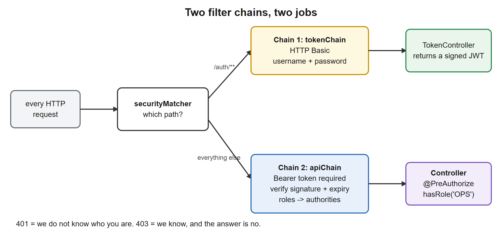
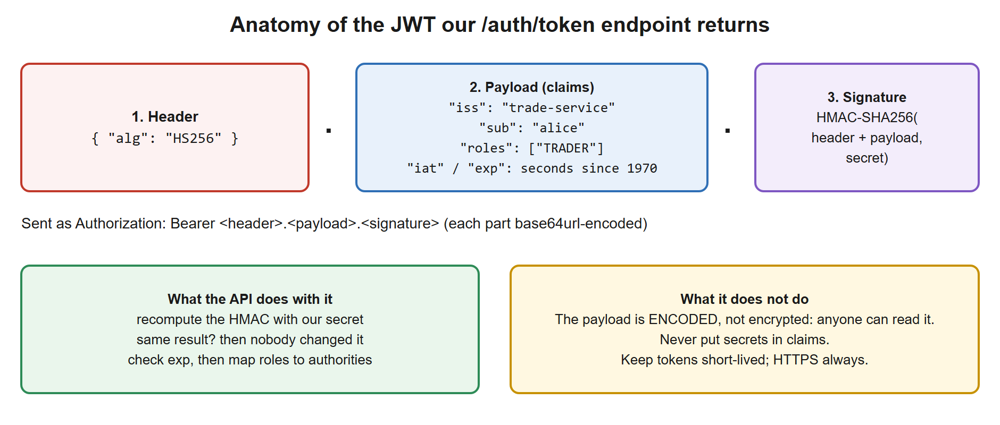

# 05. Security, JWT, OAuth2

**You build this yourself**, continuing in the same project folder. My working copy is [`../../reference/lesson-05`](../../reference/lesson-05). Open it only when you are stuck.

**Starting point:** your project as it was at the end of lesson 04. Not there? Copy everything from `reference/lesson-04` into an empty folder and continue.
**End state:** lesson 04 with a stateless, token-secured API: users log in at `/auth/token` and receive a signed JWT; every other endpoint needs `Authorization: Bearer <token>`; roles decide who may create and who may settle; Actuator is locked down except health and info. 50 tests pass.

## 1. Goal and time box

**120 minutes.** After this lesson you can: explain authentication versus authorization and `401` versus `403`; configure a Spring Security `SecurityFilterChain`; explain what a JWT contains and how the API verifies it; protect methods by role; describe OAuth2/OpenID Connect and where this application would sit in it; and test secured endpoints, including the failure cases.

## 2. Why it matters

Security is where mistakes become incidents. Interviewers for architect roles ask what you would put in front of an API, how tokens work, why they expire, and how services trust each other. The answers are conceptual, and this lesson gives you working code behind each concept.

| You know | Spring equivalent |
|---|---|
| Container security: `web.xml` security constraints, `@RolesAllowed` on EJBs | `SecurityFilterChain` rules and `@PreAuthorize` on methods |
| JAAS login modules, LDAP realms on the app server | `UserDetailsService`, or (better) an external identity provider |
| Session cookie after a form login | Stateless: a signed token on every request, no server session |
| SWIFT: message authentication and signatures prove who sent a message | A JWT signature proves who issued a token and that it was not altered |
| Network zone: only the gateway may call the back end | Resource server validates every call; zero trust inside the network too |
| Service account for a batch job | OAuth2 *client credentials* flow |

## 3. Concepts explained like a teacher

### Authentication, authorization, 401 and 403

- **Authentication**: *who are you?* Proven by a password, a token, a certificate.
- **Authorization**: *what may you do?* Roles, scopes, permissions.
- **`401 Unauthorized`** means "I do not know who you are" (no or invalid credentials). **`403 Forbidden`** means "I know who you are and the answer is no". (The names are historical: `401` really means *unauthenticated*.)

### Spring Security in one picture: filters in front of the servlet

Spring Security is a chain of **servlet filters** that run *before* `DispatcherServlet` (lesson 03). A request that fails here never reaches a controller. In Spring Security 6 you configure it by declaring `SecurityFilterChain` beans (the old `WebSecurityConfigurerAdapter` is gone).

[](images/01-two-filter-chains.svg)

We define **two chains**, because two different jobs need different rules:
1. `/auth/**`: log in with a username and password (HTTP Basic) and receive a token.
2. Everything else: accept **only** a valid token. No cookies, no session.

Each chain declares which URLs it handles (`securityMatcher`); the first match wins, so `@Order` matters.

### Stateless, and why we disable CSRF

*Cross-site request forgery* tricks a browser into sending a request **with the user's cookie**. It only works when authentication rides on a cookie that the browser attaches automatically. Our API uses an `Authorization` header that the browser does **not** add by itself, and creates no session, so CSRF protection has nothing to protect and is disabled. If you ever use cookie sessions, leave CSRF on.

### Passwords

Never store passwords or compare plain text. We hash with **bcrypt** through Spring's `DelegatingPasswordEncoder`: the stored value looks like `{bcrypt}$2a$10$...`, the prefix names the algorithm, so you can migrate algorithms later without a flag day. Our users live in memory with the password `password` for **learning only**; real systems use a user store or, better, an identity provider.

### JWT: a signed set of claims

[](images/02-jwt-anatomy.svg)

A JSON Web Token has three base64url parts: **header** (algorithm), **payload** (claims: `iss` issuer, `sub` subject, `exp` expiry, `iat` issued-at, plus ours: `roles`) and **signature**. The server recomputes the signature with its secret; if it matches, nobody changed the payload. Facts you must be able to state:

- **Signed, not encrypted.** Anyone can read the payload. Never put secrets or sensitive personal data in it.
- **Stateless and fast:** no database lookup per request. The price: you **cannot revoke** a token before it expires. Hence short lifetimes (minutes), plus refresh tokens issued by the identity provider.
- **HS256** (HMAC, one shared secret, what we use) versus **RS256 / ES256** (asymmetric: the issuer signs with a private key, everyone verifies with a public key published at a JWKS URL). With several services, use asymmetric so no service holds the signing secret.
- Always validate: signature, `exp`, and in real systems `iss` (issuer) and `aud` (audience).

### OAuth2 and OpenID Connect, the big picture

| Role | Meaning | Examples |
|---|---|---|
| **Authorization server** (identity provider) | Authenticates users, issues tokens | Keycloak, Microsoft Entra ID, Okta, Auth0 |
| **Resource server** | An API that accepts and validates tokens | **our trade service** |
| **Client** | An app that obtains tokens to call APIs | web app, mobile app, another service |
| **Resource owner** | The user | trader, ops analyst |

Flows you should be able to name: **Authorization Code with PKCE** (a user logs in through a browser or mobile app, the standard for user-facing apps), **Client Credentials** (service-to-service, no user), **Refresh Token**. **OpenID Connect (OIDC)** is a thin layer on OAuth2 that adds an *ID token* with the user's identity; OAuth2 alone is about *authorization to call APIs*.

Our `/auth/token` endpoint is a deliberately tiny stand-in for the authorization server, so the whole chain runs on your laptop. **In a real system** you delete `TokenController` and the encoder, and replace our decoder with one line of configuration: `spring.security.oauth2.resourceserver.jwt.issuer-uri=https://idp.example.com/realms/trade`. Spring then discovers the public keys (JWKS) and validates tokens issued by the identity provider. Your rules and `@PreAuthorize` annotations stay the same; only how roles appear in the token changes (a converter maps them, as ours does).

### Authorization in code: URL rules and method security

- **URL rules** in the chain: coarse and central ("health is public, other actuator endpoints need `ADMIN`, everything else needs a login"). Rules are checked **top to bottom, first match wins**: put specific rules first. End with `anyRequest().authenticated()`: **deny by default**.
- **Method security** (`@EnableMethodSecurity` plus `@PreAuthorize("hasRole('OPS')")`): fine-grained and next to the code it protects, so reviewers see who may call what. `hasRole('OPS')` checks the authority `ROLE_OPS`.

## 4. Setup steps

1. Open your project folder in VS Code and a terminal in it.
2. Confirm the starting point:

```powershell
.\mvnw.cmd -q clean verify
```

Expected: no output.

3. Set the compare shortcut (change the path):

```powershell
$REF = "C:\path\to\springboot-2day\reference\lesson-05"
```

### Files to change or add, in order

| # | File | Change | Why |
|---|---|---|---|
| 1 | `pom.xml` | **edit**: security, resource server, security test | Libraries |
| 2 | `application.yml`, `application-prod.yml` | **edit**: secret and token lifetime | Configuration, no secret in prod defaults |
| 3 | `security/SecurityProperties.java` | **new** | Validated settings |
| 4 | `security/SecurityConfig.java` | **new** | Filter chains, users, JWT encoder and decoder |
| 5 | `security/TokenController.java` | **new** | The login endpoint |
| 6 | `web/TradeController.java`, `web/ApiExceptionHandler.java` | **edit** | Roles per endpoint; `403` mapping |
| 7 | Tests: `TestTokens`, `SecurityTest` **new**; `TradeControllerTest`, `ActuatorTest`, `ConfigurationTest`, `TradeApiTest` **edit** | Existing tests must now present tokens |

## 5. Code walkthrough

A build-along. Where a file already exists, the block shows the **whole file**.

### Step 1. Add the security libraries

**File:** `pom.xml`
```xml
<?xml version="1.0" encoding="UTF-8"?>
<project xmlns="http://maven.apache.org/POM/4.0.0"
         xmlns:xsi="http://www.w3.org/2001/XMLSchema-instance"
         xsi:schemaLocation="http://maven.apache.org/POM/4.0.0 https://maven.apache.org/xsd/maven-4.0.0.xsd">
  <modelVersion>4.0.0</modelVersion>

  <!-- The parent pins versions of over 1,500 libraries, so we never write versions below. -->
  <parent>
    <groupId>org.springframework.boot</groupId>
    <artifactId>spring-boot-starter-parent</artifactId>
    <version>3.5.16</version>
    <relativePath/>
  </parent>

  <!-- Our project's own identity. -->
  <groupId>com.example</groupId>
  <artifactId>trade-service</artifactId>
  <version>0.0.1-SNAPSHOT</version>
  <name>trade-service</name>

  <properties>
    <java.version>21</java.version>
  </properties>

  <dependencies>
    <!-- Web starter: embedded Tomcat + Spring MVC + Jackson (JSON). -->
    <dependency>
      <groupId>org.springframework.boot</groupId>
      <artifactId>spring-boot-starter-web</artifactId>
    </dependency>

    <!-- AOP starter (lesson 01): brings AspectJ so we can write @Aspect classes. -->
    <dependency>
      <groupId>org.springframework.boot</groupId>
      <artifactId>spring-boot-starter-aop</artifactId>
    </dependency>

    <!-- Actuator (NEW in lesson 02): /actuator/health, /actuator/beans, /actuator/conditions, metrics... -->
    <dependency>
      <groupId>org.springframework.boot</groupId>
      <artifactId>spring-boot-starter-actuator</artifactId>
    </dependency>

    <!-- Validation starter (NEW in lesson 02): Bean Validation (jakarta.validation) + Hibernate Validator.
         Lesson 02 uses it to validate configuration; lesson 03 uses it to validate request bodies. -->
    <dependency>
      <groupId>org.springframework.boot</groupId>
      <artifactId>spring-boot-starter-validation</artifactId>
    </dependency>

    <!-- JPA starter (NEW in lesson 04): Spring Data JPA + Hibernate + HikariCP connection pool + transaction support. -->
    <dependency>
      <groupId>org.springframework.boot</groupId>
      <artifactId>spring-boot-starter-data-jpa</artifactId>
    </dependency>

    <!-- H2 (NEW in lesson 04): in-memory database for learning and tests. Runtime only: our code never imports it. -->
    <dependency>
      <groupId>com.h2database</groupId>
      <artifactId>h2</artifactId>
      <scope>runtime</scope>
    </dependency>

    <!-- Security starter (NEW in lesson 05): Spring Security filter chain, password encoders, method security. -->
    <dependency>
      <groupId>org.springframework.boot</groupId>
      <artifactId>spring-boot-starter-security</artifactId>
    </dependency>

    <!-- OAuth2 resource server (NEW in lesson 05): validates "Authorization: Bearer <JWT>" on incoming requests.
         Also brings the Nimbus library we use to sign (create) the demo tokens. -->
    <dependency>
      <groupId>org.springframework.boot</groupId>
      <artifactId>spring-boot-starter-oauth2-resource-server</artifactId>
    </dependency>

    <!-- Test starter: JUnit 5, AssertJ, Mockito, Spring test support. Only used when testing. -->
    <dependency>
      <groupId>org.springframework.boot</groupId>
      <artifactId>spring-boot-starter-test</artifactId>
      <scope>test</scope>
    </dependency>

    <!-- Security test helpers (NEW in lesson 05): jwt() request post-processor, @WithMockUser. -->
    <dependency>
      <groupId>org.springframework.security</groupId>
      <artifactId>spring-security-test</artifactId>
      <scope>test</scope>
    </dependency>
  </dependencies>

  <build>
    <plugins>
      <!-- Builds the runnable "fat jar" and adds the spring-boot:run command. -->
      <plugin>
        <groupId>org.springframework.boot</groupId>
        <artifactId>spring-boot-maven-plugin</artifactId>
      </plugin>
    </plugins>
  </build>
</project>
```

**Why:** `spring-boot-starter-security` is the filter chain, password encoders and method security. `spring-boot-starter-oauth2-resource-server` adds the bearer-token filter and the Nimbus JOSE library (it also signs our demo tokens). `spring-security-test` gives `MockMvc` helpers such as `jwt()` and `httpBasic()`.

**Checkpoint:** `.\mvnw.cmd -q compile` silent. (If you run the application now, every request answers `401`: Boot secures everything as soon as the starter is on the classpath. That is the "secure by default" principle in action.)

### Step 2. Configuration for the signing secret

**File:** `src/main/resources/application.yml`
```yaml
# Base configuration: applies in every profile. Profile files (application-dev.yml, application-prod.yml)
# are layered on top and win when the same key appears in both.
spring:
  application:
    name: trade-service
  profiles:
    default: dev          # used only when no profile is activated explicitly
  jpa:
    open-in-view: false           # no Hibernate session during view rendering: lazy-loading mistakes fail early
    hibernate:
      ddl-auto: create-drop       # Hibernate builds the tables from the entities. Learning only: real systems use Flyway/Liquibase.

# Our own settings, bound to the TradeProperties record (prefix "trade").
trade:
  max-quantity: 1000000
  venue: XLON
  security:
    # HS256 needs a secret of at least 32 characters. The default below is for local development ONLY.
    # Real environments inject JWT_SECRET from a secret store (the prod profile has no default on purpose).
    jwt-secret: ${JWT_SECRET:dev-only-secret-change-me-0123456789abcdef}
    token-ttl: 15m

# Custom switch for the conditional bean in lesson 02.
audit:
  enabled: false

# Actuator: expose only what is safe by default; the dev profile opens more.
management:
  endpoints:
    web:
      exposure:
        include: health,info
  info:
    env:
      enabled: true       # publish the "info.*" keys below at /actuator/info

info:
  app:
    name: trade-service
    description: Trade capture and settlement demo
```

**File:** `src/main/resources/application-prod.yml`
```yaml
# Production: expose the minimum, hide health details, enable Kubernetes probes.
management:
  endpoints:
    web:
      exposure:
        include: health,info
  endpoint:
    health:
      show-details: never
      probes:
        enabled: true       # adds /actuator/health/liveness and /actuator/health/readiness

trade:
  max-quantity: 500000
  security:
    jwt-secret: ${JWT_SECRET:}     # no default: a blank value fails validation, so prod refuses to start without it

logging:
  level:
    com.example.trade: INFO
```

**File:** `src/main/java/com/example/trade/security/SecurityProperties.java`
```java
package com.example.trade.security;

import jakarta.validation.constraints.NotBlank;
import jakarta.validation.constraints.Size;
import java.time.Duration;
import org.springframework.boot.context.properties.ConfigurationProperties;
import org.springframework.boot.context.properties.bind.DefaultValue;
import org.springframework.validation.annotation.Validated;

// Keys under "trade.security." in the yml. A secret that is missing or too short stops the application at startup,
// instead of silently running with a guessable signing key.
@ConfigurationProperties(prefix = "trade.security")
@Validated
public record SecurityProperties(
        @NotBlank @Size(min = 32, message = "must be at least 32 characters (256 bits) for HS256") String jwtSecret,
        @DefaultValue("15m") Duration tokenTtl) {}
```

**Why:**
- The secret is read from the environment variable `JWT_SECRET` when present; the `dev` default after the colon exists **only** so the lesson runs on your laptop.
- `application-prod.yml` has **no default** (`${JWT_SECRET:}` is empty), so a production start without the variable fails validation instead of running with a guessable key. We prove it in step 7.
- `@Size(min = 32)`: an HS256 key should be at least 256 bits.
- `@DefaultValue("15m")` gives the token lifetime; `Duration` binds `15m`, `30s`, `PT15M`.

**Checkpoint:** `.\mvnw.cmd -q compile` silent.

### Step 3. The security configuration

**File:** `src/main/java/com/example/trade/security/SecurityConfig.java`
```java
package com.example.trade.security;

import com.nimbusds.jose.jwk.source.ImmutableSecret;
import java.nio.charset.StandardCharsets;
import javax.crypto.SecretKey;
import javax.crypto.spec.SecretKeySpec;
import org.springframework.boot.autoconfigure.condition.ConditionalOnWebApplication;
import org.springframework.context.annotation.Bean;
import org.springframework.context.annotation.Configuration;
import org.springframework.core.annotation.Order;
import org.springframework.security.config.Customizer;
import org.springframework.security.config.annotation.method.configuration.EnableMethodSecurity;
import org.springframework.security.config.annotation.web.builders.HttpSecurity;
import org.springframework.security.config.http.SessionCreationPolicy;
import org.springframework.security.core.userdetails.User;
import org.springframework.security.core.userdetails.UserDetailsService;
import org.springframework.security.crypto.factory.PasswordEncoderFactories;
import org.springframework.security.crypto.password.PasswordEncoder;
import org.springframework.security.oauth2.jose.jws.MacAlgorithm;
import org.springframework.security.oauth2.jwt.JwtDecoder;
import org.springframework.security.oauth2.jwt.JwtEncoder;
import org.springframework.security.oauth2.jwt.NimbusJwtDecoder;
import org.springframework.security.oauth2.jwt.NimbusJwtEncoder;
import org.springframework.security.oauth2.server.resource.authentication.JwtAuthenticationConverter;
import org.springframework.security.oauth2.server.resource.authentication.JwtGrantedAuthoritiesConverter;
import org.springframework.security.provisioning.InMemoryUserDetailsManager;
import org.springframework.security.web.SecurityFilterChain;

// The whole security setup in one class. Two filter chains, because two different jobs need two different rules:
//   1. /auth/**  : "log in" with a username and password (HTTP Basic) and receive a JWT.
//   2. everything else : the API, which accepts ONLY a valid JWT (Authorization: Bearer ...). No sessions, no cookies.
//
// @ConditionalOnWebApplication: HttpSecurity only exists in a web application. Without this line the non-web run from
// lesson 01 (--spring.main.web-application-type=none) and our non-web tests would fail at startup.
@Configuration
@ConditionalOnWebApplication(type = ConditionalOnWebApplication.Type.SERVLET)
@EnableMethodSecurity           // turns on @PreAuthorize on controller/service methods
public class SecurityConfig {

    // The first chain whose securityMatcher matches the request wins, so @Order matters.
    @Bean
    @Order(1)
    SecurityFilterChain tokenChain(HttpSecurity http) throws Exception {
        http.securityMatcher("/auth/**")
                .csrf(csrf -> csrf.disable())       // no browser session or cookie here, so CSRF does not apply
                .sessionManagement(s -> s.sessionCreationPolicy(SessionCreationPolicy.STATELESS))
                .authorizeHttpRequests(a -> a.anyRequest().authenticated())
                .httpBasic(Customizer.withDefaults());
        return http.build();
    }

    @Bean
    @Order(2)
    SecurityFilterChain apiChain(HttpSecurity http, JwtAuthenticationConverter jwtConverter) throws Exception {
        http.csrf(csrf -> csrf.disable())           // CSRF protects cookie sessions; a bearer-token API has none
                .sessionManagement(s -> s.sessionCreationPolicy(SessionCreationPolicy.STATELESS))
                .authorizeHttpRequests(a -> a
                        // Rules are checked top to bottom: the FIRST match wins, so put specific rules first.
                        .requestMatchers("/actuator/health/**", "/actuator/info").permitAll()   // load balancers and probes
                        .requestMatchers("/actuator/**").hasRole("ADMIN")                      // beans, env, metrics...
                        .anyRequest().authenticated())                                           // secure by default
                .oauth2ResourceServer(o -> o.jwt(j -> j.jwtAuthenticationConverter(jwtConverter)));
        return http.build();
    }

    // Maps the "roles" claim of the token (["TRADER"]) to Spring authorities (ROLE_TRADER),
    // so hasRole('TRADER') and @PreAuthorize work.
    @Bean
    JwtAuthenticationConverter jwtAuthenticationConverter() {
        var authorities = new JwtGrantedAuthoritiesConverter();
        authorities.setAuthoritiesClaimName("roles");
        authorities.setAuthorityPrefix("ROLE_");
        var converter = new JwtAuthenticationConverter();
        converter.setJwtGrantedAuthoritiesConverter(authorities);
        return converter;
    }

    // Demo users, held in memory. A real system uses a database, LDAP, or an identity provider.
    // The passwords are stored as hashes (bcrypt via the delegating encoder), never as plain text.
    @Bean
    UserDetailsService users(PasswordEncoder encoder) {
        return new InMemoryUserDetailsManager(
                User.withUsername("alice").password(encoder.encode("password")).roles("TRADER").build(),
                User.withUsername("bob").password(encoder.encode("password")).roles("OPS").build(),
                User.withUsername("carol").password(encoder.encode("password")).roles("VIEWER").build(),
                User.withUsername("admin").password(encoder.encode("password")).roles("ADMIN").build());
    }

    @Bean
    PasswordEncoder passwordEncoder() {
        return PasswordEncoderFactories.createDelegatingPasswordEncoder();   // bcrypt by default, upgradeable
    }

    // --- JWT signing: HS256 = HMAC with ONE shared secret (same key signs and verifies). ---
    // Fine for one service. With several services, use an identity provider and RS256/ES256 public keys (see the lesson).
    @Bean
    SecretKey jwtKey(SecurityProperties props) {
        return new SecretKeySpec(props.jwtSecret().getBytes(StandardCharsets.UTF_8), "HmacSHA256");
    }

    // Defining this bean makes Boot back off from its own JwtDecoder (which would need an issuer-uri).
    @Bean
    JwtDecoder jwtDecoder(SecretKey jwtKey) {
        return NimbusJwtDecoder.withSecretKey(jwtKey).macAlgorithm(MacAlgorithm.HS256).build();
    }

    @Bean
    JwtEncoder jwtEncoder(SecretKey jwtKey) {
        return new NimbusJwtEncoder(new ImmutableSecret<>(jwtKey));
    }
}
```

**Why, piece by piece:**
- `@ConditionalOnWebApplication`: `HttpSecurity` exists only in a web application. Without this line, the non-web run and non-web tests from lessons 01 to 04 would fail at startup with *`required a bean of type HttpSecurity`*.
- `tokenChain` (`@Order(1)`): matches `/auth/**` only, HTTP Basic, stateless.
- `apiChain` (`@Order(2)`): rules first-match-wins: health and info public, other `/actuator/**` need `ADMIN`, everything else needs a login. `oauth2ResourceServer(jwt)` says "accept a bearer JWT".
- `jwtAuthenticationConverter`: copies the token's `roles` claim to Spring authorities with the prefix `ROLE_`, which is what `hasRole` checks.
- `users`: four demo users, passwords hashed with the delegating encoder.
- `jwtKey`, `jwtDecoder`, `jwtEncoder`: HS256 with one shared key. **Defining our own `JwtDecoder` makes Boot back off** from its auto-configured one (lesson 02's rule), which would otherwise demand an `issuer-uri`.

**Checkpoint:** `.\mvnw.cmd -q compile` silent.

**Stuck?**
- *`package com.nimbusds.jose.jwk.source does not exist`*: the resource-server starter is missing from the pom.
- *`required a bean of type HttpSecurity` when you run with `--spring.main.web-application-type=none`*: the `@ConditionalOnWebApplication` line on `SecurityConfig` is missing.

### Step 4. The login endpoint

**File:** `src/main/java/com/example/trade/security/TokenController.java`
```java
package com.example.trade.security;

import com.fasterxml.jackson.annotation.JsonProperty;
import java.time.Instant;
import java.util.List;
import org.springframework.boot.autoconfigure.condition.ConditionalOnWebApplication;
import org.springframework.security.core.Authentication;
import org.springframework.security.core.GrantedAuthority;
import org.springframework.security.oauth2.jose.jws.MacAlgorithm;
import org.springframework.security.oauth2.jwt.JwsHeader;
import org.springframework.security.oauth2.jwt.JwtClaimsSet;
import org.springframework.security.oauth2.jwt.JwtEncoder;
import org.springframework.security.oauth2.jwt.JwtEncoderParameters;
import org.springframework.web.bind.annotation.PostMapping;
import org.springframework.web.bind.annotation.RestController;

// A tiny "login" endpoint: the caller proves who they are with HTTP Basic (see tokenChain), we hand back a signed JWT.
// This stands in for an identity provider (Keycloak, Entra ID, Okta...). In a real system THEY issue the tokens
// and this service only validates them, so this controller would simply not exist.
@RestController
@ConditionalOnWebApplication(type = ConditionalOnWebApplication.Type.SERVLET)   // needs the JwtEncoder from SecurityConfig
public class TokenController {

    // The OAuth2 field names are snake_case ("access_token", "expires_in"), so we name them explicitly.
    public record TokenResponse(
            @JsonProperty("access_token") String accessToken,
            @JsonProperty("token_type") String tokenType,
            @JsonProperty("expires_in") long expiresIn) {}

    private final JwtEncoder encoder;
    private final SecurityProperties props;

    public TokenController(JwtEncoder encoder, SecurityProperties props) {
        this.encoder = encoder;
        this.props = props;
    }

    @PostMapping("/auth/token")
    public TokenResponse token(Authentication authentication) {
        Instant now = Instant.now();
        List<String> roles = authentication.getAuthorities().stream()
                .map(GrantedAuthority::getAuthority)
                .map(a -> a.startsWith("ROLE_") ? a.substring(5) : a)
                .sorted()
                .toList();

        // Claims = the facts inside the token: who (sub), who issued it (iss), validity window (iat, exp), and roles.
        JwtClaimsSet claims = JwtClaimsSet.builder()
                .issuer("trade-service")
                .subject(authentication.getName())
                .issuedAt(now)
                .expiresAt(now.plus(props.tokenTtl()))
                .claim("roles", roles)
                .build();

        String jwt = encoder.encode(JwtEncoderParameters.from(JwsHeader.with(MacAlgorithm.HS256).build(), claims))
                .getTokenValue();
        return new TokenResponse(jwt, "Bearer", props.tokenTtl().toSeconds());
    }
}
```

**Why:** the caller proves identity with HTTP Basic (handled by `tokenChain` before this method runs, so we receive an already-authenticated `Authentication`). We read the user's authorities, turn `ROLE_TRADER` into `TRADER`, build the **claims**, sign with `HS256`, and return the standard OAuth2 field names (`access_token`, `token_type`, `expires_in`). In a real system this class does not exist: the identity provider issues tokens.

**Checkpoint:** run the application and use the API as a client would.

```powershell
.\mvnw.cmd -q spring-boot:run
```

In a second terminal:

```powershell
curl.exe -s -i localhost:8080/trades
$T = (curl.exe -s -X POST -u alice:password localhost:8080/auth/token | ConvertFrom-Json).access_token
$T
curl.exe -s localhost:8080/trades -H "Authorization: Bearer $T"
```

Expected (verified; your token text and timestamps differ):

```
HTTP/1.1 401
WWW-Authenticate: Bearer

eyJhbGciOiJIUzI1NiJ9.eyJpc3MiOiJ0cmFkZS1zZXJ2aWNlIiwic3ViIjoiYWxpY2UiLCJleHAiOjE3OTQxOTE3MTksImlhdCI6MTc5NDE5MDgxOSwicm9sZXMiOlsiVFJBREVSIl19.<signature>

[{"id":1,"isin":"US0378331005","quantity":100,"price":189.5000,"status":"SETTLED"}]
```

Now look **inside** the token (you will see that anybody can):

```powershell
$p = $T.Split('.')[1].Replace('-','+').Replace('_','/'); $p = $p.PadRight($p.Length + (4 - $p.Length % 4) % 4, '='); [Text.Encoding]::UTF8.GetString([Convert]::FromBase64String($p))
```

```
{"iss":"trade-service","sub":"alice","exp":1794191719,"iat":1794190819,"roles":["TRADER"]}
```

`exp` minus `iat` is `900` seconds: the 15 minutes from the configuration. Paste your token at jwt.io too if you like (never paste a production token into a website).

**Stuck?**
- *`401` on the login call*: wrong user or password (all four use `password`), or `-u` quoting: `-u alice:password`.
- *`ConvertFrom-Json` errors*: the login returned an error body; run it without the conversion to read it.
- *A `401` with `error="invalid_token"` on the API call*: the token expired (15 minutes) or was cut off when copied; fetch a new one.

### Step 5. Roles per endpoint and the `403` mapping

**File:** `src/main/java/com/example/trade/web/TradeController.java`
```java
package com.example.trade.web;

import com.example.trade.domain.Trade;
import com.example.trade.domain.TradeStatus;
import com.example.trade.service.TradeService;
import jakarta.validation.Valid;
import jakarta.validation.constraints.NotBlank;
import jakarta.validation.constraints.NotNull;
import jakarta.validation.constraints.Pattern;
import jakarta.validation.constraints.Positive;
import java.math.BigDecimal;
import java.net.URI;
import java.util.List;
import org.springframework.http.ResponseEntity;
import org.springframework.security.access.prepost.PreAuthorize;
import org.springframework.web.bind.annotation.GetMapping;
import org.springframework.web.bind.annotation.PathVariable;
import org.springframework.web.bind.annotation.PostMapping;
import org.springframework.web.bind.annotation.RequestBody;
import org.springframework.web.bind.annotation.RequestMapping;
import org.springframework.web.bind.annotation.RequestParam;
import org.springframework.web.bind.annotation.RestController;
import org.springframework.web.servlet.support.ServletUriComponentsBuilder;

// Web layer: translates HTTP <-> Java. It contains NO business logic; it only calls the service.
// @RestController = @Controller + @ResponseBody: return values are written as JSON.
@RestController
@RequestMapping("/trades")
public class TradeController {

    // Request body shape. Jackson turns JSON into this record, then Bean Validation checks the annotations
    // (because the parameter is marked @Valid). A record is perfect here: immutable and no boilerplate.
    public record CreateTradeRequest(
            @NotBlank @Pattern(regexp = "[A-Z]{2}[A-Z0-9]{9}[0-9]", message = "must be a 12-character ISIN") String isin,
            @NotNull @Positive BigDecimal quantity,
            @NotNull @Positive BigDecimal price) {}

    private final TradeService service;

    public TradeController(TradeService service) {
        this.service = service;
    }

    // 201 Created + Location header pointing at the new resource: the REST convention for POST that creates.
    // Who may do what: the URL rules in SecurityConfig say "must be logged in"; these annotations say "with which role".
    // Reading needs no role beyond being authenticated (VIEWER, TRADER, OPS may all read).
    @PostMapping
    @PreAuthorize("hasRole('TRADER')")
    public ResponseEntity<Trade> create(@Valid @RequestBody CreateTradeRequest req) {
        Trade created = service.create(req.isin(), req.quantity(), req.price());
        URI location = ServletUriComponentsBuilder.fromCurrentRequest()
                .path("/{id}").buildAndExpand(created.id()).toUri();
        return ResponseEntity.created(location).body(created);
    }

    @GetMapping("/{id}")
    public Trade get(@PathVariable Long id) {
        return service.get(id);
    }

    // GET /trades?status=NEW. A bad value ("status=BOGUS") is rejected with 400 before this method runs.
    @GetMapping
    public List<Trade> list(@RequestParam(required = false) TradeStatus status) {
        return service.list(status);
    }

    // An action on a resource, modelled as POST on a sub-resource. Not idempotent here: a second call gives 409.
    @PostMapping("/{id}/settle")
    @PreAuthorize("hasRole('OPS')")
    public Trade settle(@PathVariable Long id) {
        return service.settle(id);
    }
}
```

**File:** `src/main/java/com/example/trade/web/ApiExceptionHandler.java`
```java
package com.example.trade.web;

import com.example.trade.service.BusinessRuleException;
import com.example.trade.service.TradeNotFoundException;
import com.example.trade.service.TradeStateException;
import java.util.LinkedHashMap;
import java.util.Map;
import org.slf4j.Logger;
import org.slf4j.LoggerFactory;
import org.springframework.http.HttpHeaders;
import org.springframework.http.HttpStatus;
import org.springframework.http.HttpStatusCode;
import org.springframework.http.ProblemDetail;
import org.springframework.http.ResponseEntity;
import org.springframework.security.access.AccessDeniedException;
import org.springframework.web.bind.MethodArgumentNotValidException;
import org.springframework.web.bind.annotation.ExceptionHandler;
import org.springframework.web.bind.annotation.RestControllerAdvice;
import org.springframework.web.context.request.WebRequest;
import org.springframework.web.servlet.mvc.method.annotation.ResponseEntityExceptionHandler;

// ONE place that turns exceptions into HTTP responses, for every controller.
// The body is a ProblemDetail (RFC 9457): JSON with type, title, status, detail, content type application/problem+json.
// ResponseEntityExceptionHandler already maps Spring's own errors (bad JSON, wrong method, bad parameter type) to
// ProblemDetail; we add our domain exceptions and enrich the validation error.
@RestControllerAdvice
public class ApiExceptionHandler extends ResponseEntityExceptionHandler {
    private static final Logger log = LoggerFactory.getLogger(ApiExceptionHandler.class);

    @ExceptionHandler(TradeNotFoundException.class)
    ProblemDetail notFound(TradeNotFoundException ex) {
        return ProblemDetail.forStatusAndDetail(HttpStatus.NOT_FOUND, ex.getMessage());
    }

    @ExceptionHandler(TradeStateException.class)
    ProblemDetail conflict(TradeStateException ex) {
        return ProblemDetail.forStatusAndDetail(HttpStatus.CONFLICT, ex.getMessage());
    }

    @ExceptionHandler(BusinessRuleException.class)
    ProblemDetail unprocessable(BusinessRuleException ex) {
        return ProblemDetail.forStatusAndDetail(HttpStatus.UNPROCESSABLE_ENTITY, ex.getMessage());
    }

    // Method security (@PreAuthorize) throws this from INSIDE the controller call, so our catch-all below would
    // otherwise catch it and answer 500. We answer 403 explicitly. (Missing/invalid tokens never get here: the
    // security filter rejects them earlier with 401.)
    @ExceptionHandler(AccessDeniedException.class)
    ProblemDetail forbidden(AccessDeniedException ex) {
        return ProblemDetail.forStatusAndDetail(HttpStatus.FORBIDDEN, "Access denied");
    }

    // Validation failure: add a map field -> message so a client can show errors next to the right input.
    @Override
    protected ResponseEntity<Object> handleMethodArgumentNotValid(MethodArgumentNotValidException ex,
            HttpHeaders headers, HttpStatusCode status, WebRequest request) {
        Map<String, String> errors = new LinkedHashMap<>();
        ex.getBindingResult().getFieldErrors().forEach(e -> errors.putIfAbsent(e.getField(), e.getDefaultMessage()));
        ProblemDetail pd = ProblemDetail.forStatusAndDetail(HttpStatus.BAD_REQUEST, "Validation failed");
        pd.setProperty("errors", errors);
        return handleExceptionInternal(ex, pd, headers, status, request);
    }

    // Safety net: anything unexpected becomes a generic 500. Log the detail here, never send it to the client
    // (stack traces and SQL fragments help attackers, not users).
    @ExceptionHandler(Exception.class)
    ProblemDetail unexpected(Exception ex) {
        log.error("Unhandled exception", ex);
        return ProblemDetail.forStatusAndDetail(HttpStatus.INTERNAL_SERVER_ERROR, "Unexpected error");
    }
}
```

**Why:**
- `@PreAuthorize("hasRole('TRADER')")` on `create` and `hasRole('OPS')` on `settle`: a trader books, operations settle (separation of duties). Reading needs only a login.
- **A trap we fell into and you must know:** `@PreAuthorize` throws `AccessDeniedException` from *inside* the controller call, so our catch-all `@ExceptionHandler(Exception.class)` from lesson 03 would catch it and answer **`500`**. The dedicated handler answers `403` with a `ProblemDetail` instead. Missing or invalid tokens never get here: the security filter answers `401` earlier.

**Checkpoint:** restart the application and try the roles:

```powershell
curl.exe -s -i -X POST localhost:8080/trades -H "Authorization: Bearer $T" -H "Content-Type: application/json" -d '{\"isin\":\"US0378331005\",\"quantity\":100,\"price\":189.50}'
curl.exe -s -i -X POST localhost:8080/trades/2/settle -H "Authorization: Bearer $T"
$TB = (curl.exe -s -X POST -u bob:password localhost:8080/auth/token | ConvertFrom-Json).access_token
curl.exe -s -X POST localhost:8080/trades/2/settle -H "Authorization: Bearer $TB"
```

(`$T` is alice's token; fetch a new one first if you opened a new terminal or restarted: tokens are signed with the same dev secret, so the old token is still valid after a restart unless it expired.)

Expected (verified):

```
HTTP/1.1 201
Location: http://localhost:8080/trades/2

HTTP/1.1 403
Content-Type: application/problem+json
{"type":"about:blank","title":"Forbidden","status":403,"detail":"Access denied","instance":"/trades/2/settle"}

{"id":2,"isin":"US0378331005","quantity":100,"price":189.5000,"status":"SETTLED"}
```

Alice (a trader) created the trade but may not settle it; Bob (ops) settled it.

Actuator and bad tokens:

```powershell
curl.exe -s -o NUL -w "health %{http_code}`n" localhost:8080/actuator/health
curl.exe -s -o NUL -w "beans, no token %{http_code}`n" localhost:8080/actuator/beans
curl.exe -s -o NUL -w "beans, alice %{http_code}`n" localhost:8080/actuator/beans -H "Authorization: Bearer $T"
$TA = (curl.exe -s -X POST -u admin:password localhost:8080/auth/token | ConvertFrom-Json).access_token
curl.exe -s -o NUL -w "beans, admin %{http_code}`n" localhost:8080/actuator/beans -H "Authorization: Bearer $TA"
curl.exe -s -i localhost:8080/trades -H "Authorization: Bearer ${T}x"
```

```
health 200
beans, no token 401
beans, alice 403
beans, admin 200
HTTP/1.1 401
WWW-Authenticate: Bearer error="invalid_token", error_description="An error occurred while attempting to decode the Jwt: Signed JWT rejected: Invalid signature", ...
```

The last call appended one character to the token: the signature no longer matches, so the token is rejected. That is tamper detection working.

### Step 6. Tests: update the old ones, add the security tests

The existing tests now run against a secured application, so they must present credentials. Replace these four files, then add the two new ones.

**File:** `src/test/java/com/example/trade/TradeControllerTest.java`
```java
package com.example.trade;

import static org.mockito.ArgumentMatchers.any;
import static org.mockito.ArgumentMatchers.eq;
import static org.mockito.BDDMockito.given;
import static org.springframework.security.test.web.servlet.request.SecurityMockMvcRequestPostProcessors.jwt;
import static org.springframework.test.web.servlet.request.MockMvcRequestBuilders.get;
import static org.springframework.test.web.servlet.request.MockMvcRequestBuilders.post;
import static org.springframework.test.web.servlet.result.MockMvcResultMatchers.content;
import static org.springframework.test.web.servlet.result.MockMvcResultMatchers.header;
import static org.springframework.test.web.servlet.result.MockMvcResultMatchers.jsonPath;
import static org.springframework.test.web.servlet.result.MockMvcResultMatchers.status;

import com.example.trade.domain.Trade;
import com.example.trade.domain.TradeStatus;
import com.example.trade.service.BusinessRuleException;
import com.example.trade.service.TradeNotFoundException;
import com.example.trade.service.TradeService;
import com.example.trade.service.TradeStateException;
import com.example.trade.security.SecurityConfig;
import com.example.trade.security.SecurityProperties;
import com.example.trade.web.TradeController;
import java.math.BigDecimal;
import java.util.List;
import org.junit.jupiter.api.Test;
import org.springframework.beans.factory.annotation.Autowired;
import org.springframework.boot.test.autoconfigure.web.servlet.WebMvcTest;
import org.springframework.boot.context.properties.EnableConfigurationProperties;
import org.springframework.context.annotation.Import;
import org.springframework.http.MediaType;
import org.springframework.security.core.authority.SimpleGrantedAuthority;
import org.springframework.security.test.web.servlet.request.SecurityMockMvcRequestPostProcessors.JwtRequestPostProcessor;
import org.springframework.test.context.bean.override.mockito.MockitoBean;
import org.springframework.test.web.servlet.MockMvc;

// A "slice" test: only the web layer is started (controllers, the exception handler, JSON conversion).
// The service is replaced by a Mockito mock, so we test HTTP behaviour alone and fast.
// Since lesson 05 the slice also loads our real SecurityConfig, so the real URL rules and @PreAuthorize apply.
@WebMvcTest(TradeController.class)
@Import(SecurityConfig.class)
@EnableConfigurationProperties(SecurityProperties.class)   // a slice does not scan properties classes, so we add it
class TradeControllerTest {

    @Autowired MockMvc mvc;
    @MockitoBean TradeService service;

    private static final String VALID = """
            {"isin":"US0378331005","quantity":100,"price":189.50}""";

    // jwt() puts an already-validated token into the request, so these tests need no real signing.
    private static JwtRequestPostProcessor as(String role) {
        return jwt().authorities(new SimpleGrantedAuthority("ROLE_" + role));
    }

    private static Trade trade(long id, TradeStatus status) {
        return new Trade(id, "US0378331005", new BigDecimal("100"), new BigDecimal("189.50"), status);
    }

    @Test
    void createReturns201WithLocationHeader() throws Exception {
        given(service.create(eq("US0378331005"), any(), any())).willReturn(trade(7, TradeStatus.NEW));

        mvc.perform(post("/trades").with(as("TRADER")).contentType(MediaType.APPLICATION_JSON).content(VALID))
                .andExpect(status().isCreated())
                .andExpect(header().string("Location", "http://localhost/trades/7"))
                .andExpect(jsonPath("$.id").value(7))
                .andExpect(jsonPath("$.status").value("NEW"));
    }

    @Test
    void invalidBodyReturns400WithFieldErrors() throws Exception {
        String bad = """
                {"isin":"not-an-isin","quantity":-5}""";

        mvc.perform(post("/trades").with(as("TRADER")).contentType(MediaType.APPLICATION_JSON).content(bad))
                .andExpect(status().isBadRequest())
                .andExpect(content().contentTypeCompatibleWith("application/problem+json"))
                .andExpect(jsonPath("$.detail").value("Validation failed"))
                .andExpect(jsonPath("$.errors.isin").value("must be a 12-character ISIN"))
                .andExpect(jsonPath("$.errors.quantity").exists())
                .andExpect(jsonPath("$.errors.price").exists());
    }

    @Test
    void malformedJsonReturns400() throws Exception {
        mvc.perform(post("/trades").with(as("TRADER")).contentType(MediaType.APPLICATION_JSON).content("{oops"))
                .andExpect(status().isBadRequest());
    }

    @Test
    void unknownTradeReturns404ProblemDetail() throws Exception {
        given(service.get(99L)).willThrow(new TradeNotFoundException(99L));

        mvc.perform(get("/trades/99").with(as("VIEWER")))
                .andExpect(status().isNotFound())
                .andExpect(content().contentTypeCompatibleWith("application/problem+json"))
                .andExpect(jsonPath("$.status").value(404))
                .andExpect(jsonPath("$.detail").value("Trade not found: 99"));
    }

    @Test
    void settlingTwiceReturns409() throws Exception {
        given(service.settle(1L)).willThrow(new TradeStateException("Trade 1 is already settled"));

        mvc.perform(post("/trades/1/settle").with(as("OPS"))).andExpect(status().isConflict());
    }

    @Test
    void businessRuleReturns422() throws Exception {
        given(service.create(any(), any(), any())).willThrow(new BusinessRuleException("too big"));

        mvc.perform(post("/trades").with(as("TRADER")).contentType(MediaType.APPLICATION_JSON).content(VALID))
                .andExpect(status().isUnprocessableEntity())
                .andExpect(jsonPath("$.detail").value("too big"));
    }

    @Test
    void unexpectedErrorReturnsGeneric500WithoutLeakingDetails() throws Exception {
        given(service.get(1L)).willThrow(new IllegalStateException("jdbc:oracle://secret-host failed"));

        mvc.perform(get("/trades/1").with(as("VIEWER")))
                .andExpect(status().isInternalServerError())
                .andExpect(jsonPath("$.detail").value("Unexpected error"));
    }

    @Test
    void listPassesTheStatusFilterAndRejectsBadValues() throws Exception {
        given(service.list(TradeStatus.NEW)).willReturn(List.of(trade(1, TradeStatus.NEW)));

        mvc.perform(get("/trades").with(as("VIEWER")).param("status", "NEW"))
                .andExpect(status().isOk())
                .andExpect(jsonPath("$[0].id").value(1));
        mvc.perform(get("/trades").with(as("VIEWER")).param("status", "BOGUS"))
                .andExpect(status().isBadRequest());
    }

    @Test
    void noTokenReturns401() throws Exception {
        mvc.perform(get("/trades/1")).andExpect(status().isUnauthorized());
    }

    @Test
    void viewerCannotCreateAndGets403ProblemDetail() throws Exception {
        mvc.perform(post("/trades").with(as("VIEWER")).contentType(MediaType.APPLICATION_JSON).content(VALID))
                .andExpect(status().isForbidden())
                .andExpect(content().contentTypeCompatibleWith("application/problem+json"));
    }

    @Test
    void onlyOpsMaySettle() throws Exception {
        mvc.perform(post("/trades/1/settle").with(as("TRADER"))).andExpect(status().isForbidden());
    }
}
```

**File:** `src/test/java/com/example/trade/ActuatorTest.java`
```java
package com.example.trade;

import static org.springframework.security.test.web.servlet.request.SecurityMockMvcRequestPostProcessors.jwt;
import static org.springframework.test.web.servlet.request.MockMvcRequestBuilders.get;
import static org.springframework.test.web.servlet.result.MockMvcResultMatchers.jsonPath;
import static org.springframework.test.web.servlet.result.MockMvcResultMatchers.status;

import com.example.trade.health.GatewayStatus;
import org.junit.jupiter.api.Nested;
import org.junit.jupiter.api.Test;
import org.springframework.beans.factory.annotation.Autowired;
import org.springframework.boot.test.autoconfigure.web.servlet.AutoConfigureMockMvc;
import org.springframework.boot.test.context.SpringBootTest;
import org.springframework.security.core.authority.SimpleGrantedAuthority;
import org.springframework.test.context.ActiveProfiles;
import org.springframework.test.web.servlet.MockMvc;

class ActuatorTest {

    // Since lesson 05 only /actuator/health and /actuator/info are public; everything else needs the ADMIN role.
    private static final org.springframework.test.web.servlet.request.RequestPostProcessor ADMIN =
            jwt().authorities(new SimpleGrantedAuthority("ROLE_ADMIN"));

    @Nested
    @SpringBootTest
    @AutoConfigureMockMvc
    class Dev {
        @Autowired MockMvc mvc;
        @Autowired GatewayStatus gateway;

        @Test
        void healthIsUpAndShowsOurCustomIndicator() throws Exception {
            mvc.perform(get("/actuator/health"))
                    .andExpect(status().isOk())
                    .andExpect(jsonPath("$.status").value("UP"))
                    .andExpect(jsonPath("$.components.gateway.status").value("UP"));
        }

        @Test
        void healthGoesDownWith503WhenTheGatewayIsDown() throws Exception {
            gateway.setUp(false);
            try {
                mvc.perform(get("/actuator/health"))
                        .andExpect(status().isServiceUnavailable())
                        .andExpect(jsonPath("$.status").value("DOWN"))
                        .andExpect(jsonPath("$.components.gateway.details.reason").value("no heartbeat"));
            } finally {
                gateway.setUp(true);    // the context is shared by other tests: always restore
            }
        }

        @Test
        void infoShowsKeysFromTheYaml() throws Exception {
            mvc.perform(get("/actuator/info"))
                    .andExpect(jsonPath("$.app.name").value("trade-service"));
        }

        @Test
        void devExposesTheBeansEndpoint() throws Exception {
            mvc.perform(get("/actuator/beans").with(ADMIN)).andExpect(status().isOk());
        }
    }

    @Nested
    @SpringBootTest(properties = "trade.security.jwt-secret=test-secret-test-secret-test-secret-123")   // prod has no default secret
    @AutoConfigureMockMvc
    @ActiveProfiles("prod")
    // the prod profile has no default secret (on purpose), so the test supplies one
    class Prod {
        @Autowired MockMvc mvc;

        @Test
        void prodDoesNotExposeBeans() throws Exception {
            mvc.perform(get("/actuator/beans").with(ADMIN)).andExpect(status().isNotFound());
        }

        @Test
        void prodHidesHealthDetailsButKeepsProbes() throws Exception {
            mvc.perform(get("/actuator/health"))
                    .andExpect(status().isOk())
                    .andExpect(jsonPath("$.components").doesNotExist());
            mvc.perform(get("/actuator/health/liveness")).andExpect(status().isOk());
            mvc.perform(get("/actuator/health/readiness")).andExpect(status().isOk());
        }
    }
}
```

**File:** `src/test/java/com/example/trade/ConfigurationTest.java`
```java
package com.example.trade;

import static org.assertj.core.api.Assertions.assertThat;

import com.example.trade.config.TradeProperties;
import org.junit.jupiter.api.Nested;
import org.junit.jupiter.api.Test;
import org.springframework.beans.factory.annotation.Autowired;
import org.springframework.boot.test.context.SpringBootTest;
import org.springframework.test.context.ActiveProfiles;

// Shows that profiles change configuration: same code, different values.
class ConfigurationTest {

    @Nested
    @SpringBootTest(properties = "spring.main.web-application-type=none")
    class DefaultProfile {
        @Autowired TradeProperties props;

        @Test
        void usesValuesFromTheBaseFile() {
            assertThat(props.maxQuantity()).isEqualByComparingTo("1000000");
            assertThat(props.venue()).isEqualTo("XLON");
        }
    }

    @Nested
    @SpringBootTest(properties = {"spring.main.web-application-type=none",
            "trade.security.jwt-secret=test-secret-test-secret-test-secret-123"})   // prod has no default secret
    @ActiveProfiles("prod")
    class ProdProfile {
        @Autowired TradeProperties props;

        @Test
        void prodFileOverridesTheBaseFile() {
            assertThat(props.maxQuantity()).isEqualByComparingTo("500000");
            assertThat(props.venue()).isEqualTo("XLON");   // not overridden, so the base value remains
        }
    }

    @Nested
    @SpringBootTest(properties = {"spring.main.web-application-type=none", "trade.max-quantity=500"})
    class ExplicitOverride {
        @Autowired TradeProperties props;

        @Test
        void aPropertyOnTheTestOrCommandLineBeatsTheFiles() {
            assertThat(props.maxQuantity()).isEqualByComparingTo("500");
        }
    }
}
```

**File:** `src/test/java/com/example/trade/TradeApiTest.java`
```java
package com.example.trade;

import static org.springframework.http.HttpHeaders.AUTHORIZATION;
import static org.springframework.test.web.servlet.request.MockMvcRequestBuilders.get;
import static org.springframework.test.web.servlet.request.MockMvcRequestBuilders.post;
import static org.springframework.test.web.servlet.result.MockMvcResultMatchers.jsonPath;
import static org.springframework.test.web.servlet.result.MockMvcResultMatchers.status;

import org.junit.jupiter.api.Test;
import org.springframework.beans.factory.annotation.Autowired;
import org.springframework.boot.test.autoconfigure.web.servlet.AutoConfigureMockMvc;
import org.springframework.boot.test.context.SpringBootTest;
import org.springframework.http.MediaType;
import org.springframework.test.web.servlet.MockMvc;

// Full application, real service, repository, security and database; HTTP simulated by MockMvc (no real port).
// One test walks the whole lifecycle, the way real clients would: a trader books, ops settles.
@SpringBootTest
@AutoConfigureMockMvc
class TradeApiTest {

    @Autowired MockMvc mvc;

    @Test
    void createGetSettleAndConflict() throws Exception {
        String trader = TestTokens.bearerFor(mvc, "alice");
        String ops = TestTokens.bearerFor(mvc, "bob");
        String body = """
                {"isin":"US0378331005","quantity":100,"price":189.50}""";

        var created = mvc.perform(post("/trades").header(AUTHORIZATION, trader)
                        .contentType(MediaType.APPLICATION_JSON).content(body))
                .andExpect(status().isCreated())
                .andExpect(jsonPath("$.status").value("NEW"))
                .andReturn();
        String location = created.getResponse().getHeader("Location");

        mvc.perform(get(location).header(AUTHORIZATION, trader))
                .andExpect(status().isOk()).andExpect(jsonPath("$.isin").value("US0378331005"));
        mvc.perform(post(location + "/settle").header(AUTHORIZATION, ops))
                .andExpect(status().isOk()).andExpect(jsonPath("$.status").value("SETTLED"));
        mvc.perform(post(location + "/settle").header(AUTHORIZATION, ops))
                .andExpect(status().isConflict());
    }

    @Test
    void quantityAboveTheConfiguredLimitIs422() throws Exception {
        String body = """
                {"isin":"US0378331005","quantity":2000000,"price":1}""";

        mvc.perform(post("/trades").header(AUTHORIZATION, TestTokens.bearerFor(mvc, "alice"))
                        .contentType(MediaType.APPLICATION_JSON).content(body))
                .andExpect(status().isUnprocessableEntity());
    }
}
```

**File:** `src/test/java/com/example/trade/TestTokens.java`
```java
package com.example.trade;

import static org.springframework.security.test.web.servlet.request.SecurityMockMvcRequestPostProcessors.httpBasic;
import static org.springframework.test.web.servlet.request.MockMvcRequestBuilders.post;
import static org.springframework.test.web.servlet.result.MockMvcResultMatchers.status;

import com.jayway.jsonpath.JsonPath;
import org.springframework.test.web.servlet.MockMvc;

// Test helper: logs in through the REAL /auth/token endpoint and returns the Authorization header value.
final class TestTokens {
    private TestTokens() {}

    static String bearerFor(MockMvc mvc, String user) throws Exception {
        String json = mvc.perform(post("/auth/token").with(httpBasic(user, "password")))
                .andExpect(status().isOk())
                .andReturn().getResponse().getContentAsString();
        return "Bearer " + JsonPath.<String>read(json, "$.access_token");
    }
}
```

**File:** `src/test/java/com/example/trade/SecurityTest.java`
```java
package com.example.trade;

import static org.assertj.core.api.Assertions.assertThat;
import static org.assertj.core.api.Assertions.assertThatThrownBy;
import static org.springframework.http.HttpHeaders.AUTHORIZATION;
import static org.springframework.security.test.web.servlet.request.SecurityMockMvcRequestPostProcessors.httpBasic;
import static org.springframework.test.web.servlet.request.MockMvcRequestBuilders.get;
import static org.springframework.test.web.servlet.request.MockMvcRequestBuilders.post;
import static org.springframework.test.web.servlet.result.MockMvcResultMatchers.header;
import static org.springframework.test.web.servlet.result.MockMvcResultMatchers.jsonPath;
import static org.springframework.test.web.servlet.result.MockMvcResultMatchers.status;

import java.time.Instant;
import java.util.List;
import org.junit.jupiter.api.Test;
import org.springframework.beans.factory.annotation.Autowired;
import org.springframework.boot.WebApplicationType;
import org.springframework.boot.builder.SpringApplicationBuilder;
import org.springframework.boot.test.autoconfigure.web.servlet.AutoConfigureMockMvc;
import org.springframework.boot.test.context.SpringBootTest;
import org.springframework.http.MediaType;
import org.springframework.security.oauth2.jose.jws.MacAlgorithm;
import org.springframework.security.oauth2.jwt.JwsHeader;
import org.springframework.security.oauth2.jwt.JwtClaimsSet;
import org.springframework.security.oauth2.jwt.JwtEncoder;
import org.springframework.security.oauth2.jwt.JwtEncoderParameters;
import org.springframework.test.web.servlet.MockMvc;

// End-to-end security with REAL tokens: log in, call the API, see 401 and 403 for the right reasons.
@SpringBootTest
@AutoConfigureMockMvc
class SecurityTest {

    @Autowired MockMvc mvc;
    @Autowired JwtEncoder encoder;

    private static final String BODY = """
            {"isin":"US0378331005","quantity":100,"price":189.50}""";

    // ---- authentication: who are you? (401 when the answer is "unknown") ----

    @Test
    void apiWithoutATokenIs401WithABearerChallenge() throws Exception {
        mvc.perform(get("/trades"))
                .andExpect(status().isUnauthorized())
                .andExpect(header().string("WWW-Authenticate", org.hamcrest.Matchers.startsWith("Bearer")));
    }

    @Test
    void loginWithAWrongPasswordIs401() throws Exception {
        mvc.perform(post("/auth/token").with(httpBasic("alice", "wrong"))).andExpect(status().isUnauthorized());
    }

    @Test
    void loginReturnsABearerTokenWithTheRolesInIt() throws Exception {
        mvc.perform(post("/auth/token").with(httpBasic("alice", "password")))
                .andExpect(status().isOk())
                .andExpect(jsonPath("$.token_type").value("Bearer"))
                .andExpect(jsonPath("$.expires_in").value(900))
                .andExpect(jsonPath("$.access_token").isNotEmpty());
    }

    @Test
    void aGarbageTokenIs401() throws Exception {
        mvc.perform(get("/trades").header(AUTHORIZATION, "Bearer not.a.jwt")).andExpect(status().isUnauthorized());
    }

    @Test
    void aTamperedTokenIs401() throws Exception {
        String good = TestTokens.bearerFor(mvc, "alice");
        String tampered = good.substring(0, good.length() - 3) + (good.endsWith("AAA") ? "BBB" : "AAA");   // break the signature

        mvc.perform(get("/trades").header(AUTHORIZATION, tampered)).andExpect(status().isUnauthorized());
    }

    @Test
    void anExpiredTokenIs401() throws Exception {
        Instant past = Instant.now().minusSeconds(3600);
        JwtClaimsSet claims = JwtClaimsSet.builder().subject("alice").issuedAt(past.minusSeconds(60))
                .expiresAt(past).claim("roles", List.of("TRADER")).build();
        String expired = encoder.encode(JwtEncoderParameters.from(JwsHeader.with(MacAlgorithm.HS256).build(), claims))
                .getTokenValue();

        mvc.perform(get("/trades").header(AUTHORIZATION, "Bearer " + expired)).andExpect(status().isUnauthorized());
    }

    @Test
    void aTokenIsNotAcceptedAtTheLoginEndpoint() throws Exception {
        mvc.perform(post("/auth/token").header(AUTHORIZATION, TestTokens.bearerFor(mvc, "alice")))
                .andExpect(status().isUnauthorized());     // /auth/** wants Basic credentials, not a token
    }

    // ---- authorization: are you allowed? (403 when the answer is "known, but no") ----

    @Test
    void viewerCanReadButNotCreate() throws Exception {
        String viewer = TestTokens.bearerFor(mvc, "carol");

        mvc.perform(get("/trades").header(AUTHORIZATION, viewer)).andExpect(status().isOk());
        mvc.perform(post("/trades").header(AUTHORIZATION, viewer).contentType(MediaType.APPLICATION_JSON).content(BODY))
                .andExpect(status().isForbidden());
    }

    @Test
    void traderCanCreateButNotSettle() throws Exception {
        String trader = TestTokens.bearerFor(mvc, "alice");
        String location = mvc.perform(post("/trades").header(AUTHORIZATION, trader)
                        .contentType(MediaType.APPLICATION_JSON).content(BODY))
                .andExpect(status().isCreated()).andReturn().getResponse().getHeader("Location");

        mvc.perform(post(location + "/settle").header(AUTHORIZATION, trader)).andExpect(status().isForbidden());
        mvc.perform(post(location + "/settle").header(AUTHORIZATION, TestTokens.bearerFor(mvc, "bob")))
                .andExpect(status().isOk());
    }

    // ---- actuator: health is public, the rest is for admins ----

    @Test
    void healthIsPublicButBeansNeedAdmin() throws Exception {
        mvc.perform(get("/actuator/health")).andExpect(status().isOk());
        mvc.perform(get("/actuator/beans")).andExpect(status().isUnauthorized());
        mvc.perform(get("/actuator/beans").header(AUTHORIZATION, TestTokens.bearerFor(mvc, "alice")))
                .andExpect(status().isForbidden());
        mvc.perform(get("/actuator/beans").header(AUTHORIZATION, TestTokens.bearerFor(mvc, "admin")))
                .andExpect(status().isOk());
    }

    // ---- configuration safety ----

    @Test
    void prodRefusesToStartWithoutAJwtSecret() {
        assertThatThrownBy(() -> new SpringApplicationBuilder(TradeServiceApplication.class)
                .profiles("prod")
                .web(WebApplicationType.NONE)
                .run())
                .hasStackTraceContaining("jwtSecret");
        assertThat(System.getenv("JWT_SECRET")).as("this test assumes JWT_SECRET is not set").isNull();
    }
}
```

**Why:**
- **`TradeControllerTest` (slice)** now `@Import`s the real `SecurityConfig`, so the real URL rules and `@PreAuthorize` apply. A slice does not scan `@ConfigurationProperties` classes, hence `@EnableConfigurationProperties(SecurityProperties.class)`. The `jwt()` post-processor puts a ready-made, already-validated token in the request, so these tests need no signing and focus on *roles*.
- **`TestTokens`** logs in through the **real** `/auth/token` endpoint, so the integration tests exercise signing and verification for real.
- **`SecurityTest`** is the heart. Authentication cases (`401`): no token, wrong password, garbage token, **tampered** token, **expired** token (we mint one with an `exp` in the past using the same encoder), a token sent to the login endpoint. Authorization cases (`403`): a viewer cannot create, a trader cannot settle. Actuator: public health, admin-only beans. The last test starts the application in the `prod` profile **without** a secret and expects startup to fail.
- `ActuatorTest` and `ConfigurationTest` change for two reasons: the actuator endpoints beyond health now need `ADMIN`, and the `prod` profile now needs a secret, which the test supplies.
- Why not `@WithMockUser`? It builds a *session-style* user. For a bearer-token API the `jwt()` post-processor mirrors reality more closely.

**Checkpoint:**

```powershell
.\mvnw.cmd clean verify
```

Expected (verified), among other lines:

```
Tests run: 11, Failures: 0, Errors: 0, Skipped: 0 -- in com.example.trade.SecurityTest
Tests run: 11, Failures: 0, Errors: 0, Skipped: 0 -- in com.example.trade.TradeControllerTest
Tests run: 50, Failures: 0, Errors: 0, Skipped: 0
BUILD SUCCESS
```

**Stuck?**
- *Many `401`s in old tests*: they were not updated to send a token (steps above).
- *`TradeControllerTest` fails with `No qualifying bean of type SecurityProperties`*: the `@EnableConfigurationProperties` line is missing.
- *`prodRefusesToStartWithoutAJwtSecret` fails because the app started*: you have `JWT_SECRET` set in your environment (the test asserts it is not). Clear it: `Remove-Item Env:JWT_SECRET`.

### Run it, in production mode

Without a secret, the production profile refuses to start:

```powershell
.\mvnw.cmd -q spring-boot:run "-Dspring-boot.run.arguments=--spring.profiles.active=prod"
```

```
APPLICATION FAILED TO START
Binding to target com.example.trade.security.SecurityProperties failed:
    Property: trade.security.jwtSecret
    Value: ""
```

With a secret from the environment it starts (use your own random value of at least 32 characters; in real life it comes from a secret store):

```powershell
$env:JWT_SECRET = "a-long-random-secret-of-at-least-32-chars!!"
.\mvnw.cmd -q spring-boot:run "-Dspring-boot.run.arguments=--spring.profiles.active=prod"
```

Tokens signed with the old dev secret are now invalid. `Remove-Item Env:JWT_SECRET` afterwards.

### Debug it

1. Put a breakpoint in `TokenController.token`, press `F5`, call the login. The call stack shows the filter chain ran **before** the controller (`BasicAuthenticationFilter`).
2. Put a breakpoint in `TradeController.settle`, call it as Alice. **It is never reached**: method security stopped the call, and `ApiExceptionHandler.forbidden` ran. Now call it as Bob: you hit the breakpoint.
3. Turn on `logging.level.org.springframework.security=DEBUG` temporarily (in `application-dev.yml`) and call the API once. The log lists the **filter chain order** and shows which chain matched the request. Remove it again: it is verbose.

**Exercise (15 min).** (a) Add a rule so that only `ADMIN` may call `GET /trades` with `?status=FAILED`. Decide: URL rule or method security? (b) Change `token-ttl` to `10s`, log in, wait 11 seconds, call the API and read the `401` message. (c) Add a fifth user `dave` with both `TRADER` and `OPS` roles and verify that he can book and settle.

## 6. Common mistakes

| Mistake | How you notice | Fix |
|---|---|---|
| `hasRole('ROLE_OPS')` | Always `403` | `hasRole('OPS')` adds the `ROLE_` prefix itself; `hasAuthority('ROLE_OPS')` is the literal form |
| Rules in the wrong order | A specific rule never applies | First match wins: specific first, `anyRequest()` last |
| Catch-all advice swallowing `AccessDeniedException` | `500` instead of `403` | A dedicated handler (or rethrow), as in step 5 |
| `permitAll()` on `/**` "for testing" and forgotten | Open API in production | Deny by default; use profiles or test tokens for tests |
| Disabling CSRF on a cookie-session app | Cross-site attacks work | Disable only for stateless token APIs |
| Secret committed to Git or defaulted in prod | Anyone can mint valid tokens | Environment or secret store; fail fast when missing (`${JWT_SECRET:}`) |
| Long-lived tokens | A stolen token works for days | Minutes; refresh tokens from the identity provider |
| Putting sensitive data in the JWT | Readable by anyone who has the token | Claims are public; keep them minimal |
| Not validating issuer/audience with a real IdP | A token for another app is accepted | Configure `issuer-uri` and audience validation |
| Logging full tokens or `Authorization` headers | Tokens in log files | Mask headers in logs |
| `@WebMvcTest` with default security | Unexpected `401`/`403`, CSRF `403` on POST | `@Import` your real security config and use `jwt()` |

## 7. Production issues and design notes

| Symptom | Root cause | Fix |
|---|---|---|
| Everyone suddenly gets `401` | Clock skew between issuer and API, or key rotation | NTP everywhere; Spring allows 60 s skew by default; publish new keys before using them (JWKS) |
| User removed but still has access | Stateless token valid until `exp` | Short lifetime; refresh checks the user; a deny-list only for emergencies |
| Brute-force login attempts | No rate limiting | Gateway or filter rate limits, account lockout policy at the identity provider |
| Service-to-service calls fail after a deploy | New instance has a different secret | One secret source for all instances; prefer asymmetric keys |
| Browser app cannot call the API | Missing CORS configuration | Configure allowed origins explicitly (never `*` with credentials) |
| Token theft from the browser | Stored in `localStorage`, XSS | Prefer a backend-for-frontend with `HttpOnly` cookies, or in-memory tokens plus refresh; strict CSP |
| Audit asks "who did this?" | No subject in the logs | Log `sub` from the token with every business event (MDC), never the token |
| Admin endpoints reachable from the internet | Actuator exposed on the main port | Separate management port reachable only internally, plus the `ADMIN` rule |

## 8. Architect lens

- **Do not build your own identity provider.** Our `/auth/token` is a teaching aid. Use Keycloak, Entra ID or Okta: they handle MFA, password policy, federation, refresh, revocation and auditing. Your services become **resource servers** that only validate tokens.
- **Where to enforce:** at the **edge** (API gateway: authentication, rate limiting, coarse rules) *and* inside each service (authorization with business context). Defence in depth: never trust "the network".
- **Service-to-service:** client-credentials tokens with narrow scopes, or mutual TLS inside a mesh. Propagate the *user's* identity deliberately (token exchange) when downstream authorization depends on it.
- **Authorization model:** roles are simple and enough here. When rules depend on data ("a trader may settle only their own desk's trades") use method security with an expression or a policy engine, and test those rules.
- **Token lifetime is a business decision:** shorter is safer and costs more refreshes; weigh it against revocation requirements.
- **Secrets management:** a secret store (Vault, cloud KMS) injects secrets at runtime; rotate them; never put them in images or repositories.
- **Compliance link:** for financial messaging you will be asked about non-repudiation, audit trails and segregation of duties. Roles plus a subject on every audit event answer most of it.
- **When NOT to use JWT:** when you need instant revocation of every session (use opaque tokens with introspection or server-side sessions), or for a classic server-rendered web app where a cookie session is simpler and safer.

## 9. Self-check quiz

1. What is the difference between `401` and `403`?
2. Why do we use two `SecurityFilterChain` beans?
3. Why is CSRF disabled here, and when must it stay on?
4. What are the three parts of a JWT and what is the signature computed over?
5. Is a JWT encrypted? What follows for what you put inside?
6. HS256 versus RS256: which for several services, and why?
7. What does `hasRole('OPS')` actually check?
8. Why did the `403` need its own exception handler in this project?
9. Why does `application-prod.yml` give no default for the secret?
10. How would this application change if you adopted Keycloak?

<details><summary>Answers</summary>

1. `401`: not authenticated (unknown or invalid credentials). `403`: authenticated but not allowed.
2. The login endpoint (Basic, issues tokens) and the API (bearer token only) need different authentication mechanisms; each chain matches its own URLs.
3. CSRF abuses cookies the browser sends automatically. Our API uses an `Authorization` header and no session. Keep CSRF protection for cookie-based sessions.
4. Header, payload (claims), signature. The signature is computed over `base64url(header) + "." + base64url(payload)` with the key.
5. No, only encoded and signed. Anyone with the token can read it, so never put secrets or sensitive data in the claims.
6. RS256 (asymmetric): the issuer holds the private key; services only need the public key (JWKS), so a compromised service cannot mint tokens.
7. That the authentication holds the authority `ROLE_OPS`.
8. `@PreAuthorize` throws `AccessDeniedException` inside the controller call, where the catch-all `Exception` handler would turn it into `500`.
9. A missing secret must stop the application at startup (validation failure) instead of running with a default key.
10. Remove `TokenController`, the user store and our `JwtDecoder`/`JwtEncoder`; set `issuer-uri`; map the IdP's role claim in the converter. Rules and `@PreAuthorize` stay.

</details>

## 10. Interview Q&A

**Q1. How do you secure a REST API in Spring Boot?**
Spring Security with a stateless `SecurityFilterChain`: the API is an OAuth2 resource server validating JWT bearer tokens from an identity provider. URL rules deny by default and open only health; method security (`@PreAuthorize`) enforces roles close to the code. CSRF is off because there is no cookie session. Secrets come from the environment, and the application fails to start without them.

**Q2. Explain the structure of a JWT and how it is verified.**
Base64url header, payload with claims (`iss`, `sub`, `exp`, roles...) and a signature over header and payload. The resource server verifies the signature with the shared secret or the issuer's public key, checks `exp` (and `iss`/`aud`), then maps claims to authorities. It is signed, not encrypted.

**Q3. OAuth2 versus OIDC; which flow for which client?**
OAuth2 delegates authorization to call APIs; OIDC adds authentication (an ID token). User-facing apps use Authorization Code with PKCE; service-to-service uses Client Credentials; refresh tokens keep access tokens short-lived.

**Q4. How do you revoke a JWT?**
You cannot revoke a stateless token before it expires; you reduce the window with short lifetimes and refresh tokens, and for emergencies use a deny-list or switch to opaque tokens with introspection when instant revocation is a requirement.

**Q5. `401` or `403`?**
`401` when I do not know who you are; `403` when I do and you are not permitted.

**Q6. How do you test security rules?**
Slice tests that import the real security config with `jwt()` post-processors, per role; integration tests with real tokens; and negative tests: no token, tampered, expired, wrong role. The negative tests matter more than the positive ones.

**Q7. How do you handle secrets?**
Never in source or images. Injected at runtime from a secret store or the platform, rotated, validated at startup. Different secrets per environment.

**Q8. (Depth you may not have) "How would you integrate with our SSO / Keycloak?"**
"As a resource server: point `issuer-uri` at the realm so Spring discovers the JWKS and validates tokens, map the realm roles claim to authorities in the converter, and validate the audience. I have built the resource-server side with a local token endpoint like this lesson and I understand the flows; I have not administered a Keycloak realm in production."

## 11. Recap

1. Authentication answers *who*, authorization answers *what*; `401` means unknown, `403` means known and refused.
2. Spring Security is a chain of filters before the controller; we use two chains: Basic login for `/auth/**` and bearer-token-only for the API, stateless, CSRF off.
3. A JWT is a signed (not encrypted) set of claims; tamper and expiry are detected, revocation is not instant, so keep lifetimes short.
4. URL rules deny by default; `@PreAuthorize` puts role checks next to the code; the catch-all advice must not swallow `AccessDeniedException`.
5. In real systems an identity provider issues tokens and this service only validates them; secrets come from the environment and a missing secret stops startup.
