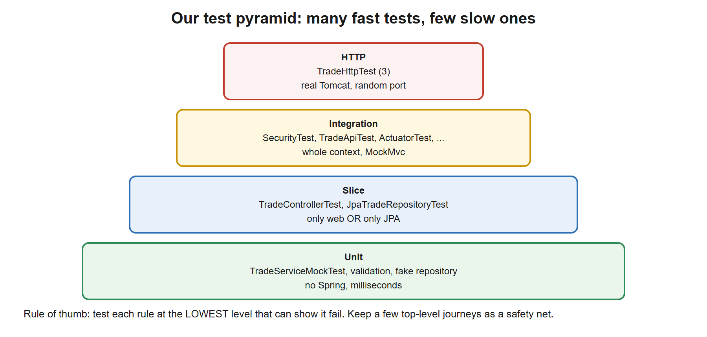
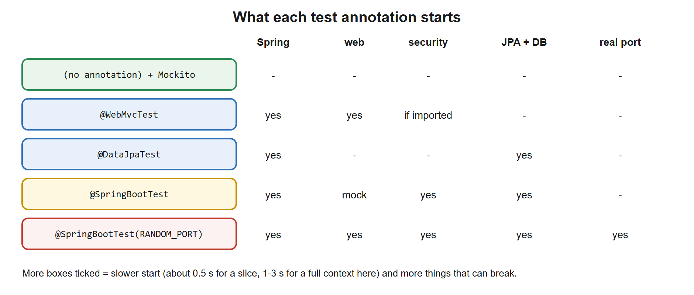

# 06. Testing

**You build this yourself**, continuing in the same project folder. My working copy is [`../../reference/lesson-06`](../../reference/lesson-06). Open it only when you are stuck.

**Starting point:** your project as it was at the end of lesson 05. Not there? Copy everything from `reference/lesson-05` into an empty folder and continue.
**End state:** lesson 05 plus a deliberate test strategy: Mockito unit tests, parameterized validation tests, a contract test shared by both repository implementations, a real-HTTP test, a clean test run (no Mockito warning), and a JaCoCo coverage report. 79 tests pass.

## 1. Goal and time box

**60 minutes** (you have already written most of the tests in lessons 01 to 05; this lesson is about choosing them well). After this lesson you can: explain the test pyramid and place every test of this project on it; choose between a mock, a fake and the real thing; pick the right Spring test annotation; write parameterized and contract tests; explain context caching; read a coverage report without being fooled by it.

## 2. Why it matters

Tests are what let you change a system you did not write. An architect is asked "how do you know it works?" and "how fast is your feedback?". A suite that is slow, flaky or tests implementation details will be abandoned; a suite that is fast and precise will be kept.

| You know | Spring Boot equivalent |
|---|---|
| Arquillian / embedded EJB container tests | `@SpringBootTest` (the real context, in your JVM) |
| JUnit 4 with hand-built fixtures | JUnit 5 (Jupiter), `@Nested`, `@ParameterizedTest`, extensions |
| Mock objects written by hand or EasyMock | Mockito (`@Mock`, `given/willReturn`, `verify`, captors) |
| A test database schema you reset between runs | `@DataJpaTest` (rolled-back transaction per test), Testcontainers for the real engine |
| Regression runs of the nightly ETL on a copy of production data | Contract and integration tests, a few of them, against real components |
| SWIFT message samples checked by validation rules | Parameterized tests: one table of inputs, one assertion |

## 3. Concepts explained like a teacher

### The test pyramid

[](images/01-test-pyramid.svg)

Many **unit** tests at the bottom: no Spring, milliseconds, they pin down rules. Fewer **slice** and **integration** tests above: they check that the parts connect and that framework behaviour (validation, security, JSON, transactions) is what you think. A **very few** tests at the top over real HTTP are the safety net. The shape matters: if you invert it you get a suite that takes 40 minutes and fails randomly.

**Rule of thumb:** test each rule at the **lowest level that can show it fail**. The "quantity above the limit" rule is a *unit* test. "Does a viewer get `403`?" can only be shown with security in place, so it is a slice or integration test.

### Mock, fake or the real thing?

| | Example here | Use when | Weakness |
|---|---|---|---|
| **Fake** (a real, simple implementation) | `InMemoryTradeRepository` | You want realistic behaviour, no setup | The fake can drift from the real thing (solved by the contract test below) |
| **Mock** (programmed stand-in, records calls) | Mockito `TradeRepository` in `TradeServiceMockTest` | You must check *interactions*: "never saved", "saved once with status NEW" | Tests know implementation details; too many mocks = brittle tests |
| **Real** | `JpaTradeRepositoryTest` on H2, Testcontainers for Postgres/Oracle | Behaviour depends on the technology (SQL, locking, security) | Slower, needs more setup |

Prefer fakes and real components; use mocks for *collaborators at a boundary* (a remote system) and for verifying "must not happen" calls.

### Which Spring annotation?

[](images/02-what-each-annotation-starts.svg)

Every extra part started costs time and adds ways to fail. Start the smallest thing that can prove the behaviour.

### Context caching (why the suite is not slower still)

Starting a Spring context takes seconds. Spring **caches** a context and reuses it for every test class with the **same configuration** (same annotations, same properties, same profiles). Two consequences:
1. Tests that differ only by one property each (`properties = "x=1"`) each pay for a new context. Share configuration where you can.
2. A cached context is **shared state**: a bean that holds data (our `GatewayStatus`, the database) keeps it across tests. Restore what you change (`finally`), or isolate with `@DirtiesContext` (which throws the context away: slow, use rarely).

In this project 79 tests start about **ten** contexts in total (verified from the log lines `Started ... in N seconds`).

### Contract tests

If a fake and a real implementation should behave the same, write the expectations **once** as an abstract test and run it against each. `TradeRepositoryContract` states what any `TradeRepository` must do; `InMemoryTradeRepositoryTest` and `JpaTradeRepositoryTest` extend it. When someone later "improves" the fake or the adapter and they diverge, a test fails. This is also how you prove that swapping implementations (lesson 04) kept behaviour.

### Coverage, honestly

JaCoCo reports which lines the tests *executed*. It does **not** say whether they *checked* anything: a test with no assertions gives 100%. Use coverage to find **untested code**, never as a score to chase. Better quality signals: tests fail when you break the code on purpose (try it in the exercise), and **mutation testing** (PIT) which automates that.

## 4. Setup steps

1. Open your project folder in VS Code and a terminal in it.
2. Confirm the starting point, and look at the noise we are about to remove:

```powershell
.\mvnw.cmd clean verify | Select-String "Mockito is currently|Java agent has been loaded"
```

Expected (verified): a `Mockito is currently self-attaching to enable the inline-mock-maker...` line and `WARNING: A Java agent has been loaded dynamically ...` lines. The tests pass; the JVM is just warning that a future Java release will forbid what Mockito does.

3. Set the compare shortcut (change the path):

```powershell
$REF = "C:\path\to\springboot-2day\reference\lesson-06"
```

### Files to change or add, in order

| # | File | Change | Why |
|---|---|---|---|
| 1 | `pom.xml` | **edit**: three plugins | Clean test JVM, coverage report, quiet SQL log |
| 2 | `TradeFixtures.java`, `TradeServiceMockTest.java` | **new** | Shared test data; a Mockito unit test |
| 3 | `CreateTradeRequestValidationTest.java` | **new** | Parameterized test with no Spring |
| 4 | `TradeRepositoryContract.java`, `InMemoryTradeRepositoryTest.java`, `JpaTradeRepositoryTest.java` | **new / edit** | One contract, two implementations |
| 5 | `TradeHttpTest.java` | **new** | Real server, real HTTP |

## 5. Code walkthrough

A build-along. Where a file already exists, the block shows the **whole file**.

### Step 1. A clean, measured test run

**File:** `pom.xml`
```xml
<?xml version="1.0" encoding="UTF-8"?>
<project xmlns="http://maven.apache.org/POM/4.0.0"
         xmlns:xsi="http://www.w3.org/2001/XMLSchema-instance"
         xsi:schemaLocation="http://maven.apache.org/POM/4.0.0 https://maven.apache.org/xsd/maven-4.0.0.xsd">
  <modelVersion>4.0.0</modelVersion>

  <!-- The parent pins versions of over 1,500 libraries, so we never write versions below. -->
  <parent>
    <groupId>org.springframework.boot</groupId>
    <artifactId>spring-boot-starter-parent</artifactId>
    <version>3.5.16</version>
    <relativePath/>
  </parent>

  <!-- Our project's own identity. -->
  <groupId>com.example</groupId>
  <artifactId>trade-service</artifactId>
  <version>0.0.1-SNAPSHOT</version>
  <name>trade-service</name>

  <properties>
    <java.version>21</java.version>
  </properties>

  <dependencies>
    <!-- Web starter: embedded Tomcat + Spring MVC + Jackson (JSON). -->
    <dependency>
      <groupId>org.springframework.boot</groupId>
      <artifactId>spring-boot-starter-web</artifactId>
    </dependency>

    <!-- AOP starter (lesson 01): brings AspectJ so we can write @Aspect classes. -->
    <dependency>
      <groupId>org.springframework.boot</groupId>
      <artifactId>spring-boot-starter-aop</artifactId>
    </dependency>

    <!-- Actuator (NEW in lesson 02): /actuator/health, /actuator/beans, /actuator/conditions, metrics... -->
    <dependency>
      <groupId>org.springframework.boot</groupId>
      <artifactId>spring-boot-starter-actuator</artifactId>
    </dependency>

    <!-- Validation starter (NEW in lesson 02): Bean Validation (jakarta.validation) + Hibernate Validator.
         Lesson 02 uses it to validate configuration; lesson 03 uses it to validate request bodies. -->
    <dependency>
      <groupId>org.springframework.boot</groupId>
      <artifactId>spring-boot-starter-validation</artifactId>
    </dependency>

    <!-- JPA starter (NEW in lesson 04): Spring Data JPA + Hibernate + HikariCP connection pool + transaction support. -->
    <dependency>
      <groupId>org.springframework.boot</groupId>
      <artifactId>spring-boot-starter-data-jpa</artifactId>
    </dependency>

    <!-- H2 (NEW in lesson 04): in-memory database for learning and tests. Runtime only: our code never imports it. -->
    <dependency>
      <groupId>com.h2database</groupId>
      <artifactId>h2</artifactId>
      <scope>runtime</scope>
    </dependency>

    <!-- Security starter (NEW in lesson 05): Spring Security filter chain, password encoders, method security. -->
    <dependency>
      <groupId>org.springframework.boot</groupId>
      <artifactId>spring-boot-starter-security</artifactId>
    </dependency>

    <!-- OAuth2 resource server (NEW in lesson 05): validates "Authorization: Bearer <JWT>" on incoming requests.
         Also brings the Nimbus library we use to sign (create) the demo tokens. -->
    <dependency>
      <groupId>org.springframework.boot</groupId>
      <artifactId>spring-boot-starter-oauth2-resource-server</artifactId>
    </dependency>

    <!-- Test starter: JUnit 5, AssertJ, Mockito, Spring test support. Only used when testing. -->
    <dependency>
      <groupId>org.springframework.boot</groupId>
      <artifactId>spring-boot-starter-test</artifactId>
      <scope>test</scope>
    </dependency>

    <!-- Security test helpers (NEW in lesson 05): jwt() request post-processor, @WithMockUser. -->
    <dependency>
      <groupId>org.springframework.security</groupId>
      <artifactId>spring-security-test</artifactId>
      <scope>test</scope>
    </dependency>
  </dependencies>

  <build>
    <plugins>
      <!-- Builds the runnable "fat jar" and adds the spring-boot:run command. -->
      <plugin>
        <groupId>org.springframework.boot</groupId>
        <artifactId>spring-boot-maven-plugin</artifactId>
      </plugin>

      <!-- (NEW in lesson 06) Step 1 of 3 for a clean test run: this plugin turns the downloaded Mockito jar into
           the property ${org.mockito:mockito-core:jar}, so Surefire can load it as a Java agent (step 3). -->
      <plugin>
        <groupId>org.apache.maven.plugins</groupId>
        <artifactId>maven-dependency-plugin</artifactId>
        <executions>
          <execution>
            <id>mockito-agent-path</id>
            <goals>
              <goal>properties</goal>
            </goals>
          </execution>
        </executions>
      </plugin>

      <!-- (NEW in lesson 06) Step 2 of 3: JaCoCo measures which lines the tests execute.
           "prepare-agent" injects its agent into the test JVM through the ${argLine} property;
           "report" writes target/site/jacoco/index.html after the tests. -->
      <plugin>
        <groupId>org.jacoco</groupId>
        <artifactId>jacoco-maven-plugin</artifactId>
        <version>0.8.16</version>     <!-- Spring Boot does not manage plugin versions for JaCoCo, so we pin one -->
        <executions>
          <execution>
            <id>jacoco-prepare</id>
            <goals>
              <goal>prepare-agent</goal>
            </goals>
          </execution>
          <execution>
            <id>jacoco-report</id>
            <phase>verify</phase>
            <goals>
              <goal>report</goal>
            </goals>
          </execution>
        </executions>
      </plugin>

      <!-- (NEW in lesson 06) Step 3 of 3: Surefire runs the tests. We pass the JVM two agents: JaCoCo (@{argLine})
           and Mockito. Loading Mockito explicitly removes the "Mockito is currently self-attaching" warning and
           keeps working on future Java versions. -Xshare:off stops the JVM complaining about class-data sharing
           when an agent is present. We also silence the SQL log, which is noise in test output. -->
      <plugin>
        <groupId>org.apache.maven.plugins</groupId>
        <artifactId>maven-surefire-plugin</artifactId>
        <configuration>
          <argLine>@{argLine} -javaagent:${org.mockito:mockito-core:jar} -Xshare:off</argLine>
          <systemPropertyVariables>
            <logging.level.org.hibernate.SQL>INFO</logging.level.org.hibernate.SQL>
          </systemPropertyVariables>
        </configuration>
      </plugin>
    </plugins>
  </build>
</project>
```

**Why, plugin by plugin (the order in the file is the order of the three steps in the comments):**
1. **`maven-dependency-plugin` `properties` goal** exposes the path of each dependency jar as a property. We need `${org.mockito:mockito-core:jar}`.
2. **JaCoCo** `prepare-agent` starts the coverage agent in the test JVM by writing the property `argLine`; `report` writes the HTML report after the tests in the `verify` phase. We pin version `0.8.16` because Boot's parent does not manage this plugin's version (Maven warns if you do not).
3. **Surefire** runs the tests. `argLine` passes the JVM **two agents**: `@{argLine}` (JaCoCo; the `@{...}` form is read *late*, after JaCoCo has set it) and `-javaagent:` Mockito. Loading Mockito as an agent from the start removes the "self-attaching" warning and keeps working on future Java versions. `-Xshare:off` stops the JVM complaining about class-data sharing when an agent is present. The `systemPropertyVariables` entry silences the SQL log that `dev` turns on (system properties outrank the YAML).

**Checkpoint:**

```powershell
.\mvnw.cmd clean verify | Select-String "Mockito is currently|Java agent has been loaded"
```

Expected: **no output**. And the report exists:

```powershell
Start-Process target\site\jacoco\index.html
```

**Stuck?**
- *`build.plugins.plugin.version for org.jacoco ... is missing`*: you left out `<version>0.8.16</version>`.
- *`Error opening zip file or JAR manifest missing : ...mockito-core...jar`*: the dependency plugin block is missing, so `${org.mockito:mockito-core:jar}` was never filled in.
- *`Could not find or load main class @{argLine}`*: you wrote `${argLine}` (early) instead of `@{argLine}`, or JaCoCo's `prepare-agent` is missing.

### Deep dive: the testing frameworks and the Maven test plugins

Lessons 00 to 05 already ran tests. This section names every testing library and plugin you now use, says what each is for, shows the options you have not used, and lists the commands (syntax, why, when).

#### A. What `spring-boot-starter-test` brings

| Library | What it is | Why we need it | Typical line |
|---|---|---|---|
| **JUnit 5 (Jupiter)** | The test framework: finds and runs test methods, reports results. Three parts: *Platform* (the launcher), *Jupiter* (the annotations and API) and *Vintage* (runs old JUnit 4 tests). | Without a runner there is no "test". | `@Test void createThenSettle() { ... }` |
| **AssertJ** | A fluent assertion library. | Readable checks and good failure messages. | `assertThat(t.status()).isEqualTo(NEW)` |
| **Mockito** | Creates **mocks**: stand-ins that you program (`when(...).thenReturn(...)`) and later verify (`verify(repo).save(...)`). | Isolate the class under test from a collaborator. | `var repo = mock(TradeRepository.class)` |
| **Spring Test** | Starts a Spring context inside a test; offers `MockMvc`, `TestRestTemplate`, `@MockitoBean`. | Test wiring, web, security and persistence for real. | `@SpringBootTest`, `@WebMvcTest` |
| **Hamcrest**, **JSONassert**, **JsonPath** | Older matcher library, JSON comparison, and a query language for JSON. | `jsonPath("$.status")` in `MockMvc` assertions. | `.andExpect(jsonPath("$.status").value("NEW"))` |
| **Awaitility** | Wait until an asynchronous condition becomes true. | Kafka and other async tests on Day 2. | `await().until(...)` |
| `spring-security-test` | (lesson 05) `jwt()`, `httpBasic()`, `@WithMockUser`. | Test secured endpoints. | |

#### B. JUnit 5: the annotations

| Annotation | Meaning | Used? |
|---|---|---|
| `@Test` | A test method | Yes |
| `@ParameterizedTest` + `@CsvSource`, `@ValueSource`, `@MethodSource`, `@EnumSource` | Run one method with many inputs | Yes (step 3) |
| `@BeforeEach`, `@AfterEach` | Run before/after every test | Yes |
| `@BeforeAll`, `@AfterAll` | Run once per class (static, unless `@TestInstance(PER_CLASS)`) | |
| `@DisplayName("...")` | A readable name in reports | |
| `@Nested` | Group tests in an inner class, sharing a setup | |
| `@Disabled("reason")` | Skip a test, always with a reason | |
| `@Tag("slow")` | Label tests, then include or exclude them (`-Dgroups=slow`) | |
| `@Timeout(2)` | Fail a test that takes longer than 2 seconds | |
| `@RepeatedTest(5)` | Run a test several times (flaky-test hunting) | |
| `@TempDir` | A temporary folder, deleted after | |
| `assertThrows(Type.class, () -> ...)` | Check that code throws | Yes |

#### C. AssertJ and Mockito in a nutshell

| Task | Code |
|---|---|
| Compare values | `assertThat(x).isEqualTo(y)`, `.isNotNull()`, `.isTrue()` |
| Collections | `assertThat(list).hasSize(2).extracting(Trade::isin).containsExactly("A","B")` |
| Numbers (BigDecimal) | `assertThat(price).isEqualByComparingTo("189.50")` (ignores scale) |
| Exceptions | `assertThatThrownBy(() -> svc.settle(99L)).isInstanceOf(TradeNotFoundException.class)` |
| Program a mock | `when(repo.findById(1L)).thenReturn(Optional.of(t))` |
| Verify a call | `verify(repo).save(any())`, `verify(repo, never()).save(any())`, `verify(repo, times(2))...` |
| Capture an argument | `ArgumentCaptor<Trade> c = ArgumentCaptor.forClass(Trade.class); verify(repo).save(c.capture());` |
| Spring bean replaced by a mock | `@MockitoBean TradeRepository repo;` (Spring Boot 3.4+; older code uses `@MockBean`) |

**Mock vs spy:** a *mock* does nothing until programmed; a *spy* wraps a real object and calls the real code unless you override a method. Mocks of **types you own** are fine; avoid mocking value types and the framework.

#### D. `MockMvc`, the web test tool

`MockMvc` calls the Spring MVC stack **without opening a socket**: the request goes through `DispatcherServlet`, filters, validation and exception handlers, but no Tomcat starts. Fast, and good for status codes, JSON bodies and security rules.

```java
mockMvc.perform(post("/trades").contentType(APPLICATION_JSON).content(json).with(jwt()...))
       .andExpect(status().isCreated())
       .andExpect(header().exists("Location"))
       .andExpect(jsonPath("$.status").value("NEW"));
```

Step 5 of this lesson uses the real thing (`TestRestTemplate` over a random port) for the few end-to-end tests. Rule: use `MockMvc` for web-layer behaviour, real HTTP for "does it start and respond".

#### E. Testcontainers (used on Day 2)

**What it is.** A Java library that starts real services (Postgres, Kafka, Redis) in **Docker containers** from inside a test, and throws them away after. **Why:** H2 is not Postgres; a container is. It needs Docker running. Boot 3.1+ wires it with `@ServiceConnection`, so the container's URL replaces `spring.datasource.url` automatically.

#### F. The Maven plugins that run tests (options not used above)

| Plugin | Phase | What it does | Options you did not use |
|---|---|---|---|
| **maven-surefire-plugin** | `test` | Runs **unit tests**: classes named `*Test`, `Test*`, `*Tests`, `*TestCase` | `<includes>`/`<excludes>` (name patterns), `<groups>`/`<excludedGroups>` (JUnit tags), `<parallel>` and `<forkCount>` (parallel tests), `<skipTests>`, `<trimStackTrace>`, `<rerunFailingTestsCount>` (retry flaky tests: use sparingly), `<reportsDirectory>` |
| **maven-failsafe-plugin** | `integration-test`, `verify` | Runs **integration tests**: classes named `*IT`, `IT*`, `*ITCase`, and **always runs `post-integration-test` cleanup** even after a failure | Same style of options. Use it when integration tests need setup/teardown around them, or you want a separate, slower stage |
| **jacoco-maven-plugin** | `prepare-package`/`verify` | Coverage report (we used it) | `check` goal with `<rules>` that **fails the build** under a minimum (`<minimum>0.80</minimum>`), `<excludes>` for generated classes, `merge` and `report-aggregate` for several modules |

Surefire writes `target/surefire-reports/` (plain text and XML per class); CI servers read the XML to draw test graphs.

#### G. The test commands: syntax, why, when

All start with `.\mvnw.cmd` (see the Maven deep dive in lesson 00).

| Command | Meaning | When |
|---|---|---|
| `.\mvnw.cmd test` | Compile and run all unit tests (Surefire). | After each change |
| `.\mvnw.cmd "-Dtest=TradeServiceTest" test` | Run one class. | Fixing one failing class |
| `.\mvnw.cmd "-Dtest=TradeServiceTest#createThenSettle" test` | Run one method. | Fixing one failing test |
| `.\mvnw.cmd "-Dtest=Trade*Test,Security*Test" test` | Run classes matching patterns (comma list). | A feature area |
| `.\mvnw.cmd "-Dgroups=slow" test` | Run only tests tagged `@Tag("slow")`. | Separate fast and slow suites |
| `.\mvnw.cmd verify` | Everything up to `verify`: tests, package, JaCoCo report, Failsafe if configured. | Before pushing |
| `.\mvnw.cmd -o test` | Offline run. | No network |
| `.\mvnw.cmd -DfailIfNoTests=false "-Dtest=X" test` | Do not fail when a pattern matches nothing (useful in multi-module builds). | Multi-module runs |
| `.\mvnw.cmd -Dsurefire.failIfNoSpecifiedTests=false "-Dtest=X" test` | The Surefire 3 spelling of the same idea. | Same |
| `.\mvnw.cmd test -DtrimStackTrace=false` | Show full stack traces in test failures. | Debugging a failure |
| `.\mvnw.cmd -DskipTests package` | Build without running tests. | You need the jar and tests already passed |

**Reading a test result:** `Tests run: 79, Failures: 0, Errors: 0, Skipped: 0`. A **failure** is an assertion that was false; an **error** is an unexpected exception (including a context that did not start); **skipped** are `@Disabled` or filtered. The text report names the first line of the stack that is in your code.

#### H. Common mistakes

| Mistake | Symptom | Fix |
|---|---|---|
| `@SpringBootTest` for a pure rule | Slow suite | Unit test with `new` |
| Mocking everything | Tests pass while the app is broken | Use fakes and real components; mock only boundaries |
| Test order dependence (a shared database or bean state) | Passes alone, fails together | Reset state in `@BeforeEach`; avoid sharing |
| `assertThat(a).isEqualTo(b)` on `BigDecimal` | Fails for `189.5` vs `189.50` | `isEqualByComparingTo` |
| Asserting on log text | Brittle | Assert on behaviour and results |
| Sleeping in async tests | Slow and flaky | Awaitility |
| Chasing 100% coverage | Assertion-free tests | Use coverage to find *untested* code only |

### Step 2. Shared test data and a Mockito unit test

**File:** `src/test/java/com/example/trade/TradeFixtures.java`
```java
package com.example.trade;

import com.example.trade.domain.Trade;
import com.example.trade.domain.TradeStatus;
import java.math.BigDecimal;

// Test data in ONE place. When the Trade record gains a field, only this file changes, not fifty tests.
final class TradeFixtures {
    private TradeFixtures() {}

    static final String ISIN = "US0378331005";

    /** A valid, unsaved trade (no id yet). */
    static Trade newTrade() {
        return new Trade(null, ISIN, new BigDecimal("100"), new BigDecimal("189.50"), TradeStatus.NEW);
    }

    /** The same trade as the database would return it, with an id. */
    static Trade savedTrade(long id, TradeStatus status) {
        return new Trade(id, ISIN, new BigDecimal("100"), new BigDecimal("189.50"), status);
    }
}
```

**File:** `src/test/java/com/example/trade/TradeServiceMockTest.java`
```java
package com.example.trade;

import static org.assertj.core.api.Assertions.assertThat;
import static org.assertj.core.api.Assertions.assertThatThrownBy;
import static org.mockito.ArgumentMatchers.any;
import static org.mockito.BDDMockito.given;
import static org.mockito.Mockito.never;
import static org.mockito.Mockito.verify;

import com.example.trade.config.TradeProperties;
import com.example.trade.domain.Trade;
import com.example.trade.domain.TradeStatus;
import com.example.trade.repo.TradeRepository;
import com.example.trade.service.BusinessRuleException;
import com.example.trade.service.TradeNotFoundException;
import com.example.trade.service.TradeService;
import com.example.trade.service.TradeStateException;
import java.math.BigDecimal;
import java.util.Optional;
import org.junit.jupiter.api.BeforeEach;
import org.junit.jupiter.api.Test;
import org.junit.jupiter.api.extension.ExtendWith;
import org.mockito.ArgumentCaptor;
import org.mockito.Mock;
import org.mockito.junit.jupiter.MockitoExtension;

// A pure unit test with a MOCK repository: no Spring, no database, runs in milliseconds.
// Unlike TradeServiceTest (which uses a working in-memory fake), a mock lets us check HOW the service talks to
// its collaborator: which calls it made, with what, and which calls it must NOT make.
@ExtendWith(MockitoExtension.class)        // creates the @Mock fields; fails the test on unused stubbings
class TradeServiceMockTest {

    @Mock TradeRepository repository;
    TradeService service;

    @BeforeEach
    void setUp() {
        service = new TradeService(repository, new TradeProperties(new BigDecimal("1000"), "TEST"));
    }

    @Test
    void createSavesANewTradeWithStatusNew() {
        given(repository.save(any(Trade.class))).willAnswer(inv -> inv.getArgument(0));

        service.create(TradeFixtures.ISIN, BigDecimal.TEN, BigDecimal.ONE);

        ArgumentCaptor<Trade> saved = ArgumentCaptor.forClass(Trade.class);
        verify(repository).save(saved.capture());            // exactly one save, and we can inspect its argument
        assertThat(saved.getValue().status()).isEqualTo(TradeStatus.NEW);
        assertThat(saved.getValue().id()).isNull();            // the database, not the service, assigns ids
    }

    @Test
    void aRejectedTradeNeverReachesTheRepository() {
        assertThatThrownBy(() -> service.create(TradeFixtures.ISIN, new BigDecimal("1001"), BigDecimal.ONE))
                .isInstanceOf(BusinessRuleException.class);

        verify(repository, never()).save(any());                // proves the rule runs BEFORE any write
    }

    @Test
    void settleSavesTheTradeWithStatusSettled() {
        given(repository.findById(5L)).willReturn(Optional.of(TradeFixtures.savedTrade(5, TradeStatus.NEW)));
        given(repository.save(any(Trade.class))).willAnswer(inv -> inv.getArgument(0));

        Trade result = service.settle(5L);

        assertThat(result.status()).isEqualTo(TradeStatus.SETTLED);
    }

    @Test
    void settlingAnAlreadySettledTradeWritesNothing() {
        given(repository.findById(5L)).willReturn(Optional.of(TradeFixtures.savedTrade(5, TradeStatus.SETTLED)));

        assertThatThrownBy(() -> service.settle(5L)).isInstanceOf(TradeStateException.class);

        verify(repository, never()).save(any());
    }

    @Test
    void settlingAnUnknownTradeIsNotFound() {
        given(repository.findById(9L)).willReturn(Optional.empty());

        assertThatThrownBy(() -> service.settle(9L)).isInstanceOf(TradeNotFoundException.class);
    }
}
```

**Why:**
- `TradeFixtures` keeps test data in one place. When `Trade` gains a field, you change one file, not fifty tests.
- `@ExtendWith(MockitoExtension.class)` creates the `@Mock` fields and (by default, "strict stubs") **fails the test if a stubbing was never used**, which keeps tests honest.
- `given(...).willAnswer(inv -> inv.getArgument(0))` makes the fake repository return what it was given, like a real one.
- `ArgumentCaptor` lets the test inspect *what* was saved: a new trade with status `NEW` and no id.
- `verify(repository, never()).save(any())` proves a rejected trade writes **nothing**. A fake could not show that so directly: this is what mocks are for.

**Checkpoint:**

```powershell
.\mvnw.cmd -q test "-Dtest=TradeServiceMockTest"
```

Expected: no output (quiet success); with `.\mvnw.cmd test "-Dtest=TradeServiceMockTest"` you see `Tests run: 5, Failures: 0`.

**Stuck?** *`UnnecessaryStubbingException`*: a `given(...)` was set up but the code path did not call it. Remove the stub or fix the test; this is the strictness helping you.

### Step 3. A parameterized test with no Spring

**File:** `src/test/java/com/example/trade/CreateTradeRequestValidationTest.java`
```java
package com.example.trade;

import static org.assertj.core.api.Assertions.assertThat;

import com.example.trade.web.TradeController.CreateTradeRequest;
import jakarta.validation.Validation;
import jakarta.validation.Validator;
import java.math.BigDecimal;
import org.junit.jupiter.api.Test;
import org.junit.jupiter.params.ParameterizedTest;
import org.junit.jupiter.params.provider.CsvSource;
import org.junit.jupiter.params.provider.ValueSource;

// Bean Validation is a plain library: no Spring, no HTTP. One ParameterizedTest replaces a dozen near-identical tests.
class CreateTradeRequestValidationTest {

    private final Validator validator = Validation.buildDefaultValidatorFactory().getValidator();

    private int violations(String isin, String quantity, String price) {
        var req = new CreateTradeRequest(isin,
                quantity == null ? null : new BigDecimal(quantity),
                price == null ? null : new BigDecimal(price));
        return validator.validate(req).size();
    }

    @Test
    void aValidRequestHasNoViolations() {
        assertThat(violations("US0378331005", "100", "189.50")).isZero();
    }

    @ParameterizedTest(name = "ISIN \"{0}\" is rejected")
    @ValueSource(strings = {"", "   ", "us0378331005", "US037833100", "US03783310055", "US-378331005", "0378331005US"})
    void badIsinsAreRejected(String isin) {
        assertThat(violations(isin, "100", "1")).isPositive();
    }

    @ParameterizedTest(name = "quantity={0} price={1} is rejected")
    @CsvSource({"0,1", "-1,1", "1,0", "1,-0.01"})
    void nonPositiveNumbersAreRejected(String quantity, String price) {
        assertThat(violations("US0378331005", quantity, price)).isPositive();
    }

    @Test
    void missingFieldsAreRejected() {
        assertThat(violations(null, null, null)).isEqualTo(3);
    }
}
```

**Why:** Bean Validation is a plain library, so we test the annotations **directly** with a `Validator`: no web layer, no context, 0.3 seconds for 13 cases. `@ParameterizedTest` runs the same method for each input (`@ValueSource` for single values, `@CsvSource` for tuples), and `name = ...` makes the report readable (*ISIN "us0378331005" is rejected*). One table of inputs replaces a dozen copy-pasted tests, and adding a case costs one line. Compare with the single bad-ISIN example in `TradeControllerTest`: that one proves the *HTTP mapping*; this one proves the *rule*.

**Checkpoint:** `.\mvnw.cmd test "-Dtest=CreateTradeRequestValidationTest"` shows `Tests run: 13, Failures: 0`.

### Step 4. One contract, two implementations

**File:** `src/test/java/com/example/trade/TradeRepositoryContract.java`
```java
package com.example.trade;

import static org.assertj.core.api.Assertions.assertThat;

import com.example.trade.domain.Trade;
import com.example.trade.domain.TradeStatus;
import com.example.trade.repo.TradeRepository;
import org.junit.jupiter.api.Test;

// A CONTRACT test: it states what ANY TradeRepository must do, and each implementation runs the same tests
// by extending this class. It is how we prove that swapping in-memory for JPA (lesson 04) kept the behaviour.
abstract class TradeRepositoryContract {

    /** Each implementation's test class supplies the repository under test. */
    abstract TradeRepository repository();

    @Test
    void saveAssignsAnId() {
        Trade saved = repository().save(TradeFixtures.newTrade());

        assertThat(saved.id()).isNotNull();
    }

    @Test
    void findByIdReturnsWhatWasSaved() {
        Trade saved = repository().save(TradeFixtures.newTrade());

        assertThat(repository().findById(saved.id())).hasValueSatisfying(found -> {
            assertThat(found.isin()).isEqualTo(TradeFixtures.ISIN);
            assertThat(found.quantity()).isEqualByComparingTo("100");      // by value: scale may differ per store
            assertThat(found.price()).isEqualByComparingTo("189.50");
            assertThat(found.status()).isEqualTo(TradeStatus.NEW);
        });
    }

    @Test
    void findByIdOfAnUnknownIdIsEmpty() {
        assertThat(repository().findById(987_654L)).isEmpty();
    }

    @Test
    void savingWithAnExistingIdUpdatesInsteadOfInserting() {
        Trade saved = repository().save(TradeFixtures.newTrade());
        int before = repository().findAll().size();

        repository().save(saved.withStatus(TradeStatus.SETTLED));

        assertThat(repository().findById(saved.id()).orElseThrow().status()).isEqualTo(TradeStatus.SETTLED);
        assertThat(repository().findAll()).hasSize(before);
    }

    @Test
    void findAllReturnsEverythingSaved() {
        int before = repository().findAll().size();

        repository().save(TradeFixtures.newTrade());
        repository().save(TradeFixtures.newTrade());

        assertThat(repository().findAll()).hasSize(before + 2);
    }
}
```

**File:** `src/test/java/com/example/trade/InMemoryTradeRepositoryTest.java`
```java
package com.example.trade;

import com.example.trade.repo.InMemoryTradeRepository;
import com.example.trade.repo.TradeRepository;

// The fake passes the same contract as the real thing, which is what makes it a trustworthy fake for unit tests.
class InMemoryTradeRepositoryTest extends TradeRepositoryContract {

    // JUnit creates a NEW test-class instance for every test method, so each test gets an empty repository.
    private final InMemoryTradeRepository repository = new InMemoryTradeRepository();

    @Override
    TradeRepository repository() {
        return repository;
    }
}
```

**File:** `src/test/java/com/example/trade/JpaTradeRepositoryTest.java`
```java
package com.example.trade;

import com.example.trade.persistence.JpaTradeRepository;
import com.example.trade.repo.TradeRepository;
import org.springframework.beans.factory.annotation.Autowired;
import org.springframework.boot.test.autoconfigure.orm.jpa.DataJpaTest;
import org.springframework.context.annotation.Import;

// A persistence "slice": starts only JPA and an embedded database, not the web layer or our services.
// Each test runs in a transaction that is rolled back at the end, so tests do not affect each other.
// Since lesson 06 the tests themselves live in TradeRepositoryContract: the JPA adapter must pass the same ones.
@DataJpaTest
@Import(JpaTradeRepository.class)       // the slice scans only JPA repositories, so we add our adapter by hand
class JpaTradeRepositoryTest extends TradeRepositoryContract {

    @Autowired JpaTradeRepository repository;

    @Override
    TradeRepository repository() {
        return repository;
    }
}
```

**Why:**
- `TradeRepositoryContract` is **abstract**: JUnit does not run it directly. Each subclass supplies `repository()`, and the inherited tests run against it.
- The **in-memory** version needs no Spring. JUnit creates a *new instance of the test class per test method*, so the field initialiser gives each test an empty repository.
- The **JPA** version replaces the lesson 04 test with the same file name: it keeps `@DataJpaTest` and `@Import`, and inherits the same five tests. Both pass, so the fake is a *trustworthy* fake.
- The contract compares `BigDecimal` with `isEqualByComparingTo` (lesson 04's scale lesson) and uses **relative** assertions (`before + 2`) so it does not depend on what else is in the database.

**Checkpoint:**

```powershell
.\mvnw.cmd test "-Dtest=InMemoryTradeRepositoryTest,JpaTradeRepositoryTest"
```

Expected: `Tests run: 5 ... -- in com.example.trade.InMemoryTradeRepositoryTest` and `Tests run: 5 ... -- in com.example.trade.JpaTradeRepositoryTest`.

**Stuck?** *`JpaTradeRepositoryTest` fails with `No qualifying bean of type JpaTradeRepository`*: the `@Import` line is missing. *The contract class is run and fails because there is no `repository()`*: it must be `abstract` and not named `*Test`.

### Step 5. The top of the pyramid: real HTTP

**File:** `src/test/java/com/example/trade/TradeHttpTest.java`
```java
package com.example.trade;

import static org.assertj.core.api.Assertions.assertThat;
import static org.springframework.boot.test.context.SpringBootTest.WebEnvironment.RANDOM_PORT;

import com.example.trade.domain.Trade;
import com.example.trade.domain.TradeStatus;
import java.util.Map;
import org.junit.jupiter.api.Test;
import org.springframework.beans.factory.annotation.Autowired;
import org.springframework.boot.test.context.SpringBootTest;
import org.springframework.boot.test.web.client.TestRestTemplate;
import org.springframework.http.HttpEntity;
import org.springframework.http.HttpHeaders;
import org.springframework.http.HttpMethod;
import org.springframework.http.HttpStatus;
import org.springframework.http.MediaType;
import org.springframework.http.ResponseEntity;

// The top of the pyramid: a REAL embedded Tomcat on a random port and REAL HTTP calls, like a client in production.
// Slower than MockMvc, so keep only a few of these: the main journeys, not every edge case.
@SpringBootTest(webEnvironment = RANDOM_PORT)
class TradeHttpTest {

    @Autowired TestRestTemplate rest;

    private static final String BODY = """
            {"isin":"US0378331005","quantity":100,"price":189.50}""";

    @SuppressWarnings("unchecked")
    private String login(String user) {
        ResponseEntity<Map> response = rest.withBasicAuth(user, "password").postForEntity("/auth/token", null, Map.class);
        assertThat(response.getStatusCode()).isEqualTo(HttpStatus.OK);
        return (String) response.getBody().get("access_token");
    }

    private HttpEntity<String> json(String body, String token) {
        HttpHeaders headers = new HttpHeaders();
        headers.setContentType(MediaType.APPLICATION_JSON);
        if (token != null) headers.setBearerAuth(token);
        return new HttpEntity<>(body, headers);
    }

    @Test
    void aTraderBooksAndOpsSettlesOverRealHttp() {
        String trader = login("alice"), ops = login("bob");

        ResponseEntity<Trade> created = rest.exchange("/trades", HttpMethod.POST, json(BODY, trader), Trade.class);
        assertThat(created.getStatusCode()).isEqualTo(HttpStatus.CREATED);
        assertThat(created.getHeaders().getLocation()).isNotNull();

        String location = created.getHeaders().getLocation().toString();
        ResponseEntity<Trade> settled = rest.exchange(location + "/settle", HttpMethod.POST, json(null, ops), Trade.class);
        assertThat(settled.getStatusCode()).isEqualTo(HttpStatus.OK);
        assertThat(settled.getBody().status()).isEqualTo(TradeStatus.SETTLED);
    }

    @Test
    void withoutATokenTheApiIs401() {
        ResponseEntity<String> response = rest.getForEntity("/trades", String.class);

        assertThat(response.getStatusCode()).isEqualTo(HttpStatus.UNAUTHORIZED);
    }

    @Test
    @SuppressWarnings("unchecked")
    void aBadRequestIs400WithFieldErrorsAsProblemJson() {
        String bad = """
                {"isin":"nope","quantity":1,"price":1}""";

        ResponseEntity<Map> response = rest.exchange("/trades", HttpMethod.POST, json(bad, login("alice")), Map.class);

        assertThat(response.getStatusCode()).isEqualTo(HttpStatus.BAD_REQUEST);
        assertThat(response.getHeaders().getContentType().toString()).startsWith("application/problem+json");
        assertThat((Map<String, String>) response.getBody().get("errors")).containsKey("isin");
    }
}
```

**Why:**
- `webEnvironment = RANDOM_PORT` starts a **real embedded Tomcat** on a free port; `TestRestTemplate` is pre-configured to call it. Everything is real: sockets, filters, JSON, security, JPA.
- It logs in with Basic auth, then calls the API with a Bearer token: a trader books, ops settles. It is the **journey** a client performs.
- Three tests only. The rest of the behaviour is covered cheaper below. It is slower (about six seconds here), so keep this level small.
- `TestRestTemplate` does **not** throw on `4xx`/`5xx`: it returns the response, so we assert on the status code.

**Checkpoint:**

```powershell
.\mvnw.cmd clean verify
```

Expected (verified), among other lines:

```
Tests run: 13, Failures: 0, Errors: 0, Skipped: 0 -- in com.example.trade.CreateTradeRequestValidationTest
Tests run: 5, Failures: 0, Errors: 0, Skipped: 0 -- in com.example.trade.InMemoryTradeRepositoryTest
Tests run: 5, Failures: 0, Errors: 0, Skipped: 0 -- in com.example.trade.JpaTradeRepositoryTest
Tests run: 3, Failures: 0, Errors: 0, Skipped: 0 -- in com.example.trade.TradeHttpTest
Tests run: 5, Failures: 0, Errors: 0, Skipped: 0 -- in com.example.trade.TradeServiceMockTest
Tests run: 79, Failures: 0, Errors: 0, Skipped: 0
BUILD SUCCESS
```

**Stuck?**
- *`TradeHttpTest` fails with `401` on login*: wrong user or password (all demo users use `password`).
- *`Connection refused`*: not `RANDOM_PORT`, so no real server is running (the default is a mock environment).

### Read the coverage report

Open `target\site\jacoco\index.html`. For this project (verified): about **98%** of instructions are covered. Click through `com.example.trade`: `TradeServiceApplication` shows about 38% because the `main` method is never run by a test; `AllocationEntity` about 71% (getters not used). Both are fine. Look for **red lines in code that matters**, for example a business rule or an error branch, and ask: which test should have caught a bug here?

### Run it: choose what you run

| Goal | Command |
|---|---|
| Everything, with coverage | `.\mvnw.cmd clean verify` |
| One class | `.\mvnw.cmd test "-Dtest=TradeControllerTest"` |
| One method | `.\mvnw.cmd test "-Dtest=TradeControllerTest#unknownTradeReturns404ProblemDetail"` |
| Several | `.\mvnw.cmd test "-Dtest=TradeServiceMockTest,CreateTradeRequestValidationTest"` |
| Skip tests (packaging only) | `.\mvnw.cmd -DskipTests package` |

In VS Code: the beaker (Testing) icon runs and debugs any test or class with one click.

### Debug it

1. Set a breakpoint inside `TradeServiceMockTest.aRejectedTradeNeverReachesTheRepository` and choose **Debug Test**. Step into `service.create`: you are in the real service, with the mock repository. Inspect `repository` in the Variables panel: Mockito's generated subclass.
2. Count the contexts: run `.\mvnw.cmd clean verify | Select-String "Started .* in"`. You see about ten lines for 79 tests. Now temporarily add a unique property to one test, for example `@SpringBootTest(properties = {"spring.main.web-application-type=none", "x=1"})` on `TransactionTest`, and run again: one more `Started` line. That is the cost of a different configuration.
3. Read a failure well: make `TradeRepositoryContract.findAllReturnsEverythingSaved` expect `before + 3`, run it, and compare the two reports (in-memory and JPA). AssertJ prints expected versus actual; the stack trace points at the contract line.

**Exercise (20 min): break it on purpose.** For each change, run `.\mvnw.cmd clean verify`, note which tests fail, then undo it. A test suite you trust fails for the *right* reasons.
1. In `TradeService.create` change `>` to `>=`. (Expected: does any test catch the boundary? If none fails, write one: quantity exactly equal to the limit must be accepted.)
2. In `AllocationReportService` remove `join fetch` from the query in `TradeJpaRepository`. (`NPlusOneTest` should fail on the statement count.)
3. In `SecurityConfig` change `.hasRole("ADMIN")` to `.authenticated()` for actuator. (`SecurityTest` should fail.)
4. In `ApiExceptionHandler` delete the `AccessDeniedException` handler. (A `403` test should now see `500`.)

## 6. Common mistakes

| Mistake | How you notice | Fix |
|---|---|---|
| `@SpringBootTest` for everything | Suite takes minutes | Unit tests and slices first; one context per distinct configuration |
| Mocking everything | Tests pass but the app is broken; refactors break tests | Fakes and real components; mock only boundaries |
| Asserting on implementation details (`verify` every call) | Tests fail when you refactor safely | Assert outcomes; `verify` only what matters ("never saved") |
| Shared mutable state between tests | Fails only in some orders or only in CI | Restore in `finally`; fresh fixtures; `@DirtiesContext` as last resort |
| `@Transactional` on a test of transaction behaviour | Rollback tests pass wrongly | Keep those tests non-transactional (lesson 04) |
| `Thread.sleep` to wait for async work | Slow and flaky | Awaitility (poll until a condition) |
| Time, randomness, network in tests | Flaky | Inject a `Clock`; fixed seeds; fakes for remote systems |
| Chasing 100% coverage | Assertion-free tests | Use coverage to find gaps; use failing-on-purpose checks for quality |
| Tests that need a person to read output | Silent passes of wrong behaviour | Assertions only |
| H2 passes, production fails | Different engine | Testcontainers for engine-specific behaviour |
| Duplicate test data everywhere | Painful changes | Fixtures / builders in one place |
| Ignoring a flaky test | The suite loses trust | Fix or delete it; never "re-run until green" |

## 7. Production issues and design notes

| Symptom | Root cause | Fix |
|---|---|---|
| CI takes 40 minutes | Pyramid inverted, too many contexts | Move checks down; share contexts; run slow suites in parallel jobs |
| Tests pass locally, fail in CI | Order dependence, timezone/locale, port clashes, missing Docker | Run in random order sometimes; set time zone; use random ports |
| Flaky test blamed on "CI" | Race condition or shared state | Treat it as a bug; reproduce by looping the test |
| Regression in a rarely used path | No test at that level | Add the lowest-level test that fails, then fix |
| A change in a library breaks everything | No contract tests at module boundaries | Contract tests between layers and, between services, consumer-driven contracts (Pact) |
| Security regression shipped | Only positive tests existed | Negative tests per rule (like `SecurityTest`) |
| Production data issue unreproducible | Tests use unrealistic data | Fixtures derived from real, anonymised cases |
| Build warnings ignored until a JDK upgrade breaks the build | Mockito self-attach, deprecation notices | Fix warnings early (we did for Mockito) |

## 8. Architect lens

- **A test strategy is an architecture decision.** Write down which behaviours are tested at which level, who owns the slow suites, and the time budget for feedback (for example unit under 1 minute, full build under 10).
- **Design for testability.** Constructor injection (lesson 01), small interfaces at boundaries (lesson 04), configuration as records (lesson 02) are why most of this project is testable without a server. If a class is hard to test, its design is telling you something.
- **Contract tests protect seams.** Between your layers (this lesson) and between services (consumer-driven contracts) they catch drift that unit tests cannot see.
- **Real dependencies where it matters.** Use Testcontainers for the engines you run in production (Oracle/Postgres, Kafka on Day 2). Keep H2 and fakes for speed, and know their limits.
- **Test in production-like ways too:** health checks, synthetic transactions, canary releases, and observability complement tests; they do not replace them.
- **Separate fast and slow suites.** Maven convention: `*Test` by Surefire (unit/slice), `*IT` by Failsafe (integration, in `verify`). We keep one suite here for simplicity; large systems split them so developers get quick feedback.
- **When NOT to write a test:** trivial getters, framework behaviour you did not customise, code you will delete tomorrow. Spend the time on rules, failure paths and seams.

## 9. Self-check quiz

1. Where does a test of "quantity above the limit" belong on the pyramid, and why?
2. Mock, fake or real: which do you use for the repository in `TradeServiceTest`, in `TradeServiceMockTest` and in `JpaTradeRepositoryTest`?
3. What does `@WebMvcTest` start and what does it not?
4. What is context caching and what two things does it imply?
5. What problem does the contract test solve?
6. Why does `TradeHttpTest` use `RANDOM_PORT` and how many such tests should you have?
7. What does 98% coverage tell you, and what does it not tell you?
8. What does the Mockito agent configuration in `pom.xml` fix?
9. Why `verify(repository, never()).save(...)` instead of only checking the exception?
10. Name two ways a test can be flaky and the fix for each.

<details><summary>Answers</summary>

1. Unit test: it is a rule in the service that needs no framework, so the lowest level shows it fail fastest.
2. A fake (`InMemoryTradeRepository`); a Mockito mock; the real JPA adapter on an embedded database.
3. The web layer only: controllers, advice, Jackson, validation (and security if imported). Not services, repositories, the database or a real port.
4. Spring reuses an application context across test classes with identical configuration. Different configuration = new context (slow); shared context = shared state you must restore.
5. It guarantees the fake and the real repository behave the same, so swapping or "improving" one cannot silently diverge.
6. It starts a real server on a free port so tests do not clash. A handful (the main journeys): they are the slowest tests.
7. That 98% of instructions were executed by tests. Not that anything was verified, or that the right cases were tried.
8. The "self-attaching" warning: Mockito is loaded as a Java agent at JVM start, which also works on future JDKs.
9. It proves nothing was written, which an exception alone does not show: a bug could throw *after* saving.
10. Shared state or order dependence (isolate or restore); time or async waits (inject a `Clock`, use Awaitility instead of sleeping).

</details>

## 10. Interview Q&A

**Q1. Describe your testing strategy for a Spring Boot service.**
A pyramid: many fast unit tests for rules with no Spring; slice tests (`@WebMvcTest`, `@DataJpaTest`) for the web and persistence layers; a few `@SpringBootTest` integration tests for wiring, security and transactions; a very small number of real-HTTP tests for the main journeys; Testcontainers where engine behaviour matters. Each rule is tested at the lowest level that can fail.

**Q2. Mocks or fakes?**
Fakes and real components by default, because they test behaviour and survive refactoring. Mocks for boundaries (remote systems, clocks) and for interaction checks such as "never saved". Contract tests keep fakes honest.

**Q3. What is `@MockitoBean` (formerly `@MockBean`) and when do you use it?**
It replaces a bean in the Spring context with a Mockito mock. I use it in slice tests to isolate the layer under test, for example mocking the service in a controller test. In unit tests with no context I use plain `@Mock`.

**Q4. How do you keep integration tests fast?**
Share contexts by keeping configuration identical, avoid `@DirtiesContext`, use slices where full context is not needed, reuse containers across tests, and run slow suites separately in CI.

**Q5. How do you test code that uses time, randomness or async work?**
Inject a `Clock` and fix it; seed random generators or inject them; use Awaitility to wait for a condition with a timeout instead of sleeping; make async executors synchronous in tests where the behaviour allows it.

**Q6. How do you handle database tests?**
Fast tests on an embedded database in `@DataJpaTest`; for anything dialect-, locking- or sequence-specific, the real engine with Testcontainers; schema from the same migrations as production; each test isolated by rollback or by cleaning its own data.

**Q7. How do you test messaging and external APIs?**
Fakes or stubs at the boundary (WireMock for HTTP) for most tests, an embedded or containerised broker for the integration tests (Day 2 with Kafka), and consumer-driven contracts to protect the interface between teams.

**Q8. (Depth you may not have) "Have you used mutation testing or contract testing tools?"**
"I use a hand-made version: I break the code on purpose and check the right test fails, and I use abstract contract tests across implementations, like the repository contract here. I have not run PIT or Pact in a pipeline myself; I understand PIT automates the first and Pact the consumer-driven version of the second, and I would pilot them on the highest-risk module first."

## 11. Recap

1. Aim for a pyramid: many fast unit tests, some slices and integration tests, very few real-HTTP tests.
2. Test each rule at the lowest level that can show it fail; start the smallest Spring slice that can prove the behaviour.
3. Prefer fakes and real components; use mocks for boundaries and "must not happen" checks; keep fakes honest with a contract test.
4. Spring caches contexts for identical configuration: share configuration, restore shared state, avoid `@DirtiesContext`.
5. Coverage finds untested code but does not prove quality; break the code on purpose and expect the right test to fail.
