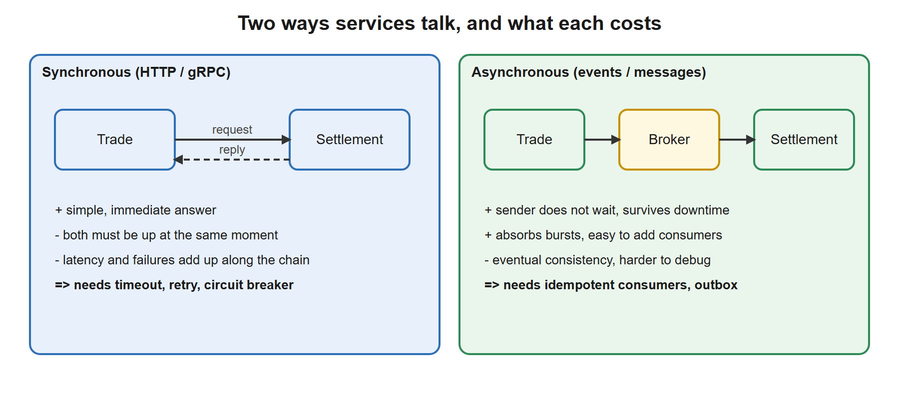
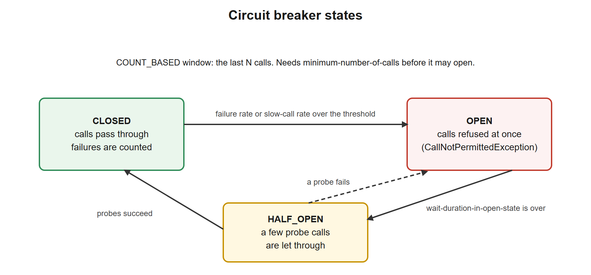
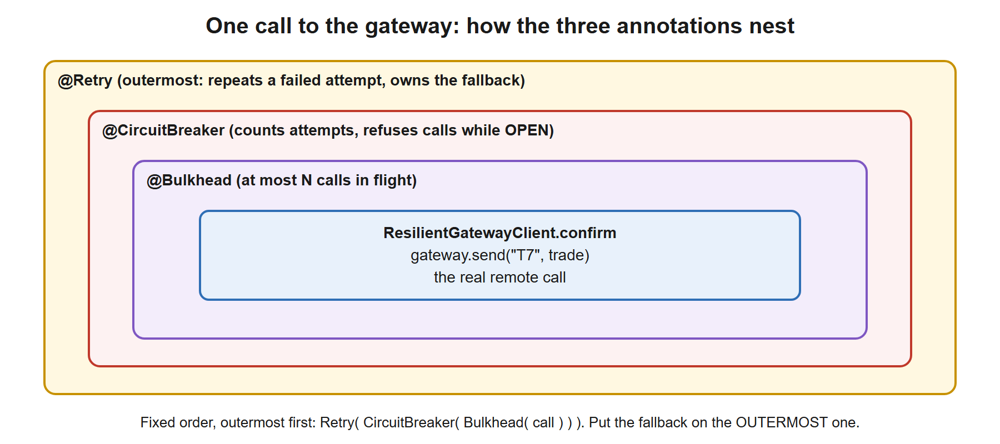

# 07. Microservice Patterns and Resilience

**You build this yourself**, continuing in the same project folder you used for Day 1. My working copy is [`../../reference/lesson-07`](../../reference/lesson-07). Open it only when you are stuck.

**Starting point:** your project as it was at the end of lesson 06 (the finished Day 1 project, 79 tests). Not there? Copy everything from `reference/lesson-06` into an empty folder and continue.
**End state:** lesson 06 plus a *gateway client* that survives a flaky remote system: retry with backoff, a circuit breaker, a bulkhead and a fallback, all proven by 12 new tests (91 in total).

## 1. Goal and time box

**100 minutes** (35 reading, 45 typing and running, 20 for the quiz and Q&A). After this lesson you can:
- Explain when microservices are the right answer and when a modular monolith is better.
- Choose between synchronous and asynchronous communication and say what each costs.
- Name the resilience patterns (timeout, retry, backoff with jitter, circuit breaker, bulkhead, rate limiter, fallback, idempotency) and say which failure each one defends against.
- Use **Resilience4j** in a Spring Boot service and explain every setting in its configuration.
- Explain, with a passing test as proof, why a retry must be safe to repeat, and why the fallback belongs on the outermost annotation.

## 2. Why it matters

Day 1 gave you one well-built service. The moment it calls another system (a SWIFT gateway, a pricing service, a payment provider) a new class of problems appears: the other side is slow, down, or answers twice. In an architect interview "how do you stop one failing dependency from taking everything down?" is a certain question.

| You know | Equivalent in this lesson |
|---|---|
| A batch job that re-runs a failed step 3 times, then alerts operations | `@Retry` with `max-attempts: 3`, then the fallback |
| A SWIFT message with a unique reference so a resend is recognised | The **idempotency key** (`"T" + tradeId`) |
| A JMS queue that buffers while the receiver is down | Asynchronous messaging (lessons 08 and 09) |
| A WebLogic work-manager that caps threads per application | The **bulkhead** |
| An operator who stops sending to a dead counterparty until it recovers | The **circuit breaker** |
| Reconciliation of "sent but no ack" messages | The `202 Accepted` / `confirmed: false` result and the queued request |

## 3. Concepts explained like a teacher

### Monolith, modular monolith, microservices

| Style | What it is | Strength | Cost |
|---|---|---|---|
| **Monolith** | One deployable, one database, one codebase | Simple to build, test, debug and deploy. Method calls, local transactions | Grows into a "ball of mud" without discipline. All parts scale and deploy together |
| **Modular monolith** | One deployable, but strict internal modules (packages) with clear interfaces, often one schema per module | Most of the design benefit, almost none of the distributed cost | Needs discipline: nothing stops a module reaching into another |
| **Microservices** | Many small deployables, each owning its data, talking over the network | Independent deployment and scaling, team autonomy, fault isolation | Every call can fail or be slow; no shared transaction; many things to run and observe |

**The architect's answer:** start with a modular monolith. Split a service out only when you can name the force that justifies the cost: a different scaling profile, a different release cadence, a different team, a different availability or security need, or a regulatory boundary. "Microservices are modern" is not a reason. Moving from a distributed system to a monolith is rarely done; moving the other way is routine.

**Splitting by business capability** (domain-driven design: *bounded contexts*). For trade settlement a plausible split is:

| Service | Owns | Why separate |
|---|---|---|
| Trade capture | Trades, validation, allocation | High write rate at market open, strict validation |
| Settlement | Instructions, status, gateway messages | Talks to SWIFT/T2S, strict ordering, regulatory audit |
| Reference data | Instruments, counterparties, calendars | Read-heavy, many consumers, changes rarely |
| Notification and reporting | Confirmations, regulatory reports | Eventual consistency is fine, heavy batch |

**Rule: each service owns its data.** No other service reads its tables. Others ask through its API or consume its events. Sharing a database turns a distributed system into a distributed monolith with all the cost and none of the benefit.

### Two ways services talk

[](images/03-sync-vs-async.svg)

Prefer **asynchronous events** between services that do not need an answer *right now* (a trade was settled; others react). Use **synchronous calls** when the caller truly needs the answer to continue (look up an instrument). Today's lesson makes synchronous calls safe; lessons 08 and 09 make asynchronous ones reliable.

### The supporting cast of a microservice platform

| Concern | The problem | Typical answer |
|---|---|---|
| **Service discovery** | How does Trade find Settlement when instances come and go? | Kubernetes `Service` DNS names (`http://settlement`). Older Spring Cloud used Eureka |
| **API gateway / edge** | One entry point for clients: routing, authentication, rate limits | Spring Cloud Gateway, Kong, cloud load balancers |
| **Externalized configuration** | Same image, different settings per environment | ConfigMaps and Secrets (lesson 10), Spring profiles (lesson 02) |
| **Authentication between services** | Who is calling me? | Short-lived JWTs from an identity provider (lesson 05) |
| **Observability** | Which of 30 services made this request slow? | Central logs, metrics (Actuator, lesson 02), **distributed tracing** |
| **Data consistency** | No transaction spans services | Saga and outbox (lesson 08) |
| **Resilience** | A dependency fails or slows | **This lesson** |

**Distributed tracing in one paragraph.** Every incoming request gets a *trace id*; each hop adds a *span* (one unit of work with start and duration) and passes the trace id on in an HTTP header (W3C `traceparent`). Micrometer Tracing (the successor of Spring Cloud Sleuth) does this in Boot 3, with exporters for OpenTelemetry, Zipkin or Jaeger. The log lines carry the trace id, so one search shows the whole journey across services.

### What goes wrong when you call another system

The "fallacies of distributed computing" in one table:

| Failure | What you see | Defence |
|---|---|---|
| **Slow response** | Threads pile up waiting; the caller becomes slow and then falls over | **Timeouts** everywhere, **bulkhead** |
| **Transient error** (reset, 503, brief blip) | A single call fails; the next would succeed | **Retry** with backoff and jitter |
| **Sustained outage** | Every call fails after a long wait | **Circuit breaker**: fail fast, give it time to recover |
| **Overload** (you or they) | Rising latency, errors | **Rate limiter**, bulkhead, back-pressure |
| **Duplicate delivery** (the reply was lost, so you retried) | The action happens twice | **Idempotency**: the same key does the work once |
| **Partial failure** | Some steps done, some not | **Saga** with compensation (lesson 08) |

**Cascading failure** is the real danger: Service A waits on slow B, so A's threads run out, so C (which calls A) slows down too. Every pattern below exists to stop a local problem becoming a global one.

### The patterns, one by one

| Pattern | What it does | Key settings | Pitfall |
|---|---|---|---|
| **Timeout** | Give up waiting after a fixed time | connect and read timeouts on the HTTP client; `TimeLimiter` | No timeout = wait forever. The default of many clients is *infinite* |
| **Retry** | Repeat a failed call | attempts, wait, which exceptions | Retrying a non-idempotent call duplicates it. Retrying an overloaded service makes it worse |
| **Backoff + jitter** | Wait longer each time, with randomness | multiplier, randomized factor | Without jitter all clients retry together: a "thundering herd" |
| **Circuit breaker** | Stop calling a failing dependency for a while | failure rate, window, open duration | Too sensitive flaps; too lax never trips |
| **Bulkhead** | Limit concurrent calls, like watertight compartments in a ship | max concurrent calls | Too small rejects normal traffic |
| **Rate limiter** | Allow at most N calls per period | limit, period | Needed to protect a dependency with a quota |
| **Fallback** | A degraded answer when the call fails | a method | A fallback that hides errors silently. Make degradation visible (our `202`) |
| **Idempotency key** | Same key, same effect, once | key generation, storage | The key must be stable across retries (not a new UUID per attempt) |

### The circuit breaker state machine

[](images/02-circuit-breaker-states.svg)

- **CLOSED:** normal. Every outcome goes into a *sliding window*. If the failure rate (or the share of slow calls) reaches the threshold, and there were at least the minimum number of calls, the breaker trips.
- **OPEN:** calls are refused immediately (no network, no waiting) and throw `CallNotPermittedException`. This protects the dependency (no load while it recovers) and your threads (no waiting).
- **HALF_OPEN:** after a wait, a few trial calls go through. All good: back to CLOSED. Failures: back to OPEN.

### How the annotations nest

[](images/01-annotation-nesting.svg)

Resilience4j applies its annotations in a fixed order: **Retry( CircuitBreaker( RateLimiter( TimeLimiter( Bulkhead( call ) ) ) ) )**. Two consequences you will prove in tests:
1. The circuit breaker sees **each attempt** that the retry makes, not each logical call.
2. A fallback on an *inner* annotation turns the failure into a normal return value, so the *outer* retry never sees an exception and never retries. Put the fallback on the **outermost** annotation (`@Retry`).

## 4. Setup steps

1. Open your project folder in VS Code and a terminal in it.
2. Confirm the starting point still works:

```powershell
.\mvnw.cmd -q clean verify
```

Expected: no output.

3. Set the compare shortcut for this lesson (change the path):

```powershell
$REF = "C:\path\to\springboot-2day\reference\lesson-07"
```

When stuck, compare one file: `fc.exe pom.xml "$REF\pom.xml"`. `FC: no differences encountered` means identical.

### Commands used in this lesson

All commands were explained in lessons 00 to 06 (`mvnw`, `curl.exe`, `ConvertFrom-Json`, `$variable`). Here is the short list so you can see which ones you will type and why:

| Command | Why here | When you use it later |
|---|---|---|
| `.\mvnw.cmd -q clean verify` | Prove the project still builds and all tests pass | Before every commit |
| `.\mvnw.cmd "-Dtest=ResilienceTest" test` | Run only the new resilience tests | While changing retry or breaker settings |
| `$B = (curl.exe -s -X POST -u bob:password localhost:8080/auth/token \| ConvertFrom-Json).access_token` | Log in as `bob` (role OPS) and keep the token in a variable | Any call to a secured endpoint |
| `curl.exe -s -i -X POST localhost:8080/trades/1/confirm -H "Authorization: Bearer $B"` | Call the new endpoint and see status plus body | Trying an endpoint |
| `curl.exe -s localhost:8080/actuator/circuitbreakers -H "Authorization: Bearer $A"` | Read the breaker state (needs the `ADMIN` token `$A`) | Operating the service |

### Files to change or add, in order

| # | File | Change | Why |
|---|---|---|---|
| 1 | `pom.xml` | **edit**: add `resilience4j-spring-boot3` | The library |
| 2 | `gateway/GatewayException.java`, `GatewayRejectedException.java`, `SettlementConfirmation.java`, `SettlementGateway.java` | **new** | The contract with the remote system and two kinds of failure |
| 3 | `gateway/FlakySettlementGateway.java` | **new** | A simulator we can break on demand |
| 4 | `gateway/ResilientGatewayClient.java` | **new** | The three annotations and the fallbacks |
| 5 | `src/main/resources/application.yml` | **edit** | Retry, circuit breaker and bulkhead settings; breaker in health |
| 6 | `service/ConfirmationService.java`, `web/ConfirmationController.java` | **new** | The use case and its endpoint |
| 7 | `web/GatewaySimulatorController.java` | **new** | A dev-only switch to break the simulator from `curl` |
| 8 | `ResilienceTest.java`, `ConfirmationApiTest.java` | **new** tests | Prove all of it |

## 5. Code walkthrough

A build-along. Where a file already exists, the block shows the **whole file** with the changes inside, so you can replace its content.

### Step 1. Add Resilience4j to `pom.xml`

**Do:** open `pom.xml` and add the marked dependency before the test starters. The block shows the whole file.

**File:** `pom.xml`
```xml
<?xml version="1.0" encoding="UTF-8"?>
<project xmlns="http://maven.apache.org/POM/4.0.0"
         xmlns:xsi="http://www.w3.org/2001/XMLSchema-instance"
         xsi:schemaLocation="http://maven.apache.org/POM/4.0.0 https://maven.apache.org/xsd/maven-4.0.0.xsd">
  <modelVersion>4.0.0</modelVersion>

  <!-- The parent pins versions of over 1,500 libraries, so we never write versions below. -->
  <parent>
    <groupId>org.springframework.boot</groupId>
    <artifactId>spring-boot-starter-parent</artifactId>
    <version>3.5.16</version>
    <relativePath/>
  </parent>

  <!-- Our project's own identity. -->
  <groupId>com.example</groupId>
  <artifactId>trade-service</artifactId>
  <version>0.0.1-SNAPSHOT</version>
  <name>trade-service</name>

  <properties>
    <java.version>21</java.version>
  </properties>

  <dependencies>
    <!-- Web starter: embedded Tomcat + Spring MVC + Jackson (JSON). -->
    <dependency>
      <groupId>org.springframework.boot</groupId>
      <artifactId>spring-boot-starter-web</artifactId>
    </dependency>

    <!-- AOP starter (lesson 01): brings AspectJ so we can write @Aspect classes. -->
    <dependency>
      <groupId>org.springframework.boot</groupId>
      <artifactId>spring-boot-starter-aop</artifactId>
    </dependency>

    <!-- Actuator (NEW in lesson 02): /actuator/health, /actuator/beans, /actuator/conditions, metrics... -->
    <dependency>
      <groupId>org.springframework.boot</groupId>
      <artifactId>spring-boot-starter-actuator</artifactId>
    </dependency>

    <!-- Validation starter (NEW in lesson 02): Bean Validation (jakarta.validation) + Hibernate Validator.
         Lesson 02 uses it to validate configuration; lesson 03 uses it to validate request bodies. -->
    <dependency>
      <groupId>org.springframework.boot</groupId>
      <artifactId>spring-boot-starter-validation</artifactId>
    </dependency>

    <!-- JPA starter (NEW in lesson 04): Spring Data JPA + Hibernate + HikariCP connection pool + transaction support. -->
    <dependency>
      <groupId>org.springframework.boot</groupId>
      <artifactId>spring-boot-starter-data-jpa</artifactId>
    </dependency>

    <!-- H2 (NEW in lesson 04): in-memory database for learning and tests. Runtime only: our code never imports it. -->
    <dependency>
      <groupId>com.h2database</groupId>
      <artifactId>h2</artifactId>
      <scope>runtime</scope>
    </dependency>

    <!-- Security starter (NEW in lesson 05): Spring Security filter chain, password encoders, method security. -->
    <dependency>
      <groupId>org.springframework.boot</groupId>
      <artifactId>spring-boot-starter-security</artifactId>
    </dependency>

    <!-- OAuth2 resource server (NEW in lesson 05): validates "Authorization: Bearer <JWT>" on incoming requests.
         Also brings the Nimbus library we use to sign (create) the demo tokens. -->
    <dependency>
      <groupId>org.springframework.boot</groupId>
      <artifactId>spring-boot-starter-oauth2-resource-server</artifactId>
    </dependency>

    <!-- Resilience4j (NEW in lesson 07): @Retry, @CircuitBreaker, @Bulkhead, @RateLimiter, @TimeLimiter as annotations,
         configured under "resilience4j:" in application.yml. Boot does not manage its version, so we pin it.
         It needs the AOP starter (lesson 01) and the Actuator (lesson 02), which we already have. -->
    <dependency>
      <groupId>io.github.resilience4j</groupId>
      <artifactId>resilience4j-spring-boot3</artifactId>
      <version>2.3.0</version>
    </dependency>

    <!-- Test starter: JUnit 5, AssertJ, Mockito, Spring test support. Only used when testing. -->
    <dependency>
      <groupId>org.springframework.boot</groupId>
      <artifactId>spring-boot-starter-test</artifactId>
      <scope>test</scope>
    </dependency>

    <!-- Security test helpers (NEW in lesson 05): jwt() request post-processor, @WithMockUser. -->
    <dependency>
      <groupId>org.springframework.security</groupId>
      <artifactId>spring-security-test</artifactId>
      <scope>test</scope>
    </dependency>
  </dependencies>

  <build>
    <plugins>
      <!-- Builds the runnable "fat jar" and adds the spring-boot:run command. -->
      <plugin>
        <groupId>org.springframework.boot</groupId>
        <artifactId>spring-boot-maven-plugin</artifactId>
      </plugin>

      <!-- (NEW in lesson 06) Step 1 of 3 for a clean test run: this plugin turns the downloaded Mockito jar into
           the property ${org.mockito:mockito-core:jar}, so Surefire can load it as a Java agent (step 3). -->
      <plugin>
        <groupId>org.apache.maven.plugins</groupId>
        <artifactId>maven-dependency-plugin</artifactId>
        <executions>
          <execution>
            <id>mockito-agent-path</id>
            <goals>
              <goal>properties</goal>
            </goals>
          </execution>
        </executions>
      </plugin>

      <!-- (NEW in lesson 06) Step 2 of 3: JaCoCo measures which lines the tests execute.
           "prepare-agent" injects its agent into the test JVM through the ${argLine} property;
           "report" writes target/site/jacoco/index.html after the tests. -->
      <plugin>
        <groupId>org.jacoco</groupId>
        <artifactId>jacoco-maven-plugin</artifactId>
        <version>0.8.16</version>     <!-- Spring Boot does not manage plugin versions for JaCoCo, so we pin one -->
        <executions>
          <execution>
            <id>jacoco-prepare</id>
            <goals>
              <goal>prepare-agent</goal>
            </goals>
          </execution>
          <execution>
            <id>jacoco-report</id>
            <phase>verify</phase>
            <goals>
              <goal>report</goal>
            </goals>
          </execution>
        </executions>
      </plugin>

      <!-- (NEW in lesson 06) Step 3 of 3: Surefire runs the tests. We pass the JVM two agents: JaCoCo (@{argLine})
           and Mockito. Loading Mockito explicitly removes the "Mockito is currently self-attaching" warning and
           keeps working on future Java versions. -Xshare:off stops the JVM complaining about class-data sharing
           when an agent is present. We also silence the SQL log, which is noise in test output. -->
      <plugin>
        <groupId>org.apache.maven.plugins</groupId>
        <artifactId>maven-surefire-plugin</artifactId>
        <configuration>
          <argLine>@{argLine} -javaagent:${org.mockito:mockito-core:jar} -Xshare:off</argLine>
          <systemPropertyVariables>
            <logging.level.org.hibernate.SQL>INFO</logging.level.org.hibernate.SQL>
          </systemPropertyVariables>
        </configuration>
      </plugin>
    </plugins>
  </build>
</project>
```
**Why:** `resilience4j-spring-boot3` brings the retry, circuit breaker, bulkhead, rate limiter and time limiter modules, the annotations, the configuration binding for `resilience4j.*` keys, the Actuator endpoints and the Micrometer metrics. Spring Boot's parent does not manage its version, so we write `2.3.0` ourselves. It needs the AOP starter (lesson 01) because the annotations are applied through proxies, and the Actuator (lesson 02) for its endpoints, which we already have.

**Checkpoint:** `.\mvnw.cmd -q compile` prints nothing.

**Stuck?** *`Could not find artifact io.github.resilience4j...`*: a typo in the coordinates, or no network for the first download.

### Deep dive: Resilience4j, the library

**What it is.** A lightweight fault-tolerance library for Java 17+, built for functional programming and designed as the successor of **Netflix Hystrix**, which was put into maintenance mode in 2018. Each pattern is a small, separate module that wraps a function: you give it a supplier, it returns a decorated supplier. The Spring Boot module adds annotations and configuration on top.

**Why this one and not something else?**

| Option | Notes |
|---|---|
| **Resilience4j** | The current standard in the Spring world. Modular, no heavy dependencies, metrics built in, works with annotations or plain code |
| **Spring Retry** (`@Retryable`) | Retry only. Spring Framework 7 brings basic retry into the core, and Boot 4 uses it. No circuit breaker |
| **Spring Cloud Circuit Breaker** | An abstraction over Resilience4j and others. Useful if you want to swap the engine; one more layer otherwise |
| **Hystrix** | Retired. You will still meet it in old code |
| **Service mesh** (Istio, Linkerd) | Retries, timeouts and circuit breaking in a sidecar proxy, outside your code. Good for uniform policy; cannot know your business fallbacks |

**The modules (and which annotation each gives you):**

| Module | Annotation | What it limits | Used here |
|---|---|---|---|
| `resilience4j-retry` | `@Retry` | Repeats failed calls | Yes |
| `resilience4j-circuitbreaker` | `@CircuitBreaker` | Stops calls to a failing dependency | Yes |
| `resilience4j-bulkhead` | `@Bulkhead` | Concurrent calls (semaphore) or a separate thread pool (`type = THREADPOOL`, async) | Yes (semaphore) |
| `resilience4j-ratelimiter` | `@RateLimiter` | Calls per time period | No |
| `resilience4j-timelimiter` | `@TimeLimiter` | Wait time. Only for `CompletableFuture` or reactive return types | No: use the HTTP client's own timeouts for blocking calls |
| `resilience4j-cache`, `-reactor`, `-micrometer`, `-feign` | | Caching, reactive adapters, metrics, Feign | Micrometer: automatic |

**Using it without annotations** (when you want explicit control, or the call is inside the same class):

```java
Supplier<SettlementConfirmation> call = () -> gateway.send(key, trade);
Supplier<SettlementConfirmation> safe = Decorators.ofSupplier(call)
        .withCircuitBreaker(circuitBreakerRegistry.circuitBreaker("gateway"))
        .withRetry(retryRegistry.retry("gateway"))
        .withFallback(List.of(CallNotPermittedException.class), e -> unconfirmed(key))
        .decorate();
SettlementConfirmation result = safe.get();
```

This version has **no proxy**, so it works for `this.method()` calls and in unit tests with no Spring.

**What it gives Operations for free** (Actuator, with `management.endpoints.web.exposure.include` open as in the `dev` profile):

| Endpoint | Shows |
|---|---|
| `/actuator/circuitbreakers` | State, failure rate, counts of every breaker |
| `/actuator/circuitbreakerevents` | The latest state changes and calls |
| `/actuator/retries`, `/actuator/retryevents` | Retry instances and events |
| `/actuator/bulkheads`, `/actuator/ratelimiters`, `/actuator/timelimiters` | Their state |
| `/actuator/health` | Each breaker, if `register-health-indicator: true` (below) |
| `/actuator/metrics/resilience4j.circuitbreaker.calls` | Counts per kind (successful, failed, not permitted) as Micrometer metrics, ready for Prometheus |

### Step 2. The contract with the remote system

**Do:** create the `gateway` package and these four files.

Two exceptions, because **not every failure should be treated the same**:
- `GatewayException`: a *transient* problem (timeout, 503). Worth retrying; counts against the gateway's health.
- `GatewayRejectedException`: a *permanent* answer ("unknown counterparty"). Retrying cannot help, and it says nothing about the gateway's health.

**File:** `src/main/java/com/example/trade/gateway/GatewayException.java`
```java
package com.example.trade.gateway;

// A TRANSIENT failure: timeout, connection reset, 503 from the gateway. Retrying may succeed.
public class GatewayException extends RuntimeException {
    public GatewayException(String message) {
        super(message);
    }
}
```
**File:** `src/main/java/com/example/trade/gateway/GatewayRejectedException.java`
```java
package com.example.trade.gateway;

// A PERMANENT answer: the gateway understood the message and said no (invalid BIC, unknown account...).
// Retrying cannot help, and it says nothing about the gateway's health, so the retry and the circuit breaker ignore it.
public class GatewayRejectedException extends RuntimeException {
    public GatewayRejectedException(String message) {
        super(message);
    }
}
```
The result is a record. `confirmed = false` is **not an error**: it means "we could not reach the gateway; the request is still owed".

**File:** `src/main/java/com/example/trade/gateway/SettlementConfirmation.java`
```java
package com.example.trade.gateway;

// The outcome of asking the gateway to confirm a trade.
// confirmed = false does not mean "failed": it means "we could not reach the gateway; the request is still owed".
public record SettlementConfirmation(String tradeKey, boolean confirmed, String reference, String note) {
    public static SettlementConfirmation confirmed(String tradeKey, String reference, String note) {
        return new SettlementConfirmation(tradeKey, true, reference, note);
    }

    public static SettlementConfirmation unconfirmed(String tradeKey, String reason) {
        return new SettlementConfirmation(tradeKey, false, null, reason);
    }
}
```
The interface is the *port* to the outside world (the same idea as `TradeRepository` in lesson 04). A real implementation would use `RestClient` or a messaging client; the application only sees this interface.

**File:** `src/main/java/com/example/trade/gateway/SettlementGateway.java`
```java
package com.example.trade.gateway;

import com.example.trade.domain.Trade;

// The remote system we depend on (think: a SWIFT/T2S gateway). Production code would implement this with an HTTP or
// MQ client. The idempotency key lets the gateway recognise a repeated request, which is what makes retrying safe.
public interface SettlementGateway {
    SettlementConfirmation send(String idempotencyKey, Trade trade);
}
```
**Why:**
- The `idempotencyKey` parameter is the heart of safe retries: the gateway uses it to recognise "I have already processed this one".
- The key is built from the **trade id**, which is stable across retries. A random UUID per attempt would defeat the purpose.
- Unchecked exceptions: callers should not be forced to catch every failure, and the Resilience4j proxy handles them in one place.

**Checkpoint:** `.\mvnw.cmd -q compile` prints nothing.

**Stuck?** *`package com.example.trade.domain does not exist`*: the starting point is wrong; check lesson 06 compiled first.

### Step 3. A gateway we can break on demand

**Do:** create the simulator. It stands in for the real remote system, so you can see resilience working without any network.

**File:** `src/main/java/com/example/trade/gateway/FlakySettlementGateway.java`
```java
package com.example.trade.gateway;

import com.example.trade.domain.Trade;
import java.util.Set;
import java.util.concurrent.ConcurrentHashMap;
import java.util.concurrent.CountDownLatch;
import java.util.concurrent.TimeUnit;
import java.util.concurrent.atomic.AtomicInteger;
import org.springframework.stereotype.Component;

// A simulator of an unreliable remote gateway, so we can PROVE the resilience behaviour on a laptop.
// It also behaves like a well-built gateway: the same idempotency key is delivered only once.
@Component
public class FlakySettlementGateway implements SettlementGateway {

    private final AtomicInteger attempts = new AtomicInteger();          // every call, successful or not
    private final AtomicInteger failuresToInject = new AtomicInteger();  // how many upcoming calls should fail
    private final Set<String> delivered = ConcurrentHashMap.newKeySet(); // keys the gateway really processed
    private volatile boolean loseReplies;                                // fail AFTER processing: the reply is lost
    private volatile boolean rejectAll;
    private volatile CountDownLatch holdCalls;                           // lets a test keep calls "in flight"
    private volatile CountDownLatch entered = new CountDownLatch(0);

    @Override
    public SettlementConfirmation send(String idempotencyKey, Trade trade) {
        attempts.incrementAndGet();
        entered.countDown();
        awaitIfHeld();
        if (rejectAll) {
            throw new GatewayRejectedException("Unknown counterparty for " + trade.isin());
        }
        if (failuresToInject.getAndUpdate(n -> n > 0 ? n - 1 : 0) > 0) {
            if (loseReplies) {
                delivered.add(idempotencyKey);      // the message arrived, but the answer never came back
            }
            throw new GatewayException("gateway timeout");
        }
        boolean firstTime = delivered.add(idempotencyKey);
        return SettlementConfirmation.confirmed(idempotencyKey, "SWIFT-" + idempotencyKey,
                firstTime ? "delivered" : "duplicate ignored");
    }

    private void awaitIfHeld() {
        CountDownLatch latch = holdCalls;
        if (latch != null) {
            try {
                latch.await(5, TimeUnit.SECONDS);
            } catch (InterruptedException e) {
                Thread.currentThread().interrupt();
            }
        }
    }

    // ---- controls used by the demo and the tests ----
    public void failNext(int calls, boolean replyLost) {
        failuresToInject.set(calls);
        loseReplies = replyLost;
    }

    public void rejectEverything(boolean value) { rejectAll = value; }

    /** Calls block until release(); expectCalls tells awaitEntered() how many callers to wait for. */
    public void hold(int expectCalls) {
        holdCalls = new CountDownLatch(1);
        entered = new CountDownLatch(expectCalls);
    }

    public boolean awaitEntered() throws InterruptedException { return entered.await(5, TimeUnit.SECONDS); }

    public void release() {
        CountDownLatch latch = holdCalls;
        if (latch != null) {
            latch.countDown();
        }
        holdCalls = null;
    }

    public int attempts() { return attempts.get(); }

    public int distinctDeliveries() { return delivered.size(); }

    public void reset() {
        release();
        attempts.set(0);
        failuresToInject.set(0);
        delivered.clear();
        loseReplies = false;
        rejectAll = false;
        entered = new CountDownLatch(0);
    }
}
```
**Why:**
- It is a `@Component`, so Spring injects it wherever a `SettlementGateway` is needed. Replacing it with a real HTTP client later changes one class.
- `failNext(n, replyLost)` makes the next `n` calls throw `GatewayException`. With `replyLost = true` the gateway **processes the message first and then fails**: the worst real-world case, "it worked but I never heard back".
- `delivered` is a set of keys the gateway really processed. A second call with the same key returns `"duplicate ignored"`. This is how a well-built gateway makes retries safe.
- The latches (`hold`, `awaitEntered`, `release`) let a test keep calls "in flight" to fill the bulkhead without sleeping.
- All state is `volatile` or atomic: the gateway is a singleton used by many request threads.

**Checkpoint:** `.\mvnw.cmd -q compile` prints nothing.

### Step 4. The resilient client

**Do:** create the class that every call to the gateway goes through.

**File:** `src/main/java/com/example/trade/gateway/ResilientGatewayClient.java`
```java
package com.example.trade.gateway;

import com.example.trade.domain.Trade;
import io.github.resilience4j.bulkhead.BulkheadFullException;
import io.github.resilience4j.bulkhead.annotation.Bulkhead;
import io.github.resilience4j.circuitbreaker.CallNotPermittedException;
import io.github.resilience4j.circuitbreaker.annotation.CircuitBreaker;
import io.github.resilience4j.retry.annotation.Retry;
import org.slf4j.Logger;
import org.slf4j.LoggerFactory;
import org.springframework.stereotype.Service;

// Every call to the remote gateway goes through here. The three annotations are proxy-based (lesson 01), so this class
// must be called from ANOTHER bean (ConfirmationService), never with this.confirm().
//
// How Resilience4j nests them (fixed order, outermost first):   Retry( CircuitBreaker( Bulkhead( the call ) ) )
//   - Bulkhead: caps concurrent calls, so a slow gateway cannot use up all our threads.
//   - CircuitBreaker: records each attempt; once too many fail it OPENS and refuses calls instantly.
//   - Retry: repeats a failed attempt a few times, with a pause.
// The fallback sits on the OUTERMOST annotation (@Retry). A fallback on the inner @CircuitBreaker would turn every
// failure into a normal return value, and the Retry outside it would never see an exception to retry.
@Service
public class ResilientGatewayClient {

    private static final Logger log = LoggerFactory.getLogger(ResilientGatewayClient.class);

    private final SettlementGateway gateway;

    public ResilientGatewayClient(SettlementGateway gateway) {
        this.gateway = gateway;
    }

    @Retry(name = "gateway", fallbackMethod = "gatewayDown")
    @CircuitBreaker(name = "gateway")
    @Bulkhead(name = "gateway")
    public SettlementConfirmation confirm(Trade trade) {
        // The trade id is the idempotency key: a retry (or a second click) can never deliver twice.
        return gateway.send("T" + trade.id(), trade);
    }

    // Fallbacks share ONE name (the one in fallbackMethod) and take the same parameters plus an exception. Resilience4j
    // picks the overload whose exception type matches best.
    // GatewayRejectedException has NO fallback on purpose: a permanent "no" must reach the caller as an error.
    SettlementConfirmation gatewayDown(Trade trade, GatewayException e) {
        log.warn("Gateway unavailable for trade {} after retries: {}", trade.id(), e.getMessage());
        return SettlementConfirmation.unconfirmed("T" + trade.id(), "gateway unavailable, queued for later");
    }

    SettlementConfirmation gatewayDown(Trade trade, CallNotPermittedException e) {
        log.warn("Circuit open, call for trade {} not attempted", trade.id());
        return SettlementConfirmation.unconfirmed("T" + trade.id(), "circuit open, queued for later");
    }

    SettlementConfirmation gatewayDown(Trade trade, BulkheadFullException e) {
        log.warn("Bulkhead full, call for trade {} not attempted", trade.id());
        return SettlementConfirmation.unconfirmed("T" + trade.id(), "too many calls in flight, queued for later");
    }
}
```
**Why, line by line:**
- `@Retry`, `@CircuitBreaker`, `@Bulkhead` with `name = "gateway"`: the name links each annotation to its settings under `resilience4j.<module>.instances.gateway` in `application.yml` (step 5).
- `fallbackMethod = "gatewayDown"` on `@Retry` only. It runs when the exception has left the retry: attempts used up, an open circuit, or a full bulkhead. The same name is used for all fallbacks; the **exception type in the last parameter** selects which one runs. Resilience4j picks the most specific match.
- `GatewayRejectedException` has **no** fallback: a permanent rejection must reach the caller as an error, not be disguised as "queued for later".
- Each fallback logs a warning and returns `unconfirmed(...)` with a reason. Degradation is **visible** to the caller and to operators, never silent.
- The method must be called from **another bean** (`ConfirmationService`). Calling it with `this.confirm(...)` would skip the proxy: the self-invocation trap from lesson 01.

**Checkpoint:** `.\mvnw.cmd -q compile` prints nothing.

**Stuck?**
- *`No fallback method found`* at the first call: the fallback names differ, or a parameter type does not match the original method (`Trade trade`) followed by the exception.
- *Retries never happen*: the fallback is on an inner annotation, or `retry-exceptions` does not list `GatewayException`.

### Step 5. Configuration

**Do:** replace `src/main/resources/application.yml` with the whole file below. The new parts are the `resilience4j:` block and the `management.health.circuitbreakers` setting.

**File:** `src/main/resources/application.yml`
```yaml
# Base configuration: applies in every profile. Profile files (application-dev.yml, application-prod.yml)
# are layered on top and win when the same key appears in both.
spring:
  application:
    name: trade-service
  profiles:
    default: dev          # used only when no profile is activated explicitly
  jpa:
    open-in-view: false           # no Hibernate session during view rendering: lazy-loading mistakes fail early
    hibernate:
      ddl-auto: create-drop       # Hibernate builds the tables from the entities. Learning only: real systems use Flyway/Liquibase.

# Our own settings, bound to the TradeProperties record (prefix "trade").
trade:
  max-quantity: 1000000
  venue: XLON
  security:
    # HS256 needs a secret of at least 32 characters. The default below is for local development ONLY.
    # Real environments inject JWT_SECRET from a secret store (the prod profile has no default on purpose).
    jwt-secret: ${JWT_SECRET:dev-only-secret-change-me-0123456789abcdef}
    token-ttl: 15m

# Custom switch for the conditional bean in lesson 02.
audit:
  enabled: false

# Resilience4j (lesson 07). "gateway" is the instance name used in the annotations on ResilientGatewayClient.
resilience4j:
  retry:
    instances:
      gateway:
        max-attempts: 3                   # the first call plus two retries
        wait-duration: 200ms              # base pause between attempts
        enable-exponential-backoff: true  # 200ms, 400ms, ... so a struggling gateway gets room to recover
        exponential-backoff-multiplier: 2
        enable-randomized-wait: true      # jitter: callers do not all retry at the same instant
        randomized-wait-factor: 0.5
        retry-exceptions:
          - com.example.trade.gateway.GatewayException
        ignore-exceptions:                # never retry a permanent "no", or a call the open circuit refused
          - com.example.trade.gateway.GatewayRejectedException
          - io.github.resilience4j.circuitbreaker.CallNotPermittedException
  circuitbreaker:
    instances:
      gateway:
        sliding-window-type: COUNT_BASED
        sliding-window-size: 10                    # judge the last 10 calls
        minimum-number-of-calls: 5                 # no verdict before 5 calls
        failure-rate-threshold: 50                 # open when 50% or more of the window failed
        slow-call-duration-threshold: 2s           # a call slower than this counts as "slow"
        slow-call-rate-threshold: 80               # open when 80% or more are slow
        wait-duration-in-open-state: 10s           # stay open this long, then probe
        permitted-number-of-calls-in-half-open-state: 3
        automatic-transition-from-open-to-half-open-enabled: true
        record-exceptions:
          - com.example.trade.gateway.GatewayException
        ignore-exceptions:
          - com.example.trade.gateway.GatewayRejectedException
        register-health-indicator: true            # the breaker state shows up in /actuator/health
        allow-health-indicator-to-fail: false      # an OPEN breaker is shown, but does NOT turn the whole service DOWN
  bulkhead:
    instances:
      gateway:
        max-concurrent-calls: 10                   # at most 10 calls in flight to the gateway
        max-wait-duration: 0ms                     # a caller above the limit fails at once instead of queueing

# Actuator: expose only what is safe by default; the dev profile opens more.
management:
  endpoints:
    web:
      exposure:
        include: health,info
  info:
    env:
      enabled: true       # publish the "info.*" keys below at /actuator/info
  health:
    circuitbreakers:
      enabled: true       # include every circuit breaker in /actuator/health (lesson 07)

info:
  app:
    name: trade-service
    description: Trade capture and settlement demo
```
**Why, key by key:**

*Retry* (`resilience4j.retry.instances.gateway`)
- `max-attempts: 3`: the first call plus two retries. It counts **all** attempts.
- `wait-duration: 200ms`, `enable-exponential-backoff: true`, `exponential-backoff-multiplier: 2`: wait 200 ms, then 400 ms. A struggling dependency gets breathing room.
- `enable-randomized-wait: true`, `randomized-wait-factor: 0.5`: each wait varies by up to plus or minus 50%. This **jitter** stops many callers retrying in lockstep.
- `retry-exceptions`: **only** these are retried. Everything not listed is not.
- `ignore-exceptions`: never retried, even if they match a list above. `GatewayRejectedException` (permanent) and `CallNotPermittedException` (the open circuit refused the call: retrying is pointless).

*Circuit breaker* (`resilience4j.circuitbreaker.instances.gateway`)
- `sliding-window-type: COUNT_BASED`, `sliding-window-size: 10`: judge the last 10 calls.
- `minimum-number-of-calls: 5`: no verdict before 5 calls, so one early failure cannot open it.
- `failure-rate-threshold: 50`: open when 50% or more of the window failed.
- `slow-call-duration-threshold: 2s`, `slow-call-rate-threshold: 80`: a call slower than 2 s counts as slow; open when 80% are slow. A gateway that answers in 30 seconds is as bad as one that is down.
- `wait-duration-in-open-state: 10s`, `automatic-transition-from-open-to-half-open-enabled: true`: stay open 10 s, then move to HALF_OPEN by itself.
- `permitted-number-of-calls-in-half-open-state: 3`: three probe calls decide whether to close.
- `record-exceptions` and `ignore-exceptions`: which exceptions count as failures. A rejection is not the gateway's fault.
- `register-health-indicator: true` and `allow-health-indicator-to-fail: false`: show the breaker under `/actuator/health`, but do **not** let an OPEN breaker turn the whole service `DOWN`. We have a fallback, so we are still able to serve requests. If it turned `DOWN`, Kubernetes would take every pod out of rotation exactly when the gateway failed: the lesson 02 rule about dependencies and health.

*Bulkhead* (`resilience4j.bulkhead.instances.gateway`)
- `max-concurrent-calls: 10`: at most 10 calls in flight.
- `max-wait-duration: 0ms`: a caller above the limit fails at once (`BulkheadFullException`) instead of queueing.

*Management*
- `management.health.circuitbreakers.enabled: true`: the Actuator health group that lists breakers.

#### Deep dive: the `resilience4j:` keys you did not use

| Module and key | Default | What it does |
|---|---|---|
| `retry.…fail-after-max-attempts` | `false` | `true` throws `MaxRetriesExceededException` when a *result* predicate keeps failing |
| `retry.…result-predicate` | none | Retry when the **returned value** is bad (for example a "pending" answer), not only on exceptions |
| `retry.…retry-exception-predicate` | none | A class that decides per exception whether to retry |
| `retry.…wait-duration` with `exponential-max-wait-duration` | none | Cap for exponential growth |
| `retry.…event-consumer-buffer-size` | `100` | How many events the `retryevents` endpoint remembers |
| `circuitbreaker.…sliding-window-type: TIME_BASED` | | The window is the last N **seconds** instead of the last N calls (`sliding-window-size` then means seconds) |
| `circuitbreaker.…max-wait-duration-in-half-open-state` | `0` (wait forever) | Close or reopen after this long even if the probes have not finished |
| `circuitbreaker.…record-failure-predicate`, `ignore-exception-predicate` | none | Predicate classes instead of exception lists |
| `circuitbreaker.…writable-stack-trace-enabled` | `true` | `false` makes `CallNotPermittedException` cheaper (no stack trace) |
| `circuitbreaker.…base-config` and `configs.default` | none | Shared settings: define `resilience4j.circuitbreaker.configs.default` once and let instances inherit with `base-config: default` |
| `thread-pool-bulkhead.instances.x.max-thread-pool-size`, `core-thread-pool-size`, `queue-capacity`, `keep-alive-duration` (used with the annotation `@Bulkhead(type = Bulkhead.Type.THREADPOOL)`) | | A separate thread pool per dependency (asynchronous calls). Stronger isolation than a semaphore, higher cost |
| `ratelimiter.instances.x.limit-for-period`, `limit-refresh-period`, `timeout-duration` | `50`, `500ns`, `5s` | Allow N calls per period; callers wait up to `timeout-duration` for a permit |
| `timelimiter.instances.x.timeout-duration`, `cancel-running-future` | `1s`, `true` | Time limit for `CompletableFuture` returning methods |
| `…enabled` (under each module) | `true` | Turn a whole module off, for example in a test profile |

### Step 6. The use case and its endpoint

**Do:** create the service and the controller.

**File:** `src/main/java/com/example/trade/service/ConfirmationService.java`
```java
package com.example.trade.service;

import com.example.trade.domain.Trade;
import com.example.trade.gateway.ResilientGatewayClient;
import com.example.trade.gateway.SettlementConfirmation;
import org.springframework.stereotype.Service;

// NOT @Transactional on purpose: trades.get(...) opens and COMMITS its own short transaction. We must never hold a
// database transaction (and its pooled connection) open while waiting for a slow remote system.
@Service
public class ConfirmationService {

    private final TradeService trades;
    private final ResilientGatewayClient gateway;

    public ConfirmationService(TradeService trades, ResilientGatewayClient gateway) {
        this.trades = trades;
        this.gateway = gateway;
    }

    public SettlementConfirmation confirm(Long tradeId) {
        Trade trade = trades.get(tradeId);          // 404 if unknown
        return gateway.confirm(trade);              // goes through the resilience proxy
    }
}
```
**File:** `src/main/java/com/example/trade/web/ConfirmationController.java`
```java
package com.example.trade.web;

import com.example.trade.gateway.SettlementConfirmation;
import com.example.trade.service.ConfirmationService;
import org.springframework.http.ResponseEntity;
import org.springframework.security.access.prepost.PreAuthorize;
import org.springframework.web.bind.annotation.PathVariable;
import org.springframework.web.bind.annotation.PostMapping;
import org.springframework.web.bind.annotation.RequestMapping;
import org.springframework.web.bind.annotation.RestController;

@RestController
@RequestMapping("/trades")
public class ConfirmationController {

    private final ConfirmationService confirmations;

    public ConfirmationController(ConfirmationService confirmations) {
        this.confirmations = confirmations;
    }

    // 200 OK: the gateway confirmed. 202 Accepted: we could not reach it, the request is queued and will be completed later.
    @PostMapping("/{id}/confirm")
    @PreAuthorize("hasRole('OPS')")
    public ResponseEntity<SettlementConfirmation> confirm(@PathVariable Long id) {
        SettlementConfirmation result = confirmations.confirm(id);
        return result.confirmed() ? ResponseEntity.ok(result) : ResponseEntity.accepted().body(result);
    }
}
```
**Why:**
- `ConfirmationService` has **no `@Transactional`** on purpose. `trades.get(id)` opens and **commits** its own short transaction. We must never keep a database transaction, and its pooled connection, open while we wait for a slow remote system: the pool would run dry exactly when the remote system is slow.
- The controller maps the outcome to HTTP: **`200 OK`** when the gateway confirmed, **`202 Accepted`** when we could not reach it and the work is queued. `202` is the honest status: "I received it, it is not done yet".
- `@PreAuthorize("hasRole('OPS')")`: only operations may confirm (lesson 05).
- An unknown trade id throws `TradeNotFoundException` and becomes `404` through the handler from lesson 03. A `GatewayRejectedException` is not handled, so it would become a generic `500`; a real service would map it to `422`. (Exercise at the end.)

**Checkpoint:** `.\mvnw.cmd -q compile` prints nothing.

### Step 7. A switch to break the simulator

**Do:** create the dev-only controller.

**File:** `src/main/java/com/example/trade/web/GatewaySimulatorController.java`
```java
package com.example.trade.web;

import com.example.trade.gateway.FlakySettlementGateway;
import org.springframework.context.annotation.Profile;
import org.springframework.http.ResponseEntity;
import org.springframework.security.access.prepost.PreAuthorize;
import org.springframework.web.bind.annotation.PostMapping;
import org.springframework.web.bind.annotation.RequestMapping;
import org.springframework.web.bind.annotation.RequestParam;
import org.springframework.web.bind.annotation.RestController;

// A switch to break and repair the SIMULATED gateway while you experiment with curl. It exists only in the "dev"
// profile (the default on your laptop); in "prod" this class is not even created.
@RestController
@Profile("dev")
@RequestMapping("/sim/gateway")
public class GatewaySimulatorController {

    private final FlakySettlementGateway gateway;

    public GatewaySimulatorController(FlakySettlementGateway gateway) {
        this.gateway = gateway;
    }

    // POST /sim/gateway/fail-next?calls=100  : the next 100 calls fail.   calls=0 : repair it.
    @PostMapping("/fail-next")
    @PreAuthorize("hasRole('ADMIN')")
    public ResponseEntity<Void> failNext(@RequestParam int calls) {
        gateway.failNext(calls, false);
        return ResponseEntity.noContent().build();
    }
}
```
**Why:** `@Profile("dev")` means Spring creates this class only when the `dev` profile is active (the default on your laptop, lesson 02). In `prod` the endpoint does not exist. `ADMIN` only, so nobody can sabotage the demo by accident.

### Step 8. Tests that prove the behaviour

**Do:** create the two test classes.

**File:** `src/test/java/com/example/trade/ResilienceTest.java`
```java
package com.example.trade;

import static org.assertj.core.api.Assertions.assertThat;
import static org.assertj.core.api.Assertions.assertThatThrownBy;

import com.example.trade.domain.Trade;
import com.example.trade.domain.TradeStatus;
import com.example.trade.gateway.FlakySettlementGateway;
import com.example.trade.gateway.GatewayRejectedException;
import com.example.trade.gateway.ResilientGatewayClient;
import com.example.trade.gateway.SettlementConfirmation;
import io.github.resilience4j.circuitbreaker.CircuitBreaker;
import io.github.resilience4j.circuitbreaker.CircuitBreakerRegistry;
import java.math.BigDecimal;
import java.util.concurrent.CompletableFuture;
import java.util.concurrent.ExecutorService;
import java.util.concurrent.Executors;
import org.junit.jupiter.api.AfterEach;
import org.junit.jupiter.api.BeforeEach;
import org.junit.jupiter.api.Test;
import org.springframework.beans.factory.annotation.Autowired;
import org.springframework.boot.test.context.SpringBootTest;

// The real Spring context (so the Resilience4j proxies are real), no web server. We shorten the waits and the window so
// the tests are fast, and use the simulator gateway to make the "remote system" fail on demand.
@SpringBootTest(webEnvironment = SpringBootTest.WebEnvironment.NONE, properties = {
        "resilience4j.retry.instances.gateway.wait-duration=10ms",
        "resilience4j.circuitbreaker.instances.gateway.sliding-window-size=4",
        "resilience4j.circuitbreaker.instances.gateway.minimum-number-of-calls=4",
        "resilience4j.circuitbreaker.instances.gateway.permitted-number-of-calls-in-half-open-state=2",
        "resilience4j.circuitbreaker.instances.gateway.wait-duration-in-open-state=1h",
        "resilience4j.bulkhead.instances.gateway.max-concurrent-calls=2"})
class ResilienceTest {

    @Autowired ResilientGatewayClient client;
    @Autowired FlakySettlementGateway gateway;
    @Autowired CircuitBreakerRegistry breakers;

    private final Trade trade = new Trade(7L, "US0378331005", new BigDecimal("100"), new BigDecimal("189.50"), TradeStatus.NEW);

    private CircuitBreaker breaker() {
        return breakers.circuitBreaker("gateway");
    }

    @BeforeEach
    @AfterEach
    void cleanState() {
        gateway.reset();
        breaker().reset();
    }

    @Test
    void retryHidesTwoTransientFailures() {
        gateway.failNext(2, false);

        SettlementConfirmation result = client.confirm(trade);

        assertThat(result.confirmed()).isTrue();
        assertThat(gateway.attempts()).isEqualTo(3);     // fail, fail, success
    }

    @Test
    void whenRetriesRunOutTheFallbackAnswersInsteadOfAnException() {
        gateway.failNext(100, false);

        SettlementConfirmation result = client.confirm(trade);

        assertThat(result.confirmed()).isFalse();
        assertThat(result.note()).contains("gateway unavailable");
        assertThat(gateway.attempts()).isEqualTo(3);     // max-attempts, not more
    }

    @Test
    void aLostReplyIsSafeToRetryBecauseTheKeyIsIdempotent() {
        gateway.failNext(1, true);                       // the gateway processed it, but the reply was lost

        SettlementConfirmation result = client.confirm(trade);

        assertThat(result.confirmed()).isTrue();
        assertThat(result.note()).isEqualTo("duplicate ignored");   // the retry was recognised as a repeat
        assertThat(gateway.attempts()).isEqualTo(2);
        assertThat(gateway.distinctDeliveries()).isEqualTo(1);      // delivered once, not twice
    }

    @Test
    void aPermanentRejectionIsNeitherRetriedNorHiddenByTheFallback() {
        gateway.rejectEverything(true);

        assertThatThrownBy(() -> client.confirm(trade)).isInstanceOf(GatewayRejectedException.class);

        assertThat(gateway.attempts()).isEqualTo(1);     // no retry
        assertThat(breaker().getMetrics().getNumberOfFailedCalls()).isZero();   // not counted against the gateway
    }

    @Test
    void theCircuitOpensAfterEnoughFailuresAndThenRefusesCallsWithoutTouchingTheGateway() {
        gateway.failNext(1000, false);

        client.confirm(trade);                           // 3 failed attempts recorded
        SettlementConfirmation second = client.confirm(trade);   // the 4th failure opens the circuit; the next attempt is refused

        assertThat(breaker().getState()).isEqualTo(CircuitBreaker.State.OPEN);
        assertThat(second.note()).contains("circuit open");
        assertThat(gateway.attempts()).isEqualTo(4);

        SettlementConfirmation third = client.confirm(trade);
        assertThat(third.note()).contains("circuit open");
        assertThat(gateway.attempts()).isEqualTo(4);     // unchanged: the open circuit protected the gateway
    }

    @Test
    void afterTheProbeCallsSucceedTheCircuitClosesAgain() {
        breaker().transitionToOpenState();
        breaker().transitionToHalfOpenState();           // what the timer does after wait-duration-in-open-state
        gateway.failNext(0, false);

        client.confirm(trade);
        client.confirm(trade);                           // permitted-number-of-calls-in-half-open-state = 2 successes

        assertThat(breaker().getState()).isEqualTo(CircuitBreaker.State.CLOSED);
    }

    @Test
    void theBulkheadRefusesCallsAboveTheLimitWhileTwoAreInFlight() throws Exception {
        gateway.hold(2);                                 // the first two callers will block inside the gateway
        ExecutorService pool = Executors.newFixedThreadPool(2);
        try {
            CompletableFuture<SettlementConfirmation> a = CompletableFuture.supplyAsync(() -> client.confirm(trade), pool);
            CompletableFuture<SettlementConfirmation> b = CompletableFuture.supplyAsync(() -> client.confirm(trade), pool);
            assertThat(gateway.awaitEntered()).isTrue(); // both are now in flight

            SettlementConfirmation third = client.confirm(trade);   // no room left

            assertThat(third.confirmed()).isFalse();
            assertThat(third.note()).contains("too many calls");
            gateway.release();
            assertThat(a.get().confirmed()).isTrue();
            assertThat(b.get().confirmed()).isTrue();
        } finally {
            gateway.release();
            pool.shutdownNow();
        }
    }
}
```
**File:** `src/test/java/com/example/trade/ConfirmationApiTest.java`
```java
package com.example.trade;

import static org.assertj.core.api.Assertions.assertThat;
import static org.springframework.test.web.servlet.request.MockMvcRequestBuilders.get;
import static org.springframework.test.web.servlet.request.MockMvcRequestBuilders.post;
import static org.springframework.test.web.servlet.result.MockMvcResultMatchers.jsonPath;
import static org.springframework.test.web.servlet.result.MockMvcResultMatchers.status;

import com.example.trade.gateway.FlakySettlementGateway;
import com.jayway.jsonpath.JsonPath;
import io.github.resilience4j.circuitbreaker.CircuitBreakerRegistry;
import org.junit.jupiter.api.AfterEach;
import org.junit.jupiter.api.BeforeEach;
import org.junit.jupiter.api.Test;
import org.springframework.beans.factory.annotation.Autowired;
import org.springframework.boot.test.autoconfigure.web.servlet.AutoConfigureMockMvc;
import org.springframework.boot.test.context.SpringBootTest;
import org.springframework.http.MediaType;
import org.springframework.test.web.servlet.MockMvc;

// The whole stack over MockMvc: real security, real controller, real resilience proxies, simulated gateway.
@SpringBootTest(properties = {
        "resilience4j.retry.instances.gateway.wait-duration=10ms",
        "management.endpoints.web.exposure.include=*"})
@AutoConfigureMockMvc
class ConfirmationApiTest {

    @Autowired MockMvc mvc;
    @Autowired FlakySettlementGateway gateway;
    @Autowired CircuitBreakerRegistry breakers;

    @BeforeEach
    @AfterEach
    void cleanState() {
        gateway.reset();
        breakers.circuitBreaker("gateway").reset();
    }

    private long createTrade() throws Exception {
        String alice = TestTokens.bearerFor(mvc, "alice");
        String body = mvc.perform(post("/trades").header("Authorization", alice)
                        .contentType(MediaType.APPLICATION_JSON)
                        .content("{\"isin\":\"US0378331005\",\"quantity\":100,\"price\":189.50}"))
                .andExpect(status().isCreated())
                .andReturn().getResponse().getContentAsString();
        return ((Number) JsonPath.read(body, "$.id")).longValue();
    }

    @Test
    void confirmReturns200WhenTheGatewayAnswers() throws Exception {
        long id = createTrade();
        String bob = TestTokens.bearerFor(mvc, "bob");

        mvc.perform(post("/trades/" + id + "/confirm").header("Authorization", bob))
                .andExpect(status().isOk())
                .andExpect(jsonPath("$.confirmed").value(true))
                .andExpect(jsonPath("$.reference").value("SWIFT-T" + id));
    }

    @Test
    void confirmReturns202WhenTheGatewayIsDown() throws Exception {
        long id = createTrade();
        String bob = TestTokens.bearerFor(mvc, "bob");
        gateway.failNext(100, false);

        mvc.perform(post("/trades/" + id + "/confirm").header("Authorization", bob))
                .andExpect(status().isAccepted())
                .andExpect(jsonPath("$.confirmed").value(false));
    }

    @Test
    void theDevSwitchBreaksTheSimulatedGatewayForAdminsOnly() throws Exception {
        long id = createTrade();
        mvc.perform(post("/sim/gateway/fail-next?calls=100").header("Authorization", TestTokens.bearerFor(mvc, "bob")))
                .andExpect(status().isForbidden());
        mvc.perform(post("/sim/gateway/fail-next?calls=100").header("Authorization", TestTokens.bearerFor(mvc, "admin")))
                .andExpect(status().isNoContent());

        mvc.perform(post("/trades/" + id + "/confirm").header("Authorization", TestTokens.bearerFor(mvc, "bob")))
                .andExpect(status().isAccepted());
    }

    @Test
    void aTraderMayNotConfirmAndAnUnknownTradeIs404() throws Exception {
        long id = createTrade();
        mvc.perform(post("/trades/" + id + "/confirm").header("Authorization", TestTokens.bearerFor(mvc, "alice")))
                .andExpect(status().isForbidden());
        mvc.perform(post("/trades/9999/confirm").header("Authorization", TestTokens.bearerFor(mvc, "bob")))
                .andExpect(status().isNotFound());
    }

    @Test
    void theBreakerIsVisibleInActuatorForAdmins() throws Exception {
        String admin = TestTokens.bearerFor(mvc, "admin");
        String json = mvc.perform(get("/actuator/circuitbreakers").header("Authorization", admin))
                .andExpect(status().isOk())
                .andReturn().getResponse().getContentAsString();
        assertThat(json).contains("gateway").contains("CLOSED");
    }
}
```
**What each test proves:**

| Test | Proves |
|---|---|
| `retryHidesTwoTransientFailures` | Two failures then a success: the caller gets a confirmed result, the gateway saw 3 attempts |
| `whenRetriesRunOutTheFallbackAnswersInsteadOfAnException` | After `max-attempts` the **fallback** answers; attempts equal 3, not more |
| `aLostReplyIsSafeToRetryBecauseTheKeyIsIdempotent` | The gateway processed the first message, the reply was lost, the retry was recognised as a duplicate: **one** delivery, two attempts |
| `aPermanentRejectionIsNeitherRetriedNorHiddenByTheFallback` | One attempt only, the exception reaches the caller, and the breaker counts **zero** failures |
| `theCircuitOpensAfterEnoughFailures...` | After 4 failed attempts the breaker is `OPEN`; later calls get the "circuit open" fallback and the gateway is **not touched** |
| `afterTheProbeCallsSucceedTheCircuitClosesAgain` | HALF_OPEN with two successful probes returns to `CLOSED` |
| `theBulkheadRefusesCallsAboveTheLimit...` | With 2 calls in flight and a limit of 2, the third gets the "too many calls" fallback at once |
| `confirmReturns200...`, `...202...`, `403`, `404` | The HTTP contract, with real security |
| `theBreakerIsVisibleInActuatorForAdmins` | Operations can see the breaker |

Notice how the tests make the slow things fast: the properties on `@SpringBootTest` shorten the retry wait to 10 ms, shrink the breaker window to 4 and set the bulkhead to 2. Same code, different configuration: the point of externalized settings. `cleanState()` runs before **and** after each test because the breaker and the simulator are singletons shared through Spring's cached context (lesson 06).

**Checkpoint:**

```powershell
.\mvnw.cmd clean verify
```

Expected: `Tests run: 91, Failures: 0, Errors: 0, Skipped: 0` and `BUILD SUCCESS`. (You will also see a log line `APPLICATION FAILED TO START` in the output. It comes from a lesson 05 test that deliberately starts the `prod` profile without a secret to prove it refuses to start. It is not a failure.)

**Stuck?**
- *`No fallback method found`*: see step 4.
- *`ResilienceTest` fails on the attempt counts*: the test properties were not applied; check `@SpringBootTest(properties = {...})`.
- *A test passes alone and fails with the rest*: shared singleton state; the `cleanState()` method must have `@BeforeEach` and `@AfterEach`.
- *`ConfirmationApiTest` returns `401`*: `TestTokens` from lesson 06 is missing.

### Run it

Start the application (profile `dev` is the default):

```powershell
.\mvnw.cmd -q spring-boot:run
```

In a second terminal get two tokens. `bob` has the role OPS, `admin` has ADMIN (lesson 05):

```powershell
$B = (curl.exe -s -X POST -u bob:password localhost:8080/auth/token | ConvertFrom-Json).access_token
$A = (curl.exe -s -X POST -u admin:password localhost:8080/auth/token | ConvertFrom-Json).access_token
```

**1. The gateway works.** The demo runner from lesson 01 created trade 1 at startup, so use it:

```powershell
curl.exe -s -i -X POST localhost:8080/trades/1/confirm -H "Authorization: Bearer $B"
```

Expected (verified; the headers are left out here):

```
HTTP/1.1 200
{"tradeKey":"T1","confirmed":true,"reference":"SWIFT-T1","note":"delivered"}
```

**2. Break the gateway, then try again.** `calls=100` means "the next 100 calls fail":

```powershell
curl.exe -s -o NUL -w "%{http_code}`n" -X POST "localhost:8080/sim/gateway/fail-next?calls=100" -H "Authorization: Bearer $A"
curl.exe -s -i -X POST localhost:8080/trades/1/confirm -H "Authorization: Bearer $B"
curl.exe -s -i -X POST localhost:8080/trades/1/confirm -H "Authorization: Bearer $B"
```

Expected (verified): `204`, then:

```
HTTP/1.1 202
{"tradeKey":"T1","confirmed":false,"reference":null,"note":"gateway unavailable, queued for later"}
HTTP/1.1 202
{"tradeKey":"T1","confirmed":false,"reference":null,"note":"circuit open, queued for later"}
```

The first call used its three attempts (note how long it takes: the backoff waits). The second was refused instantly: the circuit had opened.

**3. Look at the breaker.**

```powershell
curl.exe -s localhost:8080/actuator/circuitbreakers -H "Authorization: Bearer $A"
curl.exe -s localhost:8080/actuator/health
```

In the verified run the breaker reported `state: OPEN`, `failureRate: 80.0%` (4 failed out of 5 buffered calls) and `notPermittedCalls: 2`. In `/actuator/health` the `circuitBreakers` component showed `CIRCUIT_OPEN` while the overall status stayed `"UP"`. That is `allow-health-indicator-to-fail: false` at work.

**4. Repair it and wait for recovery.** `calls=0` repairs the simulator. The breaker stays OPEN for `wait-duration-in-open-state` (10 s), moves to HALF_OPEN, and the next three successful calls close it:

```powershell
curl.exe -s -o NUL -X POST "localhost:8080/sim/gateway/fail-next?calls=0" -H "Authorization: Bearer $A"
# wait 10 seconds, then:
curl.exe -s -i -X POST localhost:8080/trades/1/confirm -H "Authorization: Bearer $B"
```

Stop the application with `Ctrl+C`.

### Debug it

1. Put a breakpoint in `ResilientGatewayClient.confirm` and in the `GatewayException` fallback.
2. Break the simulator (step 2 above) and call confirm once.
3. In the **Call Stack** panel read the frames from the bottom up: Tomcat, `DispatcherServlet`, your controller, `ConfirmationService`, then **Resilience4j aspect frames** (`RetryAspect`, `CircuitBreakerAspect`, `BulkheadAspect`) and only then your method. That is the nesting picture, live. The method is entered three times for one HTTP call: one breakpoint hit per attempt.
4. Watch the backoff: the hits are about 200 ms and 400 ms apart.

**Exercise (15 min).** (a) Map `GatewayRejectedException` to `422` with a `ProblemDetail` in `ApiExceptionHandler`, and add a test with `rejectEverything(true)`. (b) Change `max-attempts` to 1 and see which tests fail, and why. (c) Move the `fallbackMethod` from `@Retry` to `@CircuitBreaker` and run `ResilienceTest`: which tests break, and what does that tell you about the order of the annotations?

## 6. Common mistakes

| Mistake | How you recognize it | Fix |
|---|---|---|
| No timeout on the real HTTP client | Threads hang for minutes when the remote side stalls | Set connect and read timeouts on `RestClient`/`HttpClient` |
| Retrying a non-idempotent call | Duplicate bookings after a timeout | Send an idempotency key; make the receiver deduplicate |
| Retry with no backoff or jitter | The dependency gets 3 times the load exactly when it struggles | Exponential backoff plus randomized wait |
| Fallback on the inner annotation | The retry never triggers | Put `fallbackMethod` on `@Retry` |
| Calling the annotated method with `this.` | No retry, no breaker | Call it from another bean |
| Retrying `CallNotPermittedException` | Pointless waits while the breaker is open | Put it in `ignore-exceptions` |
| Holding a DB transaction around a remote call | Connection pool exhausted when the remote side is slow | No `@Transactional` around the call |
| Unbounded retries | A long outage becomes a retry storm | `max-attempts` plus circuit breaker, then queue |
| Breaker health making the service `DOWN` | Pods removed from rotation during a gateway outage | `allow-health-indicator-to-fail: false` |
| Silent fallback | Nobody knows the system is degraded | Return a visible status (`202`), log, and alert on the breaker state |

## 7. Production issues and design notes

| Symptom | Root cause | Fix |
|---|---|---|
| Latency of the whole service grows when one dependency slows | No timeouts or bulkhead: threads blocked | Timeouts, bulkhead, smaller thread pools per dependency |
| Breaker flaps between OPEN and CLOSED | Window too small or minimum calls too low | Larger window, `minimum-number-of-calls`, longer open time |
| Breaker never opens although the gateway is down | Failures are not in `record-exceptions`, or the window never reaches the minimum | Check exception lists; use `TIME_BASED` for low traffic |
| Retries multiply load: 3 layers each retrying 3 times = 27 calls | Retries at every level of the call chain | Retry at **one** layer (usually the edge closest to the failure) |
| Duplicates at the receiver | Lost replies plus retries | Idempotency key, deduplication table |
| "Queued for later" requests are never completed | Fallback returned but nothing stored the request | Persist the request (outbox, lesson 08) and a worker that completes it |
| A dependency has a rate quota | Bursts exceed it | `@RateLimiter` or a queue with a controlled consumer rate |

**Design notes.**
- The fallback here only reports "queued". A **real** fallback persists the intent (a row or a message) so that a worker completes it when the gateway returns. Lesson 08 builds exactly that with the outbox.
- Put resilience at the **boundary** (the client class for each dependency), not scattered through the code.
- Alert on **breaker state**, not only on errors: an OPEN breaker is an early, clear signal.
- Test the failure modes (this lesson's tests), and also in an environment: chaos tests that kill the dependency on purpose.

## 8. Architect lens

- **Resilience is a design topic, not a library topic.** Decide per dependency: what is the timeout, is the call idempotent, what is the degraded behaviour, who is told? The library only implements the answers.
- **Retry budget:** the total time of all attempts plus waits must stay under the caller's own timeout, or the caller gives up while you are still retrying. Think end to end.
- **Where to put the policy:** in code (Resilience4j: knows business fallbacks) or in a service mesh (uniform, no code, cannot know fallbacks). Many teams use both: mesh for timeouts and basic retries, code for business degradation.
- **Fail fast versus fail slow:** a fast, clear failure is better than a slow success that blocks everyone behind it.
- **Sync versus async:** every synchronous call between services is a coupling in time. If the caller does not need the answer now, send an event instead (lessons 08 and 09).
- **Link to your world:** this is the same thinking as retrying a failed SWIFT message with the same reference, parking it for operator review after N failures, and reconciling the "sent, no ack" ones at end of day.

## 9. Self-check quiz

1. Name two reasons to prefer a modular monolith over microservices at the start.
2. What does "each service owns its data" forbid?
3. When is a synchronous call between services appropriate, and when an event?
4. What is a cascading failure and which two patterns stop it first?
5. Why must a retried call be idempotent? How did we make `confirm` idempotent?
6. Describe the three circuit breaker states and what moves the breaker between them.
7. In what order does Resilience4j nest the annotations, and why does the fallback belong on the outermost one?
8. Why do we ignore `GatewayRejectedException` in both the retry and the circuit breaker?
9. Why must `ConfirmationService` not be `@Transactional`?
10. Why does `allow-health-indicator-to-fail: false` matter for Kubernetes?

<details><summary>Answers</summary>

1. Simpler build, test, debug and deploy; local transactions and method calls; no distributed failure modes; and the cost of splitting later is small if modules are clean. Split when a concrete force (scaling, team, cadence, compliance) demands it.
2. Other services reading or writing its tables directly. They use its API or its events.
3. Synchronous when the caller needs the answer to continue (a lookup). An event when others merely need to react and the sender should not wait (a trade was settled).
4. A failure that spreads: slow B exhausts A's threads, then A's callers slow down. Timeouts (stop waiting) and a bulkhead (limit how many threads can be stuck), then the circuit breaker.
5. A retry after a lost reply sends the message again; without idempotency the action happens twice. We send a key built from the trade id; the gateway processes each key once (`delivered` set), and the test shows two attempts but one delivery.
6. CLOSED (calls pass, outcomes recorded) opens when the failure or slow-call rate over the window reaches the threshold (after the minimum number of calls). OPEN refuses calls instantly; after the wait it becomes HALF_OPEN. HALF_OPEN lets a few probes through: success closes it, failure reopens it.
7. Retry( CircuitBreaker( RateLimiter( TimeLimiter( Bulkhead( call ) ) ) ) ). A fallback on an inner annotation converts the failure into a normal return value, so the outer retry never sees an exception.
8. It is a permanent business answer: repeating it cannot help, and it does not mean the gateway is unhealthy, so it must not count towards opening the breaker.
9. A transaction holds a pooled connection. Waiting for a slow remote call inside it would exhaust the pool and bring down unrelated requests.
10. Kubernetes uses health for readiness. If an open breaker made the service `DOWN`, every pod would leave the load balancer exactly when the gateway failed, although each pod could still answer with the fallback.

</details>

## 10. Interview Q&A

**Q1. When would you use microservices, and when not?**
When a concrete need justifies the distribution cost: independent scaling, release cadence, team ownership, fault or security isolation. Otherwise a modular monolith. I would still design clean module boundaries, so a later split is cheap. Each service owns its data, and I treat the network as unreliable from the first line of code.

**Q2. How do you stop one failing dependency from taking your service down?**
Timeouts on every remote call, a bulkhead to cap concurrent calls, a circuit breaker to fail fast when the failure rate is high, retries with exponential backoff and jitter only for transient and idempotent operations, and a visible fallback. I alert on the breaker state.

**Q3. Retry versus circuit breaker?**
Retry masks short blips and helps the caller. The breaker protects the dependency and the caller when the outage is sustained. They work together: retry inside a healthy circuit, the breaker stops retries when the circuit is open.

**Q4. Is it safe to retry a payment or a settlement instruction?**
Only if it is idempotent. I send an idempotency key (for example the trade id) and the receiver stores processed keys, so a repeat returns the earlier result. In my test the reply is lost, the retry arrives, and the receiver reports a duplicate: two attempts, one delivery.

**Q5. What happens to the request when the gateway stays down?**
We answer `202 Accepted` with `confirmed: false`: the work is owed, not lost. A real implementation stores the request (outbox) and a worker completes it when the circuit closes. Operations see the breaker state and the queue length.

**Q6. Resilience4j or a service mesh?**
A mesh gives uniform timeouts, retries and mTLS outside the code, good for policy. It cannot choose a business fallback or know what is idempotent. I use the mesh for the basics and Resilience4j where the business needs a specific degraded behaviour.

**Q7. (Depth) A colleague retries at three layers, each 3 times. What is wrong?**
Retry amplification: up to 27 calls for one request against a dependency that is already struggling. Retry at one layer only, with a budget, and rely on the breaker to stop the storm.

## 11. Recap

1. Start with a modular monolith; split along business capabilities, one database per service.
2. Prefer events between services; make synchronous calls safe with timeouts, retry (backoff and jitter), circuit breaker, bulkhead and a visible fallback.
3. A retry is only safe for an **idempotent** operation: send a stable key.
4. Resilience4j nests Retry, CircuitBreaker, RateLimiter, TimeLimiter, Bulkhead in that order; put the fallback on the outermost.
5. Ignore permanent errors in retry and breaker; never let a breaker take the whole service out of rotation; never hold a transaction around a remote call.
