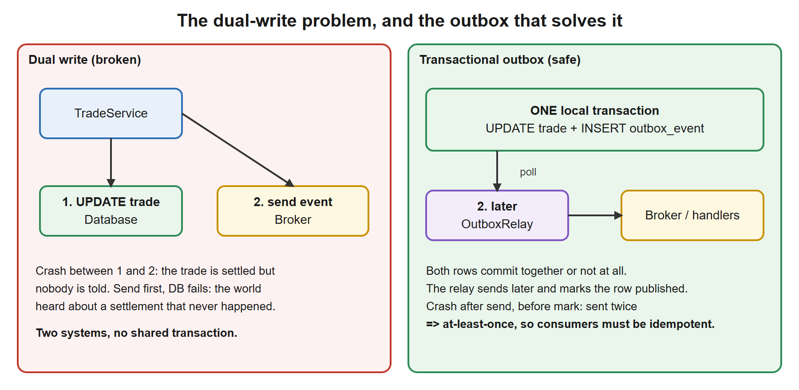
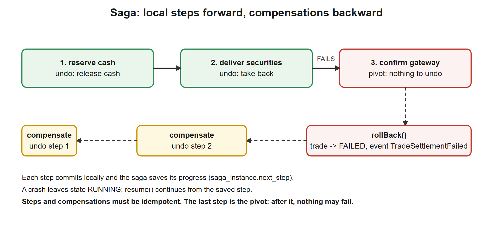
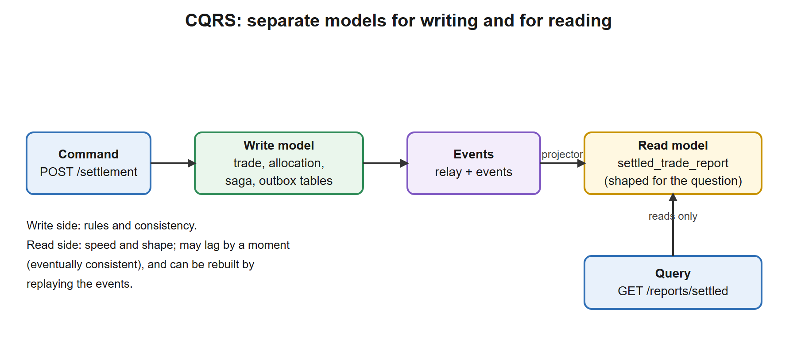
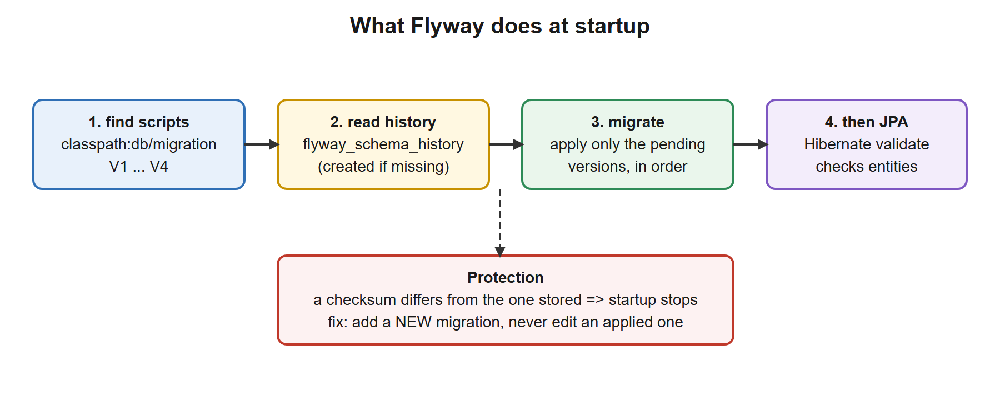

# 08. Saga, Outbox, CQRS (and Flyway)

**You build this yourself**, continuing in the same project folder. My working copy is [`../../reference/lesson-08`](../../reference/lesson-08). Open it only when you are stuck.

**Starting point:** your project as it was at the end of lesson 07 (91 tests). Not there? Copy everything from `reference/lesson-07` into an empty folder and continue.
**End state:** lesson 07 plus **Flyway migrations** for the whole schema, a **transactional outbox** with a relay, an **orchestrated saga** with compensation for settlement, and a **CQRS read model** built from events. 107 tests.

## 1. Goal and time box

**120 minutes** (40 reading, 60 typing and running, 20 quiz and Q&A). After this lesson you can:
- Explain why a distributed transaction (2PC) is avoided between microservices and what replaces it.
- Explain the **dual-write problem** and fix it with the **transactional outbox**; explain at-least-once delivery and why consumers must be idempotent.
- Design and code an **orchestrated saga** with compensating actions, durable state and resume after a crash; explain **choreography** and when to prefer it.
- Explain **CQRS** and eventual consistency, and build a read model with a projector.
- Use **Flyway** to own the database schema, and explain every file and setting involved.

## 2. Why it matters

In a monolith one `@Transactional` method keeps everything consistent. Once data lives in several services that guarantee is gone, and "what if we crash halfway?" is the architect interview's favourite question. Your EJB world used XA transactions across a database and JMS; microservices replace them with patterns that you now build.

| You know | Equivalent in this lesson |
|---|---|
| XA / two-phase commit across the database and a JMS queue | The **outbox**: one local transaction, then a relay (at-least-once) |
| A batch with a restart table: "which step did I finish?" | The **saga instance** row (`next_step`) and `resume()` |
| Reversal entries in the ledger ("storno") | **Compensating actions** |
| A reporting database loaded by an ETL job | The **read model** (CQRS), loaded by events instead of nightly batches |
| Liquibase or hand-run DDL scripts | **Flyway** versioned migrations |
| A message handled twice because the ack was lost | The **idempotent consumer** |

## 3. Concepts explained like a teacher

### Why not a distributed transaction?

Two-phase commit (2PC, XA) makes several resources commit together: a coordinator asks all to *prepare*, then tells all to *commit*. It works inside one application server. Between microservices it fails for practical reasons: it locks resources while waiting for the slowest participant, the coordinator is a single point of failure, many modern systems (Kafka, REST APIs, most cloud databases) do not support it, and it couples the availability of all services into one. So we accept that **each service commits locally**, and we design for consistency *eventually*, with explicit recovery.

### The dual-write problem and the transactional outbox

[](images/01-dual-write-and-outbox.svg)

"Update my table, then publish an event" are **two writes to two systems**. Whatever the order, a crash between them leaves them inconsistent. The outbox removes the second write from the critical path:

1. In **one local transaction**, write the business change *and* an event row into an `outbox_event` table in the same database. They commit together or not at all.
2. A **relay** (a background loop) reads unpublished rows in order, hands them to the broker, and marks them published.

**Delivery guarantee:** if the process dies after publishing but before marking the row, the relay publishes it again after restart. That is **at-least-once**. "Exactly once" across systems does not exist in general; what you build is *at-least-once delivery plus idempotent processing*, which has the same effect.

| Choice | Alternative | Trade-off |
|---|---|---|
| **Polling relay** (ours) | Change Data Capture (Debezium reads the database log) | Polling is simple and needs nothing extra but adds latency and load. CDC is faster and cleaner but is another system to run |
| One relay per instance | Only one active relay (leader election) or `SELECT ... FOR UPDATE SKIP LOCKED` | With several instances, two relays could send the same row; row locking or a single relay avoids duplicates (consumers still must cope) |
| Delete published rows | Keep them and stamp `published_at` (ours) | Keeping gives an audit trail and replay; needs a clean-up job (archive after N days) |

### Sagas: consistency without a global transaction

A **saga** is a sequence of **local transactions**, each in one service. If a step fails, the saga runs **compensating actions** for the steps that already succeeded, in reverse order. Compensation is a *business* undo, not a technical rollback: "release the cash reservation", not "ROLLBACK".

[](images/02-saga-compensation.svg)

Two ways to coordinate:

| | **Orchestration** (ours) | **Choreography** |
|---|---|---|
| Who decides the next step | A central **orchestrator** class that calls each step | Each service reacts to the previous service's event and emits its own |
| Flow visible in | One place: easy to read, test and monitor | Spread across services: hard to see the whole |
| Coupling | Orchestrator knows all participants | Services know only events |
| Best for | Processes with many steps, branches, compensation, auditing (settlement) | Short, simple reactions (send an e-mail after settlement) |

Rules for steps:
- **Idempotent** `execute` and `compensate`: after a crash they may run again.
- **Order the steps so that the risky, hard-to-undo one is last.** The last step before which everything can be undone is the **pivot**; after it, steps must be retried until they succeed, never compensated. Our gateway confirmation is the pivot.
- **Persist the saga's progress** (we save `next_step` after every step), so a restart can continue.
- A saga gives **ACD without the I**: atomic (all or compensated), consistent, durable, but **not isolated**: other requests may see intermediate states (cash reserved, trade not yet settled). Design with that in mind (semantic locks such as a `PENDING` status).

### CQRS: separate models for writing and reading

[](images/03-cqrs-read-model.svg)

**Command Query Responsibility Segregation**: use one model to **change** data (commands, with rules and transactions) and another to **read** it (queries, shaped for the screen or report). The read model is updated from the events the write side publishes, by a **projector**.

| Benefit | Cost |
|---|---|
| Read model shaped exactly for the question; fast, scalable on its own | **Eventual consistency**: the read side lags by a moment |
| Write model stays focused on rules | Two models and a projection to maintain |
| The read model can be **rebuilt** by replaying events | More moving parts and monitoring |

Use it where reads and writes differ a lot in shape or load (reporting, search: your Elasticsearch index is a read model!). Do not use it for a simple CRUD screen. **Event sourcing** (storing the events *as* the data and deriving state from them) is a separate, bigger choice that often accompanies CQRS but does not have to.

### The idempotent consumer

Because delivery is at-least-once, a handler may see the same event twice. Two ways to be safe:

| Technique | How | Example |
|---|---|---|
| **Naturally idempotent write** | An "upsert" keyed by a business id: the second run changes nothing | Our projector saves by `trade_id` |
| **Deduplication table** | Store processed event ids; skip a known id | Lesson 09's Kafka consumer |

### Database migrations: why Flyway

So far Hibernate created the tables (`ddl-auto: create-drop`). That is fine for learning, and wrong for anything with real data: you cannot review it, it cannot change a column safely, and every environment may differ. **Flyway** treats the schema like code: ordered SQL files, applied once each, recorded in a table, identical everywhere. Hibernate then only *checks* (`validate`) that the entities match the tables.

## 4. Setup steps

1. Open your project folder in VS Code and a terminal in it.
2. Confirm the starting point still works:

```powershell
.\mvnw.cmd -q clean verify
```

Expected: no output.

3. Set the compare shortcut for this lesson (change the path):

```powershell
$REF = "C:\path\to\springboot-2day\reference\lesson-08"
```

When stuck, compare one file: `fc.exe pom.xml "$REF\pom.xml"`. `FC: no differences encountered` means identical.

### Commands used in this lesson

| Command | Why here | When you use it later |
|---|---|---|
| `.\mvnw.cmd -q clean verify` | Prove the build and all tests pass | Before every commit |
| `.\mvnw.cmd "-Dtest=SagaTest" test` | Run only the saga tests | While changing a saga step |
| `.\mvnw.cmd "-Dtest=OutboxTest,ReadModelTest" test` | Run several test classes (comma list) | Working on one feature |
| `curl.exe -s -i -X POST localhost:8080/trades/2/settlement -H "Authorization: Bearer $B"` | Run the saga and see status and body | Trying the endpoint |
| `curl.exe -s "localhost:8080/reports/settled?isin=US5949181045" -H "Authorization: Bearer $C"` | Query the read model (quote the URL: it contains `?`) | Checking the projection |
| `ls src\main\resources\db\migration` | See the migration files in order | Before adding a new migration |

(`$B`, `$C`, `$A` are the tokens for `bob`, `carol`, `admin`, obtained as in lesson 07.)

### Files to change or add, in order

| # | File | Change | Why |
|---|---|---|---|
| 1 | `pom.xml` | **edit**: add `flyway-core` | The migration tool |
| 2 | `db/migration/V1..V4__*.sql` | **new** | The schema as versioned scripts |
| 3 | `application.yml` | **edit**: `ddl-auto: validate`, outbox interval | Flyway owns the schema |
| 4 | `events/*.java` | **new** | The two event types |
| 5 | `outbox/*.java` (9 files) | **new** | Outbox table access, relay, publisher and handler contracts |
| 6 | `service/TradeService.java` | **edit**: record events, add `fail` | The atomic write of change plus event |
| 7 | `TradeServiceTest`, `TradeServiceMockTest` | **edit** | The constructor changed |
| 8 | `saga/*.java` (13 files) | **new** | Steps, orchestrator, saga state, stand-in services |
| 9 | `report/*.java`, `web/ReportController.java` | **new** | The read model and its query endpoint |
| 10 | `web/SettlementController.java` | **new** | Starts the saga |
| 11 | `TradeServiceApplication.java` | **edit**: `@EnableScheduling` | The relay runs on a timer |
| 12 | `OutboxTest`, `SagaTest`, `ReadModelTest`, `FlywayMigrationTest` | **new** tests | Prove all of it |

## 5. Code walkthrough

A build-along. Where a file already exists, the block shows the **whole file** with the changes inside, so you can replace its content.

### Step 1. Add Flyway to `pom.xml`

**Do:** add the marked dependency. The block shows the whole file.

**File:** `pom.xml`
```xml
<?xml version="1.0" encoding="UTF-8"?>
<project xmlns="http://maven.apache.org/POM/4.0.0"
         xmlns:xsi="http://www.w3.org/2001/XMLSchema-instance"
         xsi:schemaLocation="http://maven.apache.org/POM/4.0.0 https://maven.apache.org/xsd/maven-4.0.0.xsd">
  <modelVersion>4.0.0</modelVersion>

  <!-- The parent pins versions of over 1,500 libraries, so we never write versions below. -->
  <parent>
    <groupId>org.springframework.boot</groupId>
    <artifactId>spring-boot-starter-parent</artifactId>
    <version>3.5.16</version>
    <relativePath/>
  </parent>

  <!-- Our project's own identity. -->
  <groupId>com.example</groupId>
  <artifactId>trade-service</artifactId>
  <version>0.0.1-SNAPSHOT</version>
  <name>trade-service</name>

  <properties>
    <java.version>21</java.version>
  </properties>

  <dependencies>
    <!-- Web starter: embedded Tomcat + Spring MVC + Jackson (JSON). -->
    <dependency>
      <groupId>org.springframework.boot</groupId>
      <artifactId>spring-boot-starter-web</artifactId>
    </dependency>

    <!-- AOP starter (lesson 01): brings AspectJ so we can write @Aspect classes. -->
    <dependency>
      <groupId>org.springframework.boot</groupId>
      <artifactId>spring-boot-starter-aop</artifactId>
    </dependency>

    <!-- Actuator (NEW in lesson 02): /actuator/health, /actuator/beans, /actuator/conditions, metrics... -->
    <dependency>
      <groupId>org.springframework.boot</groupId>
      <artifactId>spring-boot-starter-actuator</artifactId>
    </dependency>

    <!-- Validation starter (NEW in lesson 02): Bean Validation (jakarta.validation) + Hibernate Validator.
         Lesson 02 uses it to validate configuration; lesson 03 uses it to validate request bodies. -->
    <dependency>
      <groupId>org.springframework.boot</groupId>
      <artifactId>spring-boot-starter-validation</artifactId>
    </dependency>

    <!-- JPA starter (NEW in lesson 04): Spring Data JPA + Hibernate + HikariCP connection pool + transaction support. -->
    <dependency>
      <groupId>org.springframework.boot</groupId>
      <artifactId>spring-boot-starter-data-jpa</artifactId>
    </dependency>

    <!-- H2 (NEW in lesson 04): in-memory database for learning and tests. Runtime only: our code never imports it. -->
    <dependency>
      <groupId>com.h2database</groupId>
      <artifactId>h2</artifactId>
      <scope>runtime</scope>
    </dependency>

    <!-- Security starter (NEW in lesson 05): Spring Security filter chain, password encoders, method security. -->
    <dependency>
      <groupId>org.springframework.boot</groupId>
      <artifactId>spring-boot-starter-security</artifactId>
    </dependency>

    <!-- OAuth2 resource server (NEW in lesson 05): validates "Authorization: Bearer <JWT>" on incoming requests.
         Also brings the Nimbus library we use to sign (create) the demo tokens. -->
    <dependency>
      <groupId>org.springframework.boot</groupId>
      <artifactId>spring-boot-starter-oauth2-resource-server</artifactId>
    </dependency>

    <!-- Flyway (NEW in lesson 08): versioned SQL migrations (src/main/resources/db/migration) run at startup,
         so the database schema is created and changed by reviewed scripts, not guessed by Hibernate. -->
    <dependency>
      <groupId>org.flywaydb</groupId>
      <artifactId>flyway-core</artifactId>
    </dependency>

    <!-- Resilience4j (NEW in lesson 07): @Retry, @CircuitBreaker, @Bulkhead, @RateLimiter, @TimeLimiter as annotations,
         configured under "resilience4j:" in application.yml. Boot does not manage its version, so we pin it.
         It needs the AOP starter (lesson 01) and the Actuator (lesson 02), which we already have. -->
    <dependency>
      <groupId>io.github.resilience4j</groupId>
      <artifactId>resilience4j-spring-boot3</artifactId>
      <version>2.3.0</version>
    </dependency>

    <!-- Test starter: JUnit 5, AssertJ, Mockito, Spring test support. Only used when testing. -->
    <dependency>
      <groupId>org.springframework.boot</groupId>
      <artifactId>spring-boot-starter-test</artifactId>
      <scope>test</scope>
    </dependency>

    <!-- Security test helpers (NEW in lesson 05): jwt() request post-processor, @WithMockUser. -->
    <dependency>
      <groupId>org.springframework.security</groupId>
      <artifactId>spring-security-test</artifactId>
      <scope>test</scope>
    </dependency>
  </dependencies>

  <build>
    <plugins>
      <!-- Builds the runnable "fat jar" and adds the spring-boot:run command. -->
      <plugin>
        <groupId>org.springframework.boot</groupId>
        <artifactId>spring-boot-maven-plugin</artifactId>
      </plugin>

      <!-- (NEW in lesson 06) Step 1 of 3 for a clean test run: this plugin turns the downloaded Mockito jar into
           the property ${org.mockito:mockito-core:jar}, so Surefire can load it as a Java agent (step 3). -->
      <plugin>
        <groupId>org.apache.maven.plugins</groupId>
        <artifactId>maven-dependency-plugin</artifactId>
        <executions>
          <execution>
            <id>mockito-agent-path</id>
            <goals>
              <goal>properties</goal>
            </goals>
          </execution>
        </executions>
      </plugin>

      <!-- (NEW in lesson 06) Step 2 of 3: JaCoCo measures which lines the tests execute.
           "prepare-agent" injects its agent into the test JVM through the ${argLine} property;
           "report" writes target/site/jacoco/index.html after the tests. -->
      <plugin>
        <groupId>org.jacoco</groupId>
        <artifactId>jacoco-maven-plugin</artifactId>
        <version>0.8.16</version>     <!-- Spring Boot does not manage plugin versions for JaCoCo, so we pin one -->
        <executions>
          <execution>
            <id>jacoco-prepare</id>
            <goals>
              <goal>prepare-agent</goal>
            </goals>
          </execution>
          <execution>
            <id>jacoco-report</id>
            <phase>verify</phase>
            <goals>
              <goal>report</goal>
            </goals>
          </execution>
        </executions>
      </plugin>

      <!-- (NEW in lesson 06) Step 3 of 3: Surefire runs the tests. We pass the JVM two agents: JaCoCo (@{argLine})
           and Mockito. Loading Mockito explicitly removes the "Mockito is currently self-attaching" warning and
           keeps working on future Java versions. -Xshare:off stops the JVM complaining about class-data sharing
           when an agent is present. We also silence the SQL log, which is noise in test output. -->
      <plugin>
        <groupId>org.apache.maven.plugins</groupId>
        <artifactId>maven-surefire-plugin</artifactId>
        <configuration>
          <argLine>@{argLine} -javaagent:${org.mockito:mockito-core:jar} -Xshare:off</argLine>
          <systemPropertyVariables>
            <logging.level.org.hibernate.SQL>INFO</logging.level.org.hibernate.SQL>
          </systemPropertyVariables>
        </configuration>
      </plugin>
    </plugins>
  </build>
</project>
```
**Why:** `flyway-core` runs your SQL migrations when the application starts, before Hibernate and before any bean uses the database. Spring Boot manages the version through its parent, so no `<version>` is needed. (For PostgreSQL in lesson 10 you also add the module `flyway-database-postgresql`.)

**Checkpoint:** `.\mvnw.cmd -q compile` prints nothing.

### Deep dive: Flyway, the database migration tool

**What it is.** A tool that applies versioned scripts to a database **in order, exactly once**, and records what it did in a table in that same database (`flyway_schema_history`). It is the answer to "which version is this database at, and how do I bring it to the latest?". Alternatives: **Liquibase** (changes in XML/YAML/SQL "changesets", more features, more ceremony); both are widely used, Flyway is simpler.

**Why we need it.** (1) Everyone, from a laptop to production, gets the identical schema. (2) The change is a reviewed file in git. (3) Rolling a new version of the service and its schema forward is one step. (4) No more "works on my database".

**How it works at startup.**

[](images/04-flyway-startup.svg)

1. Flyway looks in `classpath:db/migration` for files named `V<version>__<description>.sql`.
2. It reads its history table (creating it on an empty database) and compares.
3. It runs every **pending** migration in version order, each in a transaction where the database supports transactional DDL (PostgreSQL does; Oracle and MySQL commit DDL implicitly).
4. It stores the file's **checksum**. If you edit an already-applied migration, the checksum no longer matches and Flyway **refuses to start** (`Validate failed: Migration checksum mismatch`). That is the protection: **never edit an applied migration, add a new one**.

**File naming (a hard rule).**

| Part | Example | Meaning |
|---|---|---|
| `V` | `V2__outbox.sql` | A **versioned** migration, runs once |
| Version | `2`, `2.1`, `20261109` | Orders the files numerically, not alphabetically (`V10` is after `V9`) |
| `__` | two underscores | Separator |
| Description | `outbox` | Words separated by `_`, shown in the history table |
| `R__name.sql` | `R__views.sql` | A **repeatable** migration: re-run whenever its checksum changes (views, stored procedures) |
| `U2__name.sql` | | An undo migration (paid Flyway editions only) |

**The history table (verified in our test):** after startup `flyway_schema_history` holds one row per migration: version, description, checksum, execution time, success flag. The log shows `Migrating schema "PUBLIC" to version "2 - outbox"` and `Successfully applied 4 migrations ... now at version v4`.

**Configuration keys** (`spring.flyway.*`; we used none, the defaults suit us):

| Key | Default | What it does |
|---|---|---|
| `spring.flyway.enabled` | `true` | Turn Flyway off (for example in a quick test profile) |
| `spring.flyway.locations` | `classpath:db/migration` | Where the scripts are. Can list several, or vendor folders such as `classpath:db/migration/{vendor}` |
| `spring.flyway.baseline-on-migrate` | `false` | For an **existing** database that Flyway has never seen: treat its current state as the baseline instead of failing |
| `spring.flyway.baseline-version` | `1` | The version given to that baseline |
| `spring.flyway.validate-on-migrate` | `true` | Check checksums of applied migrations before migrating |
| `spring.flyway.out-of-order` | `false` | Allow a late-arriving lower version to be applied (use with care on teams) |
| `spring.flyway.clean-disabled` | `true` | `clean` drops everything; it is **disabled by default** for good reason |
| `spring.flyway.table` | `flyway_schema_history` | Name of the history table |
| `spring.flyway.schemas`, `default-schema` | database default | Which schema(s) to manage |
| `spring.flyway.url`, `user`, `password` | the application's datasource | A **separate, more privileged** account for migrations: the application then runs with a least-privilege account |
| `spring.flyway.placeholders.*` | none | `${name}` substitutions inside SQL |
| `spring.flyway.connect-retries` | `0` | Retry if the database is not up yet (useful in containers) |

**How it works with Hibernate.** With Flyway on the classpath and `spring.jpa.hibernate.ddl-auto` set to `validate`, Hibernate checks at startup that every entity's table and columns exist with compatible types, and stops if not. Migrations change the database; entities describe it; `validate` catches a mismatch **at startup** rather than at the first query.

**Migration practice for zero-downtime releases (interview favourite).** Old and new versions of the service run side by side during a rolling update, so every migration must work for **both**. Use *expand then contract*: first add the new column (nullable), deploy the code that writes both, back-fill, deploy the code that reads only the new one, and only then drop the old column in a later migration.

**The commands.** Flyway runs by itself when the application starts. You can also use the Maven plugin or the command line for `info`/`migrate`/`validate`; we do not need them here. To see the state, query the table:

```sql
SELECT installed_rank, version, description, success FROM flyway_schema_history ORDER BY installed_rank;
```

(In `dev` you can run this in the H2 console if you enable `spring.h2.console.enabled=true`, lesson 04.)

### Step 2. The schema as migrations

**Do:** create the folder `src/main/resources/db/migration` and the four files below. **V1** is what Hibernate used to build for us; V2, V3 and V4 are this lesson's new tables.

**File:** `src/main/resources/db/migration/V1__trades.sql`
```sql
-- Version 1: the tables Hibernate created for us in lessons 04 to 07, now written down as a reviewed script.
-- Plain SQL that H2 and PostgreSQL both accept, so the same migration runs on a laptop and in production.
CREATE TABLE trade (
    id        BIGINT GENERATED BY DEFAULT AS IDENTITY PRIMARY KEY,
    isin      VARCHAR(12)    NOT NULL,
    quantity  NUMERIC(19, 0) NOT NULL,
    price     NUMERIC(19, 4) NOT NULL,
    status    VARCHAR(10)    NOT NULL
);

CREATE TABLE allocation (
    id        BIGINT GENERATED BY DEFAULT AS IDENTITY PRIMARY KEY,
    trade_id  BIGINT         NOT NULL REFERENCES trade (id),
    account   VARCHAR(20)    NOT NULL,
    quantity  NUMERIC(19, 0) NOT NULL
);
```
**File:** `src/main/resources/db/migration/V2__outbox.sql`
```sql
-- Version 2: the transactional outbox. A row is written in the SAME transaction as the business change it describes.
-- A separate relay publishes unpublished rows and stamps published_at.
CREATE TABLE outbox_event (
    id            BIGINT GENERATED BY DEFAULT AS IDENTITY PRIMARY KEY,
    event_type    VARCHAR(60)   NOT NULL,
    aggregate_id  VARCHAR(40)   NOT NULL,
    payload       VARCHAR(4000) NOT NULL,
    created_at    TIMESTAMP WITH TIME ZONE NOT NULL,
    published_at  TIMESTAMP WITH TIME ZONE
);

-- The relay's query is "oldest rows where published_at is null". On PostgreSQL a PARTIAL index
-- (CREATE INDEX ... ON outbox_event (id) WHERE published_at IS NULL) is smaller; H2 has no partial indexes.
CREATE INDEX ix_outbox_published ON outbox_event (published_at, id);
```
**File:** `src/main/resources/db/migration/V3__saga.sql`
```sql
-- Version 3: durable saga state. If the process dies halfway, the row says which step comes next.
CREATE TABLE saga_instance (
    id              BIGINT GENERATED BY DEFAULT AS IDENTITY PRIMARY KEY,
    trade_id        BIGINT       NOT NULL REFERENCES trade (id),
    state           VARCHAR(15)  NOT NULL,
    next_step       INT          NOT NULL,
    failure_reason  VARCHAR(300)
);
```
**File:** `src/main/resources/db/migration/V4__settled_trade_report.sql`
```sql
-- Version 4: the READ MODEL (the query side of CQRS). Built only from events, shaped for one question:
-- "which trades were settled, per instrument?". No foreign key to trade: it could live in another service's database.
CREATE TABLE settled_trade_report (
    trade_id    BIGINT PRIMARY KEY,
    isin        VARCHAR(12)    NOT NULL,
    quantity    NUMERIC(19, 0) NOT NULL,
    notional    NUMERIC(19, 4) NOT NULL,
    settled_at  TIMESTAMP WITH TIME ZONE NOT NULL
);

CREATE INDEX ix_report_isin ON settled_trade_report (isin);
```
**Why:**
- Types match the entities from lesson 04: `NUMERIC(19, 0)` for quantity, `NUMERIC(19, 4)` for price, `VARCHAR(10)` for the enum stored as text.
- `BIGINT GENERATED BY DEFAULT AS IDENTITY` is standard SQL, understood by H2 and by PostgreSQL 10+, so lesson 10 runs the same files on Postgres. (Avoid vendor tricks such as `AUTO_INCREMENT` or `SERIAL`.)
- `TIMESTAMP WITH TIME ZONE` maps to Java's `Instant`. Store instants in UTC.
- `outbox_event.published_at` is **nullable**: `NULL` means "not yet sent".
- `saga_instance` stores the saga's `state` and `next_step`: the durable memory.
- `settled_trade_report` has **no foreign key** to `trade`. The read model could live in another database; it is built only from events. `trade_id` is its primary key, which gives the projector its idempotency.

**Checkpoint:** none yet (the application does not start until the entities and configuration agree; step 3 comes next).

### Step 3. Let Flyway own the schema

**Do:** replace `src/main/resources/application.yml` with the whole file below. Two changes: `ddl-auto: validate`, and the outbox polling interval.

**File:** `src/main/resources/application.yml`
```yaml
# Base configuration: applies in every profile. Profile files (application-dev.yml, application-prod.yml)
# are layered on top and win when the same key appears in both.
spring:
  application:
    name: trade-service
  profiles:
    default: dev          # used only when no profile is activated explicitly
  jpa:
    open-in-view: false           # no Hibernate session during view rendering: lazy-loading mistakes fail early
    hibernate:
      ddl-auto: validate          # Flyway owns the schema (db/migration); Hibernate only CHECKS that the entities match it.

# Our own settings, bound to the TradeProperties record (prefix "trade").
trade:
  max-quantity: 1000000
  venue: XLON
  outbox:
    poll-interval-ms: 2000        # how long the outbox relay waits between looks for unpublished events (lesson 08)
  security:
    # HS256 needs a secret of at least 32 characters. The default below is for local development ONLY.
    # Real environments inject JWT_SECRET from a secret store (the prod profile has no default on purpose).
    jwt-secret: ${JWT_SECRET:dev-only-secret-change-me-0123456789abcdef}
    token-ttl: 15m

# Custom switch for the conditional bean in lesson 02.
audit:
  enabled: false

# Resilience4j (lesson 07). "gateway" is the instance name used in the annotations on ResilientGatewayClient.
resilience4j:
  retry:
    instances:
      gateway:
        max-attempts: 3                   # the first call plus two retries
        wait-duration: 200ms              # base pause between attempts
        enable-exponential-backoff: true  # 200ms, 400ms, ... so a struggling gateway gets room to recover
        exponential-backoff-multiplier: 2
        enable-randomized-wait: true      # jitter: callers do not all retry at the same instant
        randomized-wait-factor: 0.5
        retry-exceptions:
          - com.example.trade.gateway.GatewayException
        ignore-exceptions:                # never retry a permanent "no", or a call the open circuit refused
          - com.example.trade.gateway.GatewayRejectedException
          - io.github.resilience4j.circuitbreaker.CallNotPermittedException
  circuitbreaker:
    instances:
      gateway:
        sliding-window-type: COUNT_BASED
        sliding-window-size: 10                    # judge the last 10 calls
        minimum-number-of-calls: 5                 # no verdict before 5 calls
        failure-rate-threshold: 50                 # open when 50% or more of the window failed
        slow-call-duration-threshold: 2s           # a call slower than this counts as "slow"
        slow-call-rate-threshold: 80               # open when 80% or more are slow
        wait-duration-in-open-state: 10s           # stay open this long, then probe
        permitted-number-of-calls-in-half-open-state: 3
        automatic-transition-from-open-to-half-open-enabled: true
        record-exceptions:
          - com.example.trade.gateway.GatewayException
        ignore-exceptions:
          - com.example.trade.gateway.GatewayRejectedException
        register-health-indicator: true            # the breaker state shows up in /actuator/health
        allow-health-indicator-to-fail: false      # an OPEN breaker is shown, but does NOT turn the whole service DOWN
  bulkhead:
    instances:
      gateway:
        max-concurrent-calls: 10                   # at most 10 calls in flight to the gateway
        max-wait-duration: 0ms                     # a caller above the limit fails at once instead of queueing

# Actuator: expose only what is safe by default; the dev profile opens more.
management:
  endpoints:
    web:
      exposure:
        include: health,info
  info:
    env:
      enabled: true       # publish the "info.*" keys below at /actuator/info
  health:
    circuitbreakers:
      enabled: true       # include every circuit breaker in /actuator/health (lesson 07)

info:
  app:
    name: trade-service
    description: Trade capture and settlement demo
```
**Why:**
- `ddl-auto: validate`: Hibernate no longer creates anything; it only checks. (Other values were explained in lesson 04.) Boot runs Flyway **before** Hibernate, so the tables exist by then.
- `trade.outbox.poll-interval-ms: 2000`: how long the relay waits between polls. Our own setting, read with `${trade.outbox.poll-interval-ms:2000}` in step 5.

**Checkpoint:** `.\mvnw.cmd -q clean verify`. All 91 earlier tests still pass: the migrations reproduce the old schema. In the log you will see `Migrating schema "PUBLIC" to version "1 - trades"` and so on.

**Stuck?**
- *`Schema-validation: missing table [...]`*: a migration file is missing, mis-named (one underscore instead of two) or in the wrong folder.
- *`Schema-validation: wrong column type`*: the column type in the SQL differs from the entity.
- *`Migration checksum mismatch`* after editing a file: you changed an applied migration. In a throwaway H2 database just restart; on a real database add a new `V5__...sql` instead.

### Step 4. Events: facts, named in the past

**Do:** create the `events` package with two records.

**File:** `src/main/java/com/example/trade/events/TradeSettledEvent.java`
```java
package com.example.trade.events;

import java.math.BigDecimal;
import java.time.Instant;

// A FACT that already happened, named in the past tense. It carries everything a consumer needs, so consumers
// never have to call back to ask. Events are a public contract: add fields, never rename or remove them.
public record TradeSettledEvent(Long tradeId, String isin, BigDecimal quantity, BigDecimal price, Instant settledAt) {
    public static final String TYPE = "TradeSettled";
}
```
**File:** `src/main/java/com/example/trade/events/TradeSettlementFailedEvent.java`
```java
package com.example.trade.events;

public record TradeSettlementFailedEvent(Long tradeId, String reason) {
    public static final String TYPE = "TradeSettlementFailed";
}
```
**Why:** an event states something that **already happened**, in the past tense, with all data a consumer needs. Consumers never have to call back. Events are a **public contract** between services: add fields freely, never rename or remove one (consumers you do not control would break). `TYPE` is the name written to the outbox.

### Step 5. The outbox

**Do:** create the `outbox` package. First the contract that business code sees, then the table access.

**File:** `src/main/java/com/example/trade/outbox/DomainEvents.java`
```java
package com.example.trade.outbox;

// What the business code sees: "record that this happened". It does not know about tables, relays or brokers.
// Unit tests pass a one-line lambda; the real implementation writes to the outbox table.
public interface DomainEvents {
    void record(String eventType, String aggregateId, Object payload);
}
```
**File:** `src/main/java/com/example/trade/outbox/OutboxEventEntity.java`
```java
package com.example.trade.outbox;

import jakarta.persistence.Column;
import jakarta.persistence.Entity;
import jakarta.persistence.GeneratedValue;
import jakarta.persistence.GenerationType;
import jakarta.persistence.Id;
import jakarta.persistence.Table;
import java.time.Instant;

// One row of the OUTBOX table: an event waiting to be published (publishedAt == null) or already published.
@Entity
@Table(name = "outbox_event")
public class OutboxEventEntity {

    @Id
    @GeneratedValue(strategy = GenerationType.IDENTITY)
    private Long id;

    @Column(name = "event_type", nullable = false, length = 60)
    private String eventType;

    @Column(name = "aggregate_id", nullable = false, length = 40)
    private String aggregateId;

    @Column(nullable = false, length = 4000)
    private String payload;                    // the event as JSON

    @Column(name = "created_at", nullable = false)
    private Instant createdAt;

    @Column(name = "published_at")
    private Instant publishedAt;               // null = not yet sent

    protected OutboxEventEntity() {}

    public OutboxEventEntity(String eventType, String aggregateId, String payload, Instant createdAt) {
        this.eventType = eventType;
        this.aggregateId = aggregateId;
        this.payload = payload;
        this.createdAt = createdAt;
    }

    public Long getId() { return id; }

    public String getEventType() { return eventType; }

    public String getAggregateId() { return aggregateId; }

    public String getPayload() { return payload; }

    public Instant getCreatedAt() { return createdAt; }

    public Instant getPublishedAt() { return publishedAt; }
}
```
**File:** `src/main/java/com/example/trade/outbox/OutboxEventRepository.java`
```java
package com.example.trade.outbox;

import java.time.Instant;
import java.util.List;
import org.springframework.data.jpa.repository.JpaRepository;
import org.springframework.data.jpa.repository.Modifying;
import org.springframework.data.jpa.repository.Query;
import org.springframework.data.repository.query.Param;
import org.springframework.transaction.annotation.Transactional;

public interface OutboxEventRepository extends JpaRepository<OutboxEventEntity, Long> {

    // Oldest first: events of one trade leave in the order they happened. A batch keeps each poll short.
    List<OutboxEventEntity> findTop50ByPublishedAtIsNullOrderByIdAsc();

    long countByPublishedAtIsNull();

    // A single UPDATE in its own tiny transaction. The relay never keeps a transaction open while it talks to the broker.
    @Transactional
    @Modifying
    @Query("update OutboxEventEntity e set e.publishedAt = :at where e.id = :id")
    int markPublished(@Param("id") Long id, @Param("at") Instant at);
}
```
**File:** `src/main/java/com/example/trade/outbox/OutboxDomainEvents.java`
```java
package com.example.trade.outbox;

import com.fasterxml.jackson.core.JsonProcessingException;
import com.fasterxml.jackson.databind.ObjectMapper;
import java.time.Instant;
import org.springframework.stereotype.Component;
import org.springframework.transaction.annotation.Propagation;
import org.springframework.transaction.annotation.Transactional;

// Writes the event into the outbox table. Propagation.MANDATORY means: "there MUST already be a transaction, join it".
// Called outside a transaction it fails loudly, which protects the one rule that makes the pattern work:
// the business change and its event are committed together, or neither is.
@Component
public class OutboxDomainEvents implements DomainEvents {

    private final OutboxEventRepository outbox;
    private final ObjectMapper json;

    public OutboxDomainEvents(OutboxEventRepository outbox, ObjectMapper json) {
        this.outbox = outbox;
        this.json = json;
    }

    @Override
    @Transactional(propagation = Propagation.MANDATORY)
    public void record(String eventType, String aggregateId, Object payload) {
        try {
            outbox.save(new OutboxEventEntity(eventType, aggregateId, json.writeValueAsString(payload), Instant.now()));
        } catch (JsonProcessingException e) {
            throw new IllegalStateException("Cannot serialise event " + eventType, e);
        }
    }
}
```
**Why:**
- `DomainEvents` is a one-method interface: business code says "record this" and knows nothing about tables. Unit tests pass a lambda.
- `OutboxDomainEvents.record` uses **`Propagation.MANDATORY`**: it *must* run inside an existing transaction and joins it. Called without one it throws `IllegalTransactionStateException`. That protects the one rule that makes the pattern work: the business change and the event commit together or not at all.
- The repository's `findTop50ByPublishedAtIsNullOrderByIdAsc` is the relay's query: oldest first, a small batch. `markPublished` is a single `UPDATE` in its own tiny transaction.

Now the delivery side: the message, the two contracts, a transport and the relay.

**File:** `src/main/java/com/example/trade/outbox/OutboxMessage.java`
```java
package com.example.trade.outbox;

import java.time.Instant;

// What leaves the outbox. The id is the idempotency key for consumers: the same message may arrive more than once.
public record OutboxMessage(Long id, String type, String aggregateId, String payload, Instant createdAt) {}
```
**File:** `src/main/java/com/example/trade/outbox/EventPublisher.java`
```java
package com.example.trade.outbox;

// How a message leaves the service. Today: in the same JVM. In lesson 09: a Kafka topic.
// Contract: throw a RuntimeException if the message could not be handed over; the relay will try again later.
public interface EventPublisher {
    void publish(OutboxMessage message);
}
```
**File:** `src/main/java/com/example/trade/outbox/EventHandler.java`
```java
package com.example.trade.outbox;

// A consumer of events. Because delivery is at-least-once, handle() MUST be safe to call twice with the same message.
public interface EventHandler {
    boolean handles(String eventType);

    void handle(OutboxMessage message);
}
```
**File:** `src/main/java/com/example/trade/outbox/InProcessEventPublisher.java`
```java
package com.example.trade.outbox;

import java.util.List;
import org.slf4j.Logger;
import org.slf4j.LoggerFactory;
import org.springframework.stereotype.Component;

// The simplest transport: hand the message to every handler that wants it, inside this JVM.
// It lets us build and test the whole pattern before a broker exists.
@Component
public class InProcessEventPublisher implements EventPublisher {

    private static final Logger log = LoggerFactory.getLogger(InProcessEventPublisher.class);

    private final List<EventHandler> handlers;

    public InProcessEventPublisher(List<EventHandler> handlers) {
        this.handlers = handlers;
    }

    @Override
    public void publish(OutboxMessage message) {
        log.info("publish {} #{} for aggregate {}", message.type(), message.id(), message.aggregateId());
        for (EventHandler handler : handlers) {
            if (handler.handles(message.type())) {
                handler.handle(message);
            }
        }
    }
}
```
**File:** `src/main/java/com/example/trade/outbox/OutboxRelay.java`
```java
package com.example.trade.outbox;

import java.time.Instant;
import org.slf4j.Logger;
import org.slf4j.LoggerFactory;
import org.springframework.scheduling.annotation.Scheduled;
import org.springframework.stereotype.Component;

// The relay: a background loop that moves rows from the outbox to the publisher.
// It gives AT-LEAST-ONCE delivery: if we crash after publishing but before marking the row, the row is sent again.
// Consumers must therefore be idempotent (see EventHandler).
@Component
public class OutboxRelay {

    private static final Logger log = LoggerFactory.getLogger(OutboxRelay.class);

    private final OutboxEventRepository outbox;
    private final EventPublisher publisher;

    public OutboxRelay(OutboxEventRepository outbox, EventPublisher publisher) {
        this.outbox = outbox;
        this.publisher = publisher;
    }

    // fixedDelay = wait this long AFTER the previous run ends, so two runs of one instance never overlap.
    @Scheduled(fixedDelayString = "${trade.outbox.poll-interval-ms:2000}")
    public void poll() {
        publishPending();
    }

    /** Publishes what is waiting, oldest first. Returns how many messages were sent. Public so tests can call it. */
    public int publishPending() {
        int sent = 0;
        for (OutboxEventEntity e : outbox.findTop50ByPublishedAtIsNullOrderByIdAsc()) {
            try {
                publisher.publish(new OutboxMessage(e.getId(), e.getEventType(), e.getAggregateId(), e.getPayload(), e.getCreatedAt()));
            } catch (RuntimeException ex) {
                // Stop at the first failure so later events never overtake an earlier one. The row stays unpublished.
                log.warn("publish of outbox event {} failed, will retry: {}", e.getId(), ex.toString());
                break;
            }
            outbox.markPublished(e.getId(), Instant.now());
            sent++;
        }
        return sent;
    }
}
```
**Why:**
- `EventPublisher` is the **port** to the outside world (like `TradeRepository` and `SettlementGateway`). Today `InProcessEventPublisher` hands each message to the matching `EventHandler`s in the same JVM. Lesson 09 adds a Kafka implementation with **no change to the relay or the business code**.
- `OutboxRelay.publishPending` publishes oldest first and **stops at the first failure**, so a later event can never overtake an earlier one. The failed row stays unpublished and is retried at the next poll. Nothing is lost.
- It is **not** `@Transactional`: no database transaction is held open while talking to the broker (the lesson 07 rule).
- `@Scheduled(fixedDelayString = ...)`: `fixedDelay` waits the given time **after the previous run finished**, so two runs of one instance never overlap. (`fixedRate` would start runs at a fixed rhythm regardless; `cron` runs at clock times.)
- `publishPending` is `public` so tests can call it directly instead of waiting for the timer.

#### Deep dive: scheduling with `@Scheduled`

| Item | Meaning |
|---|---|
| `@EnableScheduling` | Switches on the scheduler (step 7). Without it `@Scheduled` methods are silently ignored |
| `fixedDelay` | Pause between the **end** of one run and the **start** of the next |
| `fixedRate` | Start a run every N ms; runs can overlap or queue if one is slow |
| `initialDelay` | Wait before the first run |
| `cron = "0 0 18 * * MON-FRI"` | Six fields: second minute hour day-of-month month day-of-week. Spring cron has a **seconds** field first (unlike Unix cron) |
| `zone` | Time zone for `cron` |
| `...String` variants | Take `${placeholders}` so the interval comes from configuration |
| Thread | **One thread** by default for all `@Scheduled` tasks (`scheduling-1` in our log). A slow task delays the others. Set `spring.task.scheduling.pool.size` for more |
| Several instances | Each instance runs the task. For "run once in the cluster" use a lock (ShedLock) or a Kubernetes `CronJob` (lesson 10) |

### Step 6. Record the event in the same transaction as the change

**Do:** replace `TradeService` with the whole file below. Changes: a third constructor parameter `DomainEvents`; `settle` records a `TradeSettled` event; a new `fail` method records `TradeSettlementFailed`.

**File:** `src/main/java/com/example/trade/service/TradeService.java`
```java
package com.example.trade.service;

import com.example.trade.config.TradeProperties;
import com.example.trade.domain.Trade;
import com.example.trade.domain.TradeStatus;
import com.example.trade.events.TradeSettledEvent;
import com.example.trade.events.TradeSettlementFailedEvent;
import com.example.trade.outbox.DomainEvents;
import com.example.trade.repo.TradeRepository;
import java.math.BigDecimal;
import java.time.Instant;
import java.util.List;
import org.springframework.stereotype.Service;
import org.springframework.transaction.annotation.Transactional;

// @Transactional on the CLASS: every public method runs in a transaction, opened by the Spring proxy
// before the method and committed (or rolled back) after it. Reads override this with readOnly = true.
@Service
@Transactional
public class TradeService {

    private final TradeRepository repository;
    private final TradeProperties props;
    private final DomainEvents events;      // NEW in lesson 08: where "this happened" facts are recorded (the outbox)

    // Constructor injection: single constructor, so no @Autowired needed (since Spring 4.3).
    // The fields are final, so the service can never exist half-wired, and unit tests can call
    // new TradeService(fake, props, (type, id, payload) -> {}).
    public TradeService(TradeRepository repository, TradeProperties props, DomainEvents events) {
        this.repository = repository;
        this.props = props;
        this.events = events;
    }

    public Trade create(String isin, BigDecimal quantity, BigDecimal price) {
        // The limit comes from configuration (trade.max-quantity), so each environment can set its own.
        if (quantity.compareTo(props.maxQuantity()) > 0) {
            throw new BusinessRuleException("Quantity " + quantity + " exceeds limit " + props.maxQuantity());
        }
        return repository.save(new Trade(null, isin, quantity, price, TradeStatus.NEW));
    }

    @Transactional(readOnly = true)     // hint: no dirty checking, and some databases can route it to a replica
    public Trade get(Long id) {
        return repository.findById(id).orElseThrow(() -> new TradeNotFoundException(id));
    }

    // status == null means "no filter".
    @Transactional(readOnly = true)
    public List<Trade> list(TradeStatus status) {
        return repository.findAll().stream()
                .filter(t -> status == null || t.status() == status)
                .toList();
    }

    // DEMO of the self-invocation trap: the inner this.settle(id) call goes straight to the real
    // object, NOT through the Spring proxy, so TimingAspect never sees it (and neither would @Transactional).
    public Trade settleViaSelfCall(Long id) {
        return this.settle(id);
    }

    public Trade settle(Long id) {
        Trade t = get(id);
        if (t.status() == TradeStatus.SETTLED) {
            throw new TradeStateException("Trade " + id + " is already settled");
        }
        Trade settled = repository.save(t.withStatus(TradeStatus.SETTLED));
        // Same transaction as the status change (the class is @Transactional): both are committed, or neither.
        events.record(TradeSettledEvent.TYPE, String.valueOf(id),
                new TradeSettledEvent(id, settled.isin(), settled.quantity(), settled.price(), Instant.now()));
        return settled;
    }

    // NEW in lesson 08: the saga calls this when it had to roll back. The trade becomes FAILED and the world is told.
    public Trade fail(Long id, String reason) {
        Trade t = get(id);
        Trade failed = repository.save(t.withStatus(TradeStatus.FAILED));
        events.record(TradeSettlementFailedEvent.TYPE, String.valueOf(id), new TradeSettlementFailedEvent(id, reason));
        return failed;
    }

    // ALL OR NOTHING: if any id is unknown, TradeNotFoundException (unchecked) rolls back the whole transaction,
    // including the trades already settled earlier in the loop.
    public void settleAll(List<Long> ids) {
        for (Long id : ids) {
            settle(id);
        }
    }

    // DEMO 1: a CHECKED exception does NOT roll back by default. The settle below is committed.
    public void settleThenFailChecked(Long id) throws Exception {
        settle(id);
        throw new Exception("checked failure after settle");
    }

    // DEMO 2: rollbackFor = Exception.class makes the same failure roll back.
    @Transactional(rollbackFor = Exception.class)
    public void settleThenFailCheckedWithRollbackFor(Long id) throws Exception {
        settle(id);
        throw new Exception("checked failure after settle");
    }
}
```
**Why:** `TradeService` is `@Transactional` at class level (lesson 04), so `repository.save(...)` and `events.record(...)` run in **one transaction**. If the commit fails, both disappear. `settleAll` (lesson 04) is all-or-nothing, so a failure in its second trade also rolls back the event of the first, and the test below proves it.

**Do:** the constructor changed, so fix the two unit tests that build the service by hand. A do-nothing lambda is enough, because these tests are not about events.

**File:** `src/test/java/com/example/trade/TradeServiceTest.java`
```java
package com.example.trade;

import static org.assertj.core.api.Assertions.assertThat;
import static org.assertj.core.api.Assertions.assertThatThrownBy;

import com.example.trade.config.TradeProperties;
import com.example.trade.domain.TradeStatus;
import com.example.trade.repo.InMemoryTradeRepository;
import com.example.trade.service.BusinessRuleException;
import com.example.trade.service.TradeNotFoundException;
import com.example.trade.service.TradeService;
import com.example.trade.service.TradeStateException;
import java.math.BigDecimal;
import org.junit.jupiter.api.Test;

// Plain unit test: NO Spring needed, which is the payoff of constructor injection.
class TradeServiceTest {
    private final TradeService svc = new TradeService(
            new InMemoryTradeRepository(), new TradeProperties(new BigDecimal("1000"), "TEST"),
            (type, aggregateId, payload) -> { });      // events are not the point of this test: a do-nothing DomainEvents

    @Test
    void createThenSettle() {
        var t = svc.create("US0378331005", BigDecimal.TEN, BigDecimal.ONE);
        assertThat(t.status()).isEqualTo(TradeStatus.NEW);
        assertThat(svc.settle(t.id()).status()).isEqualTo(TradeStatus.SETTLED);
    }

    @Test
    void rejectsQuantityAboveConfiguredLimit() {
        assertThatThrownBy(() -> svc.create("US0378331005", new BigDecimal("1001"), BigDecimal.ONE))
                .isInstanceOf(BusinessRuleException.class)
                .hasMessageContaining("exceeds limit 1000");
    }

    @Test
    void unknownIdIsNotFound() {
        assertThatThrownBy(() -> svc.get(99L)).isInstanceOf(TradeNotFoundException.class);
    }

    @Test
    void settlingTwiceIsAStateError() {
        var t = svc.create("US0378331005", BigDecimal.TEN, BigDecimal.ONE);
        svc.settle(t.id());
        assertThatThrownBy(() -> svc.settle(t.id())).isInstanceOf(TradeStateException.class);
    }

    @Test
    void listFiltersByStatus() {
        var a = svc.create("US0378331005", BigDecimal.TEN, BigDecimal.ONE);
        svc.create("US0378331005", BigDecimal.TEN, BigDecimal.ONE);
        svc.settle(a.id());
        assertThat(svc.list(null)).hasSize(2);
        assertThat(svc.list(TradeStatus.SETTLED)).extracting("id").containsExactly(a.id());
        assertThat(svc.list(TradeStatus.NEW)).hasSize(1);
    }
}
```
**File:** `src/test/java/com/example/trade/TradeServiceMockTest.java`
```java
package com.example.trade;

import static org.assertj.core.api.Assertions.assertThat;
import static org.assertj.core.api.Assertions.assertThatThrownBy;
import static org.mockito.ArgumentMatchers.any;
import static org.mockito.BDDMockito.given;
import static org.mockito.Mockito.never;
import static org.mockito.Mockito.verify;

import com.example.trade.config.TradeProperties;
import com.example.trade.domain.Trade;
import com.example.trade.domain.TradeStatus;
import com.example.trade.repo.TradeRepository;
import com.example.trade.service.BusinessRuleException;
import com.example.trade.service.TradeNotFoundException;
import com.example.trade.service.TradeService;
import com.example.trade.service.TradeStateException;
import java.math.BigDecimal;
import java.util.Optional;
import org.junit.jupiter.api.BeforeEach;
import org.junit.jupiter.api.Test;
import org.junit.jupiter.api.extension.ExtendWith;
import org.mockito.ArgumentCaptor;
import org.mockito.Mock;
import org.mockito.junit.jupiter.MockitoExtension;

// A pure unit test with a MOCK repository: no Spring, no database, runs in milliseconds.
// Unlike TradeServiceTest (which uses a working in-memory fake), a mock lets us check HOW the service talks to
// its collaborator: which calls it made, with what, and which calls it must NOT make.
@ExtendWith(MockitoExtension.class)        // creates the @Mock fields; fails the test on unused stubbings
class TradeServiceMockTest {

    @Mock TradeRepository repository;
    TradeService service;

    @BeforeEach
    void setUp() {
        service = new TradeService(repository, new TradeProperties(new BigDecimal("1000"), "TEST"),
                (type, aggregateId, payload) -> { });
    }

    @Test
    void createSavesANewTradeWithStatusNew() {
        given(repository.save(any(Trade.class))).willAnswer(inv -> inv.getArgument(0));

        service.create(TradeFixtures.ISIN, BigDecimal.TEN, BigDecimal.ONE);

        ArgumentCaptor<Trade> saved = ArgumentCaptor.forClass(Trade.class);
        verify(repository).save(saved.capture());            // exactly one save, and we can inspect its argument
        assertThat(saved.getValue().status()).isEqualTo(TradeStatus.NEW);
        assertThat(saved.getValue().id()).isNull();            // the database, not the service, assigns ids
    }

    @Test
    void aRejectedTradeNeverReachesTheRepository() {
        assertThatThrownBy(() -> service.create(TradeFixtures.ISIN, new BigDecimal("1001"), BigDecimal.ONE))
                .isInstanceOf(BusinessRuleException.class);

        verify(repository, never()).save(any());                // proves the rule runs BEFORE any write
    }

    @Test
    void settleSavesTheTradeWithStatusSettled() {
        given(repository.findById(5L)).willReturn(Optional.of(TradeFixtures.savedTrade(5, TradeStatus.NEW)));
        given(repository.save(any(Trade.class))).willAnswer(inv -> inv.getArgument(0));

        Trade result = service.settle(5L);

        assertThat(result.status()).isEqualTo(TradeStatus.SETTLED);
    }

    @Test
    void settlingAnAlreadySettledTradeWritesNothing() {
        given(repository.findById(5L)).willReturn(Optional.of(TradeFixtures.savedTrade(5, TradeStatus.SETTLED)));

        assertThatThrownBy(() -> service.settle(5L)).isInstanceOf(TradeStateException.class);

        verify(repository, never()).save(any());
    }

    @Test
    void settlingAnUnknownTradeIsNotFound() {
        given(repository.findById(9L)).willReturn(Optional.empty());

        assertThatThrownBy(() -> service.settle(9L)).isInstanceOf(TradeNotFoundException.class);
    }
}
```
**Checkpoint:** `.\mvnw.cmd -q compile` prints nothing; the next full run is in step 10.

**Stuck?** *`constructor TradeService cannot be applied`*: a test still uses the two-argument constructor.

### Step 7. The saga

**Do:** create the `saga` package. First the vocabulary.

**File:** `src/main/java/com/example/trade/saga/SagaStep.java`
```java
package com.example.trade.saga;

import com.example.trade.domain.Trade;

// One local step of a saga, and the action that undoes its effect. There is no distributed transaction: if a later step
// fails, the orchestrator calls compensate() on the steps that already succeeded, in reverse order.
// Both methods must be IDEMPOTENT: after a crash they may run again.
public interface SagaStep {
    String name();

    void execute(Trade trade);

    void compensate(Trade trade);
}
```
**File:** `src/main/java/com/example/trade/saga/SagaStepException.java`
```java
package com.example.trade.saga;

// A step could not do its job. The orchestrator answers by compensating the earlier steps.
public class SagaStepException extends RuntimeException {
    public SagaStepException(String message) {
        super(message);
    }
}
```
**File:** `src/main/java/com/example/trade/saga/SagaState.java`
```java
package com.example.trade.saga;

public enum SagaState {
    RUNNING,        // some steps done, more to do (or the process stopped and must resume)
    COMPLETED,      // every step succeeded
    COMPENSATED     // a step failed, the earlier ones were undone
}
```
The saga's durable memory (matches the `saga_instance` table):

**File:** `src/main/java/com/example/trade/saga/SagaInstanceEntity.java`
```java
package com.example.trade.saga;

import jakarta.persistence.Column;
import jakarta.persistence.Entity;
import jakarta.persistence.EnumType;
import jakarta.persistence.Enumerated;
import jakarta.persistence.GeneratedValue;
import jakarta.persistence.GenerationType;
import jakarta.persistence.Id;
import jakarta.persistence.Table;

// The saga's memory, saved after every step. If the process dies, this row says where to continue.
@Entity
@Table(name = "saga_instance")
public class SagaInstanceEntity {

    @Id
    @GeneratedValue(strategy = GenerationType.IDENTITY)
    private Long id;

    @Column(name = "trade_id", nullable = false)
    private Long tradeId;

    @Enumerated(EnumType.STRING)
    @Column(nullable = false, length = 15)
    private SagaState state;

    @Column(name = "next_step", nullable = false)
    private int nextStep;                        // index of the next step to run

    @Column(name = "failure_reason", length = 300)
    private String failureReason;

    protected SagaInstanceEntity() {}

    public SagaInstanceEntity(Long tradeId) {
        this.tradeId = tradeId;
        this.state = SagaState.RUNNING;
        this.nextStep = 0;
    }

    public Long getId() { return id; }

    public Long getTradeId() { return tradeId; }

    public SagaState getState() { return state; }

    public int getNextStep() { return nextStep; }

    public String getFailureReason() { return failureReason; }

    void stepDone() { nextStep++; }

    void completed() { state = SagaState.COMPLETED; }

    void compensated(String reason) {
        state = SagaState.COMPENSATED;
        failureReason = reason.length() > 300 ? reason.substring(0, 300) : reason;
    }
}
```
**File:** `src/main/java/com/example/trade/saga/SagaInstanceRepository.java`
```java
package com.example.trade.saga;

import java.util.List;
import org.springframework.data.jpa.repository.JpaRepository;

public interface SagaInstanceRepository extends JpaRepository<SagaInstanceEntity, Long> {

    // What a recovery job asks at startup: "which sagas were interrupted?"
    List<SagaInstanceEntity> findByState(SagaState state);
}
```
A journal, the audit trail that our tests (and an operator) read:

**File:** `src/main/java/com/example/trade/saga/SagaJournal.java`
```java
package com.example.trade.saga;

import java.util.List;
import java.util.concurrent.CopyOnWriteArrayList;
import org.springframework.stereotype.Component;

// A running log of what the saga did, in order: the audit trail an operator reads to understand a settlement,
// and the thing our tests read to prove that compensation ran in REVERSE order.
@Component
public class SagaJournal {

    private final List<String> entries = new CopyOnWriteArrayList<>();

    public void add(String entry) { entries.add(entry); }

    public List<String> entries() { return List.copyOf(entries); }

    public void clear() { entries.clear(); }
}
```
Two stand-ins for **other services** (the cash system and the securities depot). In production these would be HTTP or messaging calls:

**File:** `src/main/java/com/example/trade/saga/CashLedger.java`
```java
package com.example.trade.saga;

import java.math.BigDecimal;
import java.util.Map;
import java.util.concurrent.ConcurrentHashMap;
import org.springframework.stereotype.Component;

// Stand-in for ANOTHER service (the cash account system). In production this would be an HTTP or messaging call.
@Component
public class CashLedger {

    private final Map<Long, BigDecimal> reserved = new ConcurrentHashMap<>();
    private volatile BigDecimal available = new BigDecimal("1000000000");

    public void reserve(Long tradeId, BigDecimal amount) {
        if (amount.compareTo(available) > 0) {
            throw new SagaStepException("insufficient cash: need " + amount + ", available " + available);
        }
        reserved.put(tradeId, amount);                 // same trade, same amount: repeating it changes nothing
    }

    public void release(Long tradeId) {
        reserved.remove(tradeId);                      // releasing nothing is fine: idempotent
    }

    public boolean isReserved(Long tradeId) { return reserved.containsKey(tradeId); }

    public void setAvailable(BigDecimal value) { available = value; }

    public void reset() {
        reserved.clear();
        available = new BigDecimal("1000000000");
    }
}
```
**File:** `src/main/java/com/example/trade/saga/SecuritiesDepot.java`
```java
package com.example.trade.saga;

import java.util.Set;
import java.util.concurrent.ConcurrentHashMap;
import java.util.concurrent.atomic.AtomicBoolean;
import org.springframework.stereotype.Component;

// Stand-in for the securities depot (another service). It can be told to refuse a delivery, to make the saga fail.
@Component
public class SecuritiesDepot {

    private final Set<Long> delivered = ConcurrentHashMap.newKeySet();
    private final AtomicBoolean refuse = new AtomicBoolean();

    public void deliver(Long tradeId, String isin) {
        if (refuse.get()) {
            throw new SagaStepException("depot refused delivery of " + isin);
        }
        delivered.add(tradeId);
    }

    public void takeBack(Long tradeId) {
        delivered.remove(tradeId);
    }

    public boolean isDelivered(Long tradeId) { return delivered.contains(tradeId); }

    public void refuseDeliveries(boolean value) { refuse.set(value); }

    public void reset() {
        delivered.clear();
        refuse.set(false);
    }
}
```
The three steps. Each has `execute` and `compensate`; `@Order` fixes the sequence:

**File:** `src/main/java/com/example/trade/saga/ReserveCashStep.java`
```java
package com.example.trade.saga;

import com.example.trade.domain.Trade;
import org.springframework.core.annotation.Order;
import org.springframework.stereotype.Component;

@Component
@Order(1)                                          // steps run in @Order sequence
public class ReserveCashStep implements SagaStep {

    private final CashLedger ledger;
    private final SagaJournal journal;

    public ReserveCashStep(CashLedger ledger, SagaJournal journal) {
        this.ledger = ledger;
        this.journal = journal;
    }

    @Override
    public String name() { return "reserve-cash"; }

    @Override
    public void execute(Trade trade) {
        ledger.reserve(trade.id(), trade.quantity().multiply(trade.price()));
        journal.add("reserve-cash " + trade.id());
    }

    @Override
    public void compensate(Trade trade) {
        ledger.release(trade.id());
        journal.add("undo reserve-cash " + trade.id());
    }
}
```
**File:** `src/main/java/com/example/trade/saga/DeliverSecuritiesStep.java`
```java
package com.example.trade.saga;

import com.example.trade.domain.Trade;
import org.springframework.core.annotation.Order;
import org.springframework.stereotype.Component;

@Component
@Order(2)
public class DeliverSecuritiesStep implements SagaStep {

    private final SecuritiesDepot depot;
    private final SagaJournal journal;

    public DeliverSecuritiesStep(SecuritiesDepot depot, SagaJournal journal) {
        this.depot = depot;
        this.journal = journal;
    }

    @Override
    public String name() { return "deliver-securities"; }

    @Override
    public void execute(Trade trade) {
        depot.deliver(trade.id(), trade.isin());
        journal.add("deliver-securities " + trade.id());
    }

    @Override
    public void compensate(Trade trade) {
        depot.takeBack(trade.id());
        journal.add("undo deliver-securities " + trade.id());
    }
}
```
**File:** `src/main/java/com/example/trade/saga/ConfirmWithGatewayStep.java`
```java
package com.example.trade.saga;

import com.example.trade.domain.Trade;
import com.example.trade.gateway.ResilientGatewayClient;
import com.example.trade.gateway.SettlementConfirmation;
import org.springframework.core.annotation.Order;
import org.springframework.stereotype.Component;

// The LAST step is the "pivot": once the gateway has the confirmation we cannot take it back, so nothing may fail
// after it. That is why it comes last, and why it has no real compensation.
// It reuses the resilient client from lesson 07: retries and the circuit breaker still apply inside the step.
@Component
@Order(3)
public class ConfirmWithGatewayStep implements SagaStep {

    private final ResilientGatewayClient gateway;
    private final SagaJournal journal;

    public ConfirmWithGatewayStep(ResilientGatewayClient gateway, SagaJournal journal) {
        this.gateway = gateway;
        this.journal = journal;
    }

    @Override
    public String name() { return "confirm-with-gateway"; }

    @Override
    public void execute(Trade trade) {
        SettlementConfirmation result = gateway.confirm(trade);
        if (!result.confirmed()) {
            // The fallback answered "queued". For a saga that means "not done": the earlier steps must be undone.
            throw new SagaStepException("gateway did not confirm: " + result.note());
        }
        journal.add("confirm-with-gateway " + trade.id());
    }

    @Override
    public void compensate(Trade trade) {
        // Nothing to undo: if this step failed, no confirmation was sent; if it succeeded, it is never compensated.
        journal.add("undo confirm-with-gateway " + trade.id() + " (nothing to do)");
    }
}
```
The orchestrator and its result:

**File:** `src/main/java/com/example/trade/saga/SettlementOutcome.java`
```java
package com.example.trade.saga;

public record SettlementOutcome(Long sagaId, Long tradeId, SagaState state, String failureReason) {}
```
**File:** `src/main/java/com/example/trade/saga/SettlementSaga.java`
```java
package com.example.trade.saga;

import com.example.trade.domain.Trade;
import com.example.trade.domain.TradeStatus;
import com.example.trade.service.TradeNotFoundException;
import com.example.trade.service.TradeService;
import com.example.trade.service.TradeStateException;
import java.util.List;
import org.slf4j.Logger;
import org.slf4j.LoggerFactory;
import org.springframework.stereotype.Service;

// The ORCHESTRATOR: one place that knows the order of the steps, runs them, and undoes them on failure.
// It is deliberately NOT @Transactional. A saga exists because no single transaction can span several systems.
// Each step commits its own local change; the saga's progress is saved to the database after every step.
@Service
public class SettlementSaga {

    private static final Logger log = LoggerFactory.getLogger(SettlementSaga.class);

    private final List<SagaStep> steps;            // Spring injects them sorted by @Order
    private final SagaInstanceRepository sagas;
    private final TradeService trades;
    private final SagaJournal journal;

    public SettlementSaga(List<SagaStep> steps, SagaInstanceRepository sagas, TradeService trades, SagaJournal journal) {
        this.steps = steps;
        this.sagas = sagas;
        this.trades = trades;
        this.journal = journal;
    }

    public SettlementOutcome run(Long tradeId) {
        Trade trade = trades.get(tradeId);
        if (trade.status() != TradeStatus.NEW) {
            throw new TradeStateException("Trade " + tradeId + " is " + trade.status() + "; only NEW trades can be settled");
        }
        SagaInstanceEntity saga = sagas.save(new SagaInstanceEntity(tradeId));
        return proceed(saga, trade);
    }

    /** What a recovery job calls for a saga found RUNNING after a restart: continue from the saved step. */
    public SettlementOutcome resume(Long sagaId) {
        SagaInstanceEntity saga = sagas.findById(sagaId)
                .orElseThrow(() -> new TradeNotFoundException(sagaId));
        if (saga.getState() != SagaState.RUNNING) {
            return outcome(saga);
        }
        return proceed(saga, trades.get(saga.getTradeId()));
    }

    private SettlementOutcome proceed(SagaInstanceEntity saga, Trade trade) {
        for (int i = saga.getNextStep(); i < steps.size(); i++) {
            SagaStep step = steps.get(i);
            try {
                step.execute(trade);
            } catch (RuntimeException e) {
                log.warn("saga {} failed at step '{}': {}", saga.getId(), step.name(), e.getMessage());
                return rollBack(saga, trade, i, step.name() + ": " + e.getMessage());
            }
            saga.stepDone();
            sagas.save(saga);                       // progress is durable before the next step starts
        }
        // Every step worked. Settle the trade (and write the event) once; a resumed saga may find it already done.
        if (trades.get(trade.id()).status() != TradeStatus.SETTLED) {
            trades.settle(trade.id());
        }
        saga.completed();
        sagas.save(saga);
        return outcome(saga);
    }

    // Undo the steps that succeeded, newest first. The failed step itself is responsible for leaving nothing behind.
    private SettlementOutcome rollBack(SagaInstanceEntity saga, Trade trade, int failedIndex, String reason) {
        for (int i = failedIndex - 1; i >= 0; i--) {
            steps.get(i).compensate(trade);
        }
        trades.fail(trade.id(), reason);
        saga.compensated(reason);
        sagas.save(saga);
        journal.add("saga " + saga.getId() + " compensated");
        return outcome(saga);
    }

    private SettlementOutcome outcome(SagaInstanceEntity saga) {
        return new SettlementOutcome(saga.getId(), saga.getTradeId(), saga.getState(), saga.getFailureReason());
    }
}
```
**Why, the important parts:**
- `List<SagaStep> steps` is injected **sorted by `@Order`**. Adding a fourth step is a new class, not a change to the orchestrator.
- `run` loads the trade, refuses anything that is not `NEW`, saves a new `SagaInstanceEntity` and calls `proceed`.
- `proceed` runs each step; after **each success** it calls `saga.stepDone()` and saves, so progress is durable **before** the next step starts. A `RuntimeException` from a step triggers `rollBack`.
- `rollBack` calls `compensate` on steps `failedIndex - 1` down to `0` (**newest first**), then `trades.fail(...)` (status `FAILED` plus an event), then saves state `COMPENSATED`. The failed step itself is responsible for leaving nothing behind.
- When all steps passed, `trades.settle(...)` runs only if the trade is not already `SETTLED`: after a crash between the settle and the final save, `resume` must not settle twice.
- `resume(sagaId)` continues a `RUNNING` saga from `next_step`. A real service calls it from a startup recovery job for every saga found `RUNNING` (`SagaInstanceRepository.findByState`).
- **No `@Transactional` on the orchestrator.** A saga exists because one transaction cannot span the systems. Each step and each repository call commits by itself.
- `ConfirmWithGatewayStep` reuses lesson 07: retries and the circuit breaker run *inside* the step. When the fallback says "queued", the step throws and the saga compensates. (A different design would **pause** the saga and retry the pivot later; compensating is simpler and shown here.)
- **Known limits of this teaching version:** a crash *during compensation* is not resumed (state stays `RUNNING` and `resume` would re-run the forward steps); real systems record a `COMPENSATING` state. Compensations that themselves keep failing need alerting and manual repair.

**Checkpoint:** `.\mvnw.cmd -q compile` prints nothing.

### Step 8. The read model (CQRS)

**Do:** create the `report` package and the query endpoint.

**File:** `src/main/java/com/example/trade/report/SettledTradeReportEntity.java`
```java
package com.example.trade.report;

import jakarta.persistence.Column;
import jakarta.persistence.Entity;
import jakarta.persistence.Id;
import jakarta.persistence.Table;
import java.math.BigDecimal;
import java.time.Instant;

// A row of the READ MODEL. Its id is the trade id (assigned by us, not generated): saving the same trade twice
// updates the same row, which is exactly what makes the projector idempotent.
@Entity
@Table(name = "settled_trade_report")
public class SettledTradeReportEntity {

    @Id
    @Column(name = "trade_id")
    private Long tradeId;

    @Column(nullable = false, length = 12)
    private String isin;

    @Column(nullable = false, precision = 19, scale = 0)
    private BigDecimal quantity;

    @Column(nullable = false, precision = 19, scale = 4)
    private BigDecimal notional;

    @Column(name = "settled_at", nullable = false)
    private Instant settledAt;

    protected SettledTradeReportEntity() {}

    public SettledTradeReportEntity(Long tradeId, String isin, BigDecimal quantity, BigDecimal notional, Instant settledAt) {
        this.tradeId = tradeId;
        this.isin = isin;
        this.quantity = quantity;
        this.notional = notional;
        this.settledAt = settledAt;
    }

    public Long getTradeId() { return tradeId; }

    public String getIsin() { return isin; }

    public BigDecimal getQuantity() { return quantity; }

    public BigDecimal getNotional() { return notional; }

    public Instant getSettledAt() { return settledAt; }
}
```
**File:** `src/main/java/com/example/trade/report/SettledTradeReportRepository.java`
```java
package com.example.trade.report;

import java.util.List;
import org.springframework.data.jpa.repository.JpaRepository;

public interface SettledTradeReportRepository extends JpaRepository<SettledTradeReportEntity, Long> {

    List<SettledTradeReportEntity> findByIsinOrderBySettledAtDesc(String isin);
}
```
**File:** `src/main/java/com/example/trade/report/TradeReportProjector.java`
```java
package com.example.trade.report;

import com.example.trade.events.TradeSettledEvent;
import com.example.trade.outbox.EventHandler;
import com.example.trade.outbox.OutboxMessage;
import com.fasterxml.jackson.core.JsonProcessingException;
import com.fasterxml.jackson.databind.ObjectMapper;
import org.springframework.stereotype.Component;
import org.springframework.transaction.annotation.Transactional;

// The PROJECTOR: listens to events and keeps the read model up to date. This is the only writer of the report table.
// Idempotent by design: the row key is the trade id, so handling the same event twice leaves one identical row.
@Component
public class TradeReportProjector implements EventHandler {

    private final SettledTradeReportRepository reports;
    private final ObjectMapper json;

    public TradeReportProjector(SettledTradeReportRepository reports, ObjectMapper json) {
        this.reports = reports;
        this.json = json;
    }

    @Override
    public boolean handles(String eventType) {
        return TradeSettledEvent.TYPE.equals(eventType);
    }

    @Override
    @Transactional
    public void handle(OutboxMessage message) {
        try {
            TradeSettledEvent e = json.readValue(message.payload(), TradeSettledEvent.class);
            reports.save(new SettledTradeReportEntity(e.tradeId(), e.isin(), e.quantity(),
                    e.quantity().multiply(e.price()), e.settledAt()));      // save() = insert or update by id
        } catch (JsonProcessingException ex) {
            throw new IllegalStateException("Cannot read event " + message.id(), ex);
        }
    }
}
```
**File:** `src/main/java/com/example/trade/web/ReportController.java`
```java
package com.example.trade.web;

import com.example.trade.report.SettledTradeReportEntity;
import com.example.trade.report.SettledTradeReportRepository;
import java.math.BigDecimal;
import java.time.Instant;
import java.util.List;
import org.springframework.web.bind.annotation.GetMapping;
import org.springframework.web.bind.annotation.RequestMapping;
import org.springframework.web.bind.annotation.RequestParam;
import org.springframework.web.bind.annotation.RestController;

// The QUERY side. It reads only the read model, never the trade table, and it can never change anything.
// The data is EVENTUALLY consistent: a settled trade appears here once the relay has published its event.
@RestController
@RequestMapping("/reports")
public class ReportController {

    public record SettledTradeRow(Long tradeId, String isin, BigDecimal quantity, BigDecimal notional, Instant settledAt) {}

    private final SettledTradeReportRepository reports;

    public ReportController(SettledTradeReportRepository reports) {
        this.reports = reports;
    }

    @GetMapping("/settled")
    public List<SettledTradeRow> settled(@RequestParam String isin) {
        return reports.findByIsinOrderBySettledAtDesc(isin).stream()
                .map(r -> new SettledTradeRow(r.getTradeId(), r.getIsin(), r.getQuantity(), r.getNotional(), r.getSettledAt()))
                .toList();
    }
}
```
**Why:**
- The entity's id is the **trade id, assigned by us** (no `@GeneratedValue`). `reports.save(...)` on an existing id **updates** the row. Handling the same event twice leaves one row: idempotent by design.
- The projector is the **only writer** of the report table; the controller **only reads** it and never touches `trade`.
- The read model holds `notional` (quantity times price), computed once at projection time and stored in the shape the query needs.

### Step 9. Start the saga over HTTP, and turn the scheduler on

**Do:** create the controller and replace the main class.

**File:** `src/main/java/com/example/trade/web/SettlementController.java`
```java
package com.example.trade.web;

import com.example.trade.saga.SagaState;
import com.example.trade.saga.SettlementOutcome;
import com.example.trade.saga.SettlementSaga;
import org.springframework.http.ResponseEntity;
import org.springframework.security.access.prepost.PreAuthorize;
import org.springframework.web.bind.annotation.PathVariable;
import org.springframework.web.bind.annotation.PostMapping;
import org.springframework.web.bind.annotation.RequestMapping;
import org.springframework.web.bind.annotation.RestController;

@RestController
@RequestMapping("/trades")
public class SettlementController {

    private final SettlementSaga saga;

    public SettlementController(SettlementSaga saga) {
        this.saga = saga;
    }

    // 200: the saga completed. 422: it ran, a step failed, and everything was rolled back (business outcome, not a crash).
    @PostMapping("/{id}/settlement")
    @PreAuthorize("hasRole('OPS')")
    public ResponseEntity<SettlementOutcome> settle(@PathVariable Long id) {
        SettlementOutcome outcome = saga.run(id);
        return outcome.state() == SagaState.COMPLETED
                ? ResponseEntity.ok(outcome)
                : ResponseEntity.unprocessableEntity().body(outcome);
    }
}
```
**File:** `src/main/java/com/example/trade/TradeServiceApplication.java`
```java
package com.example.trade;

import org.springframework.boot.SpringApplication;
import org.springframework.boot.autoconfigure.SpringBootApplication;
import org.springframework.boot.context.properties.ConfigurationPropertiesScan;
import org.springframework.scheduling.annotation.EnableScheduling;

// @SpringBootApplication = @Configuration + @EnableAutoConfiguration + @ComponentScan.
// Scanning starts at THIS package, so all our classes must live under com.example.trade.
// @ConfigurationPropertiesScan finds @ConfigurationProperties classes (TradeProperties) and registers them as beans.
// @EnableScheduling (NEW in lesson 08) switches on @Scheduled methods: the outbox relay polls on a timer.
@EnableScheduling
@ConfigurationPropertiesScan
@SpringBootApplication
public class TradeServiceApplication {
    public static void main(String[] args) {
        SpringApplication.run(TradeServiceApplication.class, args);
    }
}
```
**Why:** `POST /trades/{id}/settlement` returns **200** when the saga completed and **422** when it ran, failed and rolled back: a business outcome, not a server crash. The old `POST /trades/{id}/settle` from lesson 00 still exists and settles directly; a real service would route it through the saga (we keep it so earlier tests stay valid). `@EnableScheduling` switches on the relay's timer.

### Step 10. Tests that prove it

**Do:** create the four test classes.

**File:** `src/test/java/com/example/trade/OutboxTest.java`
```java
package com.example.trade;

import static org.assertj.core.api.Assertions.assertThat;
import static org.assertj.core.api.Assertions.assertThatThrownBy;

import com.example.trade.domain.Trade;
import com.example.trade.domain.TradeStatus;
import com.example.trade.events.TradeSettledEvent;
import com.example.trade.outbox.DomainEvents;
import com.example.trade.outbox.EventPublisher;
import com.example.trade.outbox.OutboxEventEntity;
import com.example.trade.outbox.OutboxEventRepository;
import com.example.trade.outbox.OutboxMessage;
import com.example.trade.outbox.OutboxRelay;
import com.example.trade.service.TradeNotFoundException;
import com.example.trade.service.TradeService;
import java.math.BigDecimal;
import java.util.List;
import java.util.concurrent.CopyOnWriteArrayList;
import java.util.concurrent.atomic.AtomicInteger;
import org.junit.jupiter.api.BeforeEach;
import org.junit.jupiter.api.Test;
import org.springframework.beans.factory.annotation.Autowired;
import org.springframework.boot.test.context.SpringBootTest;
import org.springframework.boot.test.context.TestConfiguration;
import org.springframework.context.annotation.Bean;
import org.springframework.context.annotation.Primary;
import org.springframework.transaction.IllegalTransactionStateException;

// The real context and the real database. The relay's timer is set to one hour so that only OUR calls to
// publishPending() move events, and the publisher is replaced by a recording one that we can make fail.
@SpringBootTest(webEnvironment = SpringBootTest.WebEnvironment.NONE,
        properties = "trade.outbox.poll-interval-ms=3600000")
class OutboxTest {

    static class RecordingPublisher implements EventPublisher {
        final List<OutboxMessage> sent = new CopyOnWriteArrayList<>();
        final AtomicInteger failures = new AtomicInteger();

        @Override
        public void publish(OutboxMessage message) {
            if (failures.getAndUpdate(n -> n > 0 ? n - 1 : 0) > 0) {
                throw new IllegalStateException("broker unavailable");
            }
            sent.add(message);
        }
    }

    @TestConfiguration
    static class Config {
        @Bean
        @Primary
        RecordingPublisher recordingPublisher() {
            return new RecordingPublisher();
        }
    }

    @Autowired TradeService trades;
    @Autowired OutboxEventRepository outbox;
    @Autowired OutboxRelay relay;
    @Autowired RecordingPublisher publisher;
    @Autowired DomainEvents domainEvents;

    @BeforeEach
    void clean() {
        outbox.deleteAll();
        publisher.sent.clear();
        publisher.failures.set(0);
    }

    private Trade newTrade() {
        return trades.create("US0378331005", new BigDecimal("100"), new BigDecimal("189.50"));
    }

    private List<OutboxEventEntity> eventsOf(Long tradeId) {
        return outbox.findAll().stream().filter(e -> e.getAggregateId().equals(String.valueOf(tradeId))).toList();
    }

    @Test
    void settlingWritesTheEventInTheSameTransactionAsTheStatusChange() {
        Trade t = newTrade();
        trades.settle(t.id());

        List<OutboxEventEntity> events = eventsOf(t.id());
        assertThat(events).hasSize(1);
        assertThat(events.get(0).getEventType()).isEqualTo(TradeSettledEvent.TYPE);
        assertThat(events.get(0).getPayload()).contains("US0378331005");
        assertThat(events.get(0).getPublishedAt()).isNull();         // waiting for the relay
    }

    @Test
    void aRolledBackSettlementLeavesNoEventBehind() {
        Trade a = newTrade();

        // settleAll is all-or-nothing: the unknown id rolls back the whole transaction, including trade a ...
        assertThatThrownBy(() -> trades.settleAll(List.of(a.id(), 9999L))).isInstanceOf(TradeNotFoundException.class);

        // ... so the status change AND its event are both gone. The outbox cannot lie about what happened.
        assertThat(trades.get(a.id()).status()).isEqualTo(TradeStatus.NEW);
        assertThat(eventsOf(a.id())).isEmpty();
    }

    @Test
    void theRelayPublishesEachEventOnceAndMarksItPublished() {
        Trade t = newTrade();
        trades.settle(t.id());

        assertThat(relay.publishPending()).isEqualTo(1);
        assertThat(publisher.sent).hasSize(1);
        assertThat(publisher.sent.get(0).type()).isEqualTo(TradeSettledEvent.TYPE);
        assertThat(eventsOf(t.id()).get(0).getPublishedAt()).isNotNull();

        assertThat(relay.publishPending()).isZero();                   // nothing new, nothing re-sent
        assertThat(publisher.sent).hasSize(1);
    }

    @Test
    void aBrokerOutageLeavesTheEventForTheNextRun() {
        Trade t = newTrade();
        trades.settle(t.id());
        publisher.failures.set(1);

        assertThat(relay.publishPending()).isZero();                   // the publisher threw
        assertThat(eventsOf(t.id()).get(0).getPublishedAt()).isNull(); // still waiting: nothing is lost

        assertThat(relay.publishPending()).isEqualTo(1);               // the broker is back
        assertThat(publisher.sent).hasSize(1);
    }

    @Test
    void eventsLeaveInTheOrderTheyHappened() {
        Trade a = newTrade();
        Trade b = newTrade();
        trades.settle(b.id());
        trades.settle(a.id());

        relay.publishPending();

        assertThat(publisher.sent).extracting(OutboxMessage::aggregateId)
                .containsExactly(String.valueOf(b.id()), String.valueOf(a.id()));
    }

    @Test
    void recordingAnEventOutsideATransactionIsRefused() {
        assertThatThrownBy(() -> domainEvents.record("X", "1", "payload"))
                .isInstanceOf(IllegalTransactionStateException.class);
    }
}
```
**File:** `src/test/java/com/example/trade/SagaTest.java`
```java
package com.example.trade;

import static org.assertj.core.api.Assertions.assertThat;
import static org.assertj.core.api.Assertions.assertThatThrownBy;
import static org.mockito.Mockito.doThrow;
import static org.mockito.Mockito.reset;

import com.example.trade.domain.Trade;
import com.example.trade.domain.TradeStatus;
import com.example.trade.events.TradeSettledEvent;
import com.example.trade.events.TradeSettlementFailedEvent;
import com.example.trade.gateway.FlakySettlementGateway;
import com.example.trade.outbox.OutboxEventEntity;
import com.example.trade.outbox.OutboxEventRepository;
import com.example.trade.saga.CashLedger;
import com.example.trade.saga.ConfirmWithGatewayStep;
import com.example.trade.saga.SagaInstanceRepository;
import com.example.trade.saga.SagaJournal;
import com.example.trade.saga.SagaState;
import com.example.trade.saga.SecuritiesDepot;
import com.example.trade.saga.SettlementOutcome;
import com.example.trade.saga.SettlementSaga;
import com.example.trade.service.TradeService;
import io.github.resilience4j.circuitbreaker.CircuitBreakerRegistry;
import java.math.BigDecimal;
import java.util.List;
import org.junit.jupiter.api.AfterEach;
import org.junit.jupiter.api.BeforeEach;
import org.junit.jupiter.api.Test;
import org.springframework.beans.factory.annotation.Autowired;
import org.springframework.boot.test.context.SpringBootTest;
import org.springframework.test.context.bean.override.mockito.MockitoSpyBean;

// The saga with every collaborator real. The "other services" (cash ledger, depot, gateway) are in-process stand-ins
// that we can tell to fail, so we can watch the compensation happen.
@SpringBootTest(webEnvironment = SpringBootTest.WebEnvironment.NONE, properties = {
        "trade.outbox.poll-interval-ms=3600000",
        "resilience4j.retry.instances.gateway.wait-duration=10ms"})
class SagaTest {

    @Autowired SettlementSaga saga;
    @Autowired TradeService trades;
    @Autowired SagaJournal journal;
    @Autowired CashLedger ledger;
    @Autowired SecuritiesDepot depot;
    @Autowired FlakySettlementGateway gateway;
    @Autowired CircuitBreakerRegistry breakers;
    @Autowired OutboxEventRepository outbox;
    @Autowired SagaInstanceRepository sagas;
    @MockitoSpyBean ConfirmWithGatewayStep gatewayStep;      // lets us simulate "the process died during this step"

    @BeforeEach
    @AfterEach
    void clean() {
        journal.clear();
        ledger.reset();
        depot.reset();
        gateway.reset();
        breakers.circuitBreaker("gateway").reset();
        outbox.deleteAll();
        reset(gatewayStep);
    }

    private Trade newTrade() {
        return trades.create("US0378331005", new BigDecimal("100"), new BigDecimal("189.50"));
    }

    private List<String> eventTypesOf(Long tradeId) {
        return outbox.findAll().stream().filter(e -> e.getAggregateId().equals(String.valueOf(tradeId)))
                .map(OutboxEventEntity::getEventType).toList();
    }

    @Test
    void whenEveryStepSucceedsTheTradeIsSettledAndTheWorldIsTold() {
        Trade t = newTrade();

        SettlementOutcome outcome = saga.run(t.id());

        assertThat(outcome.state()).isEqualTo(SagaState.COMPLETED);
        assertThat(trades.get(t.id()).status()).isEqualTo(TradeStatus.SETTLED);
        assertThat(journal.entries()).containsExactly(
                "reserve-cash " + t.id(), "deliver-securities " + t.id(), "confirm-with-gateway " + t.id());
        assertThat(ledger.isReserved(t.id())).isTrue();
        assertThat(depot.isDelivered(t.id())).isTrue();
        assertThat(eventTypesOf(t.id())).containsExactly(TradeSettledEvent.TYPE);
    }

    @Test
    void whenTheDepotRefusesTheCashReservationIsUndone() {
        Trade t = newTrade();
        depot.refuseDeliveries(true);

        SettlementOutcome outcome = saga.run(t.id());

        assertThat(outcome.state()).isEqualTo(SagaState.COMPENSATED);
        assertThat(outcome.failureReason()).contains("deliver-securities").contains("depot refused");
        assertThat(journal.entries()).containsExactly(
                "reserve-cash " + t.id(), "undo reserve-cash " + t.id(), "saga " + outcome.sagaId() + " compensated");
        assertThat(ledger.isReserved(t.id())).isFalse();
        assertThat(trades.get(t.id()).status()).isEqualTo(TradeStatus.FAILED);
        assertThat(eventTypesOf(t.id())).containsExactly(TradeSettlementFailedEvent.TYPE);   // and NOT TradeSettled
    }

    @Test
    void whenTheGatewayIsDownEarlierStepsAreUndoneInReverseOrder() {
        Trade t = newTrade();
        gateway.failNext(100, false);

        SettlementOutcome outcome = saga.run(t.id());

        assertThat(outcome.state()).isEqualTo(SagaState.COMPENSATED);
        assertThat(journal.entries()).containsExactly(
                "reserve-cash " + t.id(),
                "deliver-securities " + t.id(),
                "undo deliver-securities " + t.id(),      // newest first ...
                "undo reserve-cash " + t.id(),            // ... then the older one
                "saga " + outcome.sagaId() + " compensated");
        assertThat(depot.isDelivered(t.id())).isFalse();
        assertThat(ledger.isReserved(t.id())).isFalse();
    }

    @Test
    void whenTheFirstStepFailsThereIsNothingToUndo() {
        Trade t = newTrade();
        ledger.setAvailable(BigDecimal.ONE);

        SettlementOutcome outcome = saga.run(t.id());

        assertThat(outcome.state()).isEqualTo(SagaState.COMPENSATED);
        assertThat(journal.entries()).containsExactly("saga " + outcome.sagaId() + " compensated");
        assertThat(trades.get(t.id()).status()).isEqualTo(TradeStatus.FAILED);
    }

    @Test
    void aSagaInterruptedByACrashResumesFromTheSavedStep() {
        Trade t = newTrade();
        // An Error is not a RuntimeException, so the saga cannot catch it: the "process" dies inside step 3.
        doThrow(new AssertionError("process killed")).when(gatewayStep).execute(org.mockito.ArgumentMatchers.any());

        assertThatThrownBy(() -> saga.run(t.id())).isInstanceOf(AssertionError.class);

        var interrupted = sagas.findByState(SagaState.RUNNING).stream()
                .filter(s -> s.getTradeId().equals(t.id())).findFirst().orElseThrow();
        assertThat(interrupted.getNextStep()).isEqualTo(2);          // steps 0 and 1 are saved as done
        assertThat(trades.get(t.id()).status()).isEqualTo(TradeStatus.NEW);

        reset(gatewayStep);                                          // "restart": the step works again
        SettlementOutcome outcome = saga.resume(interrupted.getId());

        assertThat(outcome.state()).isEqualTo(SagaState.COMPLETED);
        assertThat(trades.get(t.id()).status()).isEqualTo(TradeStatus.SETTLED);
        assertThat(journal.entries()).containsExactly(               // steps 0 and 1 were NOT repeated
                "reserve-cash " + t.id(), "deliver-securities " + t.id(), "confirm-with-gateway " + t.id());
    }
}
```
**File:** `src/test/java/com/example/trade/ReadModelTest.java`
```java
package com.example.trade;

import static org.assertj.core.api.Assertions.assertThat;
import static org.springframework.test.web.servlet.request.MockMvcRequestBuilders.get;
import static org.springframework.test.web.servlet.request.MockMvcRequestBuilders.post;
import static org.springframework.test.web.servlet.result.MockMvcResultMatchers.jsonPath;
import static org.springframework.test.web.servlet.result.MockMvcResultMatchers.status;

import com.example.trade.gateway.FlakySettlementGateway;
import com.example.trade.outbox.OutboxEventEntity;
import com.example.trade.outbox.OutboxEventRepository;
import com.example.trade.outbox.OutboxMessage;
import com.example.trade.outbox.OutboxRelay;
import com.example.trade.report.SettledTradeReportRepository;
import com.example.trade.report.TradeReportProjector;
import com.example.trade.saga.CashLedger;
import com.example.trade.saga.SagaJournal;
import com.example.trade.saga.SecuritiesDepot;
import com.example.trade.service.TradeService;
import io.github.resilience4j.circuitbreaker.CircuitBreakerRegistry;
import java.math.BigDecimal;
import org.junit.jupiter.api.AfterEach;
import org.junit.jupiter.api.BeforeEach;
import org.junit.jupiter.api.Test;
import org.springframework.beans.factory.annotation.Autowired;
import org.springframework.boot.test.autoconfigure.web.servlet.AutoConfigureMockMvc;
import org.springframework.boot.test.context.SpringBootTest;
import org.springframework.test.web.servlet.MockMvc;

// The whole write side to read side journey over HTTP: settle through the saga, publish through the relay,
// read the result from the read model.
@SpringBootTest(properties = {
        "trade.outbox.poll-interval-ms=3600000",
        "resilience4j.retry.instances.gateway.wait-duration=10ms"})
@AutoConfigureMockMvc
class ReadModelTest {

    private static final String ISIN = "US5949181045";

    @Autowired MockMvc mvc;
    @Autowired TradeService trades;
    @Autowired OutboxRelay relay;
    @Autowired OutboxEventRepository outbox;
    @Autowired SettledTradeReportRepository reports;
    @Autowired TradeReportProjector projector;
    @Autowired SecuritiesDepot depot;
    @Autowired CashLedger ledger;
    @Autowired SagaJournal journal;
    @Autowired FlakySettlementGateway gateway;
    @Autowired CircuitBreakerRegistry breakers;

    @BeforeEach
    @AfterEach
    void clean() {
        outbox.deleteAll();
        reports.deleteAll();
        depot.reset();
        ledger.reset();
        journal.clear();
        gateway.reset();
        breakers.circuitBreaker("gateway").reset();
    }

    private long newTradeId() {
        return trades.create(ISIN, new BigDecimal("200"), new BigDecimal("10.5")).id();
    }

    @Test
    void aSettledTradeAppearsInTheReportOnlyAfterTheRelayHasPublishedItsEvent() throws Exception {
        long id = newTradeId();
        String bob = TestTokens.bearerFor(mvc, "bob");

        mvc.perform(post("/trades/" + id + "/settlement").header("Authorization", bob))
                .andExpect(status().isOk())
                .andExpect(jsonPath("$.state").value("COMPLETED"));

        // The write side is done, but the read side has not heard yet: EVENTUAL consistency.
        mvc.perform(get("/reports/settled?isin=" + ISIN).header("Authorization", TestTokens.bearerFor(mvc, "carol")))
                .andExpect(status().isOk())
                .andExpect(jsonPath("$.length()").value(0));

        relay.publishPending();

        mvc.perform(get("/reports/settled?isin=" + ISIN).header("Authorization", TestTokens.bearerFor(mvc, "carol")))
                .andExpect(status().isOk())
                .andExpect(jsonPath("$.length()").value(1))
                .andExpect(jsonPath("$[0].tradeId").value(id))
                .andExpect(jsonPath("$[0].notional").value(2100.0));    // 200 x 10.5
    }

    @Test
    void handlingTheSameEventTwiceLeavesOneRow() {
        long id = newTradeId();
        trades.settle(id);
        OutboxEventEntity e = outbox.findAll().stream()
                .filter(x -> x.getAggregateId().equals(String.valueOf(id))).findFirst().orElseThrow();
        OutboxMessage message = new OutboxMessage(e.getId(), e.getEventType(), e.getAggregateId(), e.getPayload(), e.getCreatedAt());

        projector.handle(message);
        projector.handle(message);                          // a duplicate delivery, as at-least-once allows

        assertThat(reports.findByIsinOrderBySettledAtDesc(ISIN)).hasSize(1);
    }

    @Test
    void aFailedSettlementAnswers422AndNeverReachesTheReport() throws Exception {
        long id = newTradeId();
        depot.refuseDeliveries(true);

        mvc.perform(post("/trades/" + id + "/settlement").header("Authorization", TestTokens.bearerFor(mvc, "bob")))
                .andExpect(status().isUnprocessableEntity())
                .andExpect(jsonPath("$.state").value("COMPENSATED"));

        relay.publishPending();
        assertThat(reports.findByIsinOrderBySettledAtDesc(ISIN)).isEmpty();
    }

    @Test
    void onlyOperationsMaySettle() throws Exception {
        long id = newTradeId();
        mvc.perform(post("/trades/" + id + "/settlement").header("Authorization", TestTokens.bearerFor(mvc, "alice")))
                .andExpect(status().isForbidden());
    }
}
```
**File:** `src/test/java/com/example/trade/FlywayMigrationTest.java`
```java
package com.example.trade;

import static org.assertj.core.api.Assertions.assertThat;

import org.flywaydb.core.Flyway;
import org.flywaydb.core.api.MigrationInfo;
import org.junit.jupiter.api.Test;
import org.springframework.beans.factory.annotation.Autowired;
import org.springframework.boot.test.context.SpringBootTest;

// Flyway ran at startup and recorded every migration in its own table (flyway_schema_history).
// If a migration did not match the entities, Hibernate's "validate" would already have stopped the context from starting.
@SpringBootTest(webEnvironment = SpringBootTest.WebEnvironment.NONE, properties = "trade.outbox.poll-interval-ms=3600000")
class FlywayMigrationTest {

    @Autowired Flyway flyway;

    @Test
    void allFourMigrationsWereAppliedInOrder() {
        assertThat(flyway.info().applied()).extracting(m -> m.getVersion().getVersion())
                .containsExactly("1", "2", "3", "4");
        assertThat(flyway.info().pending()).isEmpty();
        assertThat(flyway.info().applied()).extracting(MigrationInfo::getDescription)
                .containsExactly("trades", "outbox", "saga", "settled trade report");
    }
}
```
**What each test proves:**

| Test | Proves |
|---|---|
| `settlingWritesTheEventInTheSameTransaction...` | Settling leaves exactly one unpublished `TradeSettled` row |
| `aRolledBackSettlementLeavesNoEventBehind` | `settleAll` fails on the 2nd id: trade stays `NEW` **and** has no event: the outbox cannot lie |
| `theRelayPublishesEachEventOnceAndMarksItPublished` | First run sends 1, second run sends 0 |
| `aBrokerOutageLeavesTheEventForTheNextRun` | Publisher throws: row stays unpublished; next run delivers: nothing lost |
| `eventsLeaveInTheOrderTheyHappened` | Order is preserved |
| `recordingAnEventOutsideATransactionIsRefused` | `Propagation.MANDATORY` guards the pattern |
| `whenEveryStepSucceeds...` | `COMPLETED`, trade `SETTLED`, journal in forward order, event `TradeSettled` |
| `whenTheDepotRefuses...` | Cash reservation undone, trade `FAILED`, event `TradeSettlementFailed` and **no** `TradeSettled` |
| `whenTheGatewayIsDown...InReverseOrder` | Journal shows `undo deliver-securities` **before** `undo reserve-cash` |
| `whenTheFirstStepFails...` | Nothing to undo |
| `aSagaInterruptedByACrashResumesFromTheSavedStep` | An `Error` (not catchable by the saga) simulates a killed process during step 3. The row says `next_step = 2`; `resume` finishes without repeating steps 1 and 2 |
| `aSettledTradeAppearsInTheReport...AfterTheRelay` | Right after settling the report is empty (**eventual consistency**), after `publishPending()` it has the row with `notional` 2100 |
| `handlingTheSameEventTwiceLeavesOneRow` | Idempotent projector |
| `aFailedSettlement...422...` | HTTP contract of a compensated saga; nothing reaches the report |
| `allFourMigrationsWereAppliedInOrder` | Flyway applied V1 to V4 |

Notice the techniques: `properties = "trade.outbox.poll-interval-ms=3600000"` stops the background timer from interfering; a `@TestConfiguration` with a `@Primary` bean swaps the publisher for a recording one; `@MockitoSpyBean` wraps a real bean so one call can throw; `clean()` resets shared singletons before and after each test.

**Checkpoint:**

```powershell
.\mvnw.cmd clean verify
```

Expected: `Tests run: 107, Failures: 0, Errors: 0, Skipped: 0` and `BUILD SUCCESS`. (The `APPLICATION FAILED TO START` log line comes from a lesson 05 test that deliberately starts the `prod` profile without a secret. It is not a failure.)

**Stuck?**
- *`Schema-validation` errors*: step 2 or 3.
- *`No qualifying bean of type 'DomainEvents'`*: `OutboxDomainEvents` is missing `@Component`, or outside `com.example.trade`.
- *`IllegalTransactionStateException: No existing transaction found for transaction marked with propagation 'mandatory'`* in a test of yours: you called `record` outside a `@Transactional` method. That is the guard working.
- *Flaky outbox counts*: the background timer ran during your test; set `trade.outbox.poll-interval-ms` to a large value in `@SpringBootTest(properties = ...)`.

### Run it

```powershell
.\mvnw.cmd -q spring-boot:run
```

In a second terminal get tokens for `alice` (TRADER), `bob` (OPS), `carol` (VIEWER) and `admin`:

```powershell
$A  = (curl.exe -s -X POST -u alice:password localhost:8080/auth/token | ConvertFrom-Json).access_token
$B  = (curl.exe -s -X POST -u bob:password   localhost:8080/auth/token | ConvertFrom-Json).access_token
$C  = (curl.exe -s -X POST -u carol:password localhost:8080/auth/token | ConvertFrom-Json).access_token
$AD = (curl.exe -s -X POST -u admin:password localhost:8080/auth/token | ConvertFrom-Json).access_token
```

At startup the log shows Flyway at work (verified):

```
Migrating schema "PUBLIC" to version "1 - trades"
Migrating schema "PUBLIC" to version "2 - outbox"
Migrating schema "PUBLIC" to version "3 - saga"
Migrating schema "PUBLIC" to version "4 - settled trade report"
Successfully applied 4 migrations to schema "PUBLIC", now at version v4
```

**1. A successful saga and the eventual read model.** Create a trade (the demo runner already made trade 1), settle it through the saga, and query the report right away and again after the relay has run (it polls every 2 seconds):

```powershell
curl.exe -s -X POST localhost:8080/trades -H "Content-Type: application/json" -H "Authorization: Bearer $A" -d '{\"isin\":\"US5949181045\",\"quantity\":200,\"price\":10.50}'
curl.exe -s -i -X POST localhost:8080/trades/2/settlement -H "Authorization: Bearer $B"
curl.exe -s "localhost:8080/reports/settled?isin=US5949181045" -H "Authorization: Bearer $C"
# wait 3 seconds
curl.exe -s "localhost:8080/reports/settled?isin=US5949181045" -H "Authorization: Bearer $C"
```

Expected (verified; `-i` headers trimmed): the trade is created with `"id":2`; the saga answers `HTTP/1.1 200` with `{"sagaId":1,"tradeId":2,"state":"COMPLETED","failureReason":null}`; the first report query returns `[]`; the second returns

```
[{"tradeId":2,"isin":"US5949181045","quantity":200,"notional":2100.0000,"settledAt":"..."}]
```

That empty first answer **is** eventual consistency.

**2. A failing saga.** Break the gateway (lesson 07's switch), create a second trade and settle it:

```powershell
curl.exe -s -o NUL -X POST "localhost:8080/sim/gateway/fail-next?calls=100" -H "Authorization: Bearer $AD"
curl.exe -s -X POST localhost:8080/trades -H "Content-Type: application/json" -H "Authorization: Bearer $A" -d '{\"isin\":\"US5949181045\",\"quantity\":50,\"price\":10.50}'
curl.exe -s -i -X POST localhost:8080/trades/3/settlement -H "Authorization: Bearer $B"
curl.exe -s localhost:8080/trades/3 -H "Authorization: Bearer $C"
```

Expected (verified): `HTTP/1.1 422` with

```
{"sagaId":2,"tradeId":3,"state":"COMPENSATED","failureReason":"confirm-with-gateway: gateway did not confirm: gateway unavailable, queued for later"}
```

and the trade now reads `"status":"FAILED"`. In the log: `saga 2 failed at step 'confirm-with-gateway'` and `publish TradeSettlementFailed #3 for aggregate 3`, published by the relay thread `scheduling-1`.

Stop the application with `Ctrl+C`.

### Debug it

1. Breakpoint in `SettlementSaga.proceed` (the `step.execute(trade)` line) and in `OutboxRelay.publishPending`.
2. Settle trade through the endpoint: step through the three steps; after each, query `saga_instance` (enable the H2 console, lesson 04) and watch `next_step` go 1, 2, 3.
3. In `publishPending`, the **Call Stack** shows `scheduling-1` as the thread, not an HTTP thread: the relay is independent of requests.
4. Make a step throw in the debugger (`Evaluate` / set a breakpoint condition) to watch `rollBack` call `compensate` newest first.

**Exercise (20 min).** (a) Add a fourth step `NotifyCustodianStep` *before* the gateway step with its own compensation and extend the happy-path and reverse-order tests. (b) Make `OutboxRelay` publish with `fixedRate` instead and describe a failure that can now occur. (c) Write `V5__add_trade_venue.sql` that adds a nullable `venue` column, and observe what Hibernate `validate` says about the entity not having the field (nothing: validate only checks entity fields exist in the table, not the other way round). Then try editing `V3__saga.sql` after a run and read Flyway's error.

## 6. Common mistakes

| Mistake | How you recognize it | Fix |
|---|---|---|
| Publishing to the broker inside the business transaction | Event sent, then the transaction rolls back: a ghost event | Write to the outbox instead; publish from the relay |
| Relay marks published **before** publishing | A crash loses the event | Publish first, then mark (at-least-once) |
| Consumer not idempotent | Duplicates after a redelivery: double entries in a report | Upsert by business id or a dedupe table |
| Compensation that is not idempotent, or that can fail permanently | A retry double-undoes, or the saga is stuck | Make it idempotent; alert and repair manually when it cannot succeed |
| `@Transactional` around the whole saga | Locks held across remote calls; defeats the purpose | One transaction per step |
| Editing an applied Flyway migration | `Migration checksum mismatch` | Add a new migration |
| `ddl-auto: update` together with Flyway | Hibernate and Flyway both change the schema | `validate` only |
| Using one `V` number for two files on different branches | `Detected resolved migration not applied` or duplicates | Use timestamps as versions, or agree on a number process |
| Reading the read model right after writing and expecting the new data | "My trade is missing from the report" | Design the screen for eventual consistency; read from the write side when you need your own write |
| Putting business logic in the relay or projector | Logic spread over background loops | Keep them thin: move data, nothing else |

## 7. Production issues and design notes

| Symptom | Root cause | Fix |
|---|---|---|
| The outbox table grows without limit | Published rows are never removed | A scheduled job that archives or deletes rows older than N days |
| Relay falls behind at peak | One thread, small batch, slow broker | Larger batch, shorter poll, partition by aggregate, or CDC (Debezium) |
| Duplicate events with two instances | Both relays picked the same rows | `SELECT ... FOR UPDATE SKIP LOCKED`, or a single active relay; keep consumers idempotent anyway |
| Events of one trade arrive out of order | Several relays or a partitionless broker | One ordered stream per aggregate (a Kafka partition key, lesson 09) |
| Sagas stuck in `RUNNING` | A crash, or a participant never answering | Recovery job calling `resume`; a timeout that moves old sagas to compensation; an alert on age |
| Read model out of date or wrong | A bug in the projector, or lost events | **Rebuild**: truncate and replay all events (this is the CQRS safety net) |
| Intermediate states visible to users | Sagas have no isolation | Explicit pending states; semantic locks; show "settlement in progress" |
| Migration fails halfway in production | DDL not transactional (Oracle, MySQL) | Small migrations, one change each; test against a copy of production; take a backup |
| Slow startup because of a huge migration | A long data change inside a migration | Move big back-fills to a background job |

**Design notes.**
- Order of preference for cross-service consistency: avoid it (keep related data in one service), then events with idempotent consumers, then a saga.
- Keep events **small and stable**; version them (`TradeSettled` v2) when they must change incompatibly.
- Monitor: outbox lag (oldest unpublished row's age), number of `RUNNING` sagas and their age, projector errors.
- This is the same thinking as a reconciliation: assume messages can be lost or duplicated, and design the process so that a rerun is harmless.

## 8. Architect lens

- **Pick the weakest consistency that the business accepts.** Settlement instructions need strong, auditable correctness; a dashboard can lag by seconds.
- **Orchestration for money, choreography for notifications.** An explicit orchestrator makes the process visible to auditors and operators; choreography suits reactions with no control flow.
- **Outbox versus CDC:** the outbox is explicit and portable; CDC is lower latency and removes the polling code but ties you to database internals and an extra platform.
- **Transactional integrity is the architect's job, not the framework's.** Name, for each flow, what happens when each step fails, and who repairs what.
- **Event design is API design:** stable names, past tense, complete payloads, versioned.
- **Schema ownership:** one service owns each table and its migrations; consumers see events, not tables.
- **Link to your world:** an outbox is a "staging table plus a loader job"; a saga is a multi-step batch with reversal entries; CQRS is the data warehouse fed by change events instead of a nightly ETL.

## 9. Self-check quiz

1. Why do we avoid two-phase commit between microservices?
2. What is the dual-write problem? Give a failure for each order of the two writes.
3. How does the outbox give atomicity, and what delivery guarantee does the relay give?
4. Why must consumers be idempotent? Name two ways to achieve it.
5. What does `Propagation.MANDATORY` protect in `OutboxDomainEvents`?
6. What is a compensating action and why must it be idempotent?
7. Orchestration or choreography: when do you choose each?
8. What is the "pivot" step of a saga and where do you put it?
9. In which way is a saga not like an ACID transaction?
10. What is eventual consistency in CQRS, and how can the read model be repaired?
11. Why must you never edit an applied Flyway migration?
12. What does `ddl-auto: validate` do once Flyway owns the schema?

<details><summary>Answers</summary>

1. It holds locks across slow participants, needs a coordinator (single point of failure), is unsupported by many modern systems, and ties the availability of all services together.
2. Updating a table and publishing an event are two writes to two systems. Publish first then the database fails: an event for something that never happened. Database first, then crash before publishing: the change happened, nobody is told.
3. The business row and the event row are written in one local transaction, so both commit or neither. The relay publishes after, marks the row, and if it crashes between publish and mark it publishes again: at-least-once.
4. The same message can arrive twice (redelivery, relay restart). Make the write naturally idempotent (upsert by business key) or store processed ids and skip repeats.
5. That `record` can only run inside a business transaction: called alone it throws, so an event can never be written without its change being part of the same commit.
6. A business-level undo of a completed step (release the cash). It may run again after a crash or a retry, so a second run must not double-undo.
7. Orchestration for long, branching, auditable processes with compensation (settlement). Choreography for short reactions between services with little control flow.
8. The step after which things can no longer be undone (the gateway confirmation). Put it last, so everything before it is compensable, and make anything after it retry until success.
9. It has no isolation: other requests can see intermediate states (cash reserved, trade not yet settled).
10. The read side lags the write side by the time the event takes to travel. If it is wrong or lost, truncate it and replay the events through the projector.
11. Flyway stores a checksum of each applied file; a changed file fails validation and the application refuses to start. Add a new migration instead.
12. Hibernate checks that the entities match the existing tables and stops the startup on a mismatch; it creates nothing.

</details>

## 10. Interview Q&A

**Q1. How do you keep data consistent across microservices without distributed transactions?**
Each service commits locally. Cross-service workflows are **sagas**: a series of local steps with compensating actions. State changes and the events about them are written atomically with the **transactional outbox**, a relay publishes them at-least-once, and consumers are **idempotent**. The result is eventual consistency with explicit recovery.

**Q2. What is the outbox pattern and why not just publish after commit?**
"Commit, then publish" can crash in between and lose the event; "publish, then commit" can publish something that never committed. The outbox writes the event into the same database transaction as the change, and a relay delivers it later. At-least-once, so the consumer must deduplicate.

**Q3. Orchestration or choreography for settlement?**
Orchestration. Settlement has an order, compensation and audit needs, and operators must see where a trade is. A central orchestrator with persisted state gives that. I would use choreography for fire-and-forget reactions such as notifications.

**Q4. A saga step fails after others succeeded. What happens?**
The orchestrator runs the compensations of the earlier steps in reverse order, marks the trade failed, publishes a failure event and records state `COMPENSATED`. Compensations are idempotent; those that cannot succeed raise an alert for manual repair.

**Q5. What if the service crashes in the middle of a saga?**
The saga row stores the next step, saved after each step. A recovery job finds `RUNNING` sagas at startup and calls `resume`, which continues from the saved step. Steps are idempotent, so a step that ran but was not recorded can run again safely.

**Q6. What is CQRS and when would you use it?**
Separate models for commands and queries, the read model fed by events. I use it when reads and writes differ strongly in shape or scale, like reporting or search. The price is eventual consistency and a projection to maintain; for simple CRUD it is over-engineering.

**Q7. Flyway or Liquibase, and how do you do zero-downtime schema changes?**
Either; Flyway is simpler (ordered SQL), Liquibase has richer features. For zero downtime I use expand and contract: add the new column nullable, deploy code that writes both, back-fill, switch reads, and drop the old column in a later release, because old and new versions run together during a rolling update.

**Q8. (Depth) Can you get exactly-once delivery?**
Not across independent systems in general. You get at-least-once delivery plus idempotent processing, which behaves like exactly-once. Kafka offers exactly-once semantics inside Kafka (transactions, idempotent producer), but a side effect in a database still needs idempotency or the outbox.

## 11. Recap

1. No global transaction between services: commit locally, recover explicitly.
2. **Outbox:** business change and event in one transaction; a relay publishes at-least-once; consumers are idempotent.
3. **Saga (orchestrated):** steps with compensations, persisted progress, resume after a crash, pivot step last; no isolation.
4. **CQRS:** a read model built from events by a projector; eventually consistent, rebuildable.
5. **Flyway:** versioned, checksummed SQL migrations own the schema; Hibernate only validates; never edit an applied migration.
