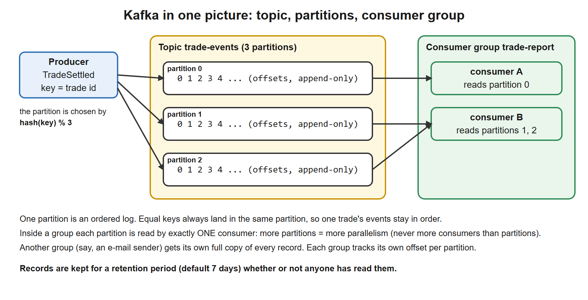
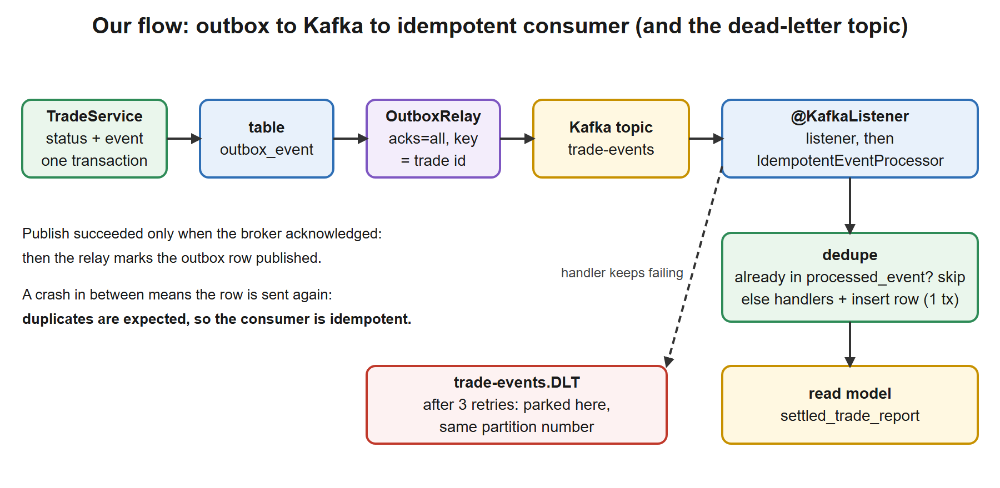

# 09. Kafka with Spring

**You build this yourself**, continuing in the same project folder. My working copy is [`../../reference/lesson-09`](../../reference/lesson-09). Open it only when you are stuck.

**Starting point:** your project as it was at the end of lesson 08 (107 tests). Not there? Copy everything from `reference/lesson-08` into an empty folder and continue.
**End state:** lesson 08 plus a **Kafka transport**: the outbox relay publishes to a Kafka topic (key = trade id), an **idempotent `@KafkaListener`** feeds the read model, and a **dead-letter topic** parks poison records. A `docker-compose.yml` runs Kafka locally. 111 tests, four of them against a real broker.

## 1. Goal and time box

**120 minutes** (45 reading, 55 typing and running, 20 quiz and Q&A). **Docker Desktop must be running** for the "Run it" part; the tests do not need it. After this lesson you can:
- Explain what Kafka is, how it differs from a queue such as JMS or IBM MQ, and draw topic, partition, offset, consumer group.
- Explain producer reliability (`acks`, idempotent producer), consumer offsets and delivery semantics (at-most-once, at-least-once, exactly-once) and what each costs.
- Pick a partition key and say what ordering Kafka does and does not guarantee.
- Use **Spring for Apache Kafka**: `KafkaTemplate`, `@KafkaListener`, error handling with retries and a **dead-letter topic**.
- Build an **idempotent consumer** with a deduplication table.
- Read a `docker-compose.yml` and use the Kafka command-line tools.

## 2. Why it matters

Kafka is in almost every bank's event backbone, and "how do you make a Kafka consumer reliable?" is a standard architect question. You know messaging from SWIFT and MQ; the interview wants you to say precisely how Kafka differs and what guarantees you actually get.

| You know | Kafka equivalent |
|---|---|
| An MQ queue: a message is **removed** when read | A topic is a **log**: records stay for the retention period; readers just keep an offset |
| One queue, several competing consumers | A **consumer group**: partitions are shared among its members |
| Publish/subscribe with durable subscriptions | Several **groups** on one topic, each with its own offset |
| Message ordering within a queue | Ordering **within a partition**, chosen by the record key |
| A poison message that blocks the queue, moved to a "backout queue" | The **dead-letter topic** (DLT) |
| Re-reading messages for a reconciliation | **Replay**: set the offset back and read again |
| Message ID for duplicate detection | `eventId` header plus the `processed_event` table |

## 3. Concepts explained like a teacher

### What Kafka is

**Apache Kafka** is a distributed, durable, replicated **commit log**. Producers append **records** to named **topics**; consumers read them at their own pace. It was built at LinkedIn for very high throughput (hundreds of thousands of records per second per broker) and to let many independent systems read the same stream.

[](images/01-topic-partitions-group.svg)

| Term | Meaning |
|---|---|
| **Record** | One message: a **key** (optional, used for partitioning), a **value** (the payload), **headers** (metadata, for example our `eventType`), a timestamp |
| **Topic** | A named stream of records (`trade-events`) |
| **Partition** | A topic is split into partitions. Each is an **ordered, append-only log**. A record's position in it is its **offset** (0, 1, 2, ...) |
| **Broker** | A Kafka server. A **cluster** has several |
| **Producer** | Sends records. The partition is chosen by hashing the key (same key, same partition) |
| **Consumer** | Reads records by polling, remembering the **offset** it has processed |
| **Consumer group** | Consumers sharing a `group.id`. Each partition is read by **exactly one** member of the group. More partitions allow more parallel consumers (never more consumers than partitions) |
| **Replication** | Each partition has a **leader** and **followers** on other brokers. The **in-sync replicas (ISR)** are the followers that are caught up |
| **Retention** | Records are kept for a time (default 7 days) or size, regardless of whether they were read. A **compacted** topic keeps only the latest record per key |
| **KRaft** | Kafka's own consensus for cluster metadata. It replaced ZooKeeper (removed in Kafka 4). Our compose file runs KRaft |
| **Offset commit** | A consumer group stores "I have processed up to offset N" in the internal topic `__consumer_offsets`. After a restart it continues from there |
| **Rebalance** | When members join or leave, partitions are redistributed within the group (consumption pauses briefly) |
| **Lag** | How far a group is behind the end of a partition. **The number to monitor** |

### What Kafka guarantees, and what it does not

- **Ordering only within a partition.** There is no global order across partitions. Therefore choose the **key** so that records that must stay in order share it. We use the **trade id**: all events of one trade go to one partition and are read in order.
- **Durability** depends on settings: a record is safe when the producer used `acks=all`, the topic has several replicas and `min.insync.replicas` is at least 2. Our laptop setup (one broker, one replica) is for learning, not for production.
- **Delivery semantics** (what happens around a failure):

| Semantics | How it arises | Result |
|---|---|---|
| **At-most-once** | Commit the offset *before* processing | A crash loses records |
| **At-least-once** (ours) | Commit the offset *after* processing | A crash causes **duplicates**; handle them with an idempotent consumer |
| **Exactly-once** | Kafka transactions (idempotent producer, transactional read-process-write between Kafka topics) | Works **inside Kafka**. A side effect in a database is outside it and still needs idempotency or the outbox |

The practical rule from lesson 08 stands: **at-least-once delivery plus an idempotent consumer**.

### Kafka or a traditional queue?

| | **Kafka** | **IBM MQ / JMS / RabbitMQ** |
|---|---|---|
| Model | Log. Consumers pull and track offsets. Records stay | Queue. The broker pushes and deletes after acknowledgement |
| Replay | Yes: reset the offset | No (a consumed message is gone) |
| Many independent readers | Natural: one group each | Needs a topic and subscriptions |
| Ordering | Per partition | Per queue (with limits when consumers compete) |
| Throughput | Very high, designed for streams | High, designed for messaging with rich routing |
| Per-message features | Few (no priority, no per-message TTL, no selectors) | Many (priorities, selectors, transactions, request/reply) |
| Best for | Event streams, integration backbone, audit and replay, analytics feeds | Commands and workflows with individual message handling, XA transactions, legacy SWIFT integration |

Neither is "better". For settlement events consumed by many systems and re-playable for rebuilds, Kafka. For a point-to-point instruction that must be processed once with an XA transaction, MQ is still a good tool.

### Producer reliability

| Setting | Effect |
|---|---|
| `acks=0` | Fire and forget. Fast, can lose data |
| `acks=1` | The leader has written it. A leader crash right after can lose it |
| `acks=all` (ours) | All in-sync replicas have it. Safest. Combine with `min.insync.replicas=2` on the topic |
| `enable.idempotence=true` (ours) | The broker discards duplicates caused by the producer's own retries, per partition and producer session. On by default since Kafka 3.0 |
| `retries` / `delivery.timeout.ms` | How long the producer keeps trying one record before it fails the send |

Our `KafkaEventPublisher` waits for the acknowledgement (`.get(10, SECONDS)`) before the relay marks the outbox row published. So "published" in the table means "the broker confirmed it".

### The consumer side with Spring

- `@KafkaListener` creates a **listener container**: a thread that polls the broker and calls your method for each record.
- **Offsets** are committed by Spring according to the `ack-mode`. We use `record`: commit after each record, once your method returned **without an exception**. A crash before the commit means the record is read again (at-least-once).
- **When the listener throws:** the `CommonErrorHandler` decides. Ours (`DefaultErrorHandler`) retries with backoff, then sends the record to `trade-events.DLT` and **continues**. Without it, the default is to retry 9 more times and then log and skip. Either way, you must decide on purpose.
- **Poison pill:** a record that can never be processed (garbage, missing header). Retrying forever blocks the partition. The DLT parks it for a human.

### Our design

[](images/02-our-flow.svg)

Business code is unchanged from lesson 08. Only the **transport** changes: a profile switches `trade.events.transport` from `in-process` to `kafka`, and a `KafkaEventPublisher` replaces `InProcessEventPublisher`. The relay, the outbox and the projector do not change: the payoff of the `EventPublisher` interface.

## 4. Setup steps

1. Open your project folder in VS Code and a terminal in it.
2. Confirm the starting point still works:

```powershell
.\mvnw.cmd -q clean verify
```

Expected: no output.

3. Check Docker is running (you need it from step 2 on):

```powershell
docker version --format "{{.Server.Version}}"
```

Expected: a version number such as `29.9.2`. An error `error during connect` means Docker Desktop is not running: start it and wait for the whale icon to settle.

4. Set the compare shortcut for this lesson (change the path):

```powershell
$REF = "C:\path\to\springboot-2day\reference\lesson-09"
```

When stuck, compare one file: `fc.exe pom.xml "$REF\pom.xml"`. `FC: no differences encountered` means identical.

### Commands used in this lesson

| Command | Syntax | Why here | When you use it later |
|---|---|---|---|
| `docker version` | `docker version [--format "<template>"]` | Check the Docker engine is reachable | First step of any Docker work |
| `docker compose up -d` | `docker compose [-f file] up [-d] [service]` | Start everything in `docker-compose.yml`. `-d` = detached (in the background) | Starting local infrastructure |
| `docker compose ps` | `docker compose ps` | Show the state and health of the services | "Is Kafka up?" |
| `docker compose logs` | `docker compose logs [-f] [service]` | Read output; `-f` follows | A service will not start |
| `docker compose down` | `docker compose down [-v]` | Stop and remove the containers and network; `-v` also deletes volumes (data) | End of the day; reset to a clean state |
| `docker exec` | `docker exec [-it] <container> <command>` | Run a command **inside** a running container (the Kafka tools live there) | Inspecting or debugging a container |
| `kafka-topics.sh` | `--bootstrap-server host:port` plus `--list`, `--describe --topic X`, `--create`, `--delete` | See and manage topics | Checking a topic exists and its partitions |
| `kafka-console-consumer.sh` | `--topic X --from-beginning [--property print.key=true] [--timeout-ms N]` | Read records from a terminal | "What is really on the topic?" |
| `kafka-consumer-groups.sh` | `--describe --group G` | Show offsets and **lag** of a group | "Is my consumer keeping up?" |
| `.\mvnw.cmd "-Dtest=KafkaFlowTest" test` | | Run the Kafka tests only | While changing Kafka code |

(On Git Bash, `docker exec ... /opt/kafka/...` paths get rewritten by the shell and fail. Use PowerShell, as in this course, or prefix the command with `MSYS_NO_PATHCONV=1`.)

### Files to change or add, in order

| # | File | Change | Why |
|---|---|---|---|
| 1 | `pom.xml` | **edit**: `spring-kafka`, `spring-kafka-test` | The library and the embedded broker for tests |
| 2 | `docker-compose.yml` | **new** | Kafka on your laptop |
| 3 | `db/migration/V5__processed_event.sql`, `kafka/ProcessedEvent*.java` | **new** | The deduplication table |
| 4 | `kafka/IdempotentEventProcessor.java` | **new** | The idempotent processing step |
| 5 | `kafka/KafkaTopics.java`, `KafkaEventPublisher.java`, `TradeEventsConsumer.java`, `KafkaConfig.java` | **new** | Producer, consumer, topics, error handling |
| 6 | `application.yml`, `application-kafka.yml` | **edit** / **new** | Kafka settings and the transport switch |
| 7 | `outbox/InProcessEventPublisher.java` | **edit**: conditional | Only one transport is active |
| 8 | `KafkaFlowTest.java`, `FlywayMigrationTest.java` | **new** / **edit** | Prove it; the migration count changed |

## 5. Code walkthrough

A build-along. Where a file already exists, the block shows the **whole file** with the changes inside, so you can replace its content.

### Step 1. Add the Kafka libraries to `pom.xml`

**Do:** add the two marked dependencies. The block shows the whole file.

**File:** `pom.xml`
```xml
<?xml version="1.0" encoding="UTF-8"?>
<project xmlns="http://maven.apache.org/POM/4.0.0"
         xmlns:xsi="http://www.w3.org/2001/XMLSchema-instance"
         xsi:schemaLocation="http://maven.apache.org/POM/4.0.0 https://maven.apache.org/xsd/maven-4.0.0.xsd">
  <modelVersion>4.0.0</modelVersion>

  <!-- The parent pins versions of over 1,500 libraries, so we never write versions below. -->
  <parent>
    <groupId>org.springframework.boot</groupId>
    <artifactId>spring-boot-starter-parent</artifactId>
    <version>3.5.16</version>
    <relativePath/>
  </parent>

  <!-- Our project's own identity. -->
  <groupId>com.example</groupId>
  <artifactId>trade-service</artifactId>
  <version>0.0.1-SNAPSHOT</version>
  <name>trade-service</name>

  <properties>
    <java.version>21</java.version>
  </properties>

  <dependencies>
    <!-- Web starter: embedded Tomcat + Spring MVC + Jackson (JSON). -->
    <dependency>
      <groupId>org.springframework.boot</groupId>
      <artifactId>spring-boot-starter-web</artifactId>
    </dependency>

    <!-- AOP starter (lesson 01): brings AspectJ so we can write @Aspect classes. -->
    <dependency>
      <groupId>org.springframework.boot</groupId>
      <artifactId>spring-boot-starter-aop</artifactId>
    </dependency>

    <!-- Actuator (NEW in lesson 02): /actuator/health, /actuator/beans, /actuator/conditions, metrics... -->
    <dependency>
      <groupId>org.springframework.boot</groupId>
      <artifactId>spring-boot-starter-actuator</artifactId>
    </dependency>

    <!-- Validation starter (NEW in lesson 02): Bean Validation (jakarta.validation) + Hibernate Validator.
         Lesson 02 uses it to validate configuration; lesson 03 uses it to validate request bodies. -->
    <dependency>
      <groupId>org.springframework.boot</groupId>
      <artifactId>spring-boot-starter-validation</artifactId>
    </dependency>

    <!-- JPA starter (NEW in lesson 04): Spring Data JPA + Hibernate + HikariCP connection pool + transaction support. -->
    <dependency>
      <groupId>org.springframework.boot</groupId>
      <artifactId>spring-boot-starter-data-jpa</artifactId>
    </dependency>

    <!-- H2 (NEW in lesson 04): in-memory database for learning and tests. Runtime only: our code never imports it. -->
    <dependency>
      <groupId>com.h2database</groupId>
      <artifactId>h2</artifactId>
      <scope>runtime</scope>
    </dependency>

    <!-- Security starter (NEW in lesson 05): Spring Security filter chain, password encoders, method security. -->
    <dependency>
      <groupId>org.springframework.boot</groupId>
      <artifactId>spring-boot-starter-security</artifactId>
    </dependency>

    <!-- OAuth2 resource server (NEW in lesson 05): validates "Authorization: Bearer <JWT>" on incoming requests.
         Also brings the Nimbus library we use to sign (create) the demo tokens. -->
    <dependency>
      <groupId>org.springframework.boot</groupId>
      <artifactId>spring-boot-starter-oauth2-resource-server</artifactId>
    </dependency>

    <!-- Flyway (NEW in lesson 08): versioned SQL migrations (src/main/resources/db/migration) run at startup,
         so the database schema is created and changed by reviewed scripts, not guessed by Hibernate. -->
    <dependency>
      <groupId>org.flywaydb</groupId>
      <artifactId>flyway-core</artifactId>
    </dependency>

    <!-- Resilience4j (NEW in lesson 07): @Retry, @CircuitBreaker, @Bulkhead, @RateLimiter, @TimeLimiter as annotations,
         configured under "resilience4j:" in application.yml. Boot does not manage its version, so we pin it.
         It needs the AOP starter (lesson 01) and the Actuator (lesson 02), which we already have. -->
    <dependency>
      <groupId>io.github.resilience4j</groupId>
      <artifactId>resilience4j-spring-boot3</artifactId>
      <version>2.3.0</version>
    </dependency>

    <!-- Spring for Apache Kafka (NEW in lesson 09): KafkaTemplate to send, @KafkaListener to receive, plus the Kafka client
         library. Spring Boot manages the version (spring-kafka 3.3.x). -->
    <dependency>
      <groupId>org.springframework.kafka</groupId>
      <artifactId>spring-kafka</artifactId>
    </dependency>

    <!-- Test starter: JUnit 5, AssertJ, Mockito, Spring test support. Only used when testing. -->
    <dependency>
      <groupId>org.springframework.boot</groupId>
      <artifactId>spring-boot-starter-test</artifactId>
      <scope>test</scope>
    </dependency>

    <!-- Embedded Kafka (NEW in lesson 09): @EmbeddedKafka starts a real Kafka broker INSIDE the test JVM, with no Docker. -->
    <dependency>
      <groupId>org.springframework.kafka</groupId>
      <artifactId>spring-kafka-test</artifactId>
      <scope>test</scope>
    </dependency>

    <!-- Security test helpers (NEW in lesson 05): jwt() request post-processor, @WithMockUser. -->
    <dependency>
      <groupId>org.springframework.security</groupId>
      <artifactId>spring-security-test</artifactId>
      <scope>test</scope>
    </dependency>
  </dependencies>

  <build>
    <plugins>
      <!-- Builds the runnable "fat jar" and adds the spring-boot:run command. -->
      <plugin>
        <groupId>org.springframework.boot</groupId>
        <artifactId>spring-boot-maven-plugin</artifactId>
      </plugin>

      <!-- (NEW in lesson 06) Step 1 of 3 for a clean test run: this plugin turns the downloaded Mockito jar into
           the property ${org.mockito:mockito-core:jar}, so Surefire can load it as a Java agent (step 3). -->
      <plugin>
        <groupId>org.apache.maven.plugins</groupId>
        <artifactId>maven-dependency-plugin</artifactId>
        <executions>
          <execution>
            <id>mockito-agent-path</id>
            <goals>
              <goal>properties</goal>
            </goals>
          </execution>
        </executions>
      </plugin>

      <!-- (NEW in lesson 06) Step 2 of 3: JaCoCo measures which lines the tests execute.
           "prepare-agent" injects its agent into the test JVM through the ${argLine} property;
           "report" writes target/site/jacoco/index.html after the tests. -->
      <plugin>
        <groupId>org.jacoco</groupId>
        <artifactId>jacoco-maven-plugin</artifactId>
        <version>0.8.16</version>     <!-- Spring Boot does not manage plugin versions for JaCoCo, so we pin one -->
        <executions>
          <execution>
            <id>jacoco-prepare</id>
            <goals>
              <goal>prepare-agent</goal>
            </goals>
          </execution>
          <execution>
            <id>jacoco-report</id>
            <phase>verify</phase>
            <goals>
              <goal>report</goal>
            </goals>
          </execution>
        </executions>
      </plugin>

      <!-- (NEW in lesson 06) Step 3 of 3: Surefire runs the tests. We pass the JVM two agents: JaCoCo (@{argLine})
           and Mockito. Loading Mockito explicitly removes the "Mockito is currently self-attaching" warning and
           keeps working on future Java versions. -Xshare:off stops the JVM complaining about class-data sharing
           when an agent is present. We also silence the SQL log, which is noise in test output. -->
      <plugin>
        <groupId>org.apache.maven.plugins</groupId>
        <artifactId>maven-surefire-plugin</artifactId>
        <configuration>
          <argLine>@{argLine} -javaagent:${org.mockito:mockito-core:jar} -Xshare:off</argLine>
          <systemPropertyVariables>
            <logging.level.org.hibernate.SQL>INFO</logging.level.org.hibernate.SQL>
          </systemPropertyVariables>
        </configuration>
      </plugin>
    </plugins>
  </build>
</project>
```
**Why:** `spring-kafka` brings `KafkaTemplate`, `@KafkaListener`, the listener containers and the Kafka client library; Spring Boot auto-configures them from `spring.kafka.*`. `spring-kafka-test` (test scope only) brings `@EmbeddedKafka`, which starts a real broker **inside the test JVM**, so tests need no Docker. Boot manages both versions (spring-kafka 3.3.x, Kafka client 3.9.x).

**Checkpoint:** `.\mvnw.cmd -q compile` prints nothing.

### Step 2. Run Kafka locally: `docker-compose.yml`

**Do:** create a file named `docker-compose.yml` in the **project root** (next to `pom.xml`).

**File:** `docker-compose.yml`
```yaml
# Local infrastructure for lessons 09 and 10. Start with:  docker compose up -d
services:
  kafka:
    image: apache/kafka:3.9.0              # the official Apache Kafka image; runs in KRaft mode (no ZooKeeper)
    container_name: trade-kafka
    ports:
      - "9092:9092"                        # host:container. Your application on the host connects to localhost:9092
    environment:
      KAFKA_NODE_ID: 1
      KAFKA_PROCESS_ROLES: broker,controller           # this one node is both the broker and the cluster controller
      KAFKA_CONTROLLER_QUORUM_VOTERS: 1@kafka:9093     # who votes for the controller: node 1, at kafka:9093
      KAFKA_LISTENERS: PLAINTEXT://:29092,PLAINTEXT_HOST://:9092,CONTROLLER://:9093
      KAFKA_ADVERTISED_LISTENERS: PLAINTEXT://kafka:29092,PLAINTEXT_HOST://localhost:9092   # the addresses clients are TOLD to use
      KAFKA_LISTENER_SECURITY_PROTOCOL_MAP: CONTROLLER:PLAINTEXT,PLAINTEXT:PLAINTEXT,PLAINTEXT_HOST:PLAINTEXT
      KAFKA_INTER_BROKER_LISTENER_NAME: PLAINTEXT
      KAFKA_CONTROLLER_LISTENER_NAMES: CONTROLLER
      KAFKA_OFFSETS_TOPIC_REPLICATION_FACTOR: 1        # one node, so every internal topic has one replica
      KAFKA_TRANSACTION_STATE_LOG_REPLICATION_FACTOR: 1
      KAFKA_TRANSACTION_STATE_LOG_MIN_ISR: 1
      KAFKA_GROUP_INITIAL_REBALANCE_DELAY_MS: 0        # do not wait to form a consumer group: faster demos
    healthcheck:
      test: ["CMD-SHELL", "/opt/kafka/bin/kafka-topics.sh --bootstrap-server localhost:9092 --list > /dev/null 2>&1"]
      interval: 10s
      timeout: 10s
      retries: 10
```
#### Deep dive: `docker-compose.yml`, key by key

**What it is.** A YAML file that describes a group of containers (**services**) that belong together: which image, which ports, which settings. `docker compose up` creates them all. It is the standard way to run local infrastructure (databases, brokers) and, in lesson 10, to run our application next to them. (Docker itself is explained fully in lesson 10.)

**What a container is, in one paragraph.** An **image** is a read-only package with a program and everything it needs (here: Kafka and a Java runtime). A **container** is one running instance of an image, isolated from the rest of your machine. Images are pulled from a **registry** (Docker Hub by default).

| Key | Meaning | Our value and why | Other options |
|---|---|---|---|
| `services:` | Top-level map; each entry is one container definition | one service, `kafka` | add `postgres:`, `app:` (lesson 10) |
| `image:` | The image to run, `name:tag` | `apache/kafka:3.9.0`: the official Apache image, **pinned** to a version so everyone runs the same | `latest` (avoid: it changes under you) |
| `container_name:` | Fixed container name | `trade-kafka`, so `docker exec trade-kafka ...` works | omit it and Compose generates one |
| `ports:` | `"host:container"` mapping | `"9092:9092"`: your machine's port 9092 reaches Kafka's 9092 | `"127.0.0.1:9092:9092"` to bind only to localhost |
| `environment:` | Environment variables for the program inside | Kafka's settings; see the next table | `env_file:` to read them from a file |
| `healthcheck:` | A command Compose runs repeatedly to decide if the service is **healthy** | List topics through the broker: succeeds only when Kafka answers. `test`, `interval` (10 s between checks), `timeout`, `retries` (10 failures = unhealthy) | `start_period:` to ignore early failures |
| `depends_on:` | Start order between services | not used here | `depends_on: kafka: condition: service_healthy` (lesson 10: the app waits for Kafka) |
| `volumes:` | Persist data outside the container | not used: our Kafka data disappears with `docker compose down` (good for a demo) | `volumes: - kafka-data:/var/lib/kafka/data` |
| `networks:` | Which virtual network | not used: Compose creates one default network, and services reach each other **by service name** (`kafka`) | custom networks |
| `restart:` | Restart policy | not used | `unless-stopped` |
| `command:`, `entrypoint:` | Override what the container runs | not used | |
| `deploy.resources.limits` | CPU and memory limits | not used | `mem_limit: 1g` |

**The Kafka environment variables.** The official image turns every `KAFKA_FOO_BAR` variable into the broker setting `foo.bar`.

| Variable | Becomes setting | Meaning |
|---|---|---|
| `KAFKA_NODE_ID: 1` | `node.id` | This broker's id in the cluster |
| `KAFKA_PROCESS_ROLES: broker,controller` | `process.roles` | KRaft: one node does both jobs (production uses separate controllers) |
| `KAFKA_CONTROLLER_QUORUM_VOTERS: 1@kafka:9093` | `controller.quorum.voters` | Who votes for the controller: node 1 at `kafka:9093` |
| `KAFKA_LISTENERS` | `listeners` | The **sockets Kafka opens**: three of them (below) |
| `KAFKA_ADVERTISED_LISTENERS` | `advertised.listeners` | The **addresses it tells clients to connect to**. A client gets these from the first connection and uses them afterwards, so they must be reachable **from the client** |
| `KAFKA_LISTENER_SECURITY_PROTOCOL_MAP` | `listener.security.protocol.map` | Which security protocol each listener name uses (`PLAINTEXT` = none; real systems use SASL_SSL) |
| `KAFKA_INTER_BROKER_LISTENER_NAME` | `inter.broker.listener.name` | Which listener brokers use between themselves |
| `KAFKA_CONTROLLER_LISTENER_NAMES` | `controller.listener.names` | Which listener carries controller traffic |
| `KAFKA_OFFSETS_TOPIC_REPLICATION_FACTOR: 1` (and two similar) | | The internal topics normally keep 3 replicas; with one broker they must be 1 or Kafka cannot start |
| `KAFKA_GROUP_INITIAL_REBALANCE_DELAY_MS: 0` | `group.initial.rebalance.delay.ms` | Do not wait before the first rebalance: quicker demos |

**Why two client listeners?** The classic Kafka trap: a client must reach the address the broker *advertises*. From **your laptop** that is `localhost:9092` (listener `PLAINTEXT_HOST`). From **another container** it is `kafka:29092` (listener `PLAINTEXT`), because inside the Docker network `localhost` means the container itself. Lesson 10 runs our application as a container that uses `kafka:29092`. A wrong advertised address is the number-one reason "I can connect, but then it hangs".

**Checkpoint:** start it and check its health.

```powershell
docker compose up -d
docker compose ps
```

The first start downloads the image (a few hundred MB). Expected (verified; the id and times differ):

```
NAME          IMAGE                COMMAND                  SERVICE   STATUS                    PORTS
trade-kafka   apache/kafka:3.9.0   "/__cacert_entrypoin…"   kafka     Up 15 seconds (healthy)   0.0.0.0:9092->9092/tcp
```

`(healthy)` means the healthcheck passed. If it says `(health: starting)`, wait 20 seconds and run `docker compose ps` again.

**Stuck?**
- *`error during connect: ... the system cannot find the file specified`*: Docker Desktop is not running.
- *`Bind for 0.0.0.0:9092 failed: port is already allocated`*: another Kafka or program uses 9092. Stop it, or change the left number of the mapping (and your bootstrap address).
- *Stays `unhealthy`*: `docker compose logs kafka` shows why; the most common cause is a typo in an environment variable name.

### Step 3. The deduplication table

**Do:** add the migration (Flyway runs it at startup, lesson 08) and the entity and repository.

**File:** `src/main/resources/db/migration/V5__processed_event.sql`
```sql
-- Version 5: the idempotent consumer's memory. One row per (consumer, event) that has already been processed.
-- The primary key makes a second insert of the same id fail, which is the last line of defence against duplicates.
CREATE TABLE processed_event (
    id            VARCHAR(80) PRIMARY KEY,
    processed_at  TIMESTAMP WITH TIME ZONE NOT NULL
);
```
**File:** `src/main/java/com/example/trade/kafka/ProcessedEventEntity.java`
```java
package com.example.trade.kafka;

import jakarta.persistence.Column;
import jakarta.persistence.Entity;
import jakarta.persistence.Id;
import jakarta.persistence.Table;
import java.time.Instant;

// "I have already handled this event." The id is "<consumer name>:<event id>", so two different consumers
// (a report builder, an e-mail sender) each keep their own memory of the same event.
@Entity
@Table(name = "processed_event")
public class ProcessedEventEntity {

    @Id
    @Column(length = 80)
    private String id;

    @Column(name = "processed_at", nullable = false)
    private Instant processedAt;

    protected ProcessedEventEntity() {}

    public ProcessedEventEntity(String id, Instant processedAt) {
        this.id = id;
        this.processedAt = processedAt;
    }

    public String getId() { return id; }

    public Instant getProcessedAt() { return processedAt; }
}
```
**File:** `src/main/java/com/example/trade/kafka/ProcessedEventRepository.java`
```java
package com.example.trade.kafka;

import org.springframework.data.jpa.repository.JpaRepository;

public interface ProcessedEventRepository extends JpaRepository<ProcessedEventEntity, String> {}
```
**Why:** the primary key is `"<consumer name>:<event id>"`. Two different consumers (a report builder, an e-mail sender) keep separate memories of the same event. A second insert of the same key violates the primary key: the database is the last line of defence against duplicates, even with two instances racing.

### Step 4. The idempotent processor

**Do:** create the class that makes redelivery harmless.

**File:** `src/main/java/com/example/trade/kafka/IdempotentEventProcessor.java`
```java
package com.example.trade.kafka;

import com.example.trade.outbox.EventHandler;
import com.example.trade.outbox.OutboxMessage;
import java.time.Instant;
import java.util.List;
import org.slf4j.Logger;
import org.slf4j.LoggerFactory;
import org.springframework.stereotype.Component;
import org.springframework.transaction.annotation.Transactional;

// Makes at-least-once delivery harmless. In ONE database transaction it (1) checks whether this event was already
// processed, (2) runs the handlers, (3) records the event as processed. The handlers' writes and the "processed" row
// commit together, so there is no window in which one exists without the other.
@Component
public class IdempotentEventProcessor {

    private static final Logger log = LoggerFactory.getLogger(IdempotentEventProcessor.class);

    private final ProcessedEventRepository processed;
    private final List<EventHandler> handlers;

    public IdempotentEventProcessor(ProcessedEventRepository processed, List<EventHandler> handlers) {
        this.processed = processed;
        this.handlers = handlers;
    }

    /** Returns true if the event was processed now, false if it was a duplicate and was skipped. */
    @Transactional
    public boolean process(String consumerName, OutboxMessage message) {
        String key = consumerName + ":" + message.id();
        if (processed.existsById(key)) {
            log.info("duplicate {} #{} skipped", message.type(), message.id());
            return false;
        }
        for (EventHandler handler : handlers) {
            if (handler.handles(message.type())) {
                handler.handle(message);
            }
        }
        // If two instances race on the same event, the second insert violates the primary key, its transaction
        // rolls back, Kafka redelivers, and the existsById check above then skips it.
        processed.save(new ProcessedEventEntity(key, Instant.now()));
        return true;
    }
}
```
**Why:**
- One `@Transactional` method does three things: **check** whether the event was processed, **run the handlers**, **record** it as processed. The projector's `@Transactional` (lesson 08) joins this transaction, so the report row and the `processed_event` row commit together. There is no window in which one exists without the other.
- **Race between two instances** on the same event: the second insert violates the primary key at commit, its transaction rolls back, Kafka redelivers, the `existsById` check now finds the row and skips. Correct without any lock.
- It returns `false` for a duplicate (and logs it), which makes the behaviour testable.

### Step 5. Topics, producer, consumer and error handling

**Do:** create the `kafka` package files. First the names, in one place so the sender, the receiver and the tests cannot disagree:

**File:** `src/main/java/com/example/trade/kafka/KafkaTopics.java`
```java
package com.example.trade.kafka;

// Topic names in one place, so the producer, consumer and tests cannot disagree.
public final class KafkaTopics {

    public static final String TRADE_EVENTS = "trade-events";
    public static final String TRADE_EVENTS_DLT = "trade-events.DLT";     // Spring's default name: "<topic>.DLT"

    public static final String HEADER_EVENT_ID = "eventId";
    public static final String HEADER_EVENT_TYPE = "eventType";
    public static final String HEADER_CREATED_AT = "createdAt";

    private KafkaTopics() {}
}
```
The **producer** side, a second implementation of the `EventPublisher` interface from lesson 08:

**File:** `src/main/java/com/example/trade/kafka/KafkaEventPublisher.java`
```java
package com.example.trade.kafka;

import com.example.trade.outbox.EventPublisher;
import com.example.trade.outbox.OutboxMessage;
import java.nio.charset.StandardCharsets;
import java.util.concurrent.ExecutionException;
import java.util.concurrent.TimeUnit;
import java.util.concurrent.TimeoutException;
import org.apache.kafka.clients.producer.ProducerRecord;
import org.springframework.boot.autoconfigure.condition.ConditionalOnProperty;
import org.springframework.kafka.core.KafkaTemplate;
import org.springframework.stereotype.Component;

// The Kafka transport for the outbox relay. Chosen with trade.events.transport=kafka (profile "kafka").
// The relay marks an outbox row published only when publish() RETURNS, so we wait here for the broker's acknowledgement.
// With acks=all that means every in-sync replica has the record: a "published" row is really safe.
@Component
@ConditionalOnProperty(name = "trade.events.transport", havingValue = "kafka")
public class KafkaEventPublisher implements EventPublisher {

    private final KafkaTemplate<String, String> kafka;

    public KafkaEventPublisher(KafkaTemplate<String, String> kafka) {
        this.kafka = kafka;
    }

    @Override
    public void publish(OutboxMessage message) {
        // The KEY is the aggregate (trade) id. Kafka sends equal keys to the same partition, and a partition is an
        // ordered log, so all events of ONE trade are consumed in the order they happened.
        ProducerRecord<String, String> record =
                new ProducerRecord<>(KafkaTopics.TRADE_EVENTS, message.aggregateId(), message.payload());
        record.headers().add(KafkaTopics.HEADER_EVENT_ID, String.valueOf(message.id()).getBytes(StandardCharsets.UTF_8));
        record.headers().add(KafkaTopics.HEADER_EVENT_TYPE, message.type().getBytes(StandardCharsets.UTF_8));
        record.headers().add(KafkaTopics.HEADER_CREATED_AT, message.createdAt().toString().getBytes(StandardCharsets.UTF_8));
        try {
            kafka.send(record).get(10, TimeUnit.SECONDS);
        } catch (InterruptedException e) {
            Thread.currentThread().interrupt();
            throw new IllegalStateException("interrupted while publishing event " + message.id(), e);
        } catch (ExecutionException | TimeoutException e) {
            throw new IllegalStateException("kafka publish failed for event " + message.id(), e);   // the relay will retry
        }
    }
}
```
The **consumer** side:

**File:** `src/main/java/com/example/trade/kafka/TradeEventsConsumer.java`
```java
package com.example.trade.kafka;

import com.example.trade.outbox.OutboxMessage;
import java.nio.charset.StandardCharsets;
import java.time.Instant;
import org.apache.kafka.clients.consumer.ConsumerRecord;
import org.apache.kafka.common.header.Header;
import org.springframework.boot.autoconfigure.condition.ConditionalOnProperty;
import org.springframework.kafka.annotation.KafkaListener;
import org.springframework.stereotype.Component;

// The receiving end. Spring runs a listener container (a polling thread) that calls this method for every record.
// All it does is translate a Kafka record into our OutboxMessage and hand it to the idempotent processor.
@Component
@ConditionalOnProperty(name = "trade.events.transport", havingValue = "kafka")
public class TradeEventsConsumer {

    static final String CONSUMER_NAME = "trade-report";

    private final IdempotentEventProcessor processor;

    public TradeEventsConsumer(IdempotentEventProcessor processor) {
        this.processor = processor;
    }

    // groupId: consumers with the same group id SHARE the partitions (scale out); a different group id gets its own copy.
    @KafkaListener(topics = KafkaTopics.TRADE_EVENTS, groupId = "trade-report")
    public void onMessage(ConsumerRecord<String, String> record) {
        OutboxMessage message = new OutboxMessage(
                Long.valueOf(header(record, KafkaTopics.HEADER_EVENT_ID)),
                header(record, KafkaTopics.HEADER_EVENT_TYPE),
                record.key(),
                record.value(),
                Instant.parse(header(record, KafkaTopics.HEADER_CREATED_AT)));
        // An exception here is NOT swallowed: the error handler in KafkaConfig retries, then sends the record to the DLT.
        processor.process(CONSUMER_NAME, message);
    }

    private static String header(ConsumerRecord<String, String> record, String name) {
        Header h = record.headers().lastHeader(name);
        if (h == null) {
            throw new IllegalArgumentException("missing header " + name);     // a malformed record: straight to the DLT
        }
        return new String(h.value(), StandardCharsets.UTF_8);
    }
}
```
Topics and **error handling**:

**File:** `src/main/java/com/example/trade/kafka/KafkaConfig.java`
```java
package com.example.trade.kafka;

import org.apache.kafka.common.TopicPartition;
import org.springframework.boot.autoconfigure.condition.ConditionalOnProperty;
import org.springframework.context.annotation.Bean;
import org.springframework.context.annotation.Configuration;
import org.springframework.kafka.config.TopicBuilder;
import org.springframework.kafka.core.KafkaTemplate;
import org.springframework.kafka.listener.CommonErrorHandler;
import org.springframework.kafka.listener.DeadLetterPublishingRecoverer;
import org.springframework.kafka.listener.DefaultErrorHandler;
import org.springframework.kafka.support.ExponentialBackOffWithMaxRetries;
import org.apache.kafka.clients.admin.NewTopic;

@Configuration
@ConditionalOnProperty(name = "trade.events.transport", havingValue = "kafka")
public class KafkaConfig {

    // Spring's KafkaAdmin creates these topics at startup if they are missing. In production, topics are normally
    // created by your platform team or infrastructure code, with the right partitions and replication.
    @Bean
    NewTopic tradeEventsTopic() {
        return TopicBuilder.name(KafkaTopics.TRADE_EVENTS)
                .partitions(3)          // 3 partitions: up to 3 consumers of one group work in parallel
                .replicas(1)            // 1 copy: fine for a laptop; production uses 3
                .build();
    }

    // The dead-letter topic must have at least as many partitions as the source: the recoverer writes to the SAME partition number.
    @Bean
    NewTopic tradeEventsDeadLetterTopic() {
        return TopicBuilder.name(KafkaTopics.TRADE_EVENTS_DLT).partitions(3).replicas(1).build();
    }

    // What happens when processing a record throws: retry a few times with growing pauses, then park the record
    // in "trade-events.DLT" and MOVE ON. Without this, one poison message would block its partition forever.
    @Bean
    CommonErrorHandler kafkaErrorHandler(KafkaTemplate<String, String> template) {
        var recoverer = new DeadLetterPublishingRecoverer(template,
                (record, ex) -> new TopicPartition(KafkaTopics.TRADE_EVENTS_DLT, record.partition()));
        var backOff = new ExponentialBackOffWithMaxRetries(3);      // 3 retries: 4 attempts in total
        backOff.setInitialInterval(200);                            // 200 ms, 400 ms, 800 ms (keep it short in a lesson;
        backOff.setMultiplier(2.0);                                 // production often uses seconds)
        backOff.setMaxInterval(2_000);
        var handler = new DefaultErrorHandler(recoverer, backOff);
        // A record that can never succeed (a missing header) is not worth retrying: straight to the DLT.
        handler.addNotRetryableExceptions(IllegalArgumentException.class);
        return handler;
    }
}
```
**Why, the important parts:**
- `@ConditionalOnProperty(name = "trade.events.transport", havingValue = "kafka")` on all three beans: they exist only in Kafka mode. In the default mode nothing connects to Kafka. (You met conditions in lesson 02.)
- **Key = aggregate id.** `new ProducerRecord<>(topic, key, value)`. Equal keys go to the same partition, so one trade's events stay in order. Using a random or empty key would spread one trade's events over partitions and lose that order.
- **Headers carry metadata** (`eventId`, `eventType`, `createdAt`), the payload stays the pure event JSON.
- `kafka.send(record).get(10, SECONDS)` **waits for the broker's acknowledgement**. Only then does `publish` return, and only then does the relay mark the outbox row published. A failure throws, the relay stops and retries later (lesson 08).
- **The listener** translates a Kafka record into our `OutboxMessage`, then calls the processor. A missing header throws `IllegalArgumentException`. **Exceptions are never swallowed**: swallowing them would tell Spring "processed", and the record would be lost.
- `groupId = "trade-report"`: all instances of this service form one group and share the three partitions.
- `NewTopic` beans: Spring's `KafkaAdmin` creates missing topics at startup. **Partitions:** 3, so up to three consumers of the group work in parallel; more partitions cannot be removed later, so think before choosing. **Replicas:** 1 here; production uses 3.
- **The error handler** is the reliability policy: `ExponentialBackOffWithMaxRetries(3)` means one attempt plus 3 retries (200 ms, 400 ms, 800 ms, capped at 2 s); then `DeadLetterPublishingRecoverer` writes the original record, plus headers explaining the failure, to `trade-events.DLT` **in the same partition number**, and the listener continues with the next record. `addNotRetryableExceptions(IllegalArgumentException.class)` sends a malformed record straight to the DLT: retrying cannot help.
- The DLT needs at least as many partitions as the source topic, because the recoverer targets the same partition number.

**Checkpoint:** `.\mvnw.cmd -q compile` prints nothing.

**Stuck?** *`No qualifying bean of type KafkaTemplate<String,String>`*: the property `trade.events.transport` is not `kafka` (conditions skip the producer) but something still injects it. Check the profile.

### Step 6. Configuration

**Do:** replace `application.yml` with the whole file below and create `application-kafka.yml`. Also replace `InProcessEventPublisher`: it gets a condition so only one transport exists.

**File:** `src/main/resources/application.yml`
```yaml
# Base configuration: applies in every profile. Profile files (application-dev.yml, application-prod.yml)
# are layered on top and win when the same key appears in both.
spring:
  application:
    name: trade-service
  profiles:
    default: dev          # used only when no profile is activated explicitly
  kafka:                                      # Spring for Apache Kafka (lesson 09). Only used when trade.events.transport=kafka.
    bootstrap-servers: ${KAFKA_BOOTSTRAP_SERVERS:localhost:9092}   # first brokers to contact; containers override it (lesson 10)
    producer:
      acks: all                               # a send succeeds only when ALL in-sync replicas have the record
      key-serializer: org.apache.kafka.common.serialization.StringSerializer
      value-serializer: org.apache.kafka.common.serialization.StringSerializer
      properties:
        enable.idempotence: true              # the broker drops duplicates caused by producer retries
        delivery.timeout.ms: 30000            # give up on a record after 30 s in total (includes retries)
    consumer:
      group-id: trade-report                  # consumers with the same group id share the partitions
      auto-offset-reset: earliest             # a NEW group starts at the oldest record, not the newest
      enable-auto-commit: false               # Spring commits the offset AFTER the listener returns (at-least-once)
      key-deserializer: org.apache.kafka.common.serialization.StringDeserializer
      value-deserializer: org.apache.kafka.common.serialization.StringDeserializer
    listener:
      ack-mode: record                        # commit the offset after each record, not after each batch
  jpa:
    open-in-view: false           # no Hibernate session during view rendering: lazy-loading mistakes fail early
    hibernate:
      ddl-auto: validate          # Flyway owns the schema (db/migration); Hibernate only CHECKS that the entities match it.

# Our own settings, bound to the TradeProperties record (prefix "trade").
trade:
  max-quantity: 1000000
  venue: XLON
  outbox:
    poll-interval-ms: 2000        # how long the outbox relay waits between looks for unpublished events (lesson 08)
  events:
    transport: in-process         # in-process (lesson 08) or kafka (lesson 09; the "kafka" profile sets it)
  security:
    # HS256 needs a secret of at least 32 characters. The default below is for local development ONLY.
    # Real environments inject JWT_SECRET from a secret store (the prod profile has no default on purpose).
    jwt-secret: ${JWT_SECRET:dev-only-secret-change-me-0123456789abcdef}
    token-ttl: 15m

# Custom switch for the conditional bean in lesson 02.
audit:
  enabled: false

# Resilience4j (lesson 07). "gateway" is the instance name used in the annotations on ResilientGatewayClient.
resilience4j:
  retry:
    instances:
      gateway:
        max-attempts: 3                   # the first call plus two retries
        wait-duration: 200ms              # base pause between attempts
        enable-exponential-backoff: true  # 200ms, 400ms, ... so a struggling gateway gets room to recover
        exponential-backoff-multiplier: 2
        enable-randomized-wait: true      # jitter: callers do not all retry at the same instant
        randomized-wait-factor: 0.5
        retry-exceptions:
          - com.example.trade.gateway.GatewayException
        ignore-exceptions:                # never retry a permanent "no", or a call the open circuit refused
          - com.example.trade.gateway.GatewayRejectedException
          - io.github.resilience4j.circuitbreaker.CallNotPermittedException
  circuitbreaker:
    instances:
      gateway:
        sliding-window-type: COUNT_BASED
        sliding-window-size: 10                    # judge the last 10 calls
        minimum-number-of-calls: 5                 # no verdict before 5 calls
        failure-rate-threshold: 50                 # open when 50% or more of the window failed
        slow-call-duration-threshold: 2s           # a call slower than this counts as "slow"
        slow-call-rate-threshold: 80               # open when 80% or more are slow
        wait-duration-in-open-state: 10s           # stay open this long, then probe
        permitted-number-of-calls-in-half-open-state: 3
        automatic-transition-from-open-to-half-open-enabled: true
        record-exceptions:
          - com.example.trade.gateway.GatewayException
        ignore-exceptions:
          - com.example.trade.gateway.GatewayRejectedException
        register-health-indicator: true            # the breaker state shows up in /actuator/health
        allow-health-indicator-to-fail: false      # an OPEN breaker is shown, but does NOT turn the whole service DOWN
  bulkhead:
    instances:
      gateway:
        max-concurrent-calls: 10                   # at most 10 calls in flight to the gateway
        max-wait-duration: 0ms                     # a caller above the limit fails at once instead of queueing

# Actuator: expose only what is safe by default; the dev profile opens more.
management:
  endpoints:
    web:
      exposure:
        include: health,info
  info:
    env:
      enabled: true       # publish the "info.*" keys below at /actuator/info
  health:
    circuitbreakers:
      enabled: true       # include every circuit breaker in /actuator/health (lesson 07)

info:
  app:
    name: trade-service
    description: Trade capture and settlement demo
```
**File:** `src/main/resources/application-kafka.yml`
```yaml
# Profile "kafka": send outbox events through Kafka instead of calling the handlers inside this JVM.
# Start with:  --spring.profiles.active=dev,kafka   (dev keeps the developer settings; kafka adds this file on top)
trade:
  events:
    transport: kafka
```
**File:** `src/main/java/com/example/trade/outbox/InProcessEventPublisher.java`
```java
package com.example.trade.outbox;

import java.util.List;
import org.slf4j.Logger;
import org.slf4j.LoggerFactory;
import org.springframework.boot.autoconfigure.condition.ConditionalOnProperty;
import org.springframework.stereotype.Component;

// The simplest transport: hand the message to every handler that wants it, inside this JVM.
// It lets us build and test the whole pattern before a broker exists. It is the DEFAULT; the "kafka" profile
// (trade.events.transport=kafka) switches it off and KafkaEventPublisher takes over. Exactly one EventPublisher exists.
@Component
@ConditionalOnProperty(name = "trade.events.transport", havingValue = "in-process", matchIfMissing = true)
public class InProcessEventPublisher implements EventPublisher {

    private static final Logger log = LoggerFactory.getLogger(InProcessEventPublisher.class);

    private final List<EventHandler> handlers;

    public InProcessEventPublisher(List<EventHandler> handlers) {
        this.handlers = handlers;
    }

    @Override
    public void publish(OutboxMessage message) {
        log.info("publish {} #{} for aggregate {}", message.type(), message.id(), message.aggregateId());
        for (EventHandler handler : handlers) {
            if (handler.handles(message.type())) {
                handler.handle(message);
            }
        }
    }
}
```
**Why, key by key (`spring.kafka`):**
- `bootstrap-servers: ${KAFKA_BOOTSTRAP_SERVERS:localhost:9092}`: the **first** brokers to contact; the client then learns the full cluster from them. The environment variable lets a container override it (lesson 10).
- `producer.acks: all`, `enable.idempotence: true`, `delivery.timeout.ms: 30000`: the reliability settings from section 3.
- `consumer.group-id: trade-report`; `auto-offset-reset: earliest`: a **new** group starts at the oldest record. (`latest`, the Kafka default, would skip everything sent before the group first connected.) It only applies when the group has **no committed offset yet**.
- `enable-auto-commit: false`: Spring commits after the listener returns; never let the client commit on a timer, or a record can be marked done before it was processed.
- `listener.ack-mode: record`: commit after every record.
- Serializers: strings. Our payload is JSON text that we write and read ourselves, so Kafka stays out of our schema. (`JsonSerializer`, Avro with a schema registry are the bigger alternatives.)
- `trade.events.transport`: the switch. The base file says `in-process`; the `kafka` profile file says `kafka`. Two profiles can be active together (`dev,kafka`): `dev` is the developer settings from lesson 02.

#### Deep dive: Kafka settings you did not use

**Producer** (`spring.kafka.producer.*`, or `properties.<kafka name>`)

| Setting | Default | What it does |
|---|---|---|
| `batch-size` / `batch.size` | 16384 bytes | Records for one partition are collected into batches up to this size |
| `properties.linger.ms` | 0 (5 in Kafka 4) | Wait this long for more records to fill a batch: higher throughput, more latency |
| `compression-type` | none | `gzip`, `snappy`, `lz4`, `zstd`: less network and disk for text payloads |
| `properties.max.in.flight.requests.per.connection` | 5 | Parallel unacknowledged requests; up to 5 keeps ordering with idempotence on |
| `properties.max.request.size` | 1 MB | Largest record. Large payloads belong in object storage, with a reference in the event |
| `transaction-id-prefix` | none | Turns on Kafka transactions (exactly-once between Kafka topics) |
| `retries` | very large | Bounded by `delivery.timeout.ms` |

**Consumer** (`spring.kafka.consumer.*`)

| Setting | Default | What it does |
|---|---|---|
| `max-poll-records` | 500 | Records returned per poll. Lower it if processing each is slow |
| `properties.max.poll.interval.ms` | 300000 (5 min) | Maximum time between polls. **Exceed it and the consumer is kicked out of the group** (rebalance, and the record is processed again by someone else) |
| `properties.session.timeout.ms` | 45000 | How long without a heartbeat before the broker considers the consumer dead |
| `properties.heartbeat.interval.ms` | 3000 | Heartbeat frequency (a background thread) |
| `fetch-min-size`, `fetch-max-wait` | 1 byte, 500 ms | Wait for more data per fetch: throughput versus latency |
| `isolation-level` | `read_uncommitted` | `read_committed` to read only committed transactional records |
| `properties.partition.assignment.strategy` | range and cooperative-sticky | How partitions are shared; `CooperativeStickyAssignor` rebalances without stopping everyone |
| `properties.group.instance.id` | none | **Static membership**: a restarting pod keeps its partitions without a rebalance |

**Listener container** (`spring.kafka.listener.*`)

| Setting | Default | What it does |
|---|---|---|
| `concurrency` | 1 | Consumer threads per listener. Not above the partition count |
| `ack-mode` | `batch` | `record`, `batch`, `time`, `count`, `count_time`, `manual`, `manual_immediate` (you call `Acknowledgment.acknowledge()`) |
| `type` | `single` | `batch` delivers a `List<ConsumerRecord>` per call |
| `poll-timeout` | 2 s | How long one `poll` blocks |
| `missing-topics-fatal` | `false` | Fail startup if a subscribed topic does not exist |

**Broker / topic** (set when creating a topic or in the cluster): `min.insync.replicas` (with `acks=all`, the minimum replicas that must confirm; production: 2 with replication factor 3), `retention.ms` (default 7 days), `retention.bytes`, `cleanup.policy` (`delete` or `compact`), `max.message.bytes`, `unclean.leader.election.enable` (keep `false`: never elect an out-of-date replica).

**Security (not on a laptop):** `security.protocol=SASL_SSL`, `sasl.mechanism`, `sasl.jaas.config`, and truststore settings, given as `spring.kafka.properties.*` and `spring.kafka.ssl.*`.

### Step 7. Tests, with a real broker

**Do:** update the Flyway test (there are five migrations now) and add the Kafka test.

**File:** `src/test/java/com/example/trade/FlywayMigrationTest.java`
```java
package com.example.trade;

import static org.assertj.core.api.Assertions.assertThat;

import org.flywaydb.core.Flyway;
import org.flywaydb.core.api.MigrationInfo;
import org.junit.jupiter.api.Test;
import org.springframework.beans.factory.annotation.Autowired;
import org.springframework.boot.test.context.SpringBootTest;

// Flyway ran at startup and recorded every migration in its own table (flyway_schema_history).
// If a migration did not match the entities, Hibernate's "validate" would already have stopped the context from starting.
@SpringBootTest(webEnvironment = SpringBootTest.WebEnvironment.NONE, properties = "trade.outbox.poll-interval-ms=3600000")
class FlywayMigrationTest {

    @Autowired Flyway flyway;

    @Test
    void everyMigrationWasAppliedInOrder() {
        assertThat(flyway.info().applied()).extracting(m -> m.getVersion().getVersion())
                .containsExactly("1", "2", "3", "4", "5");
        assertThat(flyway.info().pending()).isEmpty();
        assertThat(flyway.info().applied()).extracting(MigrationInfo::getDescription)
                .containsExactly("trades", "outbox", "saga", "settled trade report", "processed event");
    }
}
```
**File:** `src/test/java/com/example/trade/KafkaFlowTest.java`
```java
package com.example.trade;

import static org.assertj.core.api.Assertions.assertThat;
import static org.awaitility.Awaitility.await;

import com.example.trade.events.TradeSettledEvent;
import com.example.trade.kafka.KafkaEventPublisher;
import com.example.trade.kafka.KafkaTopics;
import com.example.trade.kafka.ProcessedEventRepository;
import com.example.trade.outbox.OutboxEventRepository;
import com.example.trade.outbox.OutboxMessage;
import com.example.trade.outbox.OutboxRelay;
import com.example.trade.report.SettledTradeReportRepository;
import com.example.trade.service.TradeService;
import com.fasterxml.jackson.databind.ObjectMapper;
import java.math.BigDecimal;
import java.nio.charset.StandardCharsets;
import java.time.Duration;
import java.time.Instant;
import java.util.ArrayList;
import java.util.List;
import java.util.Map;
import org.apache.kafka.clients.consumer.Consumer;
import org.apache.kafka.clients.consumer.ConsumerRecord;
import org.apache.kafka.common.serialization.StringDeserializer;
import org.junit.jupiter.api.Test;
import org.springframework.beans.factory.annotation.Autowired;
import org.springframework.boot.test.context.SpringBootTest;
import org.springframework.kafka.core.DefaultKafkaConsumerFactory;
import org.springframework.kafka.test.EmbeddedKafkaBroker;
import org.springframework.kafka.test.context.EmbeddedKafka;
import org.springframework.kafka.test.utils.KafkaTestUtils;
import org.springframework.test.context.ActiveProfiles;

// A REAL Kafka broker runs inside the test JVM (@EmbeddedKafka), no Docker needed. The "kafka" profile switches the
// outbox relay from the in-process transport to Kafka, and the @KafkaListener consumer starts.
@SpringBootTest(properties = "trade.outbox.poll-interval-ms=3600000")
@ActiveProfiles({"dev", "kafka"})
@EmbeddedKafka(partitions = 3, bootstrapServersProperty = "spring.kafka.bootstrap-servers")
class KafkaFlowTest {

    // Every test uses its OWN instrument code. Events arrive asynchronously, so a late event of one test must never
    // be visible to the assertions of the next one.
    private static final String ISIN_FLOW = "US0000000001";
    private static final String ISIN_DUPLICATE = "US0000000002";
    private static final String ISIN_POISON = "US0000000003";
    private static final String ISIN_KEYS = "US0000000004";

    @Autowired TradeService trades;
    @Autowired OutboxRelay relay;
    @Autowired OutboxEventRepository outbox;
    @Autowired KafkaEventPublisher publisher;
    @Autowired SettledTradeReportRepository reports;
    @Autowired ProcessedEventRepository processed;
    @Autowired EmbeddedKafkaBroker broker;
    @Autowired ObjectMapper json;

    private OutboxMessage settledMessage(long outboxId, long tradeId, String isin) throws Exception {
        String payload = json.writeValueAsString(
                new TradeSettledEvent(tradeId, isin, new BigDecimal("10"), new BigDecimal("2.5"), Instant.now()));
        return new OutboxMessage(outboxId, TradeSettledEvent.TYPE, String.valueOf(tradeId), payload, Instant.now());
    }

    // A plain Kafka consumer in its own group, reading a topic from the beginning: we look at what is REALLY on the topic.
    private List<ConsumerRecord<String, String>> readAll(String topic, Duration wait) {
        Map<String, Object> props = KafkaTestUtils.consumerProps("test-" + System.nanoTime(), "false", broker);
        props.put("auto.offset.reset", "earliest");
        try (Consumer<String, String> c = new DefaultKafkaConsumerFactory<>(props, new StringDeserializer(), new StringDeserializer())
                .createConsumer()) {
            c.subscribe(List.of(topic));                       // join a fresh group and read from the start
            List<ConsumerRecord<String, String>> all = new ArrayList<>();
            long end = System.currentTimeMillis() + wait.toMillis();
            while (System.currentTimeMillis() < end) {
                KafkaTestUtils.getRecords(c, Duration.ofMillis(500)).forEach(all::add);
            }
            return all;
        }
    }

    private static String header(ConsumerRecord<String, String> r, String name) {
        var h = r.headers().lastHeader(name);
        return h == null ? null : new String(h.value(), StandardCharsets.UTF_8);
    }

    @Test
    void anEventTravelsFromTheOutboxThroughKafkaIntoTheReadModel() {
        var t = trades.create(ISIN_FLOW, new BigDecimal("100"), new BigDecimal("2"));
        trades.settle(t.id());

        relay.publishPending();                                  // outbox -> Kafka topic

        await().atMost(Duration.ofSeconds(20)).untilAsserted(() ->   // Kafka -> consumer -> projector -> report table
                assertThat(reports.findByIsinOrderBySettledAtDesc(ISIN_FLOW)).extracting("tradeId").contains(t.id()));
    }

    @Test
    void theSameEventDeliveredTwiceIsProcessedOnce() throws Exception {
        OutboxMessage a = settledMessage(900_001, 900_001, ISIN_DUPLICATE);
        OutboxMessage sentinel = settledMessage(900_002, 900_001, ISIN_DUPLICATE);   // same key => same partition => read AFTER both copies of a

        publisher.publish(a);
        publisher.publish(a);                                        // a duplicate, as at-least-once delivery allows
        publisher.publish(sentinel);

        await().atMost(Duration.ofSeconds(20)).untilAsserted(() ->
                assertThat(processed.existsById("trade-report:900002")).isTrue());   // the sentinel was handled, so both copies of a were seen
        assertThat(processed.existsById("trade-report:900001")).isTrue();
        assertThat(reports.findByIsinOrderBySettledAtDesc(ISIN_DUPLICATE)).hasSize(1); // one row, not two
    }

    @Test
    void aPoisonRecordIsRetriedThenParkedInTheDeadLetterTopic() throws Exception {
        OutboxMessage poison = new OutboxMessage(900_010L, TradeSettledEvent.TYPE, "900010", "this is not json", Instant.now());

        publisher.publish(poison);

        await().atMost(Duration.ofSeconds(30)).untilAsserted(() -> {
            List<ConsumerRecord<String, String>> dead = readAll(KafkaTopics.TRADE_EVENTS_DLT, Duration.ofSeconds(1));
            assertThat(dead).anySatisfy(r -> {
                assertThat(r.key()).isEqualTo("900010");
                assertThat(r.value()).isEqualTo("this is not json");
                assertThat(header(r, "kafka_dlt-exception-message")).contains("900010");   // why it was parked
            });
        });
        assertThat(processed.existsById("trade-report:900010")).isFalse();     // never marked as processed
        assertThat(reports.findByIsinOrderBySettledAtDesc(ISIN_POISON)).isEmpty();    // and nothing leaked into the read model
    }

    @Test
    void recordsCarryTheTradeIdAsKeyAndTheEventTypeAsHeader() throws Exception {
        publisher.publish(settledMessage(900_020, 900_020, ISIN_KEYS));
        publisher.publish(settledMessage(900_021, 900_020, ISIN_KEYS));        // another event of the same trade

        await().atMost(Duration.ofSeconds(20)).untilAsserted(() -> {
            List<ConsumerRecord<String, String>> sent = readAll(KafkaTopics.TRADE_EVENTS, Duration.ofSeconds(1)).stream()
                    .filter(r -> "900020".equals(r.key())).toList();
            assertThat(sent).hasSize(2);
            assertThat(header(sent.get(0), KafkaTopics.HEADER_EVENT_TYPE)).isEqualTo("TradeSettled");
            assertThat(header(sent.get(0), KafkaTopics.HEADER_EVENT_ID)).isEqualTo("900020");
            assertThat(sent.get(0).partition()).isEqualTo(sent.get(1).partition());   // same key, same partition: order kept
        });
    }
}
```
**Why:** `@EmbeddedKafka(partitions = 3, bootstrapServersProperty = "spring.kafka.bootstrap-servers")` starts a **real Kafka broker in the test JVM** and points the application at it. `@ActiveProfiles({"dev", "kafka"})` switches to the Kafka transport. The helper `readAll` is a plain Kafka consumer in a fresh group: it lets a test look at **what is really on the topic**.

| Test | Proves |
|---|---|
| `anEventTravelsFromTheOutboxThroughKafkaIntoTheReadModel` | Settle a trade, run the relay, and (using Awaitility to wait for the asynchronous consumer) the row appears in the report: the whole chain |
| `theSameEventDeliveredTwiceIsProcessedOnce` | The same event is published twice; one report row, one `processed_event` row. A *sentinel* event with the same key is published last: because one key means one partition, in order, its processing proves both copies were seen |
| `aPoisonRecordIsRetriedThenParkedInTheDeadLetterTopic` | An unreadable record ends up in `trade-events.DLT` with its original key and value and a header explaining the exception; it is **not** marked processed and nothing reaches the read model |
| `recordsCarryTheTradeIdAsKeyAndTheEventTypeAsHeader` | The record's key is the trade id, headers are set, and two events of one trade are in the **same partition** |

Notes on the test technique: `await().atMost(...).untilAsserted(...)` replaces `Thread.sleep`: it polls until the assertion passes or the time runs out (fast when things are fast, no flakiness when slow). Each test uses its own ISIN: events arrive asynchronously, and a late event of one test must never be visible to the next. (An earlier version shared one ISIN and failed intermittently: a real lesson about asynchronous tests.)

**Checkpoint:**

```powershell
.\mvnw.cmd clean verify
```

Expected: `Tests run: 111, Failures: 0, Errors: 0, Skipped: 0` and `BUILD SUCCESS`. The Kafka tests take about 30 seconds (broker start). You will see many `ProducerConfig values:` blocks and an `APPLICATION FAILED TO START` line (the deliberate lesson 05 test): neither is a failure.

**Stuck?**
- *`Timed out waiting for a node assignment`* or `Connection refused` in a **test**: the `bootstrapServersProperty` is missing, so the app tried `localhost:9092`.
- *`FlywayMigrationTest` fails with `["1","2","3","4","5"]`*: you did not update the test to expect five.
- *A Kafka test passes alone but fails with others*: shared ISIN or shared state, see the note above.
- *`topic(s) ... are not in embedded topic list`*: you used `consumeFromAnEmbeddedTopic`; subscribe with `consumer.subscribe(...)` instead (topics are created by our `NewTopic` beans).

### Run it

Make sure Kafka is up (`docker compose ps` shows `(healthy)`), then start the application with **both** profiles:

```powershell
.\mvnw.cmd -q spring-boot:run "-Dspring-boot.run.profiles=dev,kafka"
```

The log says `The following 2 profiles are active: "dev", "kafka"`. In a second terminal get tokens as in lesson 08 (`$A` alice, `$B` bob, `$C` carol), then create and settle a trade:

```powershell
curl.exe -s -X POST localhost:8080/trades -H "Content-Type: application/json" -H "Authorization: Bearer $A" -d '{\"isin\":\"US5949181045\",\"quantity\":200,\"price\":10.50}'
curl.exe -s -X POST localhost:8080/trades/2/settlement -H "Authorization: Bearer $B"
curl.exe -s "localhost:8080/reports/settled?isin=US5949181045" -H "Authorization: Bearer $C"
```

Expected (verified): the saga answers `{"sagaId":1,"tradeId":2,"state":"COMPLETED","failureReason":null}`, and within a couple of seconds the report shows the row with `"notional":2100.0000`. The difference from lesson 08: the event went **through Kafka**.

Now look at Kafka itself. Each command runs a Kafka tool **inside** the container (`docker exec <container> <command>`); `--bootstrap-server localhost:9092` is the address *as seen from inside*:

```powershell
docker exec trade-kafka /opt/kafka/bin/kafka-topics.sh --bootstrap-server localhost:9092 --list
```
```
__consumer_offsets
trade-events
trade-events.DLT
```

```powershell
docker exec trade-kafka /opt/kafka/bin/kafka-topics.sh --bootstrap-server localhost:9092 --describe --topic trade-events
```
```
Topic: trade-events   PartitionCount: 3   ReplicationFactor: 1
  Topic: trade-events  Partition: 0  Leader: 1  Replicas: 1  Isr: 1
  Topic: trade-events  Partition: 1  Leader: 1  Replicas: 1  Isr: 1
  Topic: trade-events  Partition: 2  Leader: 1  Replicas: 1  Isr: 1
```

Read the records. `--from-beginning` starts at the oldest; `print.key` and `print.headers` show the key and our headers; `--timeout-ms 5000` stops after 5 s of silence (the tool then prints a `TimeoutException`: that is how it exits, not a failure):

```powershell
docker exec trade-kafka /opt/kafka/bin/kafka-console-consumer.sh --bootstrap-server localhost:9092 --topic trade-events --from-beginning --property print.key=true --property print.headers=true --timeout-ms 5000
```
```
eventId:2,eventType:TradeSettled,createdAt:2026-11-09T04:11:18.994669Z   2   {"tradeId":2,"isin":"US5949181045","quantity":200,"price":10.5000,"settledAt":"..."}
eventId:1,eventType:TradeSettled,createdAt:2026-11-09T04:11:16.918378Z   1   {"tradeId":1,"isin":"US0378331005","quantity":100,"price":189.5000,"settledAt":"..."}
```

Each line is: headers, **key** (2 and 1: the trade ids), value. The two events are on different partitions (so they were read in partition order, not time order). That is exactly why ordering holds only per key.

The most important operations view, the **lag** of our consumer group:

```powershell
docker exec trade-kafka /opt/kafka/bin/kafka-consumer-groups.sh --bootstrap-server localhost:9092 --describe --group trade-report
```
```
GROUP         TOPIC         PARTITION  CURRENT-OFFSET  LOG-END-OFFSET  LAG   CONSUMER-ID
trade-report  trade-events  0          1               1               0     consumer-trade-report-1-...
trade-report  trade-events  1          -               0               -     consumer-trade-report-1-...
trade-report  trade-events  2          1               1               0     consumer-trade-report-1-...
```

`CURRENT-OFFSET` is where the group is, `LOG-END-OFFSET` the end of the partition, `LAG` the difference. Lag 0 means the consumer is caught up. Partition 1 holds nothing yet (`-`).

**Recovery experiment.** With the application still running, stop only the broker: `docker compose stop kafka`. Create and settle another trade (the saga still answers `COMPLETED`: Kafka is not in the request path). The outbox row stays **unpublished** and the relay logs `publish of outbox event ... failed, will retry` every two seconds. Now `docker compose start kafka`: within seconds the relay delivers the event and the report row appears. Nothing was lost, and the HTTP caller never noticed the outage. That is the outbox.

Stop everything:

```powershell
# Ctrl+C in the application terminal, then:
docker compose down
```

`down` removes the container and the network; the Kafka data goes with it because we declared no volume.

### Debug it

1. Breakpoint in `TradeEventsConsumer.onMessage` and in `IdempotentEventProcessor.process`.
2. Settle a trade. The consumer thread is `org.springframework.kafka.KafkaListenerEndpointContainer#0-0-C-1`: **not** a request thread and not the relay thread. Three different threads touched one event: the HTTP thread (saga and outbox write), the relay thread `scheduling-1` (publish), the listener thread (consume).
3. In `process`, step over `processed.existsById`: first time `false`. Re-send the same message from the console (`kafka-console-producer.sh` with headers is awkward; use the test `theSameEventDeliveredTwiceIsProcessedOnce`) and watch `true` skip the handlers.
4. Throw an exception in the debugger inside the handler and watch the error handler retry after 200 ms, 400 ms, 800 ms, then the DLT.

**Exercise (20 min).** (a) Change the key in `KafkaEventPublisher` to `null`, run `recordsCarryTheTradeIdAsKeyAndTheEventTypeAsHeader` and explain the failure. (b) Add a second consumer group `audit-log` (a second `@KafkaListener` with another `groupId` and `CONSUMER_NAME`) that only logs; show with `kafka-consumer-groups.sh` that both groups have their own offsets. (c) Raise the backoff to 5 seconds and see which test now needs a longer `atMost`.

## 6. Common mistakes

| Mistake | How you recognize it | Fix |
|---|---|---|
| Wrong `advertised.listeners` | Client connects, then hangs or reports `Connection to node -1 could not be established` | Advertise an address the **client** can reach (`localhost` for the host, the service name for containers) |
| No key, or a random key | Events of one entity out of order | Key = the entity id |
| `auto.offset.reset=latest` for a new group | The first events are skipped | `earliest` for groups that must see everything |
| Auto-commit on | A record counted as done before processing: lost on crash | `enable-auto-commit: false`, Spring commits after the listener |
| Swallowing exceptions in the listener | The record is silently lost | Let it propagate to the error handler |
| No dead-letter handling | One poison record blocks a partition forever | `DefaultErrorHandler` with a recoverer |
| Slow processing past `max.poll.interval.ms` | Constant rebalances; the same records processed repeatedly | Smaller `max-poll-records`, faster processing, or longer interval |
| More consumers than partitions | The extra consumers sit idle | Partitions are the unit of parallelism: plan the count |
| Non-idempotent consumer | Duplicates after rebalances and restarts | Dedup table or upsert |
| Large payloads in records | `RecordTooLargeException`, slow brokers | Store the payload elsewhere, send a reference |
| Treating Kafka as a database for queries | Slow, awkward scans | Project into a read model (lesson 08) |
| Using a single partition "to keep order" | No parallelism | Order per key is enough; use partitions and keys |

## 7. Production issues and design notes

| Symptom | Root cause | Fix |
|---|---|---|
| Growing consumer **lag** | Slow processing, too few partitions or consumers, a long GC pause | Scale consumers up to the partition count, speed up the handler, batch, increase partitions (only affects new keys' mapping) |
| Frequent rebalances | Slow poll loop, pods restarted, unstable network | Tune `max.poll.interval.ms`, use cooperative-sticky and static membership |
| Duplicates seen by consumers | Rebalance, retries, at-least-once | Idempotent consumer |
| Messages "lost" | `acks=1`, unclean leader election, auto-commit | `acks=all`, `min.insync.replicas=2`, replication 3, no unclean election, manual commit |
| One partition much busier than others | A hot key (one client with most trades) | A better key, or a composite key such as trade id plus a salt (if order across the salt is not needed) |
| Out-of-order events across entities | Different partitions | Accept it; order only matters per key |
| Disk full on brokers | Retention too long, huge topics | Retention by time and size, tiered storage, monitoring |
| Schema change breaks consumers | Renamed or removed field | Compatible evolution (add only), a schema registry (Avro/Protobuf/JSON Schema) with compatibility rules, versioned event types |
| A DLT that nobody reads | DLT without ownership | Alert on DLT depth; a tool to inspect and **replay** records after the fix |
| Cluster outage | A broker down with replication 1 | Production: 3 brokers across zones, replication 3 |

**Design notes.**
- **Topic design:** one topic per event stream and business domain (`trade-events`), not per consumer. Name them consistently.
- **Partition count:** based on target throughput and the maximum consumer parallelism you want, with headroom; changing it later changes the key-to-partition mapping.
- **Event contract:** the payload is a public API. Version it, document it, test compatibility.
- **Monitoring:** consumer lag per group, under-replicated partitions, DLT depth, outbox age (lesson 08), request latency. Micrometer exposes the Kafka client metrics (`kafka.consumer...`) through the Actuator (lesson 02).
- **Security:** TLS in transit, SASL authentication, ACLs per topic; never PLAINTEXT outside a laptop.

## 8. Architect lens

- **Kafka is a platform decision, not a library choice.** Who runs it (managed service such as Confluent Cloud, MSK, or your own cluster), who owns topics, what the retention and security standards are.
- **Events versus commands:** an *event* says what happened (`TradeSettled`), anyone may consume it; a *command* asks for something (`SettleTrade`), one party must act. Do not use topics as a hidden RPC.
- **Keep Kafka at the edges of your design.** The outbox plus the `EventPublisher` interface mean the business code never imports Kafka; replacing or adding a transport is one class.
- **Schema governance** (a registry with compatibility checks) matters more than the broker setup once several teams consume your events.
- **Replay is a superpower and a risk:** rebuilding a read model is easy; replaying events into systems with side effects (e-mails, payments) is dangerous. Make side-effect consumers idempotent and mark replays.
- **Link to your world:** the topic is the "daily file feed" turned into a continuous stream; a consumer group is a set of workers sharing a queue, each partition like a sorted input file split by key; lag is the backlog in your batch window; the DLT is the reject file with a reason.

## 9. Self-check quiz

1. What is a partition, and what ordering guarantee does Kafka give?
2. How does the record key relate to ordering?
3. What does a consumer group do, and what limits its parallelism?
4. Explain at-most-once, at-least-once and exactly-once in terms of when the offset is committed.
5. What do `acks=all` and `enable.idempotence=true` each protect against?
6. Why does `KafkaEventPublisher` wait for the acknowledgement?
7. What does `auto-offset-reset: earliest` do, and when does it apply?
8. Why is the idempotent processor one transaction?
9. What happens to a record that keeps failing, with our error handler? Without one?
10. What is wrong with `advertised.listeners=localhost:9092` for a containerised consumer?

<details><summary>Answers</summary>

1. An ordered, append-only log, one slice of a topic. Kafka guarantees order **within a partition** only, not across partitions.
2. Equal keys are hashed to the same partition, so records with the same key are read in the order they were written. Choose the key so that everything that must stay in order shares it (the trade id).
3. It shares a topic's partitions among its members, each partition read by exactly one member; different groups each get all records. Parallelism is limited by the number of partitions.
4. Commit before processing: at-most-once (a crash loses records). Commit after processing: at-least-once (a crash causes duplicates). Exactly-once uses Kafka transactions and works inside Kafka; side effects outside Kafka still need idempotency.
5. `acks=all`: losing an acknowledged record when the leader fails (all in-sync replicas have it). Idempotence: duplicates created by the producer's own retries.
6. So the relay marks the outbox row published only after the broker confirmed it. A failed send throws, the row stays unpublished and is retried: nothing is lost.
7. A group with **no committed offset** starts at the oldest record instead of the newest. Once the group has committed an offset it continues from there.
8. The handler's writes and the `processed_event` row must commit together: otherwise a crash between them would either lose the effect or apply it twice.
9. With ours: retried with backoff, then parked in the DLT and the partition continues. Without any: Spring's default retries a few times then logs and skips (the record is lost), or, with a handler that retries forever, the partition blocks.
10. Inside the container `localhost` is the container itself, so the client is told to connect to an address where there is no broker. Advertise a name the container can resolve, such as `kafka:29092`.

</details>

## 10. Interview Q&A

**Q1. Kafka versus a message queue?**
Kafka is a partitioned, replicated log: records are retained, consumers track offsets and can replay, many groups read independently, and throughput is very high. A queue deletes a message once it is acknowledged and offers richer per-message features. I choose Kafka for event streams and integration backbones, and a queue for individual commands or XA scenarios.

**Q2. How do you guarantee ordering?**
Only per partition. I choose a key, for example the trade id, so all events of one trade go to one partition and are consumed in order. There is no global order; I design so that none is needed.

**Q3. How do you make a Kafka consumer reliable?**
Commit offsets after processing (at-least-once), make processing idempotent with a dedup table or an upsert, send failing records to a dead-letter topic after bounded retries, monitor lag and the DLT, and tune `max.poll.interval.ms` so slow processing does not cause rebalances.

**Q4. What is "exactly-once" in Kafka?**
Idempotent producer plus transactions give exactly-once for read-process-write between Kafka topics. A side effect outside Kafka, such as a database write, is not covered, so I use idempotent consumers or the outbox. In practice: at-least-once delivery plus idempotent processing.

**Q5. How do you scale consumers and what limits you?**
Add consumers to the group up to the partition count; beyond that they idle. If more parallelism is needed I need more partitions, planned up front because changing the count changes key-to-partition mapping.

**Q6. How do you handle a poison message?**
Bounded retries with backoff, then publish it to a dead-letter topic with the exception in headers and continue. Alert on the DLT depth and provide a way to inspect and replay after the fix. Malformed records skip the retries.

**Q7. How do you publish to Kafka and update the database consistently?**
The transactional outbox: the business change and the event are one database transaction; a relay publishes with `acks=all` and marks the row after the acknowledgement. At-least-once; consumers deduplicate.

**Q8. (Depth) How would you handle a schema change in an event?**
Only add optional fields (backward and forward compatible), never rename or remove; use a schema registry with compatibility checks; for a breaking change, publish a new event version or topic and run both during migration.

## 11. Recap

1. Kafka is a replicated, partitioned **log**: records are retained, consumers keep **offsets**, groups share partitions, ordering holds **per partition (key)**.
2. Producer: `acks=all` plus idempotence; wait for the acknowledgement before the outbox row is marked published.
3. Consumer: commit after processing (at-least-once), **idempotent** processing in one transaction, retries then a **dead-letter topic**.
4. Spring: `KafkaTemplate`, `@KafkaListener`, `DefaultErrorHandler`, `NewTopic`; `@EmbeddedKafka` for real-broker tests; Awaitility for async assertions.
5. `docker-compose.yml` runs Kafka locally; the advertised listener must be an address the **client** can reach; lag is the metric to watch.
