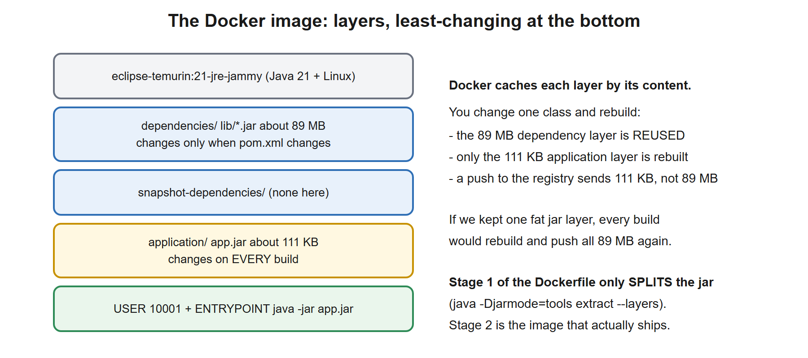
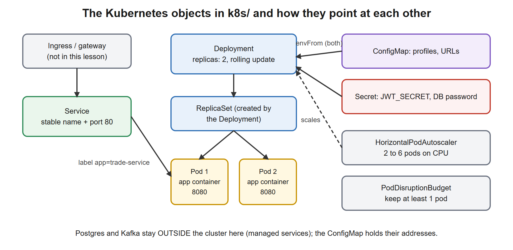
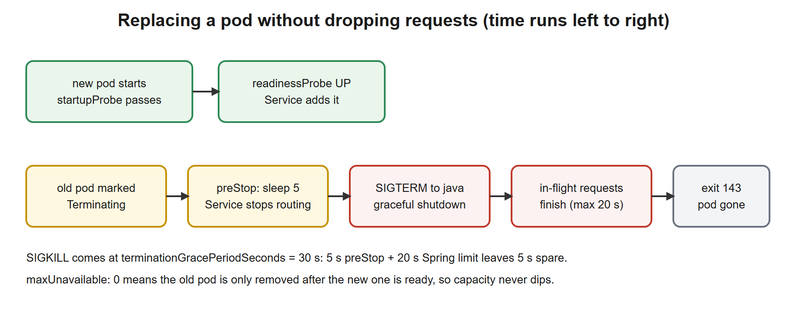

# 10. Containers, PostgreSQL and Kubernetes

**You build this yourself**, continuing in the same project folder. My working copy is [`../../reference/lesson-10`](../../reference/lesson-10). Open it only when you are stuck.

**Starting point:** your project as it was at the end of lesson 09 (111 tests). Not there? Copy everything from `reference/lesson-09` into an empty folder and continue.
**End state:** lesson 09 plus a **Docker image** (multi-stage, layered, non-root), a **docker-compose.yml** that runs the service, **PostgreSQL** and **Kafka** together, a **prod profile** that behaves well in a container (graceful shutdown, probes, JSON logs), a **Testcontainers test** on a real PostgreSQL, and **Kubernetes manifests** (`k8s/`). 113 tests, six of them against real infrastructure (four Kafka, two PostgreSQL).

## 1. Goal and time box

**120 minutes** (50 reading, 50 typing and running, 20 quiz and Q&A). **Docker Desktop must be running** for this lesson, including two of its tests (they are skipped without Docker). After this lesson you can:
- Explain what a **container** and an **image** are, how they differ from a virtual machine, and why images are built in **layers**.
- Read and write a **Dockerfile**, a **`.dockerignore`** and a **`docker-compose.yml`**, and say what every key does and which options exist that we did not use.
- Run the JVM correctly **inside** a container (memory, signals, non-root user).
- Move from the in-memory H2 database to **PostgreSQL** without changing business code, and prove it with **Testcontainers**.
- Make a Spring Boot service a good citizen on a platform: **externalised configuration**, **graceful shutdown**, **liveness and readiness probes**, **structured logs**.
- Explain **Kubernetes**: its architecture, the objects we use (Namespace, ConfigMap, Secret, Deployment, Service, HorizontalPodAutoscaler, PodDisruptionBudget) and what happens during a rolling update.

## 2. Why it matters

Almost every bank platform team now runs services as containers on Kubernetes (OpenShift, AKS, EKS, GKE or on-premise). As an architect you will not write every manifest, but you are expected to know what the platform needs from a service and how a deployment fails. Typical interview questions: "how does your service shut down?", "what is the difference between liveness and readiness?", "how do you configure it per environment without rebuilding?", "why did the pod get OOM-killed?".

| You know | Container world equivalent |
|---|---|
| A release package (EAR, WAR, zip of jars) copied to a server | An **image**: the application plus everything it needs, built once, run anywhere |
| A server provisioned by operations, with Java installed by hand | A base image such as `eclipse-temurin:21-jre-jammy`: the OS libraries and the JRE, versioned |
| Environment-specific property files edited on the server | **Environment variables**, a **ConfigMap** and a **Secret**, injected at start; the image never changes |
| The operations team restarts an application server | **Kubernetes** restarts, reschedules and replaces pods by itself, driven by probes |
| A load balancer pool configured by hand | A **Service** that always routes to the pods that are ready |
| A batch window for deployment | A **rolling update**: new pods start, old pods drain, no downtime |
| An UAT database that is "somewhat like" production | **Testcontainers**: a real PostgreSQL started by the test, thrown away afterwards |

## 3. Concepts explained like a teacher

### What a container is

A **container** is an ordinary Linux process that the operating system **isolates**: it sees its own file system, its own network, its own process list, and it is limited in how much CPU and memory it can use. It is **not** a small virtual machine. A virtual machine runs a complete operating system with its own kernel on emulated hardware. A container shares the **kernel** of the host and only brings its own user-space files. That is why a container starts in about a second and uses megabytes instead of gigabytes.

| | Virtual machine | Container |
|---|---|---|
| Contains | A full guest OS and kernel | Only the application and its libraries; **shares the host kernel** |
| Start time | Tens of seconds | About a second |
| Size | Gigabytes | Megabytes to a few hundred megabytes |
| Isolation | Strong (separate kernel) | Good (kernel features: **namespaces** for what a process sees, **cgroups** for what it may use) |
| Typical use | Whole servers, different operating systems | Packaging and running one service |

Terms you must keep apart:

| Term | Meaning |
|---|---|
| **Image** | A read-only package: file system layers plus metadata (which command to run, which user, which port). Built **once**, identified by a name and tag such as `trade-service:0.0.1` and by a **digest** (a SHA-256 of its content) |
| **Container** | A running (or stopped) instance of an image. Many containers can be started from one image |
| **Layer** | One step of the build (one Dockerfile instruction that changes files). Layers are **cached and shared**: two images with the same base share it on disk |
| **Registry** | A server that stores images (Docker Hub, Azure Container Registry, ECR, Harbor, Nexus). You `push` an image there and the cluster `pull`s it |
| **Tag** | A movable label on an image (`0.0.1`, `latest`). **`latest` is just a tag, not "the newest"**. Production uses version tags or digests |
| **Docker Engine** | The service that builds and runs containers on your machine. **Docker Desktop** is Engine plus a Linux virtual machine plus a GUI for Windows and macOS |
| **Volume** | Storage that **outlives** the container. A container's own file system is thrown away when the container is removed |
| **Build context** | The folder whose files Docker may `COPY` into the image |

### Why the image is built in layers

A Docker image is a stack of read-only layers; each Dockerfile instruction that changes files adds one. Docker **caches** a layer by its content: if the instruction and its inputs did not change, the old layer is reused. So put what changes **rarely** at the bottom and what changes **often** on top.

[](images/01-image-layers.svg)

A Spring Boot "fat jar" is one 89 MB file. If we copied it as one layer, every code change would rebuild and re-push 89 MB. Spring Boot can split the jar into **layers** (`dependencies`, `snapshot-dependencies`, `application`, and `spring-boot-loader`), and then only the 111 kB of our own classes change from build to build. The real numbers for our image are in the "Run it" section.

### Running the JVM inside a container: three rules

1. **Memory.** The container has a **memory limit** (here 512 MB). If the process goes above it, Linux kills it (**OOM kill**, exit code 137). The JVM, however, picks its default heap from the memory it **sees**. Modern JVMs read the container limit, and `-XX:MaxRAMPercentage=75` says "use 75 % of it for the heap"; the rest is for metaspace, thread stacks, direct buffers and the JVM itself. Do **not** set `-Xmx` to the full limit.
2. **Signals.** When Docker or Kubernetes stops a container it sends **SIGTERM** to process 1, waits, then sends SIGKILL. If the JVM is not process 1 (for example it was started by `sh -c "java ..."`), it never receives SIGTERM and is killed hard in the middle of a request. The **exec form** of `ENTRYPOINT` (a JSON list) makes `java` process 1.
3. **Who runs it.** A container running as `root` that is compromised gives the attacker a lot. Run as a **non-root numeric user** (`USER 10001`), with no extra Linux capabilities and a read-only root file system where possible.

`-XX:+ExitOnOutOfMemoryError` makes the JVM **exit** on an `OutOfMemoryError` instead of limping along in a broken state, so the platform restarts it cleanly.

### Configuration: the "twelve-factor" rule

The **twelve-factor app** methodology (a set of rules for cloud applications) says: *store configuration in the environment*. The **same image** goes to dev, test and production; only the environment variables differ. Spring Boot supports this with **relaxed binding** (lesson 02): the variable `SPRING_DATASOURCE_URL` sets the property `spring.datasource.url`, `KAFKA_BOOTSTRAP_SERVERS` fills the placeholder `${KAFKA_BOOTSTRAP_SERVERS:localhost:9092}`, and so on. A password or JWT secret is **never** written in the image or in Git; it is injected at start (a Kubernetes Secret, a vault).

### PostgreSQL instead of H2

Up to now the database was **H2**, an in-memory Java database: ideal for learning, but it forgets everything on restart and it is not the database you run in production. H2's SQL dialect is also *almost* PostgreSQL's, which is exactly the dangerous kind of difference: a migration that works on H2 can fail on PostgreSQL. Moving to PostgreSQL needs only three things, and **no business code changes**, because of what you learned in lessons 03 and 08:

1. The **JDBC driver** `org.postgresql:postgresql` (runtime scope: our code never imports it).
2. The Flyway module `flyway-database-postgresql`. Since Flyway 10 each database has its own small module; without it you get `Unsupported Database`.
3. The URL `spring.datasource.url=jdbc:postgresql://host:5432/trades` (plus user and password). Spring Boot builds the connection pool (HikariCP) from it, and Hibernate chooses its PostgreSQL dialect from the connection.

### Testcontainers: real infrastructure in a test

**Testcontainers** is a Java library that starts **Docker containers from inside a test** (a database, Kafka, Redis...), waits until they are ready, and removes them afterwards (a helper container named *Ryuk* cleans up even when the JVM crashes). It answers the question "does my code really work on PostgreSQL?" without a shared test database and without "works on my machine".

| Piece | What it does |
|---|---|
| `@Testcontainers` (JUnit 5 extension) | Starts and stops the containers declared as fields. `disabledWithoutDocker = true` **skips** the test class when Docker is not available (instead of failing) |
| `@Container` | Marks a container field. A **static** field means one container for the whole test class (faster); a non-static field means one per test method |
| `PostgreSQLContainer<?>("postgres:16-alpine")` | The ready-made container type for PostgreSQL: it picks a random free port, creates a database, and waits for it |
| `@ServiceConnection` (Spring Boot 3.1+, module `spring-boot-testcontainers`) | Spring Boot reads the container's URL, user and password and **uses them as the datasource**. You do not write `spring.datasource.*` |

### Making the service a good citizen on a platform

| Concern | What the platform does | What the service must do |
|---|---|---|
| **Shutdown** | Sends SIGTERM, waits (Kubernetes: 30 s by default), then SIGKILL | `server.shutdown=graceful`: stop accepting new requests, **finish the running ones**, then close the pools. Cap it with `spring.lifecycle.timeout-per-shutdown-phase` below the platform's wait |
| **Is it alive?** | **Liveness probe**: if it fails, **restart** the container | Answer `UP` unless the process is **broken beyond repair** (deadlock, corrupted state). **Never** include the database or other services here: a database outage would restart every pod for nothing |
| **Can it take traffic?** | **Readiness probe**: if it fails, **stop sending traffic** (do not restart) | Answer `UP` only when ready to serve. Spring Boot switches it to `REFUSING_TRAFFIC` automatically when shutdown begins and while starting |
| **Is it still starting?** | **Startup probe**: other probes wait for it | Slow JVM start is normal; allow enough time so liveness does not kill a pod that is still booting |
| **Logs** | Collects what the container writes to **standard output** | Write to stdout, one **JSON object per line** (`logging.structured.format.console=ecs`, Spring Boot 3.4+) so a log platform (Elastic, Splunk, Loki) can index fields |
| **Secrets** | Injects them as environment variables or files | Read them from the environment; **no default in the prod profile**: a missing secret must stop the start-up (our `jwt-secret` rule from lesson 05) |

Spring Boot's **actuator health groups** `liveness` and `readiness` implement this (`/actuator/health/liveness`, `/actuator/health/readiness`). They are enabled automatically when Boot detects Kubernetes, and by `management.endpoint.health.probes.enabled=true` anywhere else (we set it in the prod profile so Docker Compose behaves like Kubernetes).

### What Kubernetes is

**Kubernetes** (k8s) is a **container orchestrator**: you describe the **desired state** ("two copies of this image, 512 MB each, reachable under this name") in YAML files, and Kubernetes continuously works to make the real state match. If a pod dies it starts another one; if a node dies it moves the pods; when you change the image it replaces the pods one by one. Everything is an **object** in the cluster's database, created with `kubectl apply -f file.yaml`.

**Architecture.** A cluster has a **control plane** and **worker nodes**:

| Component | Role |
|---|---|
| **kube-apiserver** | The front door. Every command (`kubectl`) and every component talks to it over REST |
| **etcd** | The cluster's database: every object lives here |
| **scheduler** | Chooses a node for each new pod, using the pod's resource **requests** |
| **controller manager** | Runs the control loops ("Deployment controller", "ReplicaSet controller"...) that compare desired and actual state and act |
| **kubelet** (on every node) | Starts the containers the node should run, runs the probes, reports status |
| **container runtime** (containerd) | Actually runs the containers on the node |
| **kube-proxy / CNI** | Pod networking and Service routing |

**The objects in this lesson:**

[](images/02-k8s-objects.svg)

| Object | One-line meaning |
|---|---|
| **Pod** | The smallest unit: one or more containers sharing a network address. **Disposable**: it is never repaired, only replaced |
| **ReplicaSet** | Keeps N identical pods alive. You do not create it; a Deployment does |
| **Deployment** | Declares "N pods of this template" and performs rolling updates and rollbacks |
| **Service** | A stable name and virtual address in front of a changing set of pods, chosen by **labels** |
| **ConfigMap / Secret** | Configuration data kept outside the image. A Secret is the same idea for sensitive values |
| **Namespace** | A named partition of the cluster for quotas and access rules |
| **HorizontalPodAutoscaler (HPA)** | Changes the number of replicas from measured load |
| **PodDisruptionBudget (PDB)** | Limits how many pods may be taken away at once by planned maintenance |
| **Ingress / Gateway** | HTTP routing from outside the cluster to Services (not used here; the platform team usually owns it) |

**Labels and selectors** tie the objects together. A Deployment, a Service and an HPA do not know each other by reference to a pod; they find pods by **label** (`app: trade-service`). A selector that does not match the labels is the most common silent failure: the Service exists but has no endpoints.

**Our design.** PostgreSQL and Kafka are **managed services outside the cluster** (that is how most banks run them: a database team or a cloud service owns them). The cluster runs only the stateless trade service, so it can be killed, scaled and replaced freely. The ConfigMap holds the addresses of the external services and the Secret holds the credentials.

### A rolling update, step by step

[](images/03-rolling-update.svg)

With `maxUnavailable: 0` and `maxSurge: 1` the Deployment starts **one extra** pod, waits until its readiness probe passes, and only then removes an old one. For the old pod: Kubernetes marks it Terminating, runs the **preStop hook** (our 5 s sleep, which gives the Service time to remove the pod from its routing table; without it some requests are still routed to a pod that is already shutting down), sends SIGTERM, Spring finishes in-flight requests (**up to 20 s**), and the process exits with **143** (128 + signal 15: "terminated by SIGTERM", which is the normal result). If it is still alive after `terminationGracePeriodSeconds` (30 s), SIGKILL ends it.

### Honest limit of this lesson

There is **no Kubernetes cluster on the machine this course was built on**, and I could not install one. So the Docker image, the Compose stack, the graceful shutdown and the hardened container settings were **run and verified**; the Kubernetes manifests were **checked offline** with a script (`tools/check_k8s.py`: valid YAML, selectors match, referenced ConfigMap and Secret exist, probe ports exist, resources and version tag present) but **not applied to a cluster**. When you get a cluster (Docker Desktop has a Kubernetes switch in Settings; or `kind`, `minikube`), apply them and fix whatever it reports.

## 4. Setup steps

1. Open your project folder in VS Code and a terminal in it.
2. Confirm the starting point still works:

```powershell
.\mvnw.cmd -q clean verify
```

Expected: no output. (The four Kafka tests need no Docker: they use an embedded broker.)

3. Check Docker is running:

```powershell
docker version --format "{{.Server.Version}}"
```

Expected: a version number such as `29.9.2`. `error during connect` means Docker Desktop is not running: start it and wait until it says "Engine running".

4. Set the compare shortcut for this lesson (change the path):

```powershell
$REF = "C:\path\to\springboot-2day\reference\lesson-10"
```

When stuck, compare one file: `fc.exe Dockerfile "$REF\Dockerfile"`. `FC: no differences encountered` means identical.

### Commands used in this lesson

Each one with its syntax, why we need it here, and when you will use it later. (Commands from lessons 08 and 09, such as `docker compose up`, `ps`, `logs`, `down` and `docker exec`, are explained there; the table below adds what is new.)

| Command | Syntax | Why here | When you use it later |
|---|---|---|---|
| `.\mvnw.cmd -DskipTests package` | `mvnw.cmd [-DskipTests] package` | Build the jar `target/trade-service-0.0.1-SNAPSHOT.jar` that the Dockerfile copies. `package` runs the phases up to the jar; `-DskipTests` skips tests (we run them separately) | Every time you build an image |
| `docker build` | `docker build -t <name:tag> [-f Dockerfile] <context-dir>` | Create the image from the Dockerfile. `-t` names it; the last argument (`.`) is the **build context** | In a CI pipeline: build, then `docker push` |
| `docker compose up -d --build` | `docker compose up [-d] [--build] [service...]` | Start the stack; `--build` rebuilds images whose build inputs changed first | Local integration environment |
| `docker compose ps` | `docker compose ps [--format ...]` | Show each service's state and **health** | "Is everything up?" |
| `docker compose logs` | `docker compose logs [-f] [--tail N] [service]` | Read a service's output | A container exits at start-up |
| `docker compose down` | `docker compose down [-v]` | Remove containers and network. **`-v` also deletes the named volumes**, i.e. the database content | Reset to a clean state |
| `docker images` | `docker images [name]` | List local images and their sizes | Checking what a build produced |
| `docker history` | `docker history <image> [--no-trunc] [--format ...]` | Show the **layers** of an image and their sizes | Proving the layering works; finding what makes an image large |
| `docker stop` | `docker stop [-t seconds] <container>` | Send SIGTERM, wait (default 10 s), then SIGKILL. Exactly what Kubernetes does | Testing graceful shutdown |
| `docker inspect` | `docker inspect <container> --format "{{.State.ExitCode}}"` | Read any detail; here the exit code (143 = stopped by SIGTERM) | Why did it exit? 137 = killed (often OOM), 1 = error |
| `docker run` | `docker run [-d] [--name N] [--network N] [-e K=V] [-p host:container] <image>` | Start one container by hand with the same hardening as the manifest (`--read-only --user 10001 --cap-drop ALL --memory 512m`) | Quick experiments |
| `docker exec ... psql` | `docker exec <container> psql -U <user> -d <db> -c "<sql>"` | Run a SQL statement **inside** the Postgres container, with no client installed on your machine | Looking at data and the Flyway history |
| `kubectl apply` | `kubectl apply -f <file-or-dir> [-n namespace]` | Create or update the objects in the files (**declarative**: "make it so") | Every deployment |
| `kubectl get` | `kubectl get pods [-n ns] [-o wide] [-w]` | List objects; `-w` watches changes | "What is running?" |
| `kubectl describe` | `kubectl describe pod <name>` | Details **and events** (image pull errors, failed probes, OOM kills) | A pod will not become ready |
| `kubectl logs` | `kubectl logs <pod> [-f] [--previous]` | Container output; `--previous` is the crashed container before the restart | A pod keeps restarting |
| `kubectl rollout` | `kubectl rollout status\|history\|undo deployment/<name>` | Watch an update, list revisions, **roll back** | A bad release |
| `kubectl port-forward` | `kubectl port-forward svc/<name> 8080:80` | Tunnel a local port to a Service or pod, without exposing it | Testing a service from your laptop |
| `kubectl scale` | `kubectl scale deployment/<name> --replicas=N` | Change the replica count by hand | Emergency capacity (the HPA would override it) |
| `kubectl top` | `kubectl top pod` | Current CPU and memory (needs metrics-server) | "Is the limit too low?" |
| `python tools/check_k8s.py` | `python tools/check_k8s.py <k8s dir>` | Our offline structural check of the manifests | Before committing a manifest change |

The `kubectl` commands are listed so you know them; **they were not run for this lesson** (see "Honest limit").

### Files to change or add, in order

| # | File | Change | Why |
|---|---|---|---|
| 1 | `pom.xml` | **edit**: PostgreSQL driver, Flyway PostgreSQL module, Testcontainers | A real database and a test for it |
| 2 | `PostgresMigrationTest.java` | **new** | Prove the app and all migrations work on PostgreSQL |
| 3 | `application-prod.yml` | **edit**: graceful shutdown | Behave well when the platform stops us |
| 4 | `.dockerignore` | **new** | Keep the build context minimal |
| 5 | `Dockerfile` | **new** | The image |
| 6 | `docker-compose.yml` | **edit**: add `postgres` and `app` | The whole system on one machine |
| 7 | `k8s/*.yaml` (6 files) | **new** | The Kubernetes deployment |

## 5. Code walkthrough

A build-along. Where a file already exists, the block shows the **whole file** with the changes inside, so you can replace its content.

### Step 1. Add PostgreSQL and Testcontainers to `pom.xml`

**Do:** add the three marked groups of dependencies. The block shows the whole file.

**File:** `pom.xml`
```xml
<?xml version="1.0" encoding="UTF-8"?>
<project xmlns="http://maven.apache.org/POM/4.0.0"
         xmlns:xsi="http://www.w3.org/2001/XMLSchema-instance"
         xsi:schemaLocation="http://maven.apache.org/POM/4.0.0 https://maven.apache.org/xsd/maven-4.0.0.xsd">
  <modelVersion>4.0.0</modelVersion>

  <!-- The parent pins versions of over 1,500 libraries, so we never write versions below. -->
  <parent>
    <groupId>org.springframework.boot</groupId>
    <artifactId>spring-boot-starter-parent</artifactId>
    <version>3.5.16</version>
    <relativePath/>
  </parent>

  <!-- Our project's own identity. -->
  <groupId>com.example</groupId>
  <artifactId>trade-service</artifactId>
  <version>0.0.1-SNAPSHOT</version>
  <name>trade-service</name>

  <properties>
    <java.version>21</java.version>
  </properties>

  <dependencies>
    <!-- Web starter: embedded Tomcat + Spring MVC + Jackson (JSON). -->
    <dependency>
      <groupId>org.springframework.boot</groupId>
      <artifactId>spring-boot-starter-web</artifactId>
    </dependency>

    <!-- AOP starter (lesson 01): brings AspectJ so we can write @Aspect classes. -->
    <dependency>
      <groupId>org.springframework.boot</groupId>
      <artifactId>spring-boot-starter-aop</artifactId>
    </dependency>

    <!-- Actuator (NEW in lesson 02): /actuator/health, /actuator/beans, /actuator/conditions, metrics... -->
    <dependency>
      <groupId>org.springframework.boot</groupId>
      <artifactId>spring-boot-starter-actuator</artifactId>
    </dependency>

    <!-- Validation starter (NEW in lesson 02): Bean Validation (jakarta.validation) + Hibernate Validator.
         Lesson 02 uses it to validate configuration; lesson 03 uses it to validate request bodies. -->
    <dependency>
      <groupId>org.springframework.boot</groupId>
      <artifactId>spring-boot-starter-validation</artifactId>
    </dependency>

    <!-- JPA starter (NEW in lesson 04): Spring Data JPA + Hibernate + HikariCP connection pool + transaction support. -->
    <dependency>
      <groupId>org.springframework.boot</groupId>
      <artifactId>spring-boot-starter-data-jpa</artifactId>
    </dependency>

    <!-- H2 (NEW in lesson 04): in-memory database for learning and tests. Runtime only: our code never imports it. -->
    <dependency>
      <groupId>com.h2database</groupId>
      <artifactId>h2</artifactId>
      <scope>runtime</scope>
    </dependency>

    <!-- Security starter (NEW in lesson 05): Spring Security filter chain, password encoders, method security. -->
    <dependency>
      <groupId>org.springframework.boot</groupId>
      <artifactId>spring-boot-starter-security</artifactId>
    </dependency>

    <!-- OAuth2 resource server (NEW in lesson 05): validates "Authorization: Bearer <JWT>" on incoming requests.
         Also brings the Nimbus library we use to sign (create) the demo tokens. -->
    <dependency>
      <groupId>org.springframework.boot</groupId>
      <artifactId>spring-boot-starter-oauth2-resource-server</artifactId>
    </dependency>

    <!-- Flyway (NEW in lesson 08): versioned SQL migrations (src/main/resources/db/migration) run at startup,
         so the database schema is created and changed by reviewed scripts, not guessed by Hibernate. -->
    <dependency>
      <groupId>org.flywaydb</groupId>
      <artifactId>flyway-core</artifactId>
    </dependency>

    <!-- Resilience4j (NEW in lesson 07): @Retry, @CircuitBreaker, @Bulkhead, @RateLimiter, @TimeLimiter as annotations,
         configured under "resilience4j:" in application.yml. Boot does not manage its version, so we pin it.
         It needs the AOP starter (lesson 01) and the Actuator (lesson 02), which we already have. -->
    <dependency>
      <groupId>io.github.resilience4j</groupId>
      <artifactId>resilience4j-spring-boot3</artifactId>
      <version>2.3.0</version>
    </dependency>

    <!-- PostgreSQL driver (NEW in lesson 10): runtime only, our code never imports it. Boot picks the datasource from
         spring.datasource.url, so "jdbc:postgresql://..." is all it takes to leave H2 behind. -->
    <dependency>
      <groupId>org.postgresql</groupId>
      <artifactId>postgresql</artifactId>
      <scope>runtime</scope>
    </dependency>

    <!-- Flyway needs a small database-specific module for PostgreSQL (since Flyway 10). Without it the migrations
         fail on Postgres with "Unsupported Database". H2 support is inside flyway-core. -->
    <dependency>
      <groupId>org.flywaydb</groupId>
      <artifactId>flyway-database-postgresql</artifactId>
    </dependency>

    <!-- Spring for Apache Kafka (NEW in lesson 09): KafkaTemplate to send, @KafkaListener to receive, plus the Kafka client
         library. Spring Boot manages the version (spring-kafka 3.3.x). -->
    <dependency>
      <groupId>org.springframework.kafka</groupId>
      <artifactId>spring-kafka</artifactId>
    </dependency>

    <!-- Test starter: JUnit 5, AssertJ, Mockito, Spring test support. Only used when testing. -->
    <dependency>
      <groupId>org.springframework.boot</groupId>
      <artifactId>spring-boot-starter-test</artifactId>
      <scope>test</scope>
    </dependency>

    <!-- Testcontainers (NEW in lesson 10): start REAL services (here PostgreSQL) in Docker containers from a test.
         spring-boot-testcontainers adds @ServiceConnection: the container's URL replaces spring.datasource.url by itself. -->
    <dependency>
      <groupId>org.springframework.boot</groupId>
      <artifactId>spring-boot-testcontainers</artifactId>
      <scope>test</scope>
    </dependency>
    <dependency>
      <groupId>org.testcontainers</groupId>
      <artifactId>junit-jupiter</artifactId>
      <scope>test</scope>
    </dependency>
    <dependency>
      <groupId>org.testcontainers</groupId>
      <artifactId>postgresql</artifactId>
      <scope>test</scope>
    </dependency>

    <!-- Embedded Kafka (NEW in lesson 09): @EmbeddedKafka starts a real Kafka broker INSIDE the test JVM, with no Docker. -->
    <dependency>
      <groupId>org.springframework.kafka</groupId>
      <artifactId>spring-kafka-test</artifactId>
      <scope>test</scope>
    </dependency>

    <!-- Security test helpers (NEW in lesson 05): jwt() request post-processor, @WithMockUser. -->
    <dependency>
      <groupId>org.springframework.security</groupId>
      <artifactId>spring-security-test</artifactId>
      <scope>test</scope>
    </dependency>
  </dependencies>

  <build>
    <plugins>
      <!-- Builds the runnable "fat jar" and adds the spring-boot:run command. -->
      <plugin>
        <groupId>org.springframework.boot</groupId>
        <artifactId>spring-boot-maven-plugin</artifactId>
      </plugin>

      <!-- (NEW in lesson 06) Step 1 of 3 for a clean test run: this plugin turns the downloaded Mockito jar into
           the property ${org.mockito:mockito-core:jar}, so Surefire can load it as a Java agent (step 3). -->
      <plugin>
        <groupId>org.apache.maven.plugins</groupId>
        <artifactId>maven-dependency-plugin</artifactId>
        <executions>
          <execution>
            <id>mockito-agent-path</id>
            <goals>
              <goal>properties</goal>
            </goals>
          </execution>
        </executions>
      </plugin>

      <!-- (NEW in lesson 06) Step 2 of 3: JaCoCo measures which lines the tests execute.
           "prepare-agent" injects its agent into the test JVM through the ${argLine} property;
           "report" writes target/site/jacoco/index.html after the tests. -->
      <plugin>
        <groupId>org.jacoco</groupId>
        <artifactId>jacoco-maven-plugin</artifactId>
        <version>0.8.16</version>     <!-- Spring Boot does not manage plugin versions for JaCoCo, so we pin one -->
        <executions>
          <execution>
            <id>jacoco-prepare</id>
            <goals>
              <goal>prepare-agent</goal>
            </goals>
          </execution>
          <execution>
            <id>jacoco-report</id>
            <phase>verify</phase>
            <goals>
              <goal>report</goal>
            </goals>
          </execution>
        </executions>
      </plugin>

      <!-- (NEW in lesson 06) Step 3 of 3: Surefire runs the tests. We pass the JVM two agents: JaCoCo (@{argLine})
           and Mockito. Loading Mockito explicitly removes the "Mockito is currently self-attaching" warning and
           keeps working on future Java versions. -Xshare:off stops the JVM complaining about class-data sharing
           when an agent is present. We also silence the SQL log, which is noise in test output. -->
      <plugin>
        <groupId>org.apache.maven.plugins</groupId>
        <artifactId>maven-surefire-plugin</artifactId>
        <configuration>
          <argLine>@{argLine} -javaagent:${org.mockito:mockito-core:jar} -Xshare:off</argLine>
          <systemPropertyVariables>
            <logging.level.org.hibernate.SQL>INFO</logging.level.org.hibernate.SQL>
          </systemPropertyVariables>
        </configuration>
      </plugin>
    </plugins>
  </build>
</project>
```
**Why each dependency:**

| Dependency | Scope | Purpose |
|---|---|---|
| `org.postgresql:postgresql` | runtime | The JDBC driver. `runtime` scope: needed to run, never imported by our code. Boot picks it when the URL starts with `jdbc:postgresql:` |
| `org.flywaydb:flyway-database-postgresql` | compile (default) | Flyway's PostgreSQL support module (Flyway 10 and later). The version comes from Spring Boot's dependency management, so no `<version>` |
| `spring-boot-testcontainers` | test | The Spring integration, mainly `@ServiceConnection` |
| `org.testcontainers:junit-jupiter` | test | The JUnit 5 extension (`@Testcontainers`, `@Container`) |
| `org.testcontainers:postgresql` | test | The `PostgreSQLContainer` class |

Run `.\mvnw.cmd -q clean verify`: still green. (H2 remains the default for the tests and the `dev` profile; we did not change `application.yml`.)

### Step 2. Prove it on a real PostgreSQL

**Do:** create the test class below.

**File:** `src/test/java/com/example/trade/PostgresMigrationTest.java`
```java
package com.example.trade;

import static org.assertj.core.api.Assertions.assertThat;

import com.example.trade.domain.TradeStatus;
import com.example.trade.service.TradeService;
import java.math.BigDecimal;
import javax.sql.DataSource;
import org.flywaydb.core.Flyway;
import org.junit.jupiter.api.Test;
import org.springframework.beans.factory.annotation.Autowired;
import org.springframework.boot.test.context.SpringBootTest;
import org.springframework.boot.testcontainers.service.connection.ServiceConnection;
import org.springframework.jdbc.core.JdbcTemplate;
import org.testcontainers.containers.PostgreSQLContainer;
import org.testcontainers.junit.jupiter.Container;
import org.testcontainers.junit.jupiter.Testcontainers;

// The same migrations and the same application, but on a REAL PostgreSQL started in Docker for the length of this test.
// H2 accepted our SQL; this proves PostgreSQL does too, and that Hibernate's "validate" agrees with the schema.
// disabledWithoutDocker: on a machine without Docker the test is SKIPPED instead of failing.
@Testcontainers(disabledWithoutDocker = true)
@SpringBootTest(webEnvironment = SpringBootTest.WebEnvironment.NONE, properties = "trade.outbox.poll-interval-ms=3600000")
class PostgresMigrationTest {

    // @ServiceConnection: Spring Boot reads the container's JDBC URL, user and password and uses them as the datasource.
    // No spring.datasource.* property is needed, and the embedded H2 is not used.
    @Container
    @ServiceConnection
    static PostgreSQLContainer<?> postgres = new PostgreSQLContainer<>("postgres:16-alpine");

    @Autowired DataSource dataSource;
    @Autowired Flyway flyway;
    @Autowired TradeService trades;
    @Autowired JdbcTemplate jdbc;

    @Test
    void theApplicationStartsOnPostgresAndAllMigrationsApplied() {
        String product = jdbc.queryForObject("select version()", String.class);
        assertThat(product).startsWith("PostgreSQL 16");
        assertThat(flyway.info().applied()).hasSize(5);
        assertThat(flyway.info().pending()).isEmpty();
    }

    @Test
    void aTradeCanBeCreatedAndSettledInPostgres() {
        var t = trades.create("US0378331005", new BigDecimal("100"), new BigDecimal("189.50"));

        assertThat(trades.settle(t.id()).status()).isEqualTo(TradeStatus.SETTLED);
        // the settlement wrote its event into the outbox table, in the same Postgres transaction
        Integer events = jdbc.queryForObject(
                "select count(*) from outbox_event where aggregate_id = ? and event_type = 'TradeSettled'",
                Integer.class, String.valueOf(t.id()));
        assertThat(events).isEqualTo(1);
    }
}
```
**Read it:**
- `@SpringBootTest(webEnvironment = NONE, properties = ...)` boots the whole application but without a web server. The property slows the outbox relay to once an hour so it does not interfere.
- The **static** `@Container @ServiceConnection` field starts one PostgreSQL 16 container for the class and wires the datasource to it. The embedded H2 is **not** used here.
- Test 1 asks the database for `select version()` (it really is PostgreSQL 16) and checks Flyway applied all **5** migrations and none are pending. Hibernate's `ddl-auto: validate` also ran at start-up, so entities and schema agree.
- Test 2 creates and settles a trade, then checks the **outbox row** exists in the same PostgreSQL. This is the transactional outbox (lesson 08) working on the real database.

Run it:

```powershell
.\mvnw.cmd "-Dtest=PostgresMigrationTest" test
```

Expected: `Tests run: 2, Failures: 0, Errors: 0`. The first run pulls `postgres:16-alpine` and takes longer. Without Docker the class is **skipped**, not failed.

### Step 3. The production profile

**Do:** extend `application-prod.yml` (new keys at the end). The block shows the whole file.

**File:** `src/main/resources/application-prod.yml`
```yaml
# Production: expose the minimum, hide health details, enable Kubernetes probes.
management:
  endpoints:
    web:
      exposure:
        include: health,info
  endpoint:
    health:
      show-details: never
      probes:
        enabled: true       # adds /actuator/health/liveness and /actuator/health/readiness

trade:
  max-quantity: 500000
  security:
    jwt-secret: ${JWT_SECRET:}     # no default: a blank value fails validation, so prod refuses to start without it

# Lesson 10: behave well inside a container platform.
server:
  shutdown: graceful                       # on SIGTERM stop accepting new requests, let running ones finish
spring:
  lifecycle:
    timeout-per-shutdown-phase: 20s        # but never longer than 20 s (Kubernetes waits 30 s before killing)

logging:
  level:
    com.example.trade: INFO
```
**What the new keys do and the choices behind them:**

| Key | Meaning | Other values / options |
|---|---|---|
| `server.shutdown: graceful` | On SIGTERM stop accepting new connections and wait for active requests. The readiness state flips to `REFUSING_TRAFFIC` at once | `immediate` (the default): requests in flight are cut off |
| `spring.lifecycle.timeout-per-shutdown-phase: 20s` | Maximum time to wait for one shutdown phase (here: active requests). After it Spring continues with the shutdown | Default is `30s`. Keep it **lower** than Kubernetes' `terminationGracePeriodSeconds` minus the preStop sleep, or SIGKILL arrives first |
| `management.endpoint.health.probes.enabled: true` | Creates `/actuator/health/liveness` and `/actuator/health/readiness` even outside Kubernetes | Default: only when Boot detects Kubernetes |
| `management.endpoint.health.show-details: never` | `/actuator/health` shows only the status | `when-authorized`, `always` (dev profile) |
| `trade.security.jwt-secret: ${JWT_SECRET:}` | Taken from the environment; **empty fails validation**, so production cannot start with a forgotten secret | A default would be convenient and dangerous |

### Step 4. `.dockerignore`

**Do:** create `.dockerignore` in the project root.

**File:** `.dockerignore`
```text
# Send Docker only what the Dockerfile needs: the jar. Everything else stays out of the build context.
*
!target/trade-service-0.0.1-SNAPSHOT.jar
```
**Explained.** When you run `docker build .`, Docker first sends the **build context** (the folder `.`) to the Docker engine. Without a filter that includes `target/` (hundreds of MB of classes), `.git`, your IDE folders and possibly secret files. A `.dockerignore` works like `.gitignore`: here `*` excludes **everything**, and the line starting with `!` makes one **exception**, the jar. Result: the context is a single 100 kB file, builds start instantly, and nothing accidental can end up in the image.

| Syntax | Meaning |
|---|---|
| `*` | Every file in the context root |
| `!path` | Re-include a path that an earlier line excluded (the last matching line wins) |
| `**/*.log` | Any depth |
| `# text` | Comment |

### Step 5. The `Dockerfile`

**Do:** create `Dockerfile` in the project root (no extension).

**File:** `Dockerfile`
```dockerfile
# Build the jar first (on your machine or in CI):  .\mvnw.cmd clean package
# Then:  docker build -t trade-service:0.0.1 .

# ---- Stage 1: split the fat jar into layers (a throw-away stage; nothing from it ships except what we COPY) ----
FROM eclipse-temurin:21-jre-jammy AS layers
WORKDIR /build
COPY target/trade-service-0.0.1-SNAPSHOT.jar app.jar
# Spring Boot's own tool: dependencies, snapshot dependencies and our application code become separate folders.
RUN java -Djarmode=tools -jar app.jar extract --layers --destination extracted

# ---- Stage 2: the image that runs ----
FROM eclipse-temurin:21-jre-jammy
WORKDIR /app
# Least-changing layer first. Docker caches each COPY: when only our code changes, the big "dependencies"
# layer is reused and a rebuild and a push move a few KB instead of 89 MB.
COPY --from=layers /build/extracted/dependencies/ ./
COPY --from=layers /build/extracted/snapshot-dependencies/ ./
COPY --from=layers /build/extracted/application/ ./
# Never run as root. A NUMERIC user id lets Kubernetes verify "runAsNonRoot" without looking inside the image.
USER 10001
EXPOSE 8080
# Exec form (a JSON list): java is process 1 and receives SIGTERM directly, so Spring shuts down gracefully.
# MaxRAMPercentage: size the heap from the CONTAINER's memory limit (75%), not from the host's RAM.
ENTRYPOINT ["java", "-XX:MaxRAMPercentage=75", "-XX:+ExitOnOutOfMemoryError", "-jar", "app.jar"]
```
**Instruction by instruction.**

| Instruction | What it does here |
|---|---|
| `FROM eclipse-temurin:21-jre-jammy AS layers` | Start from a base image: the Eclipse Temurin **JRE 21** (a runtime only, no compiler, smaller) on Ubuntu 22.04 ("jammy"). `AS layers` names this **stage** |
| `WORKDIR /build` | Set (and create) the directory later instructions run in |
| `COPY target/trade-service-0.0.1-SNAPSHOT.jar app.jar` | Copy the jar from the build context into the image |
| `RUN java -Djarmode=tools -jar app.jar extract --layers --destination extracted` | Run a command **at build time**. Spring Boot's own tool splits the jar into the folders `dependencies/`, `snapshot-dependencies/`, `application/` (and the extracted jar is **named after the input**, so it is called `app.jar` again, with its libraries in `lib/`) |
| second `FROM ...` | A **second stage**: a fresh image. Only what we `COPY --from=layers` is taken from stage 1; the stage-1 files are discarded |
| `COPY --from=layers /build/extracted/dependencies/ ./` (three times) | Copy the layers **least-changing first** so Docker's cache works (see the diagram) |
| `USER 10001` | Run as a non-root user. Numeric, so Kubernetes' `runAsNonRoot` can verify it without reading `/etc/passwd` in the image |
| `EXPOSE 8080` | Documentation: this container listens on 8080. It does **not** publish the port (`-p` or the Compose `ports:` does) |
| `ENTRYPOINT [ ... ]` | The command that runs when the container starts. **Exec form** (JSON list): `java` is process 1 and gets SIGTERM |

**Options we did not use.**

| Instruction | What it does | Why not here |
|---|---|---|
| `CMD` | Default **arguments** (or default command) that the user can override at `docker run`. `ENTRYPOINT` is the fixed part, `CMD` the replaceable part | We want a fixed command |
| `ENV KEY=value` | Sets an environment variable in the image | Config belongs to the environment at **run** time |
| `ARG` | A variable that exists only at **build** time (`docker build --build-arg X=1`) | Nothing to parametrise |
| `ADD` | Like `COPY`, but also unpacks archives and downloads URLs | `COPY` is clearer and safer; use `ADD` only for archive extraction |
| `HEALTHCHECK` | A command Docker runs to mark the container healthy | Kubernetes has its own probes; Compose uses `healthcheck:` in the YAML |
| `VOLUME` | Declares a mount point | We write nothing to disk |
| `LABEL` | Metadata (`org.opencontainers.image.source=...`) | Useful in real registries to link an image to its Git commit |
| `COPY --chown=user:group` | Set owner while copying | Files owned by root and readable by everyone are fine for a read-only app |
| `STOPSIGNAL` | Choose a different stop signal | SIGTERM is what Spring expects |
| Shell form `ENTRYPOINT java -jar ...` | Runs through `/bin/sh -c`, so the shell is process 1 and swallows SIGTERM | The reason we use the exec form |

**Other ways to build the same image** (know the names): `.\mvnw.cmd spring-boot:build-image` uses **Cloud Native Buildpacks** and needs no Dockerfile; **Jib** (Google) builds an image from Maven without a Docker daemon; **GraalVM native image** compiles to a native binary with a tiny start-up time but a long build and some limits on reflection. A Dockerfile is the most widely understood and the most transparent, so we use it.

**What a multi-stage build buys you.** The final image contains only the runtime stage; the build tools and the unsplit jar of stage 1 are not in it. (In real CI, stage 1 would also contain the JDK and Maven and build the jar; we build the jar on the host to keep this lesson's build fast.)

Build it:

```powershell
.\mvnw.cmd -q -DskipTests package
docker build -t trade-service:0.0.1 .
```

The first prints nothing. The second ends with `naming to docker.io/library/trade-service:0.0.1`.

### Step 6. `docker-compose.yml`: the whole system on one machine

You met this file in lesson 09. We **add two services**, `postgres` and `app`, and a `volumes:` section. The block shows the whole file.

**File:** `docker-compose.yml`
```yaml
# The whole system on your laptop. Start with:  docker compose up -d --build
# (build the jar first: .\mvnw.cmd -DskipTests package)
services:
  kafka:
    image: apache/kafka:3.9.0              # the official Apache Kafka image; runs in KRaft mode (no ZooKeeper)
    container_name: trade-kafka
    ports:
      - "9092:9092"                        # host:container. A program on the host connects to localhost:9092
    environment:
      KAFKA_NODE_ID: 1
      KAFKA_PROCESS_ROLES: broker,controller           # this one node is both the broker and the cluster controller
      KAFKA_CONTROLLER_QUORUM_VOTERS: 1@kafka:9093     # who votes for the controller: node 1, at kafka:9093
      KAFKA_LISTENERS: PLAINTEXT://:29092,PLAINTEXT_HOST://:9092,CONTROLLER://:9093
      KAFKA_ADVERTISED_LISTENERS: PLAINTEXT://kafka:29092,PLAINTEXT_HOST://localhost:9092   # the addresses clients are TOLD to use
      KAFKA_LISTENER_SECURITY_PROTOCOL_MAP: CONTROLLER:PLAINTEXT,PLAINTEXT:PLAINTEXT,PLAINTEXT_HOST:PLAINTEXT
      KAFKA_INTER_BROKER_LISTENER_NAME: PLAINTEXT
      KAFKA_CONTROLLER_LISTENER_NAMES: CONTROLLER
      KAFKA_OFFSETS_TOPIC_REPLICATION_FACTOR: 1        # one node, so every internal topic has one replica
      KAFKA_TRANSACTION_STATE_LOG_REPLICATION_FACTOR: 1
      KAFKA_TRANSACTION_STATE_LOG_MIN_ISR: 1
      KAFKA_GROUP_INITIAL_REBALANCE_DELAY_MS: 0        # do not wait to form a consumer group: faster demos
    healthcheck:
      test: ["CMD-SHELL", "/opt/kafka/bin/kafka-topics.sh --bootstrap-server localhost:9092 --list > /dev/null 2>&1"]
      interval: 10s
      timeout: 10s
      retries: 10

  postgres:                                # NEW in lesson 10: a real database instead of H2
    image: postgres:16-alpine
    container_name: trade-postgres
    environment:
      POSTGRES_DB: trades                  # created on first start
      POSTGRES_USER: trade
      POSTGRES_PASSWORD: trade-local-only  # a laptop-only password. Real systems inject secrets, never write them in a file
    ports:
      - "5432:5432"
    volumes:
      - pgdata:/var/lib/postgresql/data    # a NAMED VOLUME: the data survives "docker compose down" (not "down -v")
    healthcheck:
      test: ["CMD-SHELL", "pg_isready -U trade -d trades"]
      interval: 5s
      timeout: 5s
      retries: 10

  app:                                     # NEW in lesson 10: our service, built from the Dockerfile
    build: .                               # build the image from ./Dockerfile
    image: trade-service:0.0.1
    container_name: trade-app
    depends_on:
      kafka:
        condition: service_healthy         # start only after Kafka and Postgres answer their healthchecks
      postgres:
        condition: service_healthy
    ports:
      - "8080:8080"
    environment:                           # Spring Boot reads these through "relaxed binding" (lesson 02)
      SPRING_PROFILES_ACTIVE: prod,kafka
      SPRING_DATASOURCE_URL: jdbc:postgresql://postgres:5432/trades   # "postgres" = the service name above
      SPRING_DATASOURCE_USERNAME: trade
      SPRING_DATASOURCE_PASSWORD: trade-local-only
      KAFKA_BOOTSTRAP_SERVERS: kafka:29092                            # the INTERNAL listener, not localhost:9092
      JWT_SECRET: ${JWT_SECRET:-compose-only-secret-0123456789abcdef-change-me}   # from your shell, or this local default
      LOGGING_STRUCTURED_FORMAT_CONSOLE: ecs                          # log as one JSON object per line (Spring Boot 3.4+), easy for log platforms

volumes:
  pgdata:
```
**New parts, key by key.**

| Key | Meaning | Other options (not used) |
|---|---|---|
| `services:` | The containers of the stack | |
| `image: postgres:16-alpine` | Image to run (`alpine` = a very small Linux base) | `build:` to build instead |
| `environment:` (postgres) | The official image reads `POSTGRES_DB`, `POSTGRES_USER`, `POSTGRES_PASSWORD` **on first start** to create the database | `env_file: .env` to read them from a file |
| `ports: "5432:5432"` | `host:container`. Lets tools on your laptop reach the database | Omit it: containers still reach each other on the Compose network |
| `volumes: pgdata:/var/lib/postgresql/data` | A **named volume** mounted where Postgres keeps its data, so the data survives `docker compose down` | A **bind mount** (`./data:/var/...`) maps a host folder; `tmpfs` for throw-away data |
| `healthcheck:` + `pg_isready` | A command run every `interval`; the service is `healthy` after it passes | |
| `build: .` | Build the image from the `Dockerfile` in this folder | `build: {context: ., dockerfile: X, args: ...}` |
| `depends_on: ... condition: service_healthy` | Start `app` only **after** Kafka and Postgres are healthy (a plain `depends_on` only waits for the container to *start*) | `service_started`, `service_completed_successfully` |
| `SPRING_DATASOURCE_URL: jdbc:postgresql://postgres:5432/trades` | Inside the Compose network each service is reachable by its **service name** (`postgres`). `localhost` would be the app container itself | |
| `KAFKA_BOOTSTRAP_SERVERS: kafka:29092` | The **internal** listener of Kafka (lesson 09). `localhost:9092` is for programs on your laptop | |
| `JWT_SECRET: ${JWT_SECRET:-default}` | Compose substitutes from **your shell's** variable, or the default after `:-` | `${VAR:?error}` makes a missing variable an error |
| `LOGGING_STRUCTURED_FORMAT_CONSOLE: ecs` | Relaxed binding for `logging.structured.format.console`: JSON logs | `logstash`, `gelf` |
| `volumes:` (top level) `pgdata:` | Declares the named volume | |

**Compose keys we did not use:** `command` / `entrypoint` (override the image's), `restart: unless-stopped` (restart after a crash or reboot), `networks:` (custom networks; the default one is created for you), `env_file`, `profiles` (start only some services), `deploy.resources.limits` (CPU and memory limits), `read_only` / `user` / `tmpfs` (the hardening we apply in Kubernetes), `stop_grace_period` (the equivalent of `terminationGracePeriodSeconds`), `secrets:`.

> The database password in this file is for a laptop only. A real environment injects secrets from a store; never commit a real one.

### Step 7. The Kubernetes manifests

Create a folder `k8s/` and the six files below. Every Kubernetes object has the same four top-level keys, which are worth knowing by heart:

| Key | Meaning |
|---|---|
| `apiVersion` | Which API group and version defines this kind (`v1`, `apps/v1`, `autoscaling/v2`) |
| `kind` | What object this is (`Deployment`) |
| `metadata` | Its `name`, `namespace`, `labels` |
| `spec` (or `data` for ConfigMap) | The **desired state**. Kubernetes adds a `status` (the actual state) that you never write |

**7a. Namespace**

**File:** `k8s/namespace.yaml`
```yaml
# A namespace groups the objects of one system and lets you apply quotas and access rules to the group.
apiVersion: v1
kind: Namespace
metadata:
  name: trade
```
Nothing to configure. Real clusters add quotas (`ResourceQuota`) and limits per namespace; the platform team often creates the namespace for you.

**7b. ConfigMap**

**File:** `k8s/configmap.yaml`
```yaml
# Non-secret settings. Each key becomes an environment variable in the pod (see envFrom in deployment.yaml).
# Spring Boot's relaxed binding turns SPRING_PROFILES_ACTIVE into spring.profiles.active, and so on (lesson 02).
apiVersion: v1
kind: ConfigMap
metadata:
  name: trade-service-config
  namespace: trade
data:
  SPRING_PROFILES_ACTIVE: "prod,kafka"
  # Managed services live OUTSIDE the cluster in this design; these are their addresses.
  SPRING_DATASOURCE_URL: "jdbc:postgresql://trade-db.internal.example:5432/trades"
  SPRING_DATASOURCE_USERNAME: "trade"
  KAFKA_BOOTSTRAP_SERVERS: "kafka-1.internal.example:9092,kafka-2.internal.example:9092"
  LOGGING_STRUCTURED_FORMAT_CONSOLE: "ecs"
```
`data` is a map of strings. We feed it to the container with `envFrom` (below), so each key **becomes an environment variable**. Options not used: mounting a ConfigMap as **files** in a volume (for config files such as `application.yml` or `logback.xml`), or picking single keys with `env[].valueFrom.configMapKeyRef`. Remember that a changed ConfigMap does **not** restart the pods: an update needs a rollout (`kubectl rollout restart deployment/trade-service`) or a hash in the Deployment that changes with it (what Helm and Kustomize automate).

**7c. Secret (a template)**

**File:** `k8s/secret.example.yaml`
```yaml
# A TEMPLATE. Never commit real values. In a real cluster this object is created by your secret tooling
# (External Secrets Operator, Sealed Secrets, the cloud's CSI secret driver) or by hand:
#   kubectl -n trade create secret generic trade-service-secret --from-literal=JWT_SECRET=... --from-literal=SPRING_DATASOURCE_PASSWORD=...
# "stringData" lets you write plain text; Kubernetes stores it base64-encoded (which is encoding, NOT encryption).
apiVersion: v1
kind: Secret
metadata:
  name: trade-service-secret
  namespace: trade
type: Opaque
stringData:
  JWT_SECRET: "replace-me-with-at-least-32-random-characters"
  SPRING_DATASOURCE_PASSWORD: "replace-me"
```
`type: Opaque` is the generic kind (others: `kubernetes.io/tls`, `kubernetes.io/dockerconfigjson` for registry credentials). `stringData` accepts plain text; Kubernetes stores it as `data` in **base64, which is encoding, not encryption**: anyone who can read the Secret can read the value. Real protection is access control (RBAC), **encryption at rest** in etcd, and an external store (HashiCorp Vault, Azure Key Vault, AWS Secrets Manager) synchronised into the cluster. This file is named `.example` because it must **never** hold real values and be committed.

**7d. Deployment** (the important one)

**File:** `k8s/deployment.yaml`
```yaml
# A Deployment keeps N identical pods running and replaces them gradually when the spec changes (a rolling update).
apiVersion: apps/v1
kind: Deployment
metadata:
  name: trade-service
  namespace: trade
  labels:
    app: trade-service
spec:
  replicas: 2                              # at least two, so one pod can restart without an outage
  revisionHistoryLimit: 3                  # keep 3 old ReplicaSets for "kubectl rollout undo"
  selector:
    matchLabels:
      app: trade-service                   # which pods this Deployment owns; must match template.metadata.labels
  strategy:
    type: RollingUpdate
    rollingUpdate:
      maxUnavailable: 0                    # never remove a ready pod before its replacement is ready
      maxSurge: 1                          # allow one extra pod during the update
  template:
    metadata:
      labels:
        app: trade-service
    spec:
      terminationGracePeriodSeconds: 30    # after SIGTERM, wait up to 30 s, then SIGKILL. Spring's own limit is 20 s.
      securityContext:
        runAsNonRoot: true                 # refuse to start if the image would run as root
        runAsUser: 10001                   # same numeric id as USER in the Dockerfile
        seccompProfile:
          type: RuntimeDefault             # the container runtime's default system-call filter
      containers:
        - name: app
          image: registry.example.com/trade/trade-service:0.0.1   # always a version tag or digest, never :latest
          imagePullPolicy: IfNotPresent
          ports:
            - name: http
              containerPort: 8080
          envFrom:
            - configMapRef:
                name: trade-service-config
            - secretRef:
                name: trade-service-secret
          resources:
            requests:                      # what the scheduler RESERVES: used to pick a node and by the autoscaler
              cpu: 250m
              memory: 512Mi
            limits:                        # the hard ceiling. Over the memory limit the container is OOM-killed.
              memory: 512Mi                # same as the request: predictable. The JVM sizes its heap from this (75%).
          securityContext:
            allowPrivilegeEscalation: false
            readOnlyRootFilesystem: true   # the app cannot write into the image; /tmp is a separate volume below
            capabilities:
              drop: ["ALL"]
          startupProbe:                    # "has it finished booting?" Other probes wait until this passes.
            httpGet:
              path: /actuator/health/liveness
              port: http
            periodSeconds: 5
            failureThreshold: 30           # up to 30 x 5 s = 150 s to start before Kubernetes gives up
          livenessProbe:                   # "is the process stuck?" A failure RESTARTS the container.
            httpGet:
              path: /actuator/health/liveness
              port: http
            periodSeconds: 10
            failureThreshold: 3
          readinessProbe:                  # "can it take traffic now?" A failure only removes the pod from the Service.
            httpGet:
              path: /actuator/health/readiness
              port: http
            periodSeconds: 5
            failureThreshold: 3
          lifecycle:
            preStop:                       # runs BEFORE SIGTERM. The pause lets the Service stop routing to this pod first.
              exec:
                command: ["sleep", "5"]
          volumeMounts:
            - name: tmp
              mountPath: /tmp
      volumes:
        - name: tmp
          emptyDir: {}                     # scratch space that disappears with the pod
```
**Key by key.**

| Key | Meaning | Choice / alternatives |
|---|---|---|
| `replicas: 2` | Number of pods | The HPA overrides this when used. One replica means every restart is an outage |
| `revisionHistoryLimit: 3` | How many old ReplicaSets are kept for rollback | Default 10 |
| `selector.matchLabels` | Which pods the Deployment **owns**. Must match the template's labels; immutable after creation | |
| `strategy.type: RollingUpdate` | Replace pods gradually | `Recreate`: stop all, then start all (downtime; needed when two versions must never run together) |
| `maxUnavailable: 0`, `maxSurge: 1` | Never go below the desired count; allow one extra pod while updating | Percentages (`25%`) are allowed; the defaults are 25 % and 25 % |
| `template.metadata.labels` | Labels put on every pod. The Service and the selector find the pods by them | |
| `terminationGracePeriodSeconds: 30` | Time between SIGTERM and SIGKILL | Raise it for slow drains |
| `securityContext` (pod level) | `runAsNonRoot` refuses to start a container that would run as root; `runAsUser` picks the id; `seccompProfile: RuntimeDefault` applies the runtime's syscall filter | Also `fsGroup` (group of mounted volumes), `runAsGroup` |
| `image` | What to run. **Always a version tag or a digest**, never `latest`: otherwise two nodes can run different code under one name | A digest `image@sha256:...` is immutable |
| `imagePullPolicy: IfNotPresent` | Pull only if the node does not have it | `Always`, `Never`. Private registries also need `imagePullSecrets` |
| `ports[].name: http` | A **name** for the container port, so the probes and the Service can say `http` instead of repeating 8080 | |
| `envFrom` | Turn **all keys** of a ConfigMap and a Secret into environment variables | `env: [{name, value}]` or `valueFrom` for single values; `fieldRef` for pod metadata such as the pod name |
| `resources.requests` | What the scheduler **reserves** for the pod: 250 millicores of CPU (0.25 core) and 512 MiB. Used to place the pod and by the HPA | Too low: the node is overloaded; too high: wasted capacity |
| `resources.limits.memory: 512Mi` | The ceiling. Above it the container is **OOM-killed** (exit 137). Equal to the request so memory is predictable. The JVM's 75 % heap rule is based on this number | |
| no `limits.cpu` | Deliberate: a CPU limit **throttles** the process (a slow JVM start, latency spikes) even when the node has free CPU. Many teams omit it; some platforms require it | Set `limits.cpu` if the platform demands it, then watch throttling |
| `securityContext` (container level) | `allowPrivilegeEscalation: false` (no gaining rights), `readOnlyRootFilesystem: true` (nothing writes into the image), `capabilities.drop: [ALL]` (no Linux capabilities) | |
| `startupProbe` | "Has it finished booting?" Until it succeeds, the other two probes do not run. 30 tries x 5 s = up to 150 s | Without it you must pad `initialDelaySeconds`, which slows every healthy start |
| `livenessProbe` | Failing 3 times in a row **restarts** the container. Uses `/actuator/health/liveness`, which has **no dependency checks** | |
| `readinessProbe` | Failing removes the pod from the Service's endpoints, **no restart** | |
| probe types / fields not used | `tcpSocket`, `exec`, `grpc` instead of `httpGet`; `initialDelaySeconds`, `timeoutSeconds` (default 1 s), `successThreshold` | |
| `lifecycle.preStop` | A command run **before** SIGTERM | Our `sleep 5` covers the delay until the Service stops routing here |
| `volumeMounts` + `volumes: tmp: emptyDir` | Tomcat and the JVM need a writable `/tmp`; with a read-only root file system we mount an in-memory/scratch directory there. `emptyDir` lives and dies with the pod | `persistentVolumeClaim` for data that must survive (not needed: this service is stateless) |

Not used here: `nodeSelector`, `affinity` and `topologySpreadConstraints` (spread pods across nodes and zones, which you want in production), `serviceAccountName` and RBAC, `initContainers`, `minReadySeconds`, `progressDeadlineSeconds`.

**7e. Service**

**File:** `k8s/service.yaml`
```yaml
# A Service gives a set of pods ONE stable name and address, and load-balances across the READY ones.
apiVersion: v1
kind: Service
metadata:
  name: trade-service
  namespace: trade
spec:
  type: ClusterIP                # reachable only inside the cluster; an Ingress or gateway exposes it to the outside
  selector:
    app: trade-service           # send traffic to pods with this label
  ports:
    - name: http
      port: 80                   # callers use http://trade-service.trade/
      targetPort: http           # the container port NAMED "http" in the Deployment (8080)
```
`selector` finds the pods by label; `port` is what callers use; `targetPort: http` is the **named** container port. The Service only sends traffic to pods whose **readiness** probe passes. Other `type` values: `NodePort` (a port on every node), `LoadBalancer` (a cloud load balancer), and a **headless** Service (`clusterIP: None`, for stateful sets). Inside the cluster the name resolves by DNS: `trade-service.trade` (or `trade-service.trade.svc.cluster.local`).

**7f. HorizontalPodAutoscaler and PodDisruptionBudget**

**File:** `k8s/hpa-pdb.yaml`
```yaml
# HorizontalPodAutoscaler: add or remove pods based on measured CPU. Needs the metrics-server add-on in the cluster.
apiVersion: autoscaling/v2
kind: HorizontalPodAutoscaler
metadata:
  name: trade-service
  namespace: trade
spec:
  scaleTargetRef:
    apiVersion: apps/v1
    kind: Deployment
    name: trade-service
  minReplicas: 2
  maxReplicas: 6
  metrics:
    - type: Resource
      resource:
        name: cpu
        target:
          type: Utilization
          averageUtilization: 70      # relative to the CPU REQUEST (250m), so the target is about 175m per pod
---
# PodDisruptionBudget: during VOLUNTARY disruptions (node drain, cluster upgrade) keep at least one pod running.
apiVersion: policy/v1
kind: PodDisruptionBudget
metadata:
  name: trade-service
  namespace: trade
spec:
  minAvailable: 1
  selector:
    matchLabels:
      app: trade-service
```
A file may hold several objects separated by `---`. The HPA needs the **metrics-server** add-on; `averageUtilization: 70` is measured against the CPU **request**. Options not used: memory metrics, custom metrics (for example Kafka consumer lag via KEDA, which is the better scaling signal for a consumer), the `behavior` block (how fast to scale up and down). The PDB protects against **voluntary** disruption only (node drain, upgrades); it does not stop a crash.

**Check them offline** (this proves structure, not that a cluster accepts them):

```powershell
pip install pyyaml
python tools\check_k8s.py reference\lesson-10\k8s
```

Expected:

```
Deployment trade-service: replicas=2, terminationGracePeriodSeconds=30
objects: ConfigMap/trade-service-config, Deployment/trade-service, HorizontalPodAutoscaler/trade-service, PodDisruptionBudget/trade-service, Namespace/trade, Secret/trade-service-secret, Service/trade-service
PASS (offline structural checks only; nothing was applied to a cluster)
```

When you do have a cluster (a first run):

```powershell
kubectl apply -f k8s/namespace.yaml
kubectl apply -f k8s/secret.example.yaml   # for a local trial only; edit the values first
kubectl apply -f k8s/configmap.yaml -f k8s/deployment.yaml -f k8s/service.yaml -f k8s/hpa-pdb.yaml
kubectl -n trade rollout status deployment/trade-service
kubectl -n trade port-forward svc/trade-service 8080:80
```

(The image name in `deployment.yaml` points at a registry that does not exist; push your image there, or load it into your local cluster, and change the name. The database and Kafka addresses in the ConfigMap are placeholders as well.)

### Step 8. Tests

The full suite, including the two PostgreSQL tests:

```powershell
.\mvnw.cmd -q clean verify
```

Expected: no output, and 113 tests in `target\surefire-reports`.

### Run it

Build the jar and the image, then start everything:

```powershell
.\mvnw.cmd -q -DskipTests package
docker compose up -d --build
```

The first run downloads the Postgres and Kafka images and builds ours; it ends with the three containers `Started` (Kafka and Postgres `Healthy`, then the app). Check:

```powershell
docker compose ps --format "table {{.Name}}\t{{.Service}}\t{{.Status}}"
```

Expected (verified):

```
NAME             SERVICE    STATUS
trade-app        app        Up 40 seconds
trade-kafka      kafka      Up 53 seconds (healthy)
trade-postgres   postgres   Up 53 seconds (healthy)
```

The application needs about 20 seconds to start. Probe it **the way Kubernetes would**:

```powershell
curl.exe -s localhost:8080/actuator/health/liveness
curl.exe -s localhost:8080/actuator/health/readiness
```

Expected: `{"status":"UP"}` twice. Now the logs, which are **JSON, one object per line**:

```powershell
docker logs trade-app --tail 2
```

```
{"@timestamp":"2026-11-09T15:39:01.401922163Z","log":{"level":"INFO","logger":"com.example.trade.aop.TimingAspect"},"process":{"pid":1,"thread":{"name":"http-nio-8080-exec-7"}},"service":{"name":"trade-service","version":"0.0.1-SNAPSHOT","node":{}},"message":"TradeService.create(..) took 2580 us","ecs":{"version":"8.11"}}
```

(`"pid":1`: the JVM is process 1 in the container, as designed.) Get tokens and run a trade through the **whole** system (app, PostgreSQL, outbox, Kafka, read model). The startup runner also creates a few demo trades, so the id may differ on your machine: use the `id` that the first call returns.

```powershell
$A=(curl.exe -s -u alice:password -X POST localhost:8080/auth/token | ConvertFrom-Json).access_token
$B=(curl.exe -s -u bob:password -X POST localhost:8080/auth/token | ConvertFrom-Json).access_token
$C=(curl.exe -s -u carol:password -X POST localhost:8080/auth/token | ConvertFrom-Json).access_token
curl.exe -s -X POST localhost:8080/trades -H "Authorization: Bearer $A" -H "Content-Type: application/json" -d '{\"isin\":\"US5949181045\",\"quantity\":200,\"price\":10.50}'
curl.exe -s -X POST localhost:8080/trades/5/settlement -H "Authorization: Bearer $B"
curl.exe -s "localhost:8080/reports/settled?isin=US5949181045" -H "Authorization: Bearer $C"
```

Expected (verified, with trade id 5):

```
{"id":5,"isin":"US5949181045","quantity":200,"price":10.50,"status":"NEW"}
{"sagaId":1,"tradeId":5,"state":"COMPLETED","failureReason":null}
[{"tradeId":5,"isin":"US5949181045","quantity":200,"notional":2100.0000,"settledAt":"2026-11-09T15:42:41.372412Z"}]
```

Look into PostgreSQL with `docker exec` (the `psql` client runs **inside** the database container). First the tables and the Flyway history:

```powershell
docker exec trade-postgres psql -U trade -d trades -c "select version, description, success from flyway_schema_history order by installed_rank"
```

```
 version |     description      | success 
---------+----------------------+---------
 1       | trades               | t
 2       | outbox               | t
 3       | saga                 | t
 4       | settled trade report | t
 5       | processed event      | t
(5 rows)
```

Check that the app really sees the Spring `prod` configuration and a protected endpoint stays protected:

```powershell
curl.exe -s localhost:8080/actuator/info
curl.exe -s -o NUL -w "%{http_code}" localhost:8080/actuator/metrics
```

Expected: `{"app":{"name":"trade-service","description":"Trade capture and settlement demo"}}` and `401` (only health and info are public).

**Prove the data lives in the volume, not the container.** Remove the app, start it again, and the trades are still there:

```powershell
docker compose rm -sf app
docker compose up -d app
```

The earlier trades are still in PostgreSQL. With H2 (lesson 03) they would be gone:

```powershell
docker exec trade-postgres psql -U trade -d trades -c "select id, status from trade order by id"
```

Expected (verified, on a fresh database where I had created one trade before removing the app):

```
 id | status  
----+---------
  1 | SETTLED
  2 | NEW
  3 | SETTLED
(3 rows)
```

Rows 1 (the startup demo trade) and 2 (the one created by hand) survived the removal of the app container. Row 3 is the demo trade that the startup runner adds again at every start.

**Prove the graceful shutdown.** `docker stop` sends SIGTERM exactly as Kubernetes does:

```powershell
docker stop trade-app
docker inspect trade-app --format "{{.State.ExitCode}}"
docker logs trade-app --tail 40
```

Expected (verified): it stops in **under a second** (`0.6 s` measured with nothing in flight), the exit code is `143` (128 + 15 = ended by SIGTERM; this is the **normal** result), and the log contains, in this order:

```
Commencing graceful shutdown. Waiting for active requests to complete
Graceful shutdown complete
... Closing the Kafka producer ...
Closing JPA EntityManagerFactory for persistence unit 'default'
HikariPool-1 - Shutdown completed.
```

Requests are finished first, then the Kafka producer and the connection pool are closed.

**Look at the image layers**, the proof that the layering works:

```powershell
docker history trade-service:0.0.1 --format "table {{.Size}}\t{{.CreatedBy}}" | Select-Object -First 7
```

Expected (verified; the `CreatedBy` text is shortened here):

```
SIZE      CREATED BY
0B        ENTRYPOINT ["java" "-XX:MaxRAMPercentage=75" "-XX:+ExitOnOutOfMemoryError" "-jar" "app.jar"]
0B        EXPOSE [8080/tcp]
0B        USER 10001
111kB     COPY /build/extracted/application/ ./
4.1kB     COPY /build/extracted/snapshot-dependencies/ ./
88.6MB    COPY /build/extracted/dependencies/ ./
```

Our code is **111 kB**; the 88.6 MB of libraries is one separate layer that Docker reuses on every build where `pom.xml` did not change. (The whole image is 573 MB on disk, of which most is the JRE and Ubuntu base; the compressed size pushed to a registry is about 180 MB.)

**Run it as Kubernetes will: hardened.** This starts the image with the same restrictions as `deployment.yaml` (non-root user, read-only root file system, a writable `/tmp`, no capabilities, 512 MB):

```powershell
docker run -d --name trade-hardened --network lesson-10_default --read-only --tmpfs /tmp --user 10001 --cap-drop ALL --security-opt no-new-privileges --memory 512m -e SPRING_PROFILES_ACTIVE=prod,kafka -e SPRING_DATASOURCE_URL=jdbc:postgresql://postgres:5432/trades -e SPRING_DATASOURCE_USERNAME=trade -e SPRING_DATASOURCE_PASSWORD=trade-local-only -e KAFKA_BOOTSTRAP_SERVERS=kafka:29092 -e JWT_SECRET=hardened-test-secret-0123456789abcdef -p 8081:8080 trade-service:0.0.1
curl.exe -s localhost:8081/actuator/health/readiness
docker stats trade-hardened --no-stream --format "mem {{.MemUsage}}"
```

Expected (verified): readiness `{"status":"UP"}` after about 20 seconds, and memory of about `351MiB / 512MiB`: the service runs fine with a **read-only file system** and a **512 MB** limit. (`--network lesson-10_default` is the network Compose created; its name is `<folder>_default`.) Remove it with `docker rm -f trade-hardened`.

Clean up when you are done:

```powershell
docker compose down        # keeps the database volume
docker compose down -v     # also deletes it: a clean slate
```

### Debug it

| Symptom | Look at | Typical cause |
|---|---|---|
| `Error: Unable to access jarfile ...` in `docker logs` | The `ENTRYPOINT` and `docker run --rm --entrypoint sh <image> -c "ls /app"` | The jar name in `ENTRYPOINT` is not the name in the image: after the layer extraction it is `app.jar` (this was a real bug while writing this lesson) |
| App container exits at once; log says `Connection refused` to Postgres or Kafka | `docker compose ps`, `docker compose logs postgres` | `depends_on` without `condition: service_healthy`, or `localhost` used instead of the service name |
| `Unsupported Database: PostgreSQL 16` at start-up | The Maven dependencies | `flyway-database-postgresql` is missing |
| `Schema-validation: missing table` | `flyway_schema_history` | The migrations did not run, or `ddl-auto` is not `validate` and Hibernate invented a schema |
| Container exits with code 137 | `docker inspect --format "{{.State.OOMKilled}}"` | Memory limit too low for the heap plus non-heap memory |
| App starts but is unreachable from the host | `docker compose ps` ports | Missing `ports:` mapping, or the app binds only to localhost (it does not here) |
| The build sends hundreds of MB of context | `docker build` first line `transferring context` | Missing `.dockerignore` |
| Testcontainers test fails: `Could not find a valid Docker environment` | `docker version` | Docker Desktop is not running (with `disabledWithoutDocker` it is skipped instead) |
| (Kubernetes) pod `CrashLoopBackOff` | `kubectl logs <pod> --previous`, `kubectl describe pod` | Application error at start, a missing Secret, or the liveness probe killing a slow start (use `startupProbe`) |
| (Kubernetes) pod `Running` but `0/1` ready | `kubectl describe pod` events | Readiness failing: dependency down, wrong path or port |
| (Kubernetes) Service has no endpoints | `kubectl get endpoints trade-service` | Selector does not match the pod labels, or no pod is ready |
| (Kubernetes) `OOMKilled` | `kubectl describe pod` | Memory limit too low, or a memory leak |
| (Kubernetes) `ImagePullBackOff` | `kubectl describe pod` | Wrong image name or tag, or missing `imagePullSecrets` |

## 6. Common mistakes

| Mistake | How you recognize it | Fix |
|---|---|---|
| Shell-form `ENTRYPOINT` or `CMD java -jar ...` | `docker stop` takes 10 s and the exit code is 137; no graceful-shutdown log | Exec form (JSON list) so `java` is process 1 |
| Image tag `latest` | "It worked yesterday"; different nodes run different code | Immutable version tags or digests |
| Secrets in the image or in Git | `docker history`, a leaked repository | Inject at run time; no default in the prod profile |
| Running as root | A security scan fails; the cluster policy rejects the pod | `USER 10001` and `runAsNonRoot` |
| `-Xmx` equal to the container limit | OOM kills although the heap looks fine | `MaxRAMPercentage=75` |
| Database in the liveness probe | A database outage restarts **every** pod, making recovery slower | Liveness = the process only; dependencies belong to readiness (and use them carefully) |
| No startup probe on a slow JVM start | `CrashLoopBackOff` that disappears when you raise `initialDelaySeconds` | `startupProbe` |
| Grace period shorter than the drain time | Requests fail during rollouts; SIGKILL in the logs | `timeout-per-shutdown-phase` + preStop < `terminationGracePeriodSeconds` |
| No preStop delay | A few 5xx errors at every rollout | `sleep` in preStop, so the Service stops routing first |
| One replica | Every deployment or node drain is an outage | At least 2, plus a PDB and spread constraints |
| No resource requests | The scheduler packs pods onto one node; noisy neighbours | Set requests from measurements |
| `hostname: localhost` for a service in the same Compose network | Connection refused | Use the service name |
| Testing only against H2 | A migration or SQL passes locally and fails in production | Testcontainers on the real database |
| Using `docker compose down -v` casually | The database is gone | `-v` is a deliberate reset |
| Selector and labels differ by one character | A Service with no endpoints; a Deployment that will not apply | Keep one `app` label; use the offline check |

## 7. Production issues and design notes

| Symptom | Root cause | Fix |
|---|---|---|
| Errors during every rollout | No readiness gate, no preStop delay, or no graceful shutdown | Probes, preStop, `server.shutdown=graceful`, `maxUnavailable: 0` |
| Pod restarted repeatedly, no error in the log | OOM kill (the JVM did not get to log) | Check `OOMKilled`; raise the limit or reduce the heap and thread count |
| Slow start, latency spike after start | JIT warm-up, CPU throttling from a CPU limit | Remove or raise the CPU limit; consider a warm-up request; native image if it matters |
| Cluster upgrade takes the service down | All pods on one node, no PDB | Spread constraints, PDB, at least 2 replicas |
| All pods restart together after a database blip | The database check is in liveness | Move it out; use readiness and circuit breakers (lesson 07) |
| A config change is "not applied" | Environment variables are read at start-up; the pods were not restarted | `kubectl rollout restart`; or a hash annotation; or a config reload design |
| Connection pool exhausted after scaling out | N pods x pool size is more than the database allows | Size `maximumPoolSize` x replicas below the database limit; use a pooler (PgBouncer) |
| Kafka consumer rebalances at every deployment | Pods restarting in sequence | Cooperative rebalancing, static membership, enough time to drain (lesson 09) |
| Image pull is slow, deployments are slow | One huge layer, or a registry far away | Layered jars (done), a regional registry or a cache |
| A vulnerability scan flags the base image | Old OS packages | Rebuild regularly on an updated base; scan in CI; minimal base images |

**Design notes.**
- **One image for all environments**; the environment supplies configuration. Promote **the same image digest** from test to production.
- **Stateless services.** The pod may vanish at any moment: no local files that matter, no in-memory sessions (we use JWT tokens, lesson 05). State lives in PostgreSQL and Kafka.
- **Right-size from measurements**: start with a guess, watch memory and CPU in your monitoring for a week, then adjust requests and limits.
- **GitOps and packaging.** Real teams do not run `kubectl apply` by hand: manifests live in Git and **Argo CD** or **Flux** applies them; **Helm** (templated charts) or **Kustomize** (overlays per environment) removes the copy-and-paste between environments. Know the names and what problem they solve.
- **Observability on the platform:** logs to stdout (JSON), metrics scraped from `/actuator/prometheus` (needs `micrometer-registry-prometheus`), traces (OpenTelemetry). The Actuator work from lesson 02 plugs in here.
- **Managed state:** run PostgreSQL and Kafka as managed services unless you have a platform team for them. Operators (Strimzi for Kafka, CloudNativePG) exist when you must run them in the cluster.

## 8. Architect lens

- **What the platform guarantees and what it does not.** Kubernetes restarts and reschedules; it does not make your service correct. Idempotency (lessons 07-09) still matters because a pod can be killed between "write" and "reply", and a Kafka consumer will see duplicates after a restart.
- **A cluster is a shared product.** Decide who owns what: base images, namespaces, ingress, secrets, the network policies, the observability stack. A service team that gets this wrong either blocks on the platform team or bypasses it.
- **Twelve-factor boundaries:** config in the environment, logs to stdout, stateless processes, disposability (fast start, graceful stop), dev/prod parity (Testcontainers), backing services as attached resources (the JDBC URL is the only thing that tells the app which database it uses).
- **Security by default:** non-root, read-only file system, dropped capabilities, no secrets in images, minimal base image, scanned images, network policies that allow only the required traffic. These are cheap to do on day one and expensive to retrofit.
- **Cost and capacity:** requests are what you **pay for** (they are reserved), limits are what you can **burst** to. Over-requesting everywhere is the usual reason a cluster is "full" at 20 % real usage.
- **Deployment strategy beyond rolling:** blue-green (two full environments, switch the router) and canary (a few percent of traffic to the new version, compared on error rate and latency) reduce the risk of a bad release further; they need a mesh or an ingress controller that supports it.
- **Link to your world:** a Deployment is the release manager who rolls a new version across the application servers one by one; a probe is the load balancer's health check; the ConfigMap is the environment properties file, the Secret the password vault entry; `docker history` is the release package's bill of materials.

## 9. Self-check quiz

1. What is the difference between an image and a container?
2. Why do we copy the dependencies, the snapshot dependencies and our own classes in three separate `COPY` steps?
3. Why must `ENTRYPOINT` use the exec form?
4. What does `-XX:MaxRAMPercentage=75` do, and why not 100?
5. What do `server.shutdown=graceful` and `timeout-per-shutdown-phase` do, and how must they relate to `terminationGracePeriodSeconds`?
6. What happens when a liveness probe fails? A readiness probe? Why must the database not be in liveness?
7. Why does `SPRING_DATASOURCE_URL` in Compose say `postgres` and not `localhost`?
8. What does `@ServiceConnection` replace in the test?
9. What does a Service use to find its pods, and what is the symptom of a mismatch?
10. What is the difference between resource `requests` and `limits`? What happens when memory exceeds the limit?
11. Why is a base64 Secret not "secure" by itself?
12. Exit code 143 after `docker stop`: good or bad?

<details><summary>Answers</summary>

1. An image is a read-only, layered package (built once). A container is a running instance of it, with a thin writable layer on top. Many containers can run from one image.
2. They change at different speeds. Docker caches each layer, so a code change rebuilds only the 111 kB application layer and the 88.6 MB dependency layer is reused (and not re-pushed).
3. In the exec form `java` is process 1 and receives SIGTERM directly. In the shell form `sh` is process 1 and the JVM never sees the signal: no graceful shutdown, a hard kill after the grace period (exit 137).
4. The JVM uses 75 % of the container's memory limit for the heap. The rest is needed for metaspace, thread stacks, direct buffers and the JVM itself; a heap of 100 % would be OOM-killed.
5. `graceful` stops accepting requests and lets running ones finish; the timeout caps that wait (20 s). The sum of the preStop sleep (5 s) and the timeout (20 s) must stay **below** `terminationGracePeriodSeconds` (30 s), otherwise SIGKILL cuts the drain.
6. Liveness failure: Kubernetes **restarts** the container. Readiness failure: the pod is **removed from the Service**, no restart. If liveness included the database, a database outage would restart every pod although restarting cannot help.
7. In the Compose network each container has its own `localhost`. Services reach each other by **service name**; `localhost` would be the app container itself.
8. The `spring.datasource.url`, user and password: Boot takes them from the running container.
9. **Labels**: the Service `selector` against the pods' labels. On a mismatch the Service exists but has no endpoints, so requests fail with connection errors or timeouts.
10. `requests` are reserved and used for scheduling and the autoscaler; `limits` are the ceiling. Above the memory limit the container is OOM-killed (137) and restarted; above a CPU limit it is only throttled.
11. Base64 is an encoding that anyone can reverse. Protection must come from RBAC, encryption at rest and, ideally, an external secret store.
12. Good: 143 = 128 + SIGTERM(15), the process ended in response to the polite stop signal. 137 (SIGKILL) would mean it did not stop in time.

</details>

## 10. Interview Q&A

**Q1. Container versus virtual machine?**
A VM virtualises hardware and runs a full guest operating system; a container is an isolated process that **shares the host kernel**, isolated by namespaces and limited by cgroups. Containers start in seconds and are much smaller, which is why we package one service per image. The isolation is weaker than a VM's, so I harden them: non-root, read-only file system, no capabilities.

**Q2. How do you build a good Docker image for a Spring Boot service?**
Multi-stage, a slim JRE base with a version tag, the jar split into layers (dependencies first, our code last) so rebuilds and pushes are tiny, a non-root numeric user, exec-form entrypoint so SIGTERM reaches the JVM, `MaxRAMPercentage` for the heap, no secrets in the image, and a `.dockerignore`.

**Q3. How do you configure the service for different environments?**
The same image everywhere; configuration comes from environment variables, ConfigMaps and Secrets through Spring's relaxed binding and profiles. Secrets come from a store, never from the image or Git, and the production profile has no default for them so a missing secret stops the start-up.

**Q4. Liveness versus readiness?**
Liveness asks "should this container be restarted?" and must only reflect that the process is broken. Readiness asks "can it serve traffic now?"; a failure removes the pod from the Service without a restart. Dependencies such as the database belong, if anywhere, in readiness. A startup probe protects a slow start from the liveness probe.

**Q5. How do you deploy without downtime?**
Rolling update with `maxUnavailable: 0`: a new pod must be ready before an old one goes. The old pod gets a preStop delay so the Service stops routing to it, then SIGTERM; Spring's graceful shutdown finishes in-flight requests within the grace period. At least two replicas and a PodDisruptionBudget for node maintenance. And the application must tolerate two versions running together, so database changes are backward compatible (expand and contract, lesson 08).

**Q6. A pod keeps restarting. How do you investigate?**
`kubectl describe pod` for events and the last state (OOMKilled, probe failures, image errors), `kubectl logs --previous` for the crashed container, check the probes and their timing (a liveness probe killing a slow start), the memory limit against the heap, and missing config or secrets.

**Q7. How does Kubernetes find the pods of a Service or Deployment?**
By **labels** and selectors. The Service's selector is matched against pod labels and only **ready** pods become endpoints. A mismatch is a classic silent failure: the object exists, but nothing receives traffic.

**Q8. How do you scale the service?**
Stateless pods scale horizontally: replicas via an HPA on CPU, or better on the business signal (request rate, or Kafka lag with KEDA). Limits come from the dependencies: the connection pool size times replicas must stay below the database's connection limit, and Kafka consumers are limited by the partition count.

**Q9. How do you test against a real database in CI?**
Testcontainers: the test starts PostgreSQL in Docker, `@ServiceConnection` wires the datasource, Flyway applies the real migrations, Hibernate validates the entities. No shared test database, no drift between H2 and production SQL. CI needs a Docker daemon.

**Q10. (Depth) How do you handle secrets in Kubernetes?**
A Secret is only base64, so protect it: RBAC on who can read it, encryption at rest, and preferably an external store (Vault, a cloud key vault) synchronised by an operator or a CSI driver, with rotation. The pod gets values as environment variables or mounted files; the application never logs them.

**Q11. (Depth) Why might a Java service be OOM-killed although the heap is below the limit?**
The container's memory is heap **plus** metaspace, thread stacks, code cache, direct buffers and the native memory of libraries. With the heap at 75 % of the limit there is room for these; a heap at 100 % (or many threads, large direct buffers) pushes the total over the limit, and Linux kills the process.

## 11. Recap

1. A **container** is an isolated process sharing the host kernel; an **image** is a layered, immutable package. Put what changes rarely at the bottom: **layered jars** make rebuilds and pushes small.
2. Run the JVM correctly: **exec-form** `ENTRYPOINT`, `MaxRAMPercentage`, **non-root** user, `ExitOnOutOfMemoryError`.
3. **Config from the environment**, secrets injected; the prod profile has no defaults for secrets. One image for every environment.
4. **PostgreSQL** needs only the driver, the Flyway module and a URL; **Testcontainers** with `@ServiceConnection` proves it on the real database.
5. A good platform citizen: **graceful shutdown**, **liveness** (process only) versus **readiness** (can serve) versus **startup** probes, JSON logs on stdout.
6. **Kubernetes**: you declare desired state; Deployment, ReplicaSet, Pod, Service, ConfigMap, Secret, HPA, PDB; objects find each other by **labels**; a rolling update with `maxUnavailable: 0`, a preStop delay and a graceful shutdown loses no requests.
7. Verified here: the image and layers, the Compose stack end to end, the graceful shutdown, the hardened run, the PostgreSQL tests. **Not verified on a cluster:** the manifests, which passed only an offline structure check.
