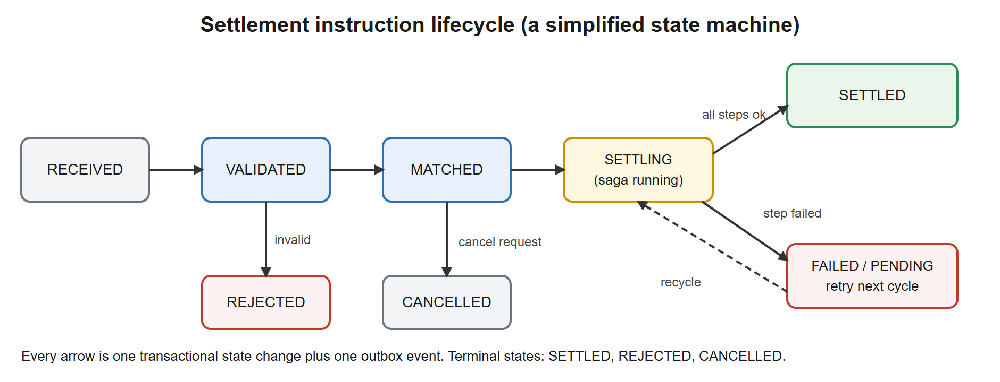
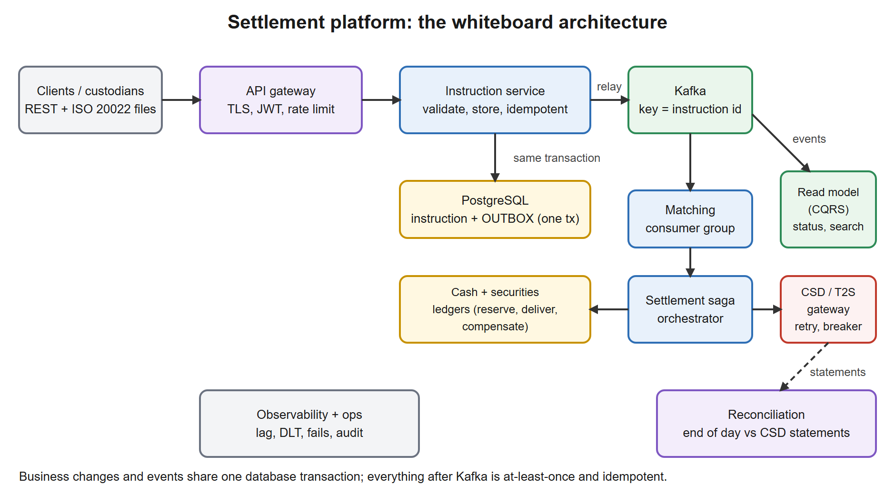

# 11. System design: a trade settlement platform

**No new code in this lesson.** You design on paper (or a whiteboard), then **map the design onto the project you built in lessons 03-10**. The map is the point: in the interview you can say "I have built the core of this", and you can name the class. My working copy of the project is [`../../reference/lesson-10`](../../reference/lesson-10).

**Starting point:** lessons 07-10 done (or at least read), the project at the end of lesson 10.
**End state:** you can run a **45-minute system-design interview** on "design a trade settlement platform" using a fixed method, with numbers, a data model, a consistency story, failure handling and a defended list of trade-offs.

## 1. Goal and time box

**90 minutes** (30 reading, 40 whiteboard practice, 20 quiz and Q&A). After this lesson you can:
- Follow a **fixed eight-step method** for any system-design question, and say what to cover in each step and for how long.
- Explain the **settlement lifecycle** (instruction, validation, matching, settlement, fails, reconciliation) in plain words, as a domain primer you can speak to without notes.
- Do a **back-of-the-envelope capacity estimate** and use it to justify a design (partition count, database size, whether you need sharding).
- Draw the **architecture** (API, database with outbox, Kafka, saga, gateway, read model, reconciliation) and justify each box with the pattern from lessons 07-09.
- Choose **consistency, ordering and idempotency** rules per boundary and say what happens on every failure.
- Defend **trade-offs** (orchestration versus choreography, synchronous versus asynchronous, consistency versus availability) and describe an **evolution path** from a batch system.

## 2. Why it matters

For an architect role the system-design round is usually the deciding round. The interviewer does not want a perfect box diagram; they watch **how you think**: do you ask about requirements, do you put numbers on things, do you name failure modes, do you make a decision and defend it? Your domain (settlement, SWIFT messaging, T2S, batch and reconciliation) is an advantage **only if** you turn it into a structured answer rather than a story.

| You know from your work | Interview vocabulary |
|---|---|
| The nightly batch and its window | Throughput, peak, capacity estimate, SLA |
| A reconciliation break | Eventual consistency, a detective control, idempotent re-processing |
| A SWIFT message sent twice | At-least-once delivery, idempotency key, deduplication |
| A message that cannot be processed and goes to a repair queue | Dead-letter topic, retry policy, poison message |
| Sequence of messages for one trade | Ordering per key, partitioning |
| A rerun after an abend | Restartable saga, checkpoints, idempotent steps |
| Two systems that disagree about a position | Source of truth, outbox, reconciliation |

## 3. Concepts explained like a teacher

### The eight-step method

Use the same steps every time. It keeps you calm, it shows structure, and it makes sure you do not spend 30 minutes on the database and forget failures.

| # | Step | What to say and draw | Minutes |
|---|---|---|---|
| 1 | **Clarify** requirements | Functional scope, non-functional goals (volume, latency, availability, audit), what is **out** of scope. Ask; do not assume | 5 |
| 2 | **Estimate** | Instructions per day, peak per second, events per instruction, storage per year | 4 |
| 3 | **Interfaces** | The public API and the events (names, key fields, idempotency key) | 4 |
| 4 | **Data model** | The main tables, the keys, what is the source of truth | 5 |
| 5 | **Architecture** | The boxes and arrows (the picture below) | 8 |
| 6 | **Deep dives** | Two or three hard problems: consistency across services, duplicates and ordering, reconciliation | 12 |
| 7 | **Failures and operations** | What breaks, what the user sees, how you detect and repair; DR; security; monitoring | 5 |
| 8 | **Trade-offs and evolution** | What you chose and rejected; how it grows and how you migrate from today's system | 2 |

Say the plan aloud at the start ("I will clarify, estimate, then draw the interfaces and data, the architecture, and go deep on consistency and failures"). The interviewer then knows where you are and can steer you.

### A settlement primer (say it in 60 seconds)

When two parties trade a security, the trade must be **settled**: the securities move from the seller to the buyer and the cash moves the other way. The usual rule is **DvP (delivery versus payment)**: both legs happen together or not at all, so neither side is exposed. The steps in a simplified settlement chain:

1. **Capture**: the trade or the **settlement instruction** arrives (from a client, a custodian, a trading system), in a format such as an ISO 20022 `sese.023` message or an internal API.
2. **Validation**: mandatory fields, known securities (ISIN) and accounts, the settlement date, the instruction's own rules. A bad instruction is **rejected** at once.
3. **Matching**: in many markets both counterparties send an instruction and the infrastructure **matches** them on fields such as ISIN, quantity, amount, settlement date and counterparty. Unmatched instructions wait.
4. **Settlement**: on the settlement date the platform checks that the seller has the securities and the buyer has the cash, and books both legs. A **central securities depository (CSD)** or, in Europe, the **T2S** platform of the Eurosystem does this in central-bank money across many CSDs.
5. **Fails**: if securities or cash are missing, the instruction **fails** or stays pending and is retried in later cycles. Fails cost money (penalties under CSDR in the EU), so they are monitored closely.
6. **Confirmation and reporting**: status and confirmation messages (for example `sese.024` status advice and `sese.025` confirmation) go back to the client, and positions and cash are reported.
7. **Reconciliation**: your records are compared with the CSD's statements. Differences (**breaks**) are investigated.

[](images/02-lifecycle.svg)

You know this domain better than most candidates; the point of the picture is to turn it into **states and transitions**. Each transition is one transactional state change plus one event (the outbox of lesson 08).

> Be careful with market specifics in the interview (settlement cycle lengths, penalty rules, message numbers). If you are not sure, say "for example" and move on. What matters is the **design**, not recitation of the rulebook.

### The architecture on the whiteboard

[](images/01-architecture.svg)

| Box | Responsibility | Pattern and lesson |
|---|---|---|
| **API gateway** | TLS, authentication (JWT validation), rate limiting, routing. No business logic | Security, lesson 05 |
| **Instruction service** | Validates, stores the instruction, enforces **idempotency** on the client's reference, writes the state change **and the outbox event in one transaction** | Transactions lesson 04, outbox lesson 08 |
| **PostgreSQL** | Source of truth for instructions, plus the `outbox_event` table | Flyway migrations, lessons 08 and 10 |
| **Outbox relay** | Reads unpublished events, publishes to Kafka, marks them published after the acknowledgement | Lesson 08 and 09 |
| **Kafka** | The event backbone. Topic keyed by **instruction id** so one instruction's events stay in order | Lesson 09 |
| **Matching** | Consumer group that pairs instructions; idempotent consumer | Lesson 09 |
| **Settlement saga** | Orchestrates the steps with **compensation**: reserve cash, deliver securities, confirm with the CSD gateway. Persisted, restartable | Saga, lesson 08 |
| **CSD / T2S gateway** | Remote call wrapped in **retry, circuit breaker, bulkhead**, with an idempotent request id | Resilience4j, lesson 07 |
| **Ledgers** | Cash and securities positions, changed only by saga steps | Lesson 08 |
| **Read model** | Denormalised view for status queries, reports, search. Built from events | CQRS, lesson 08 |
| **Reconciliation** | End-of-day comparison with the CSD statements, producing breaks | A detective control |
| **Observability** | Metrics (lag, fails, saga states), logs (JSON), traces, audit trail | Actuator, lesson 02; platform, lesson 10 |

### Capacity estimation: put numbers on it

State your assumptions out loud, compute, and **use the result**. Example (assumptions are mine, say yours):

| Quantity | Calculation | Result |
|---|---|---|
| Instructions per day | assumption | **5,000,000** |
| Active window | assumption: 12 hours = 43,200 s | |
| Average rate | 5,000,000 / 43,200 | about **116 per second** |
| Peak | assumption: 10 times the average | about **1,160 per second** |
| Events per instruction | received, validated, matched, settling, settled, confirmations, status... | about **8** |
| Events per day | 5,000,000 x 8 | **40 million** |
| Event size | assumption | 1 KB |
| Event volume per day | 40,000,000 x 1 KB | about **40 GB** |
| Per year (250 business days) | 40 GB x 250 | about **10 TB** |

**What the numbers tell you:**
- 1,160 writes per second is **comfortable for a single PostgreSQL primary** on decent hardware. **Do not shard** at this size; say why (complexity, cross-shard transactions). Partition large tables **by date** instead so old data can be archived and queries stay fast.
- 1,160 events per second is trivial for Kafka. Partition count is chosen for **consumer parallelism**, not throughput: for example 12 or 24 partitions, so up to 12 or 24 matching workers.
- 10 TB per year of events does **not** belong in the hot database: keep a retention period in Kafka (days), the instruction table in PostgreSQL, and archive older data to cheap storage (object store, a data lake).
- Settlement has a **peak cycle** (a window around the settlement run), so the design must survive **bursts**, not just averages: this is where queues and backpressure help.

### Consistency, ordering and idempotency: the decisions

| Boundary | Decision | Why |
|---|---|---|
| Instruction row and its event | **One database transaction** (transactional outbox) | Avoids the dual-write problem: a crash can never leave a changed row without an event |
| Instruction service to Kafka | **At-least-once**, `acks=all`, idempotent producer, key = instruction id | No loss; duplicates possible, handled downstream |
| Kafka to a consumer | **Idempotent consumer** (a `processed_event` table in the same transaction as the effect) | Duplicates after restarts and rebalances are harmless |
| Several steps across ledgers and the CSD | **Saga with compensation**, persisted state, resume after crash | No distributed transaction (2PC) across the services and an external CSD |
| Remote call to the CSD | **Idempotency key** (the instruction id), retry with backoff on technical errors only, circuit breaker | A retry must never settle twice; a down CSD must not hang threads |
| Order of events | Only **per instruction** (partition key) | Global order is not needed and would force one partition |
| Read model | **Eventually consistent** (seconds) | Queries are a different workload; a stale status for a few seconds is acceptable, and the status API can read the source of truth when it must |
| Whole-system correctness | **End-of-day reconciliation** against CSD statements | Software has bugs and messages get lost somewhere; a detective control catches what the preventive ones missed |

**Orchestration versus choreography** (a classic question). *Choreography*: services react to each other's events with no central controller. Simple for two or three steps, but the flow is spread over many services, hard to see and hard to change. *Orchestration*: one component (the saga) tells each participant what to do and tracks the state. We use **orchestration** for settlement because the steps are ordered, money is involved, compensation must be explicit, and operations needs one place to ask "where is instruction X?". We use **choreography** for the loose parts: the read model and notifications simply consume events.

**Synchronous or asynchronous?** The client gets a quick **synchronous acknowledgement** ("accepted, id X, status RECEIVED") and then follows the status asynchronously (poll, webhook, or events). A synchronous call that waits for settlement would hold a connection for minutes or days.

### Failure modes: the table to know by heart

| What fails | What happens | How we cope |
|---|---|---|
| Instruction service crashes after commit, before the relay publishes | Outbox row stays unpublished | The relay publishes it on the next poll |
| Relay crashes after publishing, before marking | The event is published twice | Consumers are idempotent |
| Consumer crashes mid-processing | Offset not committed; the record is delivered again | The idempotent processor (one transaction) |
| A poison message | Would block a partition | Bounded retries, then the dead-letter topic; an alert and a replay tool |
| CSD gateway is slow or down | Calls would pile up | Timeout, retry with backoff, **circuit breaker**, bulkhead; saga step retried later; instruction stays pending |
| CSD says "no" (a business rejection) | Retrying cannot help | Not retried; saga **compensates** (releases the reserved cash) and the instruction fails with a reason |
| Saga orchestrator crashes mid-way | Persisted state says which steps are done | **Resume**: completed steps are skipped, the next one continues; compensation also resumes |
| PostgreSQL primary fails | Writes stop | Replica promotion (automatic failover), RPO close to zero with synchronous replication (a cost: write latency) |
| Kafka broker fails | One partition leader moves | Replication factor 3, `min.insync.replicas=2`: no loss, short pause |
| A whole zone or region fails | Service unavailable there | Multi-zone deployment; for a region, a **DR plan** with stated RPO and RTO (below) |
| A bad deployment | Errors rise | Rolling update with readiness gates, quick rollback, backward-compatible schema (expand and contract) |
| A client retries the same instruction | A duplicate booking | The client reference is a **unique key**; the second call returns the first result |
| Clock differences between servers | Wrong ordering by timestamp | Order by sequence per key, not by wall-clock time |

**RPO and RTO** (always define them): **RPO (recovery point objective)** is how much data you may lose (how far back you recover), **RTO (recovery time objective)** is how long you may be down. "RPO zero" needs synchronous replication to the second site; "RTO of minutes" needs automated failover and rehearsed runbooks. State a target, then say what it costs.

### Security and audit in one breath

TLS everywhere; authentication at the gateway (OAuth2 / JWT, lesson 05) and authorisation per operation (who may settle, who may only view); **audit trail** of every state change (who, what, when, from which request id), kept immutable; secrets in a vault; encryption of sensitive fields at rest; PII and account numbers masked in logs; separation of duties (the person who enters is not the person who approves).

### Evolution from the existing batch system

You will rarely build this from nothing. The **strangler fig** approach: put the new platform *beside* the old one, route **one flow** (one market, one client group) to it, compare results (**shadow mode**: both systems process, only the old one is authoritative, outputs are compared), then move more flows and finally retire the old batch. Reconciliation is your safety net during the migration. Say it: "I would not do a big-bang cut-over for a settlement system".

### Honest limit

What we built in lessons 03-10 is a **teaching model**: one service, a simulated gateway and ledgers, no matching engine, no real CSD connectivity, one PostgreSQL, one Kafka node. The design above is what you **say**; the project proves that you understand and have implemented the **mechanisms** (outbox, saga, idempotent consumer, resilience, containers), not that you have built a settlement system.

## 4. Setup steps

1. Open the course folder in VS Code and a PowerShell terminal in `springboot-2day`.
2. You need paper or a whiteboard and a **timer** (phone). The exercise is spoken, not typed.

### Commands used in this lesson

We use PowerShell's search commands to **find the real code behind each box** of the design. Read-only; nothing is built or started.

| Command | Syntax | Why here | When you use it later |
|---|---|---|---|
| `Get-ChildItem` | `Get-ChildItem <path> [-Directory] [-Filter *.java] [-Recurse]` | List files or folders; `-Directory` shows only folders (our packages), `-Filter` matches names, `-Recurse` goes into sub-folders | Orienting yourself in an unknown codebase |
| `Select-Object` | `... \| Select-Object -ExpandProperty Name` | Keep only the `Name` property, as plain text | Shortening output |
| `Select-String` | `... \| Select-String -Pattern "<regex>"` | Search file **content** (like `grep`). Each match has `Filename`, `LineNumber`, `Line` | Finding where an annotation or a class is used |
| `ForEach-Object` | `... \| ForEach-Object { "{0}:{1}" -f $_.Filename, $_.LineNumber }` | Format each result as you like (`-f` fills `{0}`, `{1}`) | Making output readable |

### Files to change or add, in order

None. This lesson only **reads** the project.

## 5. Code walkthrough

There is no code to write. Do the design exercise in six steps, then map it to the project.

### Step 1. Clarify requirements (5 minutes)

Say these questions aloud, and **write the answers** on the board. If the interviewer says "you decide", state your assumption and move on.

**Functional**
- Who are the clients: banks, custodians, internal trading desks? How do they send instructions (API, files, SWIFT)?
- Which instruction types: delivery versus payment, free of payment, both buy and sell sides? Matching needed?
- Cancellation and amendment? Partial settlement? Hold and release?
- Which statuses must clients see and how fast? Notifications?

**Non-functional**
- Volume per day, peak, growth? (We assume 5 million per day, peak ten times the average.)
- Latency: how quickly must an instruction be acknowledged (assume under 200 ms) and how quickly must a status change be visible (seconds)?
- Availability (assume 99.9 percent in the business window), **RPO and RTO** (assume RPO under 1 minute, RTO under 30 minutes).
- Audit and regulation: how long must data be kept, who may see what?
- Out of scope today (say it): pricing, trading, risk, the CSD's own internals.

### Step 2. Estimate (4 minutes)

Use the table in section 3. Write the five numbers (per day, average per second, peak per second, events per day, GB per year) and **one conclusion each** (no sharding, partitions for parallelism, archive).

### Step 3. Interfaces (4 minutes)

**API (REST, synchronous acknowledgement):**

| Call | Meaning | Notes |
|---|---|---|
| `POST /instructions` | Submit an instruction | Header `Idempotency-Key` (or the client reference in the body) makes a retry safe; returns `201` with the id and status `RECEIVED`, or `200` with the existing instruction on a repeat |
| `GET /instructions/{id}` | Status and history | Served from the read model; `?consistent=true` may read the source of truth |
| `GET /instructions?isin=&status=&date=` | Search and reports | Read model, paged |
| `POST /instructions/{id}/cancel` | Request cancellation | A command that may be refused if already settling |
| `GET /reports/settled?...` | Reporting | CQRS read side |

**Events (Kafka topic `instruction-events`, key = instruction id):** `InstructionReceived`, `InstructionValidated`, `InstructionMatched`, `SettlementStarted`, `InstructionSettled`, `SettlementFailed`, `InstructionCancelled`. Each carries `eventId` (for deduplication), `instructionId`, `occurredAt`, a version number and only the data consumers need. **The event is a public contract**: version it, add fields compatibly, never rename.

### Step 4. Data model (5 minutes)

| Table | Key columns | Notes |
|---|---|---|
| `instruction` | `id`, `client_reference` **unique per client**, `isin`, `quantity`, `amount`, `settlement_date`, `status`, `version` | Source of truth. `version` for optimistic locking. **Partition by settlement date** |
| `outbox_event` | `id`, `aggregate_id`, `event_type`, `payload`, `created_at`, `published_at` | Written in the same transaction as the state change (lesson 08) |
| `saga_instance` | `id`, `instruction_id`, `state`, `step`, `failure_reason` | Persisted saga progress, the basis for resume (lesson 08) |
| `processed_event` | `id` (primary key) | The consumer's deduplication memory (lesson 09) |
| `cash_ledger`, `securities_position` | account, ISIN, balance, reserved | Changed only by saga steps; an entry per movement (a journal), balance is derived or checked |
| `settled_instruction_report` | denormalised columns | The CQRS read model (lesson 08) |
| `audit_log` | who, what, when, request id | Append-only |

Say which index serves which query (status and settlement date for the operations screen, ISIN for reports) and that the **unique constraint on the client reference** is what makes the API idempotent.

### Step 5. Draw the architecture (8 minutes)

Draw the picture from section 3 **left to right**: clients, gateway, instruction service with its database and outbox, relay, Kafka, matching, saga, gateway to the CSD, read model, reconciliation. Say the rule that drives it: *"every state change commits with its event in one transaction; everything after Kafka is at-least-once and idempotent."*

### Step 6. Deep dives (12 minutes)

Pick the three the interviewer cares about; the strongest candidates are these.

**A. How do you keep cash, securities and the CSD consistent without a distributed transaction?**
A saga with persisted state. Steps: reserve cash, deliver securities, confirm with the CSD. If a later step fails, **compensating actions** run in reverse (release cash). The saga state is saved after every step, so a crash resumes instead of restarting. Compensation is **semantic** (an undo that is a new business action), not a database rollback, so each step and each compensation must be **idempotent**. There is a window in which the system is in an intermediate state (cash reserved, securities not delivered): that is acceptable and visible (`SETTLING`), because the alternative, a global lock, would not scale and the CSD is outside our control.

**B. How do you avoid duplicates and lost messages?**
Never *dual-write*: the outbox makes the event part of the transaction. Delivery is at-least-once, so every consumer is idempotent (dedup table in the same transaction as its effect) and every external call carries an idempotency key. Ordering per instruction comes from the partition key. A poison message goes to the dead-letter topic after bounded retries and **alerts** someone.

**C. How do you know the system is right?**
**Reconciliation**: each day compare our instructions and positions with the CSD statements, produce **breaks**, classify them (timing, missing, quantity), and route them to operations with a repair tool (replay an event, resubmit, adjust). Add **invariants** monitored continuously (reserved cash never negative, a settled instruction has exactly one settled event, outbox age under a threshold, consumer lag under a threshold).

Alternatives the interviewer may raise: *two-phase commit* (rejected: the CSD does not take part, locks, availability), *event sourcing* (a legitimate choice for the audit trail; costs: replay complexity, schema evolution, rebuilding views), *sharding* (not needed at this volume).

### Step 7. Failures and operations (5 minutes)

Walk the failure table in section 3 for **three** rows of your choice, and add: **monitoring** (consumer lag, DLT depth, outbox age, saga states stuck in `RUNNING` too long, fails per market, breaks count), **runbooks** (what operations does when the DLT fills), **security**, and **DR** with your RPO and RTO.

### Step 8. Trade-offs and evolution (2 minutes)

Say what you **rejected and why**, in one line each: *no microservice per box* (start with a modular monolith or few services; split along team and scaling lines), *no 2PC*, *no sharding*, *no global ordering*. Then the **strangler** migration with shadow mode and reconciliation.

> **Practice.** Set a 45-minute timer and run all eight steps aloud against a blank sheet. Do it twice. The second time record yourself (phone) and listen for filler words, missing numbers and skipped failure modes.

### Step 9. Map the design to the code you built

The following commands show the real code behind the boxes. Run them from `springboot-2day`.

```powershell
Get-ChildItem reference\lesson-10\src\main\java\com\example\trade -Directory | Select-Object -ExpandProperty Name
```

Expected (verified):

```
aop
audit
config
domain
events
gateway
health
kafka
outbox
persistence
repo
report
saga
security
service
web
```

Now find the pattern annotations, with file and line:

```powershell
Get-ChildItem reference\lesson-10\src\main\java -Recurse -Filter *.java | Select-String -Pattern "@Retry\(|@CircuitBreaker\(|@Bulkhead\(|@KafkaListener\(|@Scheduled\(|@PreAuthorize\(" | ForEach-Object { "{0}:{1}: {2}" -f $_.Filename, $_.LineNumber, $_.Line.Trim() }
```

Expected (verified):

```
ResilientGatewayClient.java:33: @Retry(name = "gateway", fallbackMethod = "gatewayDown")
ResilientGatewayClient.java:34: @CircuitBreaker(name = "gateway")
ResilientGatewayClient.java:35: @Bulkhead(name = "gateway")
TradeEventsConsumer.java:27: @KafkaListener(topics = KafkaTopics.TRADE_EVENTS, groupId = "trade-report")
OutboxRelay.java:26: @Scheduled(fixedDelayString = "${trade.outbox.poll-interval-ms:2000}")
ConfirmationController.java:24: @PreAuthorize("hasRole('OPS')")
GatewaySimulatorController.java:27: @PreAuthorize("hasRole('ADMIN')")
SettlementController.java:25: @PreAuthorize("hasRole('OPS')")
TradeController.java:48: @PreAuthorize("hasRole('TRADER')")
TradeController.java:69: @PreAuthorize("hasRole('OPS')")
```

And the migrations (the data model in order of creation):

```powershell
Get-ChildItem reference\lesson-10\src\main\resources\db\migration | Select-Object -ExpandProperty Name
```

```
V1__trades.sql
V2__outbox.sql
V3__saga.sql
V4__settled_trade_report.sql
V5__processed_event.sql
```

**The map** (say it in the interview as "I built the core mechanisms of this in a reference project"):

| Design box | What I built | Where |
|---|---|---|
| Instruction service, state change plus event in one transaction | `TradeService` (class-level `@Transactional`) writing through `OutboxDomainEvents` | `service/TradeService.java`, `outbox/` |
| Outbox and relay | `outbox_event` table, `OutboxRelay` with `@Scheduled` polling | `outbox/OutboxRelay.java`, `V2__outbox.sql` |
| Kafka transport, key and idempotent producer | `KafkaEventPublisher`, topics and error handler | `kafka/` |
| Idempotent consumer, dead-letter topic | `IdempotentEventProcessor`, `processed_event`, `TradeEventsConsumer` | `kafka/`, `V5__processed_event.sql` |
| Settlement saga with compensation and resume | `SettlementSaga`, `ReserveCashStep`, `DeliverSecuritiesStep`, `ConfirmWithGatewayStep`, `SagaJournal`, `saga_instance` | `saga/`, `V3__saga.sql` |
| CSD gateway with resilience | `ResilientGatewayClient` (`@Retry`, `@CircuitBreaker`, `@Bulkhead`), `FlakySettlementGateway` as the simulated CSD | `gateway/` |
| Read model (CQRS) | `TradeReportProjector`, `settled_trade_report` | `report/`, `V4__settled_trade_report.sql` |
| Security at the edge | JWT, roles `TRADER`, `OPS`, `VIEWER`, `ADMIN` | `security/`, `web/` |
| Observability and platform | Actuator, probes, JSON logs, Docker and Kubernetes | lessons 02 and 10 |
| **Not built** | Matching engine, real CSD connectivity, reconciliation job, multi-region | say so |

Saying what you **did not** build is part of a credible answer.

## 6. Common mistakes

| Mistake | How the interviewer sees it | Fix |
|---|---|---|
| Jumping to boxes at once | No requirements, no numbers: "this person designs by habit" | The eight-step method, questions first |
| No numbers | Cannot justify partitions, database choice or sharding | Estimate, then use the result |
| "Microservices for everything" | Over-engineering; distributed transaction problems appear | Few services; split by team and scaling need; say why |
| Distributed transaction (2PC) across services | Ignores availability and the external CSD | Saga plus outbox plus idempotency |
| "Exactly once" delivered by magic | Hand-waving | At-least-once plus idempotent processing; say where |
| Ignoring failures until asked | Only the happy path was designed | Walk the failure table yourself |
| Global ordering requirement | Forces one partition, kills scaling | Order per key |
| Choosing technology first ("use Kafka") | Tool-driven rather than problem-driven | State the need, then the pattern, then the tool, then the alternative |
| Everything eventually consistent, with no reconciliation | No way to detect errors | Add a detective control |
| One giant database "for simplicity" shared by all services | Hidden coupling | Each service owns its data; share by events and APIs |
| No security, audit or operations | "Architect" without the non-functionals | A closing minute on security, audit, monitoring, runbooks |
| Silence while thinking | The interviewer cannot follow | Think aloud: "options are A and B; I choose A because..." |
| Defending a choice stubbornly | No flexibility | Accept a constraint ("if latency must be under 10 ms I would change X") |

## 7. Production issues and design notes

| Symptom | Root cause | Fix |
|---|---|---|
| Instructions stuck in `SETTLING` | The saga crashed or the gateway is down; nobody resumed | A recovery job that resumes sagas older than a threshold; an alert on stuck sagas |
| Growing outbox | The relay is slow or Kafka is down | Alert on the age of the oldest unpublished event; scale or fix the relay |
| Duplicate settlement | A non-idempotent retry to the CSD | Idempotency key per call; unique constraint on the confirmation |
| Daily breaks in reconciliation | Timing differences, a lost status message | Classify breaks; fix the cause, not only the symptom; replay tools |
| A hot partition | One client sends most of the volume and the key is the client | Key by instruction id (even spread); ordering is only needed per instruction |
| Slow queries on the operations screen | Querying the transactional tables | Read model with the right indexes; archive old data |
| A schema change breaks an old consumer | A renamed field | Compatible evolution only; version events |
| Peak-time latency | The peak settlement window with too few consumers | Capacity for the **peak**; scale consumers up to the partition count; backpressure |
| Recovery takes hours | A DR plan never rehearsed | Rehearse; automate failover; document runbooks |

**Design notes.**
- **Start with a modular monolith if the team is small**; separate the modules clearly (instruction, saga, reporting) so splitting later is cheap. Microservices are an organisational choice as much as a technical one.
- **Make operations a first-class user:** search by any reference, see the history of an instruction, replay, resubmit, cancel. In settlement, the support tools decide whether the system is livable.
- **Design for the fail path.** A settlement platform is judged by what it does when things go wrong (fails, partial settlement, late cancellations).
- **Regulatory evolution:** settlement cycles and penalty rules change over time. Keep rules configurable and versioned, and keep the audit trail complete.

## 8. Architect lens

- **Name the quality attributes and rank them.** For settlement the order is roughly: **correctness and auditability** first, then **availability** in the business window, then **throughput**, then **latency**. A design that is fast but can lose or double an instruction fails the first test.
- **Preventive and detective controls.** Idempotency, transactions and the outbox are preventive; reconciliation and invariants monitoring are detective. A mature design has both, and says so.
- **Buy, build or integrate:** matching and CSD connectivity are often products or market infrastructure. The architect decides what is differentiating (build) and what is a commodity (buy or use the market's platform).
- **Team boundaries are architecture boundaries** (Conway's law). A service per team with a clear event contract scales an organisation; a shared database does not.
- **Cost:** Kafka and databases cost money at scale; retention and archive policies are a design decision, not an afterthought.
- **Risk of change:** a settlement platform is hard to replace; every design choice should reduce the cost of changing your mind (interfaces, events, versioned contracts, the strangler migration).
- **Link to your world:** the outbox plus the relay replaces the "extract file, then send" step with something that cannot desynchronise; reconciliation is the daily control report you already know; the saga is the restartable batch job that knows which step it reached; the dead-letter topic is the repair queue.

## 9. Self-check quiz

1. List the eight steps of the method and say which one most candidates skip.
2. What does DvP mean, and why does it matter for the design of the saga?
3. Compute the average and peak rate for 3 million instructions per day over 10 hours with a peak factor of 8.
4. Why is sharding the database not the first answer at about 1,000 writes per second?
5. How do you pick the number of Kafka partitions?
6. Why orchestration for settlement, and where would you still use choreography?
7. A client sends the same instruction twice because of a timeout. Describe exactly what happens.
8. The CSD returns a business rejection. What does the saga do, and what does it **not** do?
9. What is the difference between RPO and RTO?
10. Which controls detect errors that the preventive controls missed?
11. How would you migrate from the existing batch platform?
12. Name three things your reference project does **not** do.

<details><summary>Answers</summary>

1. Clarify, estimate, interfaces, data model, architecture, deep dives, failures and operations, trade-offs and evolution. Most skip the estimate and the failures.
2. Delivery versus payment: securities and cash move together or not at all. The saga must treat both legs as one outcome: if one leg cannot complete, the other is compensated (cash released).
3. 3,000,000 / 36,000 s = about 83 per second on average; peak 8 x 83 = about 667 per second.
4. That is well within a single primary; sharding adds cross-shard transactions, rebalancing and operational complexity. Use indexes, date partitioning, a read model and archiving first.
5. By the **maximum consumer parallelism** you want, with headroom (for example 12 or 24), not by throughput. Changing the count later changes the key-to-partition mapping.
6. The steps are ordered, involve money, need explicit compensation, and operations needs one place to see state: orchestration. Loose reactions such as the read model and notifications use choreography.
7. The client reference is a unique key. The second request finds the existing instruction and returns its result (no second booking). The unique constraint is the last line of defence if two requests race.
8. It stops (a rejection is not retried), **compensates** the earlier steps (release cash), marks the saga `COMPENSATED` and the instruction `FAILED` with the reason, and emits an event. It does **not** retry the CSD call.
9. RPO: how much data loss is acceptable (recovery point). RTO: how long the service may be down (recovery time).
10. Reconciliation against the CSD statements, invariant monitoring (stuck sagas, outbox age, DLT depth, lag) and audit review.
11. Strangler: run beside the old system, shadow mode with output comparison, move one flow at a time with reconciliation as the safety net, retire the batch last.
12. For example: a matching engine, real CSD connectivity, a reconciliation job, multi-node Kafka or PostgreSQL, multi-region failover.

</details>

## 10. Interview Q&A

**Q1. Walk me through how you would design a trade settlement platform.**
I clarify the requirements and volumes, estimate (about 5 million instructions a day, around a thousand a second at peak), define the API and events, then the data model with PostgreSQL as the source of truth. The architecture is an instruction service that writes the state and an outbox event in one transaction, a relay to Kafka keyed by instruction id, a matching consumer, an orchestrated settlement saga with compensation, a resilient gateway to the CSD, a CQRS read model and an end-of-day reconciliation. Then I go deep on consistency, idempotency and failure handling, and close with security, operations and a strangler migration.

**Q2. How do you make settlement consistent across services without a distributed transaction?**
A saga: each local transaction commits, the saga's state is persisted, and a failure triggers compensating actions in reverse order. Every step and compensation is idempotent so a crash and resume is safe. The intermediate state is explicit and visible. Reconciliation catches what slips through.

**Q3. How do you prevent a double settlement?**
Several layers: a unique client reference at the API, an idempotency key on every call to the CSD, a unique constraint on the settlement confirmation, idempotent consumers with a deduplication table, and the saga's persisted state so completed steps are not repeated. And reconciliation as the detective control.

**Q4. Why Kafka here, and what are the risks?**
It is a durable, replayable event backbone with ordering per key and many independent consumers. Risks: duplicates (at-least-once), partition-key mistakes, consumer lag and poison messages, schema evolution across teams. I mitigate with the outbox, idempotent consumers, a dead-letter topic with alerts, lag monitoring and a schema registry with compatibility rules.

**Q5. How would you scale it?**
Stateless services scale horizontally; consumers scale up to the partition count; the database scales up first, with indexes, date partitioning, a read replica for reporting and a read model; sharding only if the numbers demand it. I would measure first and design for the peak settlement window.

**Q6. What happens if the CSD is down?**
Calls time out, retry with backoff on technical errors only, and the circuit breaker opens so threads do not pile up. The saga step stays retriable; the instruction remains `SETTLING` or `PENDING`, operations see it, and settlement resumes when the CSD is back. If the settlement deadline passes, it becomes a fail with the usual business consequences.

**Q7. How do you handle ordering?**
Only where it is needed: per instruction, via the partition key. For cross-instruction rules (for example two instructions competing for the same securities balance) I serialise through the ledger with a database transaction and optimistic or pessimistic locking, not through the message order.

**Q8. How do you test such a system?**
Unit tests for the rules; slice and integration tests with Testcontainers for the database and Kafka; contract tests for events and the CSD interface; **fault-injection** tests (kill the saga mid-way, duplicate every message, make the gateway fail) to prove idempotency and resume; load tests at the peak; and a reconciliation run in the test environment.

**Q9. How do you handle a change to an event schema?**
Add optional fields only, keep old fields, version the event type, and run compatibility checks in the build (schema registry). For a breaking change, publish a new version beside the old one and migrate consumers.

**Q10. (Depth) Would you use event sourcing here?**
It fits the audit requirement naturally (the log is the history) and makes replays easy. The costs are real: every state is rebuilt from events, schema evolution of old events, more complex queries (so you need projections anyway), and a steeper learning curve. I would use a conventional state table plus an outbox for events, and consider event sourcing for the ledger if the audit requirement justifies it.

**Q11. (Depth) How do you migrate from the existing batch system?**
Strangler fig: run the new platform beside the old one, in shadow mode for one flow, comparing outputs automatically; fix differences; switch that flow over; repeat. Keep the old system as a fallback until reconciliation has been clean for an agreed period. No big bang.

**Q12. What would you do differently if latency had to be a few milliseconds?**
Settlement is not latency-critical, but if a path were (for example pre-trade checks), I would keep that path synchronous and in memory with a local cache of positions, update it from events, and accept that the authoritative check happens later in the saga. I would say what that costs: a possibility of rejection after acceptance.

## 11. Recap

1. Use the **eight steps**: clarify, estimate, interfaces, data, architecture, deep dives, failures and operations, trade-offs and evolution. Say the plan first.
2. Put **numbers** on it (116/s average, about 1,160/s peak, 40 GB a day) and **use** them: no sharding, partitions for parallelism, archive.
3. **State change plus event in one transaction** (outbox); everything after Kafka is **at-least-once and idempotent**; order only per key.
4. A **saga with compensation** (orchestrated, persisted, resumable) replaces distributed transactions; the CSD call is resilient and idempotent.
5. **Reconciliation** and invariants are the detective controls; **RPO and RTO** are stated, and the **strangler** migration avoids a big bang.
6. Map the design to what you built (`TradeService`, `OutboxRelay`, `IdempotentEventProcessor`, `SettlementSaga`, `ResilientGatewayClient`, `TradeReportProjector`) and say plainly what you did not build.
